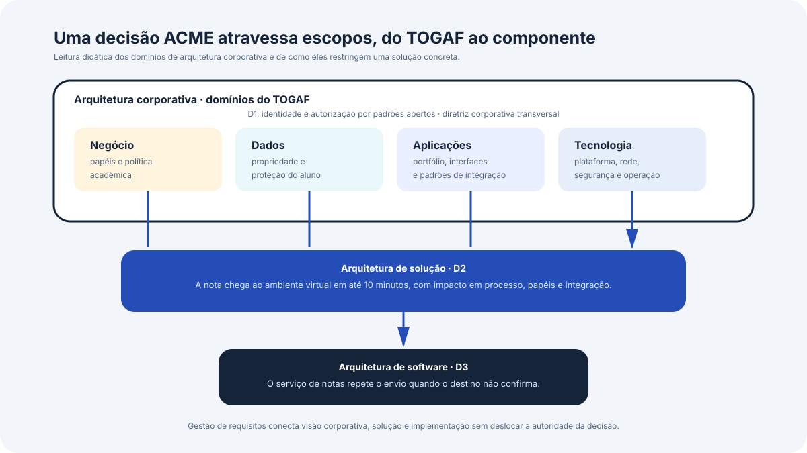
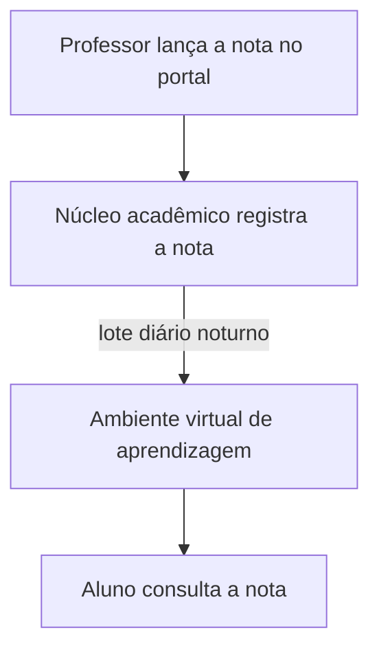

# Arquitetura de soluções e arquitetura de software

Quando a ACME decidiu modernizar o sistema acadêmico, surgiram decisões de tamanhos muito diferentes: uma regra de identidade para a universidade toda, uma mudança no prazo de entrega da nota e um detalhe de como um serviço repete um envio. Este bloco apresenta o critério que mostra de quem é cada uma e, com ele, distingue a arquitetura de soluções da arquitetura de software.

## Antes de começar

- [Arquitetura de solução](../referencia/glossario.md#arquitetura-de-solucao)
- [Arquitetura de software](../referencia/glossario.md#arquitetura-de-software)
- [Arquitetura corporativa](../referencia/glossario.md#arquitetura-corporativa)
- [Componentes da solução](../referencia/glossario.md#componentes-da-solucao)

## O que é Arquitetura de Solução?

Quando os alunos da ACME reclamam que a nota demora a aparecer, o caminho mais curto é ajustar o ponto que incomoda, como antecipar o envio noturno. Esse ajuste pode resolver o sintoma imediato, mas não necessariamente o problema que o aluno percebe. A abordagem arquitetural olha para a situação inteira em três níveis. Primeiro, descreve o problema e uma possível resposta de forma **conceitual**. Depois, divide a solução em componentes e mostra como eles se relacionam de forma **lógica**. Por fim, descreve o que será implantado ou alterado para realizar a solução. Neste curso, esse último nível é chamado de **físico**: ele trata da realização concreta do desenho, não apenas de equipamentos.

Todo sistema tem uma arquitetura, inclusive o sistema acadêmico da ACME, em operação desde 2004. Arquitetura, nesse enquadramento, é a estrutura e o comportamento inerentes de um sistema, que existem como resultado de projeto, de evolução, ou dos dois. A estrutura são os componentes e suas conexões, e o comportamento são os efeitos da operação do sistema. Dizer que a arquitetura é inerente significa que todo sistema tem uma, mesmo quando ninguém a analisou, projetou ou documentou. O documento que descreve essa estrutura e esse comportamento é a descrição de arquitetura, objeto da norma ISO/IEC/IEEE 42010, uma norma internacional que define o que essa descrição deve conter.

> [!TIP]
> **Arquitetura de solução** é a disciplina responsável pela produção e pela gestão do plano de uma solução completa, que atende a uma necessidade, um problema ou uma oportunidade de negócio e se integra ao negócio em alinhamento com a estratégia, minimizando impactos negativos. Produção e gestão são duas responsabilidades distintas: coordenar as atividades de projeto, e assegurar que cada mudança seja testada, validada e acordada em todas as etapas.

Dentro dessa solução, alguém precisa decidir como o serviço de notas é estruturado por dentro, e essa tarefa é da **arquitetura de software**, o desenvolvimento e a documentação da estrutura e do comportamento de um sistema ou componente de software, incluindo suas interfaces internas e externas. Ela atua em vários níveis, da unidade de granularidade fina ao sistema inteiro, e responde por manter o software em linha com as diretrizes estratégicas, por modularidade, por cumprimento de acordos de nível de serviço, que são os compromissos formais de desempenho e disponibilidade assumidos com quem usa o sistema, e por manutenibilidade, a facilidade de corrigir e alterar o software.

Um caso simples mostra como as duas definições se relacionam. Uma solução que troque um formulário em papel por um aplicativo, sem mudar quem aprova o pedido nem o prazo do processo, não resolveu o problema de negócio, ainda que o software esteja bem construído. Isso acontece porque a solução depende de pessoas, estruturas organizacionais, processos, informação e tecnologia, os cinco tipos de componente da solução que o arquiteto de solução usa como lista de verificação, e o software está contido em apenas um deles, a tecnologia. A diferença entre as duas disciplinas está, portanto, no alcance.

## Componentes de uma Solução

{ .module-diagram }

Figura 1. Os cinco tipos de componente da solução e os três movimentos da abordagem arquitetural. A tecnologia é um dos cinco tipos de componente da solução, e o software é apenas uma parte dela.

O infográfico reúne os dois conceitos apresentados nesta seção, a lista de verificação dos cinco tipos de componente da solução e a sequência conceitual, lógica e física descrita no primeiro parágrafo. A leitura recomendada parte do círculo central, percorre os cinco tipos de componente da solução e só então desce para a faixa dos três movimentos.

## Granularidade da arquitetura

Para saber a quem pertence cada decisão da ACME, observe o alcance do seu efeito. Esse alcance é o que chamamos de granularidade. Uma regra de identidade que vale para qualquer iniciativa da universidade pede a **arquitetura corporativa**: ela define diretrizes, políticas e princípios para a organização inteira, nos domínios de negócio, aplicações, dados, infraestrutura e segurança. A mudança no prazo da nota pede a **arquitetura de solução**: ela trata uma solução completa e relaciona, neste caso, negócio, dados e aplicações. O comportamento do serviço de notas diante de uma falha de envio cabe à **arquitetura de software**: ele trata da estrutura e do comportamento de um sistema ou componente de software.

### Exemplo no caso prático do curso

{ .module-diagram }

Figura 2. Os três níveis de arquitetura por alcance, pergunta que responde e artefato típico, com os cinco domínios de referência da arquitetura corporativa na faixa inferior.

As setas verticais do infográfico representam a relação de refinamento descrita nos parágrafos anteriores: os princípios e as políticas corporativas restringem as soluções, e cada solução é detalhada em sistemas e componentes de software. O caminho inverso também acontece na prática: quando uma restrição aparece no nível do software, o arquiteto precisa revisar o plano da solução. Essa volta se chama realimentação e é tratada no [bloco 4](bloco-4-processo-de-definicao-da-arquitetura.md), sobre o processo de definição da arquitetura.

A tabela abaixo situa as três disciplinas no caso usado em todo o curso. A ACME é uma universidade privada brasileira fictícia, com 38.400 alunos ativos, cujo sistema acadêmico entrou em operação em 2004 e sustenta matrícula, avaliação, emissão de documentos e integração financeira, hoje em processo de modernização.

| Dimensão              | Arquitetura corporativa                                                      | Arquitetura de solução                                                                                                                                | Arquitetura de software                                                                            |
| --------------------- | ---------------------------------------------------------------------------- | ----------------------------------------------------------------------------------------------------------------------------------------------------- | -------------------------------------------------------------------------------------------------- |
| Alcance               | A organização inteira                                                        | Uma solução, do problema de negócio à entrega                                                                                                         | Um sistema ou componente de software                                                               |
| Pergunta que responde | Quais regras valem para todas as iniciativas                                 | Como este problema de negócio é resolvido, por inteiro                                                                                                | Como este software é estruturado por dentro e nas suas interfaces                                  |
| Horizonte             | Plurianual, revisado por ciclo de planejamento                               | O ciclo de vida da solução, da ideia à sustentação                                                                                                    | O ciclo de vida do componente                                                                      |
| Exemplo na ACME       | Identidade e autorização seguem padrões abertos, não um produto proprietário | A propagação de nota ao ambiente virtual deixa de ser lote diário e passa a ocorrer em até 10 minutos, com efeito sobre processo, papéis e integração | O serviço de notas publica um evento por lançamento e repete o envio quando o destino não confirma |
| Artefato típico       | Princípio, política, modelo de referência                                    | Plano da solução, desenho lógico, roteiro de entrega                                                                                                  | Modelo de componentes, especificação de interface, modelo de dados                                 |

{ .module-diagram }

Figura 3. As três declarações da tabela acima aplicadas à modernização do sistema acadêmico da ACME, uma por nível de arquitetura.

As três frases entre aspas no infográfico são as mesmas da linha "Exemplo na ACME" da tabela, e servem de teste de classificação: cada uma decide algo de alcance diferente sobre a mesma iniciativa de modernização. O Exercício 1 deste bloco amplia esse conjunto para nove decisões, numeradas de D1 a D9, e as três do infográfico correspondem a D1, D2 e D3. O diagrama a seguir lê essas três decisões por outro ângulo, o da estrutura de domínios que a arquitetura corporativa usa para organizar suas diretrizes.

{ .module-diagram }

Figura 4. Percurso das decisões D1, D2 e D3 da ACME, da diretriz corporativa transversal aos quatro domínios do TOGAF até a decisão de componente de software.

O diagrama usa o TOGAF, um modelo de referência muito adotado para organizar a arquitetura corporativa de uma instituição. A leitura do diagrama começa pela faixa superior, onde D1 aparece como diretriz transversal, válida para os quatro domínios ao mesmo tempo. As setas que descem indicam restrição: a decisão de solução D2 precisa respeitar o que cada domínio estabeleceu, e a decisão de software D3 precisa respeitar D2, mas nenhuma delas é consequência necessária da anterior. A linha inferior do diagrama nomeia o que mantém os três níveis conectados, a gestão de requisitos, que é o acompanhamento de cada requisito desde o pedido até virar decisão e software. O ponto de partida dessa gestão é o levantamento de requisitos, tratado na Aula 2.

Duas ressalvas evitam confusão com o infográfico da Figura 2. O diagrama usa os quatro domínios de arquitetura do TOGAF, que são negócio, dados, aplicações e tecnologia, enquanto a Figura 2 lista cinco domínios de referência, porque separa segurança e infraestrutura dentro do que o TOGAF reúne sob tecnologia. Nenhuma das duas divisões é canônica para toda organização, e a escolha entre elas depende de como a arquitetura corporativa daquela instituição está estruturada. O diagrama também é uma leitura didática montada para este curso, e não reproduz notação oficial do framework, cujo ciclo de desenvolvimento de arquitetura tem representação própria.

Quando uma mudança como a da nota chega ao software, a relação típica entre as duas disciplinas mais próximas segue quatro passos. A arquitetura de solução produz um desenho que contém requisitos passíveis de realização por software, esses requisitos são entregues à arquitetura de software para projeto, a equipe de desenvolvimento constrói ou adquire os componentes de software conforme o projeto, e as duas funções governam o processo. Há um passo anterior que costuma ser esquecido, e ele decorre do objetivo de minimizar o impacto sobre o negócio: antes de especificar componente de software novo, o arquiteto de solução precisa descobrir se o componente de software já existe na organização, consultando o catálogo de aplicações e, quando o catálogo não basta, a própria função de arquitetura de software.

### Como aplicar o grão correto

Diante de uma decisão como a de mudar o prazo da nota, o arquiteto pergunta: até onde o efeito dela chega? Se ela muda apenas a estrutura interna de um componente de software e nenhuma outra parte da organização precisa ser avisada, é uma decisão de arquitetura de software. Se muda processo, papel, propriedade de dado ou a relação com um fornecedor, é uma decisão de arquitetura de solução, mesmo quando a execução é técnica. Se vale também para iniciativas futuras da universidade, é uma decisão de arquitetura corporativa. As pessoas que precisam participar dessa decisão são identificadas no [bloco sobre partes interessadas](../modulo-2-requisitos-e-partes-interessadas/bloco-4-partes-interessadas-e-pontos-de-vista.md).

Três situações da ACME mostram o critério na prática. A Pró-Reitoria de Graduação decidiu que a matrícula não pode parar em período letivo, e o arquiteto recebe essa restrição como dado do problema. Já a escolha de fazer a transição por extração incremental de módulos, com o núcleo em COBOL em operação durante todo o percurso, é decisão de arquitetura de solução, porque afeta o contrato de sustentação, o calendário acadêmico e a rotina das equipes. Por fim, a forma como o módulo extraído mantém consistência com o núcleo durante a coexistência é decisão de arquitetura de software.

## Uso pelo arquiteto

Quando uma demanda chega ao arquiteto, como o pedido de que a nota lançada pelo professor chegue ao ambiente virtual em até 10 minutos, a primeira dúvida é de quem é a decisão que ela envolve. Ele consulta a distinção entre arquitetura corporativa, de solução e de software no início da análise, porque ela mostra até onde o efeito da decisão alcança e, por isso, quem precisa participar dela. Se o efeito atinge processo, papel, propriedade de dado ou fornecedor, ele trata a decisão como de solução e a leva ao patrocinador de negócio e às áreas afetadas, e se o efeito fica dentro de um componente de software, ele a devolve ao time de desenvolvimento.

Sem esse critério, o arquiteto corre o risco de responder sozinho por escolhas que pertencem a outro nível. Levar uma decisão de arquitetura corporativa, como a regra de identidade para a universidade toda, para dentro de uma solução isolada produz divergência entre iniciativas, e tratar uma decisão de solução como se fosse de software costuma deixar de fora os componentes da solução que não são técnicos (pessoas, estruturas organizacionais e processos), como o processo que precisa mudar e a área que precisa assumir uma responsabilidade nova.

A mesma distinção orienta o que o arquiteto leva a cada interlocutor. Ao patrocinador de negócio, ele apresenta decisões de solução, como o prazo de entrega da nota, porque cobrar dele o desenho interno dos componentes de software desloca a decisão para quem não tem elementos para tomá-la. Ao time de desenvolvimento, ele não pede que decida quem passa a ser dono de um dado, porque isso transfere ao time uma decisão de alcance organizacional.

## No caderno arquitetural

{{ficha:1}}

**Para que serve.** Antes de desenhar qualquer coisa, o arquiteto da ACME precisa saber de quem é cada decisão, porque só responde pelas que pertencem à solução, e as demais são da organização inteira ou da equipe que programa. A seção 1 do caderno, **Contexto**, guarda esse ponto de partida do projeto: quem é a ACME, que problema ela quer resolver e o que já foi decidido. Parte dessas decisões vem das conversas do arquiteto com as partes interessadas, que são as pessoas com interesse no projeto, como a Reitoria, a Diretoria de TI e a Secretaria Acadêmica.

**O que você faz neste exercício.** Nas conversas com as partes interessadas, o arquiteto da ACME reuniu nove decisões, e o enunciado as traz numeradas de D1 a D9. Uma delas diz que a identidade dos usuários segue padrões abertos em qualquer iniciativa da universidade, e outra diz que o serviço de notas repete o envio quando o ambiente virtual não confirma o recebimento. A primeira vale para a universidade toda, e a segunda só mexe dentro de um componente de software. Você faz essa mesma separação para as nove: diz de que nível é cada decisão, explica por quê e registra o resultado na tabela de decisões do caderno.

| Campo do caderno | Como preencher | Item |
| --- | --- | --- |
| Nível | Escolha entre arquitetura corporativa, quando a decisão vale para a universidade inteira, de solução, quando vale para este projeto como um todo, e de software, quando vale só dentro de um componente de software | 1 |
| Justificativa | Explique por que escolheu esse nível. Ajuda perguntar até onde o efeito da decisão chega e quem precisa ser avisado quando ela mudar | 1 |
| Componente da solução afetado | Nas decisões de solução, diga que componentes da solução a decisão atinge além da tecnologia: pessoas, estruturas organizacionais (áreas e contratos), processos ou informação | 2 |
| Dependência entre decisões | Veja se uma decisão só faz sentido depois de outra. Se fizer, diga qual vem primeiro e o que daria errado se a ordem fosse invertida | 3 |

**O que você já tem.** O caderno já traz o porte da ACME, as restrições e a pergunta central, porque são dados do caso. Falta a classificação das decisões.

**Quando está pronto.** As nove decisões têm nível e justificativa, as decisões de solução dizem qual parte da organização afetam e a dependência entre D2 e D3 está explicada.

[Ver esta seção no template](../caderno/template.md#1-contexto){ .caderno-botao }
[Ver o gabarito do exercício 1](../gabaritos/gabarito-exercicio-01.md){ .caderno-botao }

{{/ficha}}

## Exercício 1

A ACME é uma universidade privada brasileira fictícia, com 38.400 alunos ativos, 2.150 professores e 4 campi, cujo sistema acadêmico entrou em operação em 2004 e sustenta matrícula, avaliação, emissão de documentos e integração com o ERP financeiro, o sistema de gestão das finanças da universidade. O custo anual de propriedade do sistema é de R$ 15,83 milhões, o prazo médio entre pedido aprovado e entrega em produção é de 34 dias úteis, e a manutenção do núcleo em COBOL depende de 6 especialistas, dos quais 2 se aposentam em 2027. A instituição decidiu modernizar o sistema de forma incremental, sem substituí-lo por produto de mercado e sem reescrita em entrega única.

Num projeto de modernização, o arquiteto ouve decisões de todo tamanho, e a pergunta que ele faz antes de qualquer desenho é de quem é aquela decisão. Parte vale para a universidade inteira, parte vale para o projeto como um todo e parte só interessa à equipe que programa um componente de software, e o arquiteto de solução responde pelo segundo grupo e precisa reconhecer os outros para não decidir o que não é dele. O exercício tem três itens: o primeiro separa nove decisões por nível, o segundo identifica os componentes da solução que as decisões de solução afetam além da tecnologia e o terceiro examina se duas decisões dependem uma da outra. As respostas dos três itens vão para o caderno arquitetural, o documento em que o curso reúne, seção por seção, a arquitetura da solução da ACME, apresentado no [bloco 4](bloco-4-processo-de-definicao-da-arquitetura.md#o-caderno-arquitetural).

### Item 1: Nível de cada decisão

O arquiteto da ACME reuniu nove decisões tomadas ou propostas no ciclo de modernização, e cada uma é uma escolha que define como parte da modernização será feita ou o que ela precisa respeitar. O quadro abaixo as traz numeradas de D1 a D9, e três servem de exemplo dos níveis: D1 vale para toda iniciativa da universidade, D2 muda a forma como a nota viaja entre dois sistemas e D3 só altera o comportamento interno do serviço de notas. Para classificar as demais, use o critério do alcance do efeito da decisão, isto é, até onde ela chega e quem precisa ser avisado quando ela mudar, descrito na seção [Como aplicar o grão correto](#como-aplicar-o-grao-correto) deste bloco.

| Código | Decisão                                                                                                                              |
| ------ | ------------------------------------------------------------------------------------------------------------------------------------ |
| D1     | Identidade e autorização seguem padrões abertos, sem produto proprietário, em qualquer iniciativa da universidade                    |
| D2     | A propagação de nota ao ambiente virtual de aprendizagem deixa de ser lote diário e passa a ocorrer em até 10 minutos                |
| D3     | O serviço de notas repete o envio ao ambiente virtual quando não recebe confirmação, com intervalo crescente entre tentativas        |
| D4     | Nenhum dado pessoal de aluno é processado fora do território nacional                                                                |
| D5     | A Secretaria Acadêmica passa a responder pela correção de dado cadastral de aluno, hoje feita pela equipe de sustentação             |
| D6     | O índice de busca de disciplinas do portal passa a ser mantido em memória, para reduzir o tempo de resposta na abertura da matrícula |
| D7     | O núcleo em COBOL permanece sob o contrato da fábrica de software até 30/09/2027, e as alterações nele dependem desse fornecedor     |
| D8     | O histórico escolar é emitido com assinatura digital no padrão ICP-Brasil                                                            |
| D9     | A transição ocorre por extração incremental de módulos, com o núcleo em operação durante todo o percurso                             |

1. Classifique cada uma das nove decisões em arquitetura corporativa, quando vale para a universidade inteira, arquitetura de solução, quando vale para este projeto como um todo, ou arquitetura de software, quando vale só dentro de um componente de software, com uma linha de justificativa por decisão.

Sua resposta vira as colunas Nível e Justificativa da tabela de decisões, na seção 1 do caderno.

### Item 2: Componentes da solução afetados

Uma decisão de solução quase nunca é só técnica. Ela costuma exigir que alguém aprenda algo, que uma área mude de função, que um processo seja refeito ou que uma informação ganhe dono, e são essas partes que costumam ficar sem responsável. Este item pede que você identifique quais componentes da solução, além da tecnologia, cada decisão atinge. Treinar os professores para um novo procedimento, por exemplo, mexe com o componente da solução pessoas, e guardar um registro de auditoria por 5 anos mexe com o componente da solução informação. O quadro abaixo reproduz quatro dos cinco tipos de [componentes da solução](../referencia/glossario.md#componentes-da-solucao) (pessoas, estruturas organizacionais, processos e informação), detalhados no [bloco 2](bloco-2-a-solucao-como-sistema.md#os-cinco-tipos-de-componente-da-solucao) desta aula, sem o tipo tecnologia, porque o objetivo é enxergar o que está além dela.

| Tipo do componente da solução | O que abrange |
| --- | --- |
| Pessoas | Funcionários, clientes, parceiros, papéis, capacidades, habilidades e descrições de cargo |
| Estruturas organizacionais | Unidades, estruturas de gestão, terceirização, organizações parceiras, metas e acordos de nível de serviço |
| Processos | Serviços de negócio, cadeia de valor, processos, políticas, regras de negócio e procedimentos |
| Informação | Entrada, saída, gatilho, retorno, auditoria e informação como produto |

1. Escolha duas decisões que você classificou no Item 1 como de arquitetura de solução e indique, para cada uma, qual dos quatro tipos de componente da solução do quadro ela afeta, com uma linha de justificativa.

Sua resposta vira a coluna Componente da solução afetado da mesma tabela, no caderno.

### Item 3: Dependência entre a nota enviada por evento e o reenvio com intervalo crescente

Uma decisão depende de outra quando só faz sentido depois que a outra foi tomada. Reconhecer essa ordem evita que uma equipe implemente algo que não tem efeito prático ou que cria um problema novo. O item examina um par, D2 e D3, já presentes no Item 1. D2 muda a frequência com que a nota segue do núcleo acadêmico ao ambiente virtual de aprendizagem, a plataforma on-line em que o aluno consulta a nota, e D3 define o que o serviço de notas faz quando um envio individual não é confirmado. O diagrama abaixo mostra o percurso atual da nota lançada pelo professor até o aluno, que hoje passa por um lote diário noturno. As duas decisões são reproduzidas logo depois do diagrama.

| Código | Decisão |
| --- | --- |
| D2 | A propagação de nota ao ambiente virtual de aprendizagem deixa de ser lote diário e passa a ocorrer em até 10 minutos |
| D3 | O serviço de notas repete o envio ao ambiente virtual quando não recebe confirmação, com intervalo crescente entre tentativas |

1. Explique o que aconteceria se a decisão D3 fosse tomada sem que a decisão D2 tivesse sido decidida antes, considerando o percurso mostrado no diagrama.

Sua resposta vira o campo Dependência entre decisões, na seção 1 do caderno.

## Fontes

As referências seguem o formato APA, 7ª edição, e constam da [bibliografia](../referencia/bibliografia.md) do curso. O trecho consultado aparece entre parênteses ao fim de cada entrada.

- Lovatt, M. (2021). *Solution architecture foundations*. BCS, The Chartered Institute for IT. (seções 1.1, 1.2, 2.2 e 2.8)
- International Organization for Standardization/International Electrotechnical Commission/Institute of Electrical and Electronics Engineers. (2022). *Systems and software engineering — Architecture description* (ISO/IEC/IEEE 42010:2022). (definição de descrição de arquitetura)

**Material do curso.** Glossário, entradas [arquitetura de solução](../referencia/glossario.md#arquitetura-de-solucao), [arquitetura de software](../referencia/glossario.md#arquitetura-de-software), [arquitetura corporativa](../referencia/glossario.md#arquitetura-corporativa) e [componentes da solução](../referencia/glossario.md#componentes-da-solucao). Dossiê da instituição fictícia [ACME](../caso-acme/index.md), porte da instituição, restrições fechadas e requisitos declarados.
