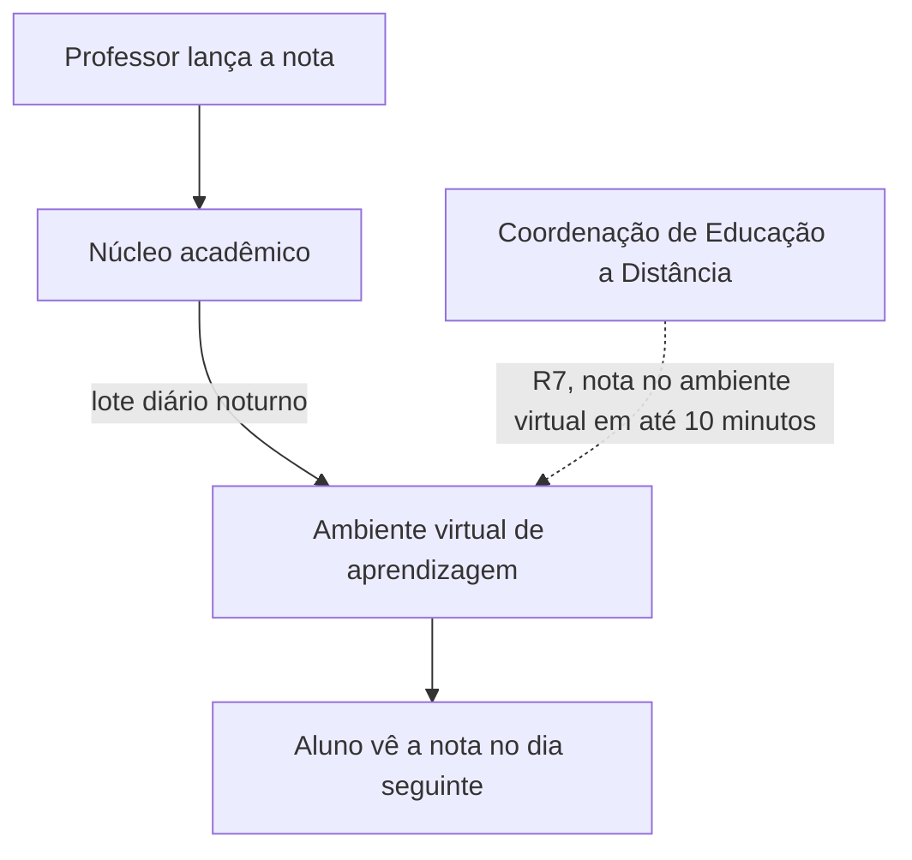

# A solução como sistema e seus componentes (pessoas, áreas, processos, informação e tecnologia)

Este bloco trata do objeto sobre o qual o arquiteto de solução trabalha, a solução vista como sistema, com seus cinco tipos de componente da solução, os três níveis em que uma organização é modelada e o alinhamento com a estratégia.

## Antes de começar

- [Componentes da solução](../referencia/glossario.md#componentes-da-solucao)
- [Arquitetura de solução](../referencia/glossario.md#arquitetura-de-solucao)
- [Parte interessada](../referencia/glossario.md#parte-interessada)

## Conceito

Uma solução atende a um problema, um risco ou uma oportunidade da organização. Com o tempo, as soluções implantadas deixam de ser reconhecíveis como tais e passam a fazer parte do funcionamento cotidiano da instituição, de modo que uma solução nova quase sempre substitui ou modifica uma solução anterior, mesmo quando ninguém a chamou assim na época.

A [arquitetura de solução](bloco-1-arquitetura-de-solucoes-e-de-software.md#o-que-e-arquitetura-de-solucao), definida no bloco 1, trata a solução como um sistema, com partes que interagem para produzir o comportamento exigido. As partes podem ser novas ou já existentes, podem ser compartilhadas com outras soluções, e interagem por interfaces nas quais informação é trocada. Essa leitura tem uma consequência direta: o comportamento que o conjunto produz é o que avalia a solução, e a qualidade isolada de cada parte não basta para julgá-la.

### Os três níveis de uma organização

Uma organização pode ser modelada em três níveis encaixados. O **sistema de negócio** é a organização, ou uma unidade dela, tratada como sistema, com estrutura e comportamento próprios, que oferece serviços a clientes e parceiros por interfaces externas. O **sistema de informação** é um híbrido de processos conduzidos por pessoas e sistemas computacionais que gerencia a informação do negócio, e pode incluir atividades manuais. O **sistema de TI** é a combinação de equipamento e software que trata dados e informação dentro do contexto de um sistema de informação.

<figure markdown="span">
{ .module-diagram }
<figcaption>Os três sistemas encaixados que modelam uma organização, com a definição e exemplos de cada nível na coluna à direita.</figcaption>
</figure>

O encaixe das elipses é a informação principal do infográfico, porque cada nível se apoia no nível interno para entregar valor e nenhum deles é avaliado isoladamente. O eixo vertical à esquerda indica que o nível externo concentra as decisões de alcance estratégico e o interno concentra as decisões técnicas, e o parágrafo seguinte instancia os três níveis no processo de matrícula da ACME.

Na ACME, universidade privada brasileira fictícia com 38.400 alunos ativos e sistema acadêmico em operação desde 2004, a matrícula ilustra os três níveis. O sistema de negócio é o processo acadêmico de alocar alunos em turmas a cada semestre, com regras de pré-requisito, limite de vagas e prazos definidos pelo calendário. O sistema de informação abrange a orientação prestada pelo coordenador de curso, a conferência manual feita pela Secretaria Acadêmica nos casos de aproveitamento de disciplina e os registros que circulam entre essas pessoas. O sistema de TI é o portal do aluno, o núcleo em COBOL que calcula a situação do aluno e as integrações com o ambiente virtual de aprendizagem e com o ERP financeiro.

A arquitetura de solução ocupa-se de soluções que são sistemas de negócio contendo dentro de si sistemas de informação e sistemas de TI. Algumas soluções têm como foco um sistema de informação ou de TI novo ou modificado, e é raro que não haja envolvimento ou impacto mais amplo do negócio.

### Os cinco tipos de componente da solução

Os componentes da solução (pessoas, estruturas organizacionais, processos, informação e tecnologia) classificam-se em cinco áreas, usadas como lista de verificação para que nenhuma delas fique de fora do desenho. Mudança, nesse contexto, inclui acrescentar um componente da solução novo, alterar um existente ou retirá-lo.

| Tipo do componente da solução | O que abrange | Exemplo na ACME |
| --- | --- | --- |
| Pessoas | Funcionários, clientes, parceiros, papéis, capacidades, habilidades e descrições de cargo | Professores que passam a lançar nota diretamente, com o treinamento correspondente |
| Estruturas organizacionais | Unidades, estruturas de gestão, terceirização, organizações parceiras, metas e acordos de nível de serviço | Fim da intermediação da fábrica de software na correção de dado cadastral, que volta para a Secretaria Acadêmica |
| Processos | Serviços de negócio, cadeia de valor, processos, políticas, regras de negócio e procedimentos | Fechamento de notas deixa de depender da janela noturna de lote |
| Informação | Entrada, saída, gatilho, retorno, auditoria e informação como produto | Trilha de auditoria de leitura de dado pessoal, com retenção de 5 anos |
| Tecnologia | Equipamento, software, comunicação, nuvem e automação | Mensageria entre o núcleo acadêmico e o ambiente virtual de aprendizagem |

O valor da lista está no que ela impede de esquecer. Uma solução que troque o lote diário por propagação em minutos, sem mudar a rotina de quem lança a nota nem o acordo de nível de serviço com o fornecedor do ambiente virtual, entrega tecnologia nova sobre processo antigo, e o resultado percebido pelo aluno tende a não mudar.

Nem todo tipo de componente da solução precisa mudar em toda solução. O desenho declara explicitamente quando um tipo permanece como está, e essa declaração é diferente de esquecimento, porque registra que a análise foi feita e concluiu pela permanência.

### Alinhamento com a estratégia

A solução precisa sustentar, e idealmente reforçar, a estratégia de negócio e a estratégia de TI. Uma forma comum de planejar a estratégia organiza cinco níveis encaixados: visão, missão, objetivos, estratégia e táticas. A visão descreve a situação futura ideal, que nem sempre é alcançável, e serve para alinhar o entendimento de todos sobre o destino pretendido. Os objetivos tornam essa direção verificável, a estratégia define o caminho escolhido, e as táticas são as ações concretas que a realizam.

Para o arquiteto, a utilidade prática dessa cadeia é o teste de coerência. Uma solução proposta que não se ligue a nenhum objetivo declarado da organização, ou que contrarie uma estratégia vigente, precisa ser reformulada ou explicitamente negociada com quem responde pela estratégia. Na ACME, a meta de reduzir o custo anual de propriedade de R$ 15,83 milhões para R$ 11,0 milhões até o fim de 2029 é o objetivo ao qual qualquer decisão de plataforma precisa se ligar, e o contrato de capacidade do mainframe vigente até 31/12/2028 é o fato que impede tratar a redução como consequência automática da migração.

## Uso pelo arquiteto

O arquiteto usa os cinco tipos de componente da solução em dois momentos. No levantamento, eles funcionam como roteiro de investigação, e cada tipo gera perguntas que a conversa técnica sozinha não faria, como quem passa a fazer o quê e qual política precisa mudar. No desenho, eles funcionam como conferência de completude, porque uma solução que só lista componentes da solução do tipo tecnologia é uma solução incompleta ou uma solução cuja parte organizacional foi deixada implicitamente para outra pessoa resolver.

Os três níveis servem para situar o alcance do que está sendo desenhado e para evitar um erro comum, o de tratar um problema de sistema de negócio como se fosse problema de sistema de TI. Quando a queixa é de que a nota demora a aparecer para o aluno, o nível de TI mostra o lote noturno, e o nível de negócio mostra que o calendário de fechamento e a rotina de conferência manual também determinam o prazo percebido.

## No caderno arquitetural

{{ficha:1}}

**Para que serve.** Uma solução não é só tecnologia. Para o sistema funcionar, alguém precisa aprender a usá-lo, uma área pode ter de mudar a rotina, um contrato pode precisar de aditivo e só então entra o programa. Cada uma dessas peças é um componente da solução, e todas precisam aparecer no caderno para que nenhuma fique sem responsável. Esta parte da seção 1 lista os componentes da solução e mostra em que nível da organização cada fato do problema aparece.

**O que você faz neste exercício.** O exercício parte de um pedido real da ACME. A Coordenação de Educação a Distância quer que a nota lançada pelo professor chegue ao ambiente virtual de aprendizagem em até 10 minutos, e hoje ela chega no dia seguinte, por um envio noturno. Esse pedido é o requisito R7. O enunciado reúne dez candidatos a componente da solução, que poderiam atender ao pedido, numerados de CP1 a CP10, como treinar os professores para publicar a nota na hora (pessoas) ou criar uma mensageria entre os dois sistemas (tecnologia). Traz também seis fatos sobre a situação atual, numerados de N1 a N6, como o calendário que fixa a data de fechamento das notas. Você diz de que tipo é cada componente da solução, em que nível da organização está cada fato, e registra as respostas no caderno.

| Campo do caderno | Como preencher | Item |
| --- | --- | --- |
| Tipo do componente da solução | Classifique cada componente da solução em um dos cinco tipos: pessoas (quem faz ou aprende algo), estruturas organizacionais (áreas, contratos e acordos), processos (como o trabalho é feito), informação (dados e registros) ou tecnologia (equipamentos e programas) | 1 |
| Tipo do componente da solução ausente | Confira se algum dos cinco tipos ficou sem nenhum componente da solução, o que indicaria algo esquecido, e diga qual tipo mais muda a rotina de quem trabalha na instituição | 1 |
| Nível do elemento | Diga se cada fato da situação atual pertence ao sistema de negócio (o que a universidade oferece, como o serviço de avaliação), ao sistema de informação (as pessoas, os processos e os registros que cuidam da informação) ou ao sistema de TI (equipamentos e programas) | 2 |
| Prazo percebido | Explique em até cinco linhas por que trocar só a tecnologia pode não encurtar o prazo que o aluno percebe | 2 |

**O que você já tem.** A tabela de decisões do exercício 1, que mostra quais decisões mexem em componentes da solução além da tecnologia.

**Quando está pronto.** Os dez componentes da solução têm tipo, os seis fatos têm nível e a explicação do prazo percebido está escrita.

[Ver esta seção no template](../caderno/template.md#1-contexto){ .caderno-botao }
[Ver o gabarito do exercício 2](../gabaritos/gabarito-exercicio-02.md){ .caderno-botao }

{{/ficha}}

## Exercício 2

A ACME é uma universidade privada brasileira fictícia, com 38.400 alunos ativos, dos quais 10.200 na graduação a distância, 2.150 professores e 4 campi em 3 cidades. O sistema acadêmico está em operação desde 2004 e sustenta matrícula, avaliação, emissão de documentos e integração com o ERP financeiro, o sistema de gestão das finanças da universidade.

Uma solução não é só tecnologia. Para o sistema funcionar, alguém precisa aprender a usá-lo, uma área pode ter de mudar a rotina e um contrato pode precisar de aditivo. Cada uma dessas peças é um componente da solução, e o arquiteto os separa em cinco tipos para conferir que nenhum ficou esquecido: pessoas, estruturas organizacionais, processos, informação e tecnologia. Uma universidade também pode ser vista em três níveis encaixados, o sistema de negócio, o sistema de informação e o sistema de TI, descritos na seção [Os três níveis de uma organização](#os-tres-niveis-de-uma-organizacao) deste bloco. Este exercício usa um pedido real da ACME, o requisito R7, para praticar as duas ideias. Requisito é aquilo que uma área da organização exige da solução, e R7 é o código com que esse pedido consta no dossiê do caso. No Item 1 você classifica os componentes da solução por tipo e no Item 2 você situa os fatos da situação atual em cada nível. As respostas dos dois itens vão para o caderno arquitetural, o documento em que o curso reúne, seção por seção, a arquitetura da solução da ACME, apresentado no [bloco 4](bloco-4-processo-de-definicao-da-arquitetura.md#o-caderno-arquitetural).

### Item 1: Componentes da solução do pedido de nota

A Coordenação de Educação a Distância, área que cuida dos cursos a distância da ACME, declarou o requisito R7, segundo o qual a nota lançada pelo professor chega ao ambiente virtual de aprendizagem em até 10 minutos. O ambiente virtual de aprendizagem é a plataforma on-line em que o aluno acompanha as disciplinas e consulta a nota. Hoje a nota segue do núcleo acadêmico, o sistema que registra as notas, para o ambiente virtual por um lote diário noturno, isto é, um envio único de todas as notas do dia, feito à noite, o que gera reclamação de aluno a cada fechamento, como mostra o diagrama abaixo. O ambiente virtual permanece em operação e não será substituído, por decisão da Reitoria de 12/03/2026, e o plano do fornecedor que oferece interfaces de programação custa 38% a mais que o plano vigente.

O enunciado reúne dez candidatos a componente da solução, que poderiam atender ao R7, numerados de CP1 a CP10, sem classificação. Dois deles são o treinamento dos professores (CP1), que trata de pessoas, e a mensageria entre os dois sistemas (CP8), que é tecnologia, e os demais você classifica por conta própria. Mensageria é o mecanismo que permite a um sistema enviar mensagens a outro assim que algo acontece.

| Código | Candidato a componente da solução |
| --- | --- |
| CP1 | Treinamento dos professores para o lançamento de nota com publicação imediata |
| CP2 | Aditivo ao contrato com o fornecedor do ambiente virtual, com a troca para o plano que oferece interfaces de programação |
| CP3 | Acordo de nível de serviço de 10 minutos entre a Diretoria de TI e a Coordenação de Educação a Distância |
| CP4 | Procedimento de correção de nota já publicada no ambiente virtual |
| CP5 | Fechamento de notas sem dependência da janela noturna de lote |
| CP6 | Registro de cada envio de nota com o horário de lançamento e o horário de confirmação pelo ambiente virtual |
| CP7 | Mensagem de nota lançada, com aluno, turma, avaliação e valor |
| CP8 | Mensageria entre o núcleo acadêmico e o ambiente virtual |
| CP9 | Serviço de notas que publica um evento a cada lançamento |
| CP10 | Responsável na Coordenação de Educação a Distância pelo acompanhamento das falhas de envio |

1. Classifique cada um dos dez candidatos a componente da solução em um dos cinco tipos de [componentes da solução](../referencia/glossario.md#componentes-da-solucao), pessoas, estruturas organizacionais, processos, informação e tecnologia, e indique se algum tipo ficou sem componente da solução.
2. Indique qual dos cinco tipos exige a mudança de maior impacto sobre quem trabalha na instituição, e justifique em duas linhas.

Suas respostas viram os campos Tipo do componente da solução e Tipo de componente da solução ausente, na seção 1 do caderno.

### Item 2: Os fatos da situação atual em três níveis

Um elemento da situação atual é um fato sobre como a ACME opera hoje e que influencia o prazo em que a nota chega ao aluno. O quadro abaixo lista seis, numerados de N1 a N6. Dois deles são o calendário acadêmico que fixa a data de fechamento das notas (N2) e a exportação noturna por lote (N6). O sistema de negócio é o que a universidade oferece, o sistema de informação reúne as pessoas, os processos e os registros que cuidam da informação, e o sistema de TI reúne equipamentos e programas. Situar cada elemento em um desses níveis mostra onde o prazo percebido pelo aluno se forma.

| Código | Elemento da situação atual |
| --- | --- |
| N1 | Serviço de avaliação que a universidade presta ao aluno, com o resultado publicado dentro do calendário acadêmico |
| N2 | Calendário acadêmico que fixa a data de fechamento das notas de cada período |
| N3 | Rotina de conferência manual das notas antes da publicação |
| N4 | Registros de nota que circulam entre professor, coordenação de curso e Secretaria Acadêmica |
| N5 | Portal do professor e núcleo em COBOL que calcula a situação do aluno |
| N6 | Exportação noturna por lote das notas ao ambiente virtual de aprendizagem |

1. Situe cada um dos seis elementos em um dos três níveis apresentados neste bloco, sistema de negócio, sistema de informação ou sistema de TI.
2. Explique, em até cinco linhas, por que uma solução construída apenas no nível de sistema de TI pode não reduzir o prazo percebido pelo aluno.

Suas respostas viram os campos Nível do elemento e Prazo percebido, na seção 1 do caderno.

## Fontes

As referências seguem o formato APA, 7ª edição, e constam da [bibliografia](../referencia/bibliografia.md) do curso. O trecho consultado aparece entre parênteses ao fim de cada entrada.

- Lovatt, M. (2021). *Solution architecture foundations*. BCS, The Chartered Institute for IT. (seções 1.2, 1.3, 1.4 e 1.8)

**Material do curso.** Glossário, entradas [componentes da solução](../referencia/glossario.md#componentes-da-solucao), [arquitetura de solução](../referencia/glossario.md#arquitetura-de-solucao) e [parte interessada](../referencia/glossario.md#parte-interessada). Dossiê da instituição fictícia [ACME](../caso-acme/index.md), porte da instituição, requisitos declarados e interesses em conflito.
