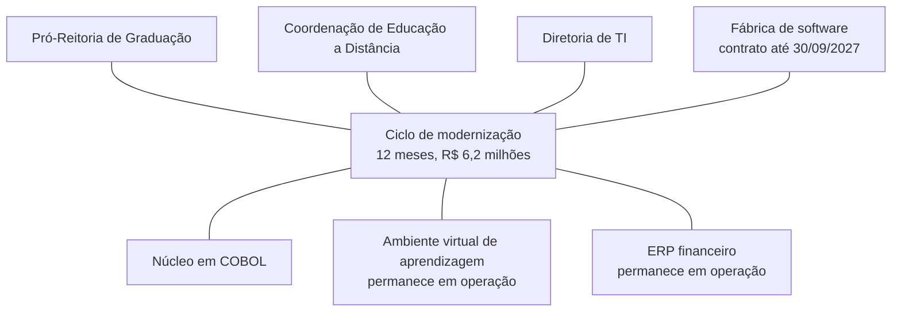

# O papel do arquiteto de solução

Num ciclo de modernização como o da ACME, com 12 meses e orçamento de R$ 6,2 milhões, muita gente trabalha ao mesmo tempo, e alguém precisa responder pela solução como um todo. Este bloco descreve o que esse arquiteto de solução faz, que competências o papel exige, o que a arquitetura de solução entrega ao fim do trabalho e que benefícios a organização obtém com essa abordagem.

## Antes de começar

- [Arquiteto de solução](../referencia/glossario.md#arquiteto-de-solucao)
- [Parte interessada](../referencia/glossario.md#parte-interessada)
- [Arquitetura de solução](../referencia/glossario.md#arquitetura-de-solucao)
- [Bloco de construção da solução](../referencia/glossario.md#bloco-de-construcao-da-solucao)

## Conceito

<figure markdown="span">
![Infográfico panorâmico do papel do arquiteto de solução. À esquerda, os conceitos de partida e as três saídas do trabalho, desenho da solução, roteiro de entrega e estimativa de custo, com os tipos de artefato, entradas, produtos intermediários e entregáveis. Ao centro, o ciclo numerado das sete atividades, de organizar o processo a governar a implementação. À direita, os quatro grupos de competência, negócio, técnico, entrega e prático, e a lista dos sete benefícios da abordagem, de visão do todo a resolução precoce de conflito e duplicação.](../assets/images/modulo-1-papel-arquiteto-panorama.png){ .module-diagram }
<figcaption>Panorama do bloco, com as atividades, as competências, as saídas do trabalho e os sete benefícios da abordagem arquitetural.</figcaption>
</figure>

O infográfico reúne, em uma página, o conteúdo que as seções seguintes desenvolvem, e serve tanto de mapa de leitura antes do estudo quanto de material de revisão depois dele. O ciclo central numerado de 1 a 7 corresponde às atividades descritas no próximo parágrafo, e a coluna da direita corresponde às competências e aos benefícios tratados nas duas seções finais.

Cada solução proposta costuma ficar sob a responsabilidade de um único arquiteto de solução. Quando o problema é grande demais, ele é decomposto em áreas de tamanho realista, cada uma conduzida por um arquiteto, com a coordenação do conjunto a cargo de um arquiteto sênior, porque uma área de problema grande demais corre o risco de não poder ser resolvida como unidade.

Antes de desenhar qualquer coisa, o arquiteto organiza o processo e conversa com as partes interessadas, para só então investigar a situação atual, levantar requisitos e propor alternativas. Escolhida uma delas, ele modela a solução, valida o desenho com quem tem autoridade para aprová-lo e permanece com responsabilidade de governança durante a implantação. Parte interessada, na definição da norma ISO/IEC/IEEE 42010, é o indivíduo, a equipe, a organização ou a classe desses que tem interesse em um sistema.

### Competências exigidas

Para conduzir essas atividades, o arquiteto recorre a competências de quatro grupos, e nenhum deles é dispensável. Uma conversa com a Reitoria sobre a meta de custo exige o grupo de **negócio**, que reúne a estratégia da organização, o modelo operacional atual e planejado, a política interna, os fatores comerciais e de mercado e a leitura do ambiente externo. A avaliação da tecnologia em uso exige o grupo **técnico**, que reúne a estratégia técnica, a arquitetura de infraestrutura e de tecnologia vigente e planejada, e as abordagens metodológicas de desenvolvimento. A montagem de um roteiro exige o grupo de **entrega**, que reúne gestão de projetos, de programas e de portfólio, gestão de mudança e de configuração, e gestão de riscos. O levantamento com as áreas exige o grupo **prático**, que reúne comunicação, gestão de partes interessadas, tratamento de requisitos, resolução de problemas, inovação e liderança.

### O que o trabalho entrega

Ao fim do trabalho, o patrocinador espera receber três saídas principais: um desenho com detalhe suficiente para ser implementado, um roteiro de entrega da solução ao negócio e uma estimativa do custo da mudança tecnológica. Para chegar a elas, o arquiteto usa e produz documentos e modelos chamados de artefatos, que se dividem em três categorias, entradas, entregáveis e produtos de trabalho intermediários.

Quando um projeto começa, três artefatos de entrada costumam estar na mesa. A declaração de visão da solução registra que a organização identificou a necessidade de agir e como a solução poderia se parecer, em termos abstratos e com o mínimo de detalhe sobre a forma de resolver. O documento de iniciação da arquitetura dá autoridade à equipe para prosseguir, estima prazo e recurso e lista os entregáveis. O catálogo de requisitos de negócio reúne os requisitos de alto nível ligados diretamente ao problema, que serão ampliados na fase de descoberta.

### Benefícios da abordagem

Percorrer o processo inteiro custa tempo, e é por isso que a abordagem arquitetural precisa se justificar por sete benefícios. O primeiro é a **visão do todo**, porque a solução é tratada como sistema que reúne os cinco tipos de componente da solução descritos no [bloco 2](bloco-2-a-solucao-como-sistema.md#os-cinco-tipos-de-componente-da-solucao), pessoas, estruturas organizacionais, processos, informação e tecnologia, e são raras as soluções bem-sucedidas que não mudam algo em cada uma dessas áreas. O segundo é o **alinhamento estratégico**, com a identificação do que é estratégico na fase de descoberta e o registro como dívida estratégica daquilo que precisou ser feito contra a estratégia por urgência. O terceiro é o **reúso**, favorecido pelo uso de modelos de componente de software e de interface, que aumentam a chance de um componente de software existente ser identificado como adequado a mais de um uso.

O quarto é a **decisão baseada em evidência**, porque a modelagem da área do problema permite localizar a causa raiz e testar se a solução proposta de fato a resolve, em lugar de decidir por opinião. O quinto é o **custo e a perturbação mínimos**, obtidos pela comparação de alternativas por análise de lacunas, que procura a menor mudança capaz de produzir o resultado desejado, e por análise de impacto, que limita os efeitos colaterais. O sexto é a **redução de dependência**, obtida pelo encapsulamento de componentes de software com interfaces definidas, de modo que o interior de um componente de software mude sem repercussão sobre os demais. O sétimo é a **resolução precoce de conflito e de duplicação**, porque o escopo declarado e as análises de lacuna e de impacto revelam cedo quais outras iniciativas em curso tocam a mesma área.

## Uso pelo arquiteto

Ao montar a equipe de um projeto como o da ACME, o arquiteto usa a lista de competências como diagnóstico da própria atuação e da composição da equipe. Quando o grupo de negócio está fraco, a solução tende a ser tecnicamente correta e desalinhada da estratégia, e quando o grupo de entrega está fraco, o desenho ignora a capacidade real de execução da organização e produz um roteiro que ninguém consegue cumprir.

A separação entre entradas, produtos intermediários e entregáveis organiza a negociação de prazo. O patrocinador costuma cobrar o desenho final desde a primeira semana, e é o arquiteto quem precisa mostrar que a declaração de visão e o documento de iniciação vêm antes, com custo baixo, e que a decisão de seguir ou parar é tomada sobre eles.

## No caderno arquitetural

{{ficha:1}}

**Para que serve.** O caderno precisa deixar claro quem faz o quê. Num projeto de modernização, parte das tarefas é do arquiteto de solução, que cuida da solução como um todo. Outra parte é do arquiteto de software ou da equipe de desenvolvimento, que cuidam do interior de cada componente de software. E uma terceira é da arquitetura corporativa, que define regras para a organização inteira. Quando essa divisão não está escrita, o arquiteto acaba decidindo o que não é dele ou deixa sem dono o que é.

**O que você faz neste exercício.** O enunciado lista dez tarefas do ciclo de modernização da ACME, numeradas de T1 a T10. Entre elas estão entrevistar a Pró-Reitoria de Graduação (T1), estimar o custo da mudança (T3) e escolher a estrutura de dados do serviço de matrícula (T4). Você diz de quem é cada tarefa, que tipo de habilidade ela pede do arquiteto de solução e, no caso da T10, que benefício ela traz. O resultado vira a tabela de papéis do caderno.

| Campo do caderno | Como preencher | Item |
| --- | --- | --- |
| Responsável | Diga se a tarefa é do arquiteto de solução, do arquiteto de software ou da arquitetura corporativa, pelo mesmo critério do exercício 1: até onde o efeito da tarefa chega | 1 |
| Justificativa | Explique em uma frase por que a tarefa é desse responsável | 1 |
| Grupo de competência | Nas tarefas do arquiteto de solução, diga qual habilidade a tarefa pede mais: de negócio, técnica, de entrega ou prática (comunicação, relacionamento com as partes interessadas, requisitos) | 2 |
| Benefício da tarefa T10 | Escolha, entre os sete benefícios da abordagem arquitetural, o que justifica verificar se já existe um componente de software reaproveitável | 3 |

**O que você já tem.** A classificação por nível do exercício 1, porque o mesmo critério de alcance separa as decisões e as tarefas.

**Quando está pronto.** As dez tarefas têm responsável e justificativa, as tarefas do arquiteto de solução têm grupo de competência e a tarefa T10 tem o benefício que a justifica.

[Ver esta seção no template](../caderno/template.md#1-contexto){ .caderno-botao }
[Ver o gabarito do exercício 3](../gabaritos/gabarito-exercicio-03.md){ .caderno-botao }

{{/ficha}}

## Exercício 3

A ACME é uma universidade privada brasileira fictícia, com 38.400 alunos ativos, 2.150 professores e 4 campi, cujo sistema acadêmico está em operação desde 2004. A instituição aprovou um ciclo de modernização de 12 meses com orçamento de R$ 6,2 milhões, mantendo o ambiente virtual de aprendizagem e o ERP financeiro em operação, e o núcleo em COBOL permanece sob contrato de sustentação de uma fábrica de software até 30/09/2027. A fábrica de software é a empresa contratada que mantém o núcleo, a parte mais antiga do sistema acadêmico, escrita em COBOL, uma linguagem de programação antiga.

Em um projeto de modernização, muita gente trabalha ao mesmo tempo, e cada tarefa precisa ter dono. Quando a divisão não está clara, o arquiteto de solução decide o que não é dele ou deixa sem responsável o que é. Este exercício apresenta dez tarefas do ciclo de modernização da ACME, numeradas de T1 a T10, como entrevistar a Pró-Reitoria de Graduação (T1) e escolher a estrutura de dados do serviço de matrícula (T4). Nos três itens você diz de quem é cada tarefa, que tipo de habilidade as tarefas do arquiteto de solução pedem e que benefício da abordagem arquitetural justifica a tarefa T10. As respostas vão para a tabela de papéis do caderno arquitetural, o documento em que o curso reúne, seção por seção, a arquitetura da solução da ACME, apresentado no [bloco 4](bloco-4-processo-de-definicao-da-arquitetura.md#o-caderno-arquitetural).

### Item 1: Responsável por cada tarefa

Na ACME, o ciclo de modernização envolve a Pró-Reitoria de Graduação, a Coordenação de Educação a Distância, a Diretoria de TI e a fábrica de software, e dura 12 meses com R$ 6,2 milhões. O diagrama abaixo situa essas áreas e os sistemas envolvidos, e o quadro seguinte lista as dez tarefas do ciclo, cada uma uma atividade de levantamento, de decisão, de redação ou de configuração. Três responsáveis são possíveis. O arquiteto de solução cuida da solução inteira, o arquiteto de software ou a equipe de desenvolvimento cuida do interior de um componente de software, e a arquitetura corporativa define regras que valem para a organização toda. O ambiente virtual de aprendizagem é a plataforma on-line em que o aluno acompanha as disciplinas e consulta a nota.

| Código | Tarefa |
| --- | --- |
| T1 | Entrevistar a Pró-Reitoria de Graduação e a Coordenação de Educação a Distância para levantar o que cada área precisa do sistema |
| T2 | Definir como o serviço extraído mantém consistência de dado com o núcleo em COBOL durante a coexistência |
| T3 | Estimar o custo da mudança tecnológica do primeiro ciclo e verificar se cabe nos R$ 6,2 milhões |
| T4 | Escolher a estrutura de dados que o serviço de matrícula usa para ordenar a lista de turmas disponíveis |
| T5 | Negociar com a fábrica de software a abertura de interfaces no núcleo antes do fim do contrato |
| T6 | Redigir a política institucional que define como qualquer sistema da universidade trata dado pessoal de aluno |
| T7 | Produzir o roteiro de entrega do ciclo, com a ordem em que os módulos são extraídos |
| T8 | Decidir que a Secretaria Acadêmica passa a responder pela correção de dado cadastral de aluno |
| T9 | Configurar o servidor de integração contínua que compila e publica o serviço extraído |
| T10 | Verificar com a Diretoria de TI se já existe na universidade um componente de software de envio de mensagem que possa ser reaproveitado |

1. Separe as dez tarefas em três grupos, as que cabem ao arquiteto de solução, as que cabem ao arquiteto de software ou à equipe de desenvolvimento, e as que cabem à arquitetura corporativa, usando o critério de alcance apresentado no [bloco 1](bloco-1-arquitetura-de-solucoes-e-de-software.md#como-aplicar-o-grao-correto). Justifique cada tarefa em uma linha.

Sua resposta vira os campos Responsável e Justificativa da tabela de papéis, na seção 1 do caderno.

### Item 2: Grupo de competência de cada tarefa

Competência é uma habilidade que o papel exige, e cada tarefa recorre mais a uma habilidade do que a outras. Saber qual delas pesa em cada tarefa ajuda a perceber que a equipe precisa de alguém que a domine. Por exemplo, gestão de riscos pertence ao grupo Entrega e comunicação com as partes interessadas pertence ao grupo Prático. O quadro abaixo resume os quatro grupos de competência do arquiteto de solução apresentados na seção [Competências exigidas](#competencias-exigidas) deste bloco.

| Grupo | O que abrange |
| --- | --- |
| Negócio | Estratégia da organização, modelo operacional atual e planejado, política interna, fatores comerciais e de mercado e leitura do ambiente externo |
| Técnico | Estratégia técnica, arquitetura de infraestrutura e de tecnologia vigente e planejada, e abordagens metodológicas de desenvolvimento |
| Entrega | Gestão de projetos, de programas e de portfólio, gestão de mudança e de configuração, e gestão de riscos |
| Prático | Comunicação, gestão de partes interessadas, tratamento de requisitos, resolução de problemas, inovação e liderança |

1. Para as tarefas que você atribuiu ao arquiteto de solução no Item 1, indique a qual dos quatro grupos de competência cada uma recorre principalmente.

Sua resposta vira o campo Grupo de competência da mesma tabela, no caderno.

### Item 3: Benefício por trás da tarefa T10

A abordagem arquitetural traz benefícios que justificam o trabalho extra do arquiteto, e cada tarefa de um projeto bem conduzido serve a algum deles. A tarefa T10 consiste em verificar com a Diretoria de TI se já existe na universidade um componente de software de envio de mensagem, isto é, um programa que transmite avisos de um sistema a outro, que possa ser reaproveitado. O item pede que você diga qual benefício está por trás dessa verificação. O quadro abaixo lista os sete benefícios da abordagem arquitetural apresentados na seção [Benefícios da abordagem](#beneficios-da-abordagem) deste bloco.

| Benefício | Como ele se produz |
| --- | --- |
| Visão do todo | A solução é tratada como sistema que reúne pessoas, estruturas organizacionais, processos, informação e tecnologia |
| Alinhamento estratégico | O que é estratégico é identificado na descoberta, e o que foi feito contra a estratégia é registrado como dívida estratégica |
| Reúso | Modelos de componente de software e de interface aumentam a chance de um componente de software existente servir a mais de um uso |
| Decisão baseada em evidência | A modelagem da área do problema localiza a causa raiz e testa se a solução proposta a resolve |
| Custo e perturbação mínimos | Análise de lacunas e análise de impacto procuram a menor mudança capaz de produzir o resultado |
| Redução de dependência | Componentes de software encapsulados com interfaces definidas mudam por dentro sem repercussão sobre os demais |
| Resolução precoce de conflito e de duplicação | Escopo declarado e análises de lacuna e de impacto revelam cedo outras iniciativas que tocam a mesma área |

1. Identifique qual dos sete benefícios justifica a existência da tarefa T10, e explique em três linhas o que a instituição perde se essa verificação não for feita antes de especificar componente de software novo.

Sua resposta vira o campo Benefício da tarefa T10 da tabela de papéis, no caderno.

## Fontes

As referências seguem o formato APA, 7ª edição, e constam da [bibliografia](../referencia/bibliografia.md) do curso. O trecho consultado aparece entre parênteses ao fim de cada entrada.

- Lovatt, M. (2021). *Solution architecture foundations*. BCS, The Chartered Institute for IT. (seções 1.5 a 1.7 e 1.9)
- International Organization for Standardization/International Electrotechnical Commission/Institute of Electrical and Electronics Engineers. (2022). *Systems and software engineering — Architecture description* (ISO/IEC/IEEE 42010:2022). (definição de parte interessada)
- Ford, N., & Richards, M. (2020). *Fundamentals of software architecture*. O'Reilly. (papel do arquiteto)

**Material do curso.** Glossário, entradas [arquiteto de solução](../referencia/glossario.md#arquiteto-de-solucao), [parte interessada](../referencia/glossario.md#parte-interessada) e [bloco de construção da solução](../referencia/glossario.md#bloco-de-construcao-da-solucao). Dossiê da instituição fictícia [ACME](../caso-acme/index.md), restrições fechadas e mapa de atores.
