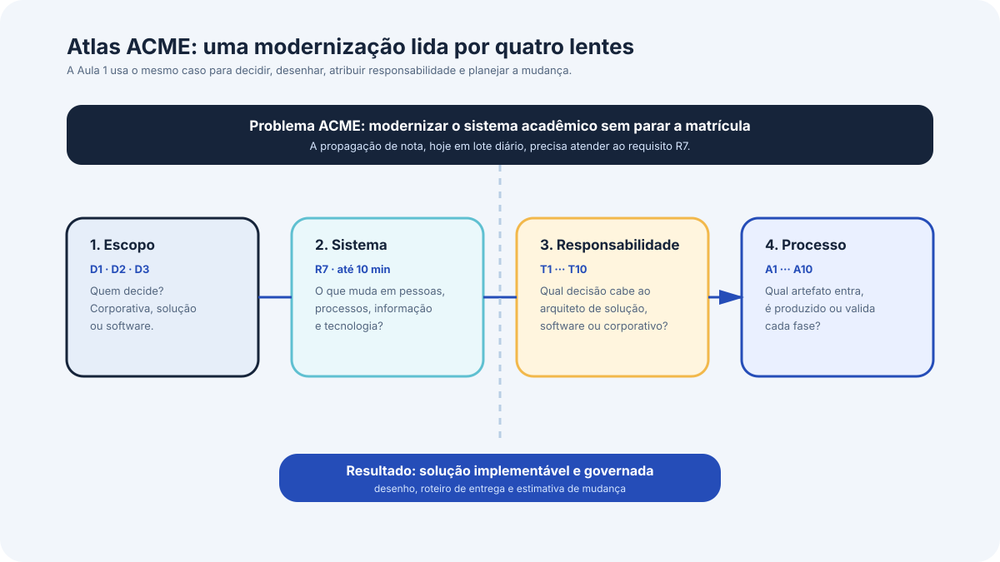

# Aula 1, arquitetura de soluções e seu processo

Quando a ACME decidiu modernizar o sistema acadêmico, o arquiteto de solução precisou responder a quatro perguntas antes de desenhar qualquer coisa: o que diferencia a arquitetura de soluções da arquitetura de software, com o que ele trabalha, o que o papel exige dele e por qual processo uma solução é definida. A aula percorre essas perguntas na ordem em que aparecem num projeto, e cada uma termina num exercício que preenche a seção 1 do caderno arquitetural.

{ .module-diagram }

## O fio condutor do curso: o caderno arquitetural

Imagine que o arquiteto de solução deixa o projeto da ACME no meio do caminho. Quem fica precisa saber qual é o problema, o que já está decidido, o que a solução precisa fazer, como ela se organiza, com que tecnologia será construída e em que ordem será entregue. O caderno arquitetural é o documento em que o arquiteto registra, num só lugar, essas respostas e as razões por trás delas, e é ele que explica as decisões a quem assume o projeto.

Neste curso, você monta o caderno da ACME aos poucos. Cada exercício preenche um pedaço, e ao fim das seis aulas os 24 exercícios formam um único documento, com a arquitetura completa da solução. O caderno tem um resumo de uma página e dez seções, e cada uma tem um objetivo:

| Seção | Para que serve |
| --- | --- |
| 0. A solução em uma página | Resume o projeto para quem não vai ler o caderno inteiro |
| 1. Contexto | Registra o ponto de partida: quem é a ACME, que problema ela quer resolver e o que já foi decidido |
| 2. Partes interessadas | Lista quem tem interesse no projeto, o que cada pessoa espera e onde os interesses entram em conflito |
| 3. Requisitos | Transforma o que as pessoas pedem em requisitos que dá para verificar |
| 4. Linha de base e lacunas | Descreve o sistema atual, que se chama linha de base, e o que falta para chegar à solução, que são as lacunas |
| 5. Contexto do sistema | Mostra num desenho o que está dentro da solução e com quais outros sistemas ela conversa |
| 6. Princípios | Fixa as regras que todas as decisões de desenho precisam respeitar |
| 7. Decisões | Guarda as escolhas principais da solução, cada uma com a razão que levou a ela |
| 8. Tecnologia e plataforma | Define com que tecnologia a solução será construída e como será protegida |
| 9. Roteiro e governança | Define a ordem das entregas e como acompanhar a obra depois de aprovada |
| 10. O que ainda falta decidir | Lista o que ainda é dúvida e quem pode resolver cada ponto |

O [template do caderno](../caderno/template.md) mostra o caderno vazio, seção por seção. O [mapa](../caderno/mapa.md) diz qual exercício preenche cada parte, e a seção [Gabaritos](../gabaritos/index.md) mostra o caderno preenchido a cada exercício.

## Objetivos de aprendizagem

Ao final da aula, o aluno é capaz de

- diferenciar arquitetura corporativa, arquitetura de solução e arquitetura de software pelo alcance da decisão que cada uma toma
- descrever uma solução como sistema, identificando seus componentes da solução nos cinco tipos, pessoas, estruturas organizacionais, processos, informação e tecnologia
- situar uma exigência de negócio nos três níveis de sistema de negócio, sistema de informação e sistema de TI
- descrever o papel do arquiteto de solução, suas competências e o que a disciplina entrega ao fim do trabalho
- descrever as oito fases do processo de definição da arquitetura, com a entrada e a saída de cada uma
- classificar artefatos de um caso real entre entrada, produto intermediário e entregável do processo
- registrar o contexto do projeto na seção 1 do caderno arquitetural, com as decisões classificadas por nível, os componentes da solução (pessoas, estruturas organizacionais, processos, informação e tecnologia), as tarefas de cada papel e os artefatos de cada fase

## Grade de tempo

A aula ocorre das 19h00 às 22h30, com intervalo das 20h30 às 20h45, e o tempo de conteúdo precisa terminar até as 22h10. Como todo o tempo de aula vai para a apresentação conceitual dos quatro blocos, os exercícios ficam para depois, fora do horário de aula. A tabela abaixo mostra o tempo de cada bloco, e esses minutos só aparecem nesta página.

| Bloco | Conceito | Apresentação (min) |
| --- | --- | --- |
| 1 | Arquitetura de soluções e arquitetura de software | 40 |
| 2 | A solução como sistema e seus componentes (pessoas, áreas, processos, informação e tecnologia) | 40 |
| 3 | O papel do arquiteto de solução | 40 |
| 4 | O processo de definição da arquitetura | 40 |

Os quatro blocos somam 160 minutos. Os 15 minutos restantes do tempo útil de 175 minutos cobrem abertura, transições e fechamento.

## Roteiro da aula

O [bloco 1](bloco-1-arquitetura-de-solucoes-e-de-software.md) apresenta a distinção que organiza o curso inteiro, entre arquitetura corporativa, de solução e de software, e o critério para saber a quem pertence cada decisão: até onde o efeito dela chega. No exercício, você classifica nove decisões da ACME nesses três níveis e registra o resultado na seção 1 do caderno.

O [bloco 2](bloco-2-a-solucao-como-sistema.md) mostra com o que o arquiteto de solução trabalha: a solução vista como um sistema, com cinco tipos de componente da solução e três níveis em que uma organização pode ser descrita. No exercício, você classifica os componentes da solução (pessoas, estruturas organizacionais, processos, informação e tecnologia) que atendem ao requisito R7 da ACME, a nota lançada chegar ao ambiente virtual em até 10 minutos, e situa esse requisito nos três níveis. O resultado também entra na seção 1, e o inventário de componentes da solução será usado no bloco 4, porque as fases do processo trabalham sobre componentes da solução já identificados.

O [bloco 3](bloco-3-papel-do-arquiteto-de-solucao.md) descreve o papel do arquiteto de solução: as competências que ele precisa ter, as três coisas que o trabalho entrega e os sete benefícios da abordagem arquitetural. No exercício, você separa dez tarefas do ciclo de modernização da ACME entre o arquiteto de solução, o arquiteto de software e a arquitetura corporativa, e registra a divisão na seção 1.

O [bloco 4](bloco-4-processo-de-definicao-da-arquitetura.md) apresenta o processo de oito fases, da iniciação à conclusão, com o que entra, o que acontece e o que sai de cada fase, e mostra em que fase cada seção do caderno nasce. No exercício, você associa dez artefatos do caso da ACME à fase correspondente e à seção do caderno em que ficam, e registra a primeira pendência do projeto, a data de conclusão, na seção 10.

A [síntese](sintese.md) fecha a aula com o resumo do que precisa ficar, perguntas para você conferir o que aprendeu e as fontes usadas nos quatro blocos.

## Adições no Caderno Arquitetural da Aula 1

Os quatro exercícios desta aula preenchem a seção 1, Contexto, que registra o ponto de partida do projeto. A aula deixa também a primeira versão do resumo, na seção 0, e da lista de pendências, na seção 10. O caderno que sai da Aula 1 é o do [gabarito do exercício 4](../gabaritos/gabarito-exercicio-04.md).

{{trilha:1}}

| Bloco | Exercício | O que entra no caderno | Gabarito |
| --- | --- | --- | --- |
| 1 | 1 | A classificação das nove decisões da ACME por nível de arquitetura (D1 a D9), com o componente da solução afetado e a dependência entre elas | [Gabarito 1](../gabaritos/gabarito-exercicio-01.md) |
| 2 | 2 | O tipo de cada um dos dez candidatos a componente da solução (CP1 a CP10) e o nível de cada um dos seis elementos da situação atual (N1 a N6) | [Gabarito 2](../gabaritos/gabarito-exercicio-02.md) |
| 3 | 3 | A divisão das dez tarefas do ciclo (T1 a T10) entre os papéis, o grupo de competência de cada uma e o benefício da tarefa T10 | [Gabarito 3](../gabaritos/gabarito-exercicio-03.md) |
| 4 | 4 | A fase, o papel e a seção do caderno de cada um dos dez artefatos do caso (A1 a A10), mais a data de conclusão como primeira pendência | [Gabarito 4](../gabaritos/gabarito-exercicio-04.md) |

## Preparação para a Aula 2

A Aula 2 trata do que entra no processo antes de qualquer desenho: os requisitos e as partes interessadas, que correspondem à fase de descoberta do bloco 4. Dois pontos desta aula voltam lá. O critério de alcance do bloco 1 ajuda a separar o requisito da solução do requisito de software, e os cinco tipos de componente da solução do bloco 2 servem de roteiro de perguntas no levantamento, porque cada tipo gera exigências próprias.
