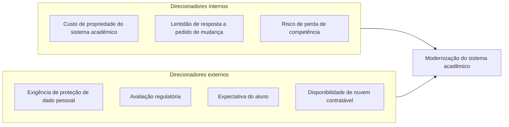
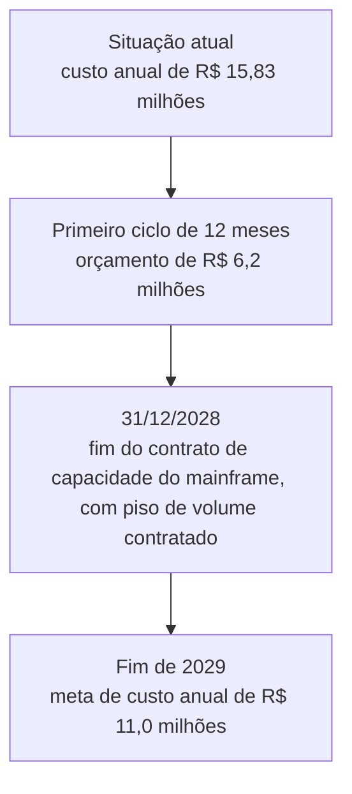

# Direcionadores de mudança

Quando a ACME, a universidade fictícia do caso usado no curso, decidiu modernizar o sistema acadêmico, a primeira pergunta do arquiteto foi o que empurrava a instituição a mudar. O parecer jurídico que exige processar dados de alunos em território nacional vem de fora da universidade e por isso é um direcionador externo, enquanto o custo anual de R$ 15,83 milhões do sistema nasce da própria gestão e é um direcionador interno. Este bloco mostra como separar essas pressões e o que delas chega ao arquiteto como insumo do desenho, e o exercício do fim pede que o aluno classifique os sete direcionadores do caso.

## Antes de começar

- [Direcionador de mudança](../referencia/glossario.md#direcionador-de-mudanca)
- [Arquitetura de solução](../referencia/glossario.md#arquitetura-de-solucao)
- [Artefato de linha de base](../referencia/glossario.md#artefato-de-linha-de-base)

## Conceito

Uma organização só se move quando sente pressão, e essa pressão tem nome: direcionador é a força que a faz querer mudar parte do negócio, mudança que uma solução nova ou modificada pode alcançar. No início do ciclo de vida, o negócio entrega à equipe de arquitetura três coisas, a declaração do problema contida na declaração de visão da solução, qualquer documentação existente que ajude a entender a situação, e a autorização para investigar, contida no documento de iniciação da arquitetura. Os dois documentos são os artefatos de entrada descritos no [bloco 3 da Aula 1](../modulo-1-fundamentos/bloco-3-papel-do-arquiteto-de-solucao.md#o-que-o-trabalho-entrega).

<figure markdown="span">
{ .module-diagram }
</figure>

### Direcionadores internos

Quem decide que uma universidade precisa mudar costuma ser a própria direção, e por isso a primeira das três fontes internas é a **estratégia de negócio**, que define a direção e as prioridades da operação e explica por que as coisas precisam mudar e em que parte do negócio a ação deve se concentrar. Dela vêm requisitos de negócio, objetivos e metas, resultados de investigações anteriores e artefatos como planos, mapas, modelos e cadeias de valor. Quando um plano já em curso se sobrepõe ao problema em análise, a mesma estratégia passa a ser também fonte de restrição.

A **estratégia de TI** está ligada à estratégia de negócio, porque a tecnologia existe para sustentar os objetivos da organização, mas nem toda ideia de mudança nasce no negócio. Quando surge tecnologia nova ou evolui a existente, aparecem oportunidades e desafios com impacto relevante sobre a operação, e por isso quase toda estratégia de TI contém um esforço de racionalização do parque instalado em direção a padrões, sistemas e componentes preferidos, muitas vezes organizado em um radar tecnológico que classifica tecnologias por grau de adoção recomendada. As decisões registradas nessa estratégia viram requisitos técnicos da solução, e o calendário de implantação de um componente novo pode restringir o calendário da solução.

A terceira fonte é a **análise de negócio**, que conduz a mudança em cinco estágios: alinhar, definir, desenhar, implementar e realizar. Tudo começa em alinhar, quando o exame do ambiente externo e do interno revela desalinhamentos e as ideias de mudança aparecem. Definir e desenhar são os estágios em que a arquitetura de solução concentra seu trabalho, e só depois deles vêm implementar e realizar, que ficam com a gestão de projetos e com as equipes de entrega, cabendo à arquitetura a governança.

### Direcionadores externos

Nem toda pressão vem de dentro. Uma lei nova ou a ação de um concorrente tem causa externa inequívoca, e a decisão estratégica de um dirigente que responde em parte a um evento de fora é mais sutil, mas também conta. A tabela abaixo reúne seis direcionadores de componente externa forte, de finanças a legislação, cada um com um exemplo de como se manifesta.

| Direcionador | Exemplo de manifestação |
| --- | --- |
| Finanças | Disponibilidade de capital, termos de contrato, relação com bancos e com o poder público |
| Acionistas e órgãos de governo | Pedido de mudança vindo de instância superior de governança |
| Exigência regulatória | Alteração de regime regulatório aplicável ao setor |
| Concorrentes | Movimento de quem atua no mesmo ambiente de negócio |
| Retorno de clientes | Reclamação recorrente ou pesquisa de satisfação |
| Legislação | Lei nova ou alterada que muda obrigações da organização |

A organização responde a esses direcionadores de forma reativa quando eles já se tornaram problema, e só consegue agir de forma antecipada se prever a mudança externa, determinar seu impacto e decidir que ações cabem.

### Análise PESTLE

Como olhar para fora sem se prender aos fatores que a equipe já conhece? PESTLE é uma técnica de análise do macroambiente, isto é, das condições externas amplas que a organização não controla, mas que podem criar oportunidades, ameaças ou restrições. O nome reúne as iniciais de seis lentes, e usá-las como roteiro reduz o risco de observar apenas os fatores mais familiares, como tecnologia e legislação, e ignorar mudanças sociais, econômicas ou ambientais capazes de alterar o problema.

| Dimensão | Pergunta orientadora | Exemplo para uma instituição de ensino |
| --- | --- | --- |
| **Política** | Que prioridades, políticas públicas ou decisões governamentais podem mudar o setor? | Mudança em programas públicos de financiamento estudantil |
| **Econômica** | Que condições de renda, crédito, inflação ou custo podem afetar demanda e operação? | Redução da capacidade de pagamento dos alunos |
| **Sociocultural** | Que mudanças de comportamento, expectativa ou perfil demográfico influenciam o serviço? | Preferência crescente por jornadas móveis e flexíveis |
| **Tecnológica** | Que tecnologias emergentes, obsolescentes ou mais acessíveis alteram as possibilidades? | Oferta de serviços de nuvem previamente homologados |
| **Legal** | Que leis, normas ou decisões regulatórias criam obrigações? | Exigência de residência de dados em território nacional |
| **Ambiental** | Que condições ambientais ou compromissos de sustentabilidade afetam a operação? | Eventos climáticos que interrompem o acesso a um campus |

PESTLE não produz requisitos automaticamente nem prevê o futuro com certeza, mas organiza a investigação: para cada fator relevante, a equipe registra a evidência, estima o possível impacto, identifica o horizonte de tempo e decide se deve monitorar o sinal, formular um requisito ou reconhecer uma restrição.

Na ACME, a análise começa pelos fatos que o dossiê já documenta: a dimensão legal aparece na exigência de processamento de dados no Brasil, a tecnológica nos provedores de nuvem pré-aprovados e a sociocultural na expectativa por acesso móvel. As outras dimensões exigem pesquisa adicional, e a diferença importa, porque um fator plausível levantado numa oficina ainda é hipótese, enquanto uma condição apoiada por fonte verificável pode orientar uma decisão.

### Os direcionadores da ACME

Para ver os direcionadores atuando em conjunto, volta-se à ACME, universidade privada brasileira fictícia com 38.400 alunos ativos, 2.150 professores e 4 campi em 3 cidades, cujo sistema acadêmico está em operação desde 2004. A tabela abaixo organiza o que o dossiê do caso registra sobre as pressões que a levaram a querer mudar.

| Direcionador | Natureza | Evidência no caso |
| --- | --- | --- |
| Custo de propriedade do sistema acadêmico | Interno, estratégia de negócio | R$ 15,83 milhões por ano, com meta declarada de R$ 11,0 milhões até o fim de 2029 |
| Lentidão de resposta a pedido de mudança | Interno, operação | 34 dias úteis entre pedido aprovado e entrega em produção |
| Risco de perda de competência | Interno, pessoas | 6 especialistas em COBOL na sustentação, 2 deles com aposentadoria prevista para 2027 |
| Exigência de proteção de dado pessoal | Externo, legislação | Parecer jurídico de 28/04/2026 exigindo processamento em território nacional |
| Avaliação regulatória | Externo, regulação | Preocupação declarada da Reitoria com queda de nota na avaliação |
| Expectativa do aluno | Externo, retorno de clientes | Demanda por aplicativo móvel e por matrícula que não falhe na abertura |
| Disponibilidade de nuvem contratável | Externo, tecnologia | Dois provedores pré-aprovados pelo Conselho Universitário em 12/03/2026 |

Lidos em conjunto, os três direcionadores internos apontam para custo, prazo e competência, e os quatro externos apontam para conformidade, reputação e expectativa. Por isso uma solução que trate só dos internos deixa sem resposta o que pressiona a instituição de fora.

### Fontes práticas de pesquisa para o arquiteto

De onde vem a evidência verificável que a análise PESTLE exige para cada fator? As dimensões tecnológica e econômica dependem de informação sobre maturidade de tecnologias e sobre mercados de fornecedores que a equipe raramente produz sozinha, e empresas de pesquisa e consultoria em tecnologia publicam relatórios recorrentes com essa informação. Três deles aparecem com frequência em discussões de arquitetura: o Hype Cycle e o Magic Quadrant, ambos do Gartner, e o Forrester Wave, da Forrester Research. O acesso ao conteúdo completo costuma depender de assinatura, mas as metodologias que definem os relatórios estão descritas publicamente nos sites das duas empresas.

Quando uma tecnologia nova ganha manchete, o arquiteto precisa saber se ela já entrega o que promete, e o **Hype Cycle** ajuda a responder porque representa a trajetória das expectativas sobre uma inovação ao longo do tempo. Segundo o Gartner, o eixo vertical mede as expectativas e o eixo horizontal as relaciona ao valor comprovado da inovação à medida que o tempo passa, e a travessia do ciclo leva com frequência entre três e cinco anos, com parte das inovações abandonada antes de chegar ao fim. A tabela abaixo descreve as cinco fases, com a tradução adotada nesta disciplina e o nome original usado pelo Gartner em inglês.

| Fase | Nome original | O que caracteriza a fase |
| --- | --- | --- |
| Gatilho da inovação | Innovation Trigger | Um avanço técnico ou o lançamento de um produto passa a atrair atenção |
| Pico das expectativas infladas | Peak of Inflated Expectations | O uso cresce, mas ainda há mais expectativa do que prova de que a inovação entrega o que promete |
| Vale da desilusão | Trough of Disillusionment | O interesse diminui quando experimentos e implantações não entregam o resultado esperado |
| Rampa do esclarecimento | Slope of Enlightenment | Os primeiros adotantes obtêm benefícios e outras organizações entendem como adaptar a inovação |
| Platô da produtividade | Plateau of Productivity | Mais usuários obtêm benefício real e a inovação passa ao uso corrente |

Na prática, o ciclo ajuda a estimar o horizonte de tempo de um fator tecnológico da análise PESTLE e o risco de adotar uma tecnologia que ainda está no pico das expectativas, quando o custo de ser um dos primeiros adotantes tende a ser maior. A posição de uma tecnologia no ciclo descreve a expectativa do mercado em geral, e por isso a adequação dela ao problema da organização continua dependendo dos requisitos e das restrições do caso.

O Gartner mantém uma página pública sobre o [Hype Cycle for Emerging Technologies](https://www.gartner.com/en/articles/hype-cycle-for-emerging-technologies), a edição anual dedicada a tecnologias emergentes, que serve de exemplo de aplicação do ciclo a um conjunto concreto de tecnologias e foi consultada em 29/09/2026.

Quando chega a hora de escolher entre fornecedores, o arquiteto precisa de uma comparação organizada, e o **Magic Quadrant** oferece uma: compara fornecedores de um mesmo mercado em dois critérios, a capacidade de execução, Ability to Execute, e a abrangência da visão, Completeness of Vision, e o cruzamento dos dois critérios define quatro quadrantes.

| Quadrante | Nome original | Descrição resumida do Gartner |
| --- | --- | --- |
| Líderes | Leaders | Oferta madura que atende à demanda do mercado, com visão demonstrada para sustentar a posição à medida que os requisitos evoluem |
| Desafiantes | Challengers | Forte capacidade de execução, mas talvez sem plano que mantenha proposta de valor forte para clientes novos |
| Visionários | Visionaries | Alinhados à visão do Gartner sobre a evolução do mercado, com capacidade de entrega ainda menos comprovada |
| Participantes de nicho | Niche Players | Bom desempenho em um segmento do mercado, por foco em uma funcionalidade ou região, ou por serem entrantes recentes |

O próprio Gartner declara, no aviso que acompanha as publicações do Magic Quadrant, que não endossa fornecedor, produto ou serviço representado em sua pesquisa e que não recomenda selecionar apenas os fornecedores com as avaliações mais altas, porque suas publicações expressam a opinião da sua organização de pesquisa. Um participante de nicho pode ser a melhor escolha quando o nicho coincide com o problema da organização, e essa é a leitura que o arquiteto precisa fazer antes de usar o quadrante como lista de candidatos.

Um exemplo publicado é o Magic Quadrant for Strategic Cloud Platform Services, com as posições de maio de 2025, exibido por completo em uma [publicação do Google Cloud de 08/08/2025](https://cloud.google.com/blog/products/compute/google-is-a-leader-in-gartner-magic-quadrant-for-scps), consultada em 29/09/2026. A página pertence a um dos fornecedores avaliados, que reproduz o gráfico sob licença do Gartner, e por isso deve ser lida como material promocional que contém dado de terceiro.

Uma segunda opinião sobre o mesmo mercado vem do **Forrester Wave**, que a Forrester Research descreve como um guia para compradores que avaliam opções em um mercado de tecnologia, baseado na análise e na opinião da empresa. A avaliação combina a oferta atual do fornecedor, Current Offering, e a sua estratégia, Strategy, e desde 01/07/2024 o gráfico apresenta a avaliação de clientes, Customer Feedback, no lugar da antiga presença de mercado. Segundo a metodologia da Forrester, a avaliação de clientes considera quantos clientes de referência o fornecedor indicou, quantos deles responderam e quão satisfeitos estavam, e o fornecedor com avaliação superior recebe no gráfico um marcador mais destacado. A metodologia consultada não define o critério antigo de presença de mercado, que por isso não é detalhado aqui. Na mesma revisão, a classificação passou a ter três categorias, Leaders, Strong Performers e Contenders. O nome da empresa é Forrester Research, e a grafia Forrester Group, que aparece em algumas referências informais, não corresponde à razão social.

Um exemplo publicado é o [Forrester Wave: Public Cloud Platforms, Q4 2024](https://reprint.forrester.com/reports/the-forrester-wave-tm-public-cloud-platforms-q4-2024-9c26c6b4/index.html), distribuído em reimpressão licenciada no portal de reimpressões da Forrester Research e consultado em 29/09/2026. Ele avalia um mercado próximo ao do Magic Quadrant citado acima, o que permite confrontar a opinião das duas empresas sobre provedores de nuvem.

Cada um dos três instrumentos responde a uma pergunta diferente e entra em um momento diferente do processo, como a tabela abaixo resume.

| Instrumento | Pergunta respondida | Uso no processo de arquitetura | Cuidado na leitura |
| --- | --- | --- | --- |
| Hype Cycle | Em que estágio de maturidade e de expectativa está uma tecnologia? | Horizonte de tempo e risco de adoção de um fator tecnológico na análise PESTLE | A posição reflete a expectativa do mercado e não a adequação ao caso |
| Magic Quadrant | Como os fornecedores de um mercado se comparam em execução e visão? | Lista inicial de candidatos antes da comparação de plataformas, tratada na Aula 5 | O recorte do mercado definido pelo Gartner pode diferir do problema da organização |
| Forrester Wave | Como os fornecedores se comparam em oferta atual, estratégia e avaliação de clientes? | Segunda opinião sobre o mesmo mercado, útil para confrontar com o Magic Quadrant | Os critérios e os pesos pertencem à Forrester Research e podem divergir das forças do caso |

Nenhum dos três relatórios substitui a evidência produzida pela própria organização, como prova de conceito, contato com clientes do fornecedor e verificação de aderência às restrições. Ao citar qualquer um deles em uma análise PESTLE ou em um registro de decisão, o arquiteto registra o título, a edição, a data de publicação e o mercado avaliado, porque os relatórios são revistos com frequência e uma posição de dois anos antes pode não valer mais. Na ACME, por exemplo, um Magic Quadrant de plataformas de nuvem pode informar a comparação entre os dois provedores pré-aprovados pelo Conselho Universitário em 12/03/2026, mas não reabre a restrição que limita a escolha a esses dois.

## Uso pelo arquiteto

Na ACME, o dossiê reúne sete pressões, entre elas o custo anual de R$ 15,83 milhões, o parecer jurídico de 28/04/2026 e os dois provedores de nuvem pré-aprovados em 12/03/2026, e o arquiteto precisa saber quais delas fecham alternativas e quais apenas ordenam preferências. Por isso ele classifica cada direcionador como interno ou externo e registra a evidência antes de discutir qualquer solução, porque a origem indica quem pode revê-lo. O parecer jurídico, de natureza legal e origem externa, elimina as alternativas que processam dado de aluno fora do país, e o custo, de origem interna, serve para ordenar as alternativas que restam. Sem essa classificação, a equipe poderia avaliar uma opção que o parecer já excluiu.

O arquiteto volta ao registro quando muda o patrocinador ou quando um novo interlocutor questiona o motivo da iniciativa. Ele leva ao interlocutor a tabela de direcionadores com a evidência de cada linha, como a aposentadoria prevista para 2027 de 2 dos 6 especialistas em COBOL, e mostra que a solução responde a pressões documentadas. Ao preencher a análise PESTLE, ele também separa o fator apoiado em fonte verificável, como um relatório de pesquisa citado com título, edição e data, do fator que ainda é hipótese levantada em oficina. Sem o registro, o motivo da mudança fica na memória de quem participou da conversa inicial, e cada troca de liderança reabre a discussão sobre a necessidade do projeto.

## No caderno arquitetural

{{ficha:3}}

**Para que serve.** A seção 3 do caderno, Requisitos, registra o que a solução precisa entregar e como saber que ela entregou, e começa pelas pressões que levaram a ACME a querer mudar: o custo de R$ 15,83 milhões por ano, os 34 dias úteis para entregar uma mudança e o parecer jurídico de 28/04/2026. Sem esse registro o arquiteto não sabe quais pressões pedem uma resposta imediata e quais podem apenas ser acompanhadas, e por isso o exercício as ordena antes de qualquer requisito ser escrito.

**O que você faz neste exercício.** O enunciado traz sete direcionadores de mudança, três internos e quatro externos, como o custo de propriedade e a avaliação regulatória, e você diz se a ACME responde a cada um de forma reativa ou antecipatória, citando o dado do caso que sustenta a escolha. Depois distribui três fatos externos, numerados de F1 a F3, nas seis dimensões da análise PESTLE, acrescenta um fator às dimensões que ficarem vazias e explica em até cinco linhas como o contrato do mainframe, que termina em 31/12/2028, limita a meta de custo. As respostas viram o quadro de direcionadores e a análise do ambiente externo do caderno.

| Campo do caderno | Como preencher | Item |
| --- | --- | --- |
| Resposta ao direcionador | Diga se a ACME responde de forma reativa, porque o direcionador já virou problema, ou antecipatória, porque a mudança é prevista e ainda não produziu efeito | 1 |
| Evidência da resposta | Cite o dado do caso que sustenta a escolha, como uma data, um valor ou um incidente | 1 |
| Dimensão da análise PESTLE | Diga em qual das seis dimensões do ambiente externo cada um dos três fatos se encaixa | 2 |
| Fator externo acrescentado | Nas dimensões que ficaram sem fato, escreva um fator plausível para os próximos três anos e marque que ele é seu, porque o dossiê não o registra | 2 |
| Efeito do contrato do mainframe na meta de custo | Explique em até cinco linhas por que o contrato de capacidade limita o que o projeto pode prometer de economia no primeiro ciclo | 3 |

**O que você já tem.** As restrições da seção 1, preenchidas na Aula 1, porque o parecer jurídico de 28/04/2026 e a pré-aprovação dos dois provedores de nuvem aparecem lá como as restrições RT5 e RT3.

**Quando está pronto.** Os sete direcionadores têm resposta e evidência, as seis dimensões têm um fator marcado como do dossiê ou acrescentado, e a explicação do contrato diz o que o primeiro ciclo pode prometer.

[Ver esta seção no template](../caderno/template.md#3-requisitos){ .caderno-botao }
[Ver o gabarito do exercício 5](../gabaritos/gabarito-exercicio-05.md){ .caderno-botao }

{{/ficha}}

## Exercício 5

A equipe da ACME tem sete pressões sobre a mesa e uma verba limitada, e o arquiteto precisa saber quais delas já viraram problema e quais ainda podem ser previstas, porque isso decide o que a solução trata primeiro e o que pode apenas ser monitorado. O exercício tem três itens: o primeiro separa os direcionadores da ACME em reativos e antecipatórios, o segundo organiza fatores externos pelas seis dimensões da análise PESTLE, e o terceiro relaciona a meta de custo ao contrato do mainframe, o computador de grande porte em que roda o núcleo do sistema acadêmico, com os dados necessários no enunciado de cada item.

A ACME é uma universidade privada brasileira fictícia, com 38.400 alunos ativos, dos quais 10.200 na graduação a distância, e um sistema acadêmico em operação desde 2004 que sustenta matrícula, avaliação, emissão de documentos e integração com o ERP financeiro. A modernização foi autorizada com orçamento de R$ 6,2 milhões para o primeiro ciclo de 12 meses, o custo anual de propriedade do sistema é de R$ 15,83 milhões, o prazo médio de entrega de uma mudança é de 34 dias úteis, e dois dos três incidentes graves dos últimos 18 meses ocorreram na janela de matrícula.

### Item 1: Direcionadores reativos e antecipatórios

Quando o arquiteto da ACME reuniu o que o dossiê registra, chegou a sete [direcionadores de mudança](../referencia/glossario.md#direcionador-de-mudanca), três internos e quatro externos, reproduzidos no diagrama e no quadro abaixo. A resposta a um direcionador é reativa quando ele já se tornou problema, como a matrícula que já falhou na abertura, e é antecipatória quando a organização prevê a mudança e age antes que ela produza efeito, como a aposentadoria de especialistas marcada para 2027. Para cada direcionador, decida em qual dessas duas situações a ACME se encontra hoje.

| Direcionador | Natureza | Evidência no caso |
| --- | --- | --- |
| Custo de propriedade do sistema acadêmico | Interno, estratégia de negócio | R$ 15,83 milhões por ano, com meta declarada de R$ 11,0 milhões até o fim de 2029 |
| Lentidão de resposta a pedido de mudança | Interno, operação | 34 dias úteis entre pedido aprovado e entrega em produção |
| Risco de perda de competência | Interno, pessoas | 6 especialistas em COBOL na sustentação, 2 deles com aposentadoria prevista para 2027 |
| Exigência de proteção de dado pessoal | Externo, legislação | Parecer jurídico de 28/04/2026 exigindo processamento em território nacional |
| Avaliação regulatória | Externo, regulação | Preocupação declarada da Reitoria com queda de nota na avaliação |
| Expectativa do aluno | Externo, retorno de clientes | Demanda por aplicativo móvel e por matrícula que não falhe na abertura |
| Disponibilidade de nuvem contratável | Externo, tecnologia | Dois provedores pré-aprovados pelo Conselho Universitário em 12/03/2026 |

1. Classifique cada um dos sete direcionadores como reativo ou antecipatório, e justifique citando o dado da coluna Evidência no caso que sustenta a escolha. Registre a classificação e a justificativa ao lado do nome do direcionador.

Suas respostas viram os campos Resposta ao direcionador e Evidência da resposta, na seção 3 do caderno.

### Item 2: Análise PESTLE da ACME

Para olhar o ambiente externo da ACME, o arquiteto parte dos fatos que o dossiê já registra e os distribui pelas seis dimensões da [análise PESTLE](#analise-pestle). O primeiro quadro abaixo traz três desses fatos, numerados de F1 a F3, e dois deles são o parecer jurídico sobre dados no território nacional e a pré-aprovação de dois provedores de nuvem. O segundo quadro traz as seis dimensões com a coluna de fator externo em branco, e a tarefa é distribuir os fatos nas dimensões e completar as que ficarem vazias.

| Código | Fato registrado no dossiê |
| --- | --- |
| F1 | Parecer jurídico de 28/04/2026 exige o processamento de dado pessoal de aluno em território nacional |
| F2 | O Conselho Universitário pré-aprovou dois provedores de nuvem em 12/03/2026 |
| F3 | A representação discente demanda aplicativo móvel e matrícula que não falhe na abertura |

| Dimensão | Pergunta orientadora | Fator externo que pode afetar a ACME |
| --- | --- | --- |
| Política | Que prioridades, políticas públicas ou decisões governamentais podem mudar o setor? | |
| Econômica | Que condições de renda, crédito, inflação ou custo podem afetar demanda e operação? | |
| Sociocultural | Que mudanças de comportamento, expectativa ou perfil demográfico influenciam o serviço? | |
| Tecnológica | Que tecnologias emergentes, obsolescentes ou mais acessíveis alteram as possibilidades? | |
| Legal | Que leis, normas ou decisões regulatórias criam obrigações? | |
| Ambiental | Que condições ambientais ou compromissos de sustentabilidade afetam a operação? | |

1. Associe cada um dos três fatos registrados a uma das seis dimensões e anote-o na linha correspondente do segundo quadro.
2. Preencha cada dimensão que ficou sem fato com um fator externo plausível, que possa afetar a instituição nos próximos três anos, e marque cada um desses fatores como acréscimo seu, porque o dossiê não o registra.

Suas respostas viram os campos Dimensão da análise PESTLE e Fator externo acrescentado, na seção 3 do caderno.

### Item 3: Meta de custo e contrato do mainframe

O dossiê registra a meta de reduzir o custo anual do sistema de R$ 15,83 milhões para R$ 11,0 milhões, e este item verifica se ela cabe no primeiro ano de trabalho. A dificuldade é que a ACME paga pelo mainframe um contrato de capacidade com piso de volume contratado, isto é, um valor mínimo devido mesmo que a carga diminua. O diagrama abaixo dispõe em ordem cronológica os quatro marcos que condicionam a meta, da situação atual até 2029.

1. Explique, em até cinco linhas, como o contrato de capacidade do mainframe, que só termina em 31/12/2028, afeta a meta de custo de R$ 11,0 milhões e, por consequência, o que o projeto pode prometer de economia dentro do primeiro ciclo de 12 meses.

Sua resposta vira o campo Efeito do contrato do mainframe na meta de custo, na seção 3 do caderno.

## Fontes

As referências seguem o formato APA, 7ª edição, e constam da [bibliografia](../referencia/bibliografia.md) do curso. O trecho consultado aparece entre parênteses ao fim de cada entrada.

- Lovatt, M. (2021). *Solution architecture foundations*. BCS, The Chartered Institute for IT. (seções 4.1 e 4.2)
- Gartner. (n.d.). *Gartner Hype Cycle research methodology*. https://www.gartner.com/en/research/methodologies/gartner-hype-cycle (eixos e cinco fases do Hype Cycle)
- Gartner. (n.d.). *Magic Quadrant research methodology*. https://www.gartner.com/en/research/methodologies/magic-quadrants-research (critérios e quadrantes do Magic Quadrant)
- Forrester Research. (n.d.). *The Forrester Wave methodology*. https://www.forrester.com/policies/forrester-wave-methodology/ (dimensões e categorias do Forrester Wave, revisão de 01/07/2024)

**Material do curso.** Glossário, entradas [direcionador de mudança](../referencia/glossario.md#direcionador-de-mudanca), [arquitetura de solução](../referencia/glossario.md#arquitetura-de-solucao) e [artefato de linha de base](../referencia/glossario.md#artefato-de-linha-de-base). Dossiê da instituição fictícia [ACME](../caso-acme/index.md), pergunta central, restrições fechadas e [dados operacionais](../caso-acme/dados-operacionais.md).
