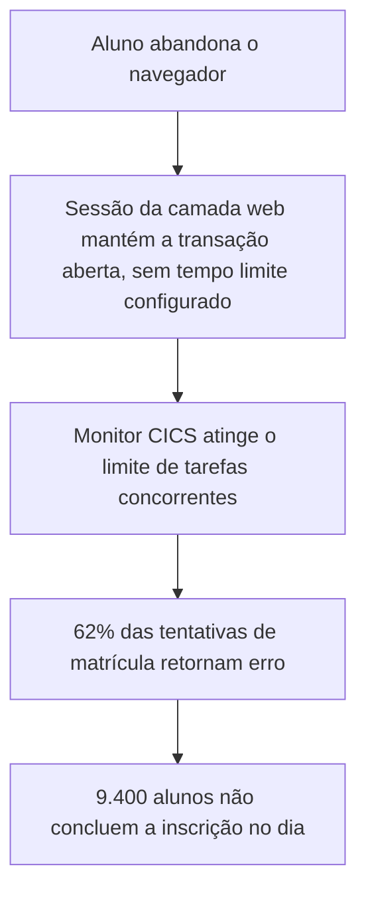

# Cenários de qualidade, linha de base e restrições

Quando a ACME diz que a matrícula não pode cair, o arquiteto precisa transformar a frase em algo que oriente decisão. Este bloco trata de como tornar um requisito de atributo de qualidade concreto o bastante para isso, de como julgar se um requisito deve pesar sobre a arquitetura e de quais insumos já existentes entram no processo antes de qualquer desenho, os artefatos de linha de base e as restrições. Cenário é a descrição de uma situação concreta, com quem a provoca, o que acontece e que resposta se espera do sistema. Artefato de linha de base é um documento ou medição que já existe e descreve o sistema atual, como o inventário de componentes, e restrição é uma decisão tomada por outra instância, como a escolha de apenas dois provedores de nuvem, que o arquiteto precisa respeitar.

## Antes de começar

- [Cenário de atributo de qualidade](../referencia/glossario.md#cenario-de-atributo-de-qualidade)
- [Requisito arquiteturalmente significativo](../referencia/glossario.md#requisito-arquiteturalmente-significativo)
- [Direcionador arquitetural](../referencia/glossario.md#direcionador-arquitetural)
- [Artefato de linha de base](../referencia/glossario.md#artefato-de-linha-de-base)
- [Arquitetura de linha de base](../referencia/glossario.md#arquitetura-de-linha-de-base)

## Conceito

Mesmo um [requisito de atributo de qualidade](bloco-2-qualidade-e-tipos-de-requisito.md#conceito) bem formulado pode levar equipes diferentes a entendimentos distintos. O cenário descreve a situação em que ele vale, o que acontece e como a resposta será medida. O Software Engineering Institute usa cenários para reduzir essa ambiguidade. O relatório CMU/SEI-2003-TR-016 descreve o Quality Attribute Workshop, QAW, como método conduzido com os interessados para descobrir atributos de qualidade importantes e esclarecer requisitos antes mesmo de existir uma arquitetura detalhada. No QAW, os interessados geram, consolidam, priorizam e refinam cenários que representam os requisitos de qualidade do sistema. Esse trabalho também revela suposições e conflitos que permaneceriam ocultos em expressões genéricas como rápido, seguro ou flexível.

Para eliminar essa dúvida, o **cenário de atributo de qualidade** organiza a expectativa em seis elementos, que a tabela abaixo apresenta com a pergunta que cada um responde.

| Elemento | Pergunta respondida |
| --- | --- |
| Fonte do estímulo | Quem ou o que provoca o evento |
| Estímulo | O que acontece |
| Ambiente | Sob quais condições |
| Artefato | Que parte do sistema é afetada |
| Resposta | O que o sistema deve fazer |
| Medida da resposta | Como se verificará o atendimento |

<figure markdown="span">
{ .module-diagram }
</figure>

*Figura 1 — Relação entre a estrutura do cenário de qualidade, a linha de base, as restrições e a decisão arquitetural. Fonte: material do curso.*

Um exemplo aplicado torna a estrutura concreta antes das três variações detalhadas a seguir.

{ .module-diagram }

*Figura 2 — Exemplo aplicado da estrutura de seis elementos a um requisito de desempenho de um serviço de catálogo. Fonte: material do curso.*

Os três exemplos seguintes usam serviços da Universidade ACME. Os valores servem para treinar a formulação de cenários e precisam de validação antes de entrar no projeto. O primeiro trata da consulta de notas. Compare sua estrutura com a progressão de contexto, carga e medida apresentada no [bloco 2](bloco-2-qualidade-e-tipos-de-requisito.md).

| Elemento | Especificação |
| --- | --- |
| Fonte | Alunos autenticados no aplicativo da Universidade ACME |
| Estímulo | Submissão de consulta de nota |
| Ambiente | Pico mensal de 2.000 requisições por segundo |
| Artefato | API de consulta de notas e suas dependências |
| Resposta | Validar a identidade, recuperar a nota e devolver a resposta |
| Medida | p95 até 500 ms, p99 até 1 s, erros abaixo de 0,1% |

Na medida, p95 e p99 são os tempos dentro dos quais terminam 95% e 99% das consultas. O segundo exemplo trata de modificabilidade: considere uma futura troca do gateway de pagamento usado na matrícula. A equipe quer incluir a integração nova sem alterar as existentes. Essa troca é uma situação de análise, sujeita à decisão de escopo.

| Elemento | Especificação |
| --- | --- |
| Fonte | Equipe de produto |
| Estímulo | Solicitação de inclusão de novo gateway de pagamento |
| Ambiente | Sistema em evolução normal |
| Artefato | Componente de roteamento de pagamentos |
| Resposta | Implementar e ativar a nova integração sem alterar as integrações existentes |
| Medida | Até dez dias úteis, alterações limitadas ao adaptador, configuração e testes contratuais |

O terceiro exemplo trata da proteção da conta de aluno na Universidade ACME. Ele descreve a resposta proposta a tentativas repetidas de adivinhar a senha. A equipe de segurança precisa validar os limites antes da adoção.

| Elemento | Especificação |
| --- | --- |
| Fonte | Agente que tenta acesso não autorizado a uma conta de aluno |
| Estímulo | Cinco tentativas de autenticação inválida para a mesma conta em dez minutos |
| Ambiente | Operação normal do aplicativo do aluno |
| Artefato | Serviço de identidade do aplicativo do aluno |
| Resposta | Bloquear novas tentativas, registrar o evento e notificar o aluno |
| Medida | Bloqueio por quinze minutos, registro em log de auditoria, notificação em até um minuto |

Um cenário bem escrito ainda não indica se o requisito é arquiteturalmente significativo, conceito definido a seguir. Depois de formulado, ele precisa ser priorizado e avaliado quanto ao impacto sobre a arquitetura.

Nem todo requisito produz o mesmo efeito sobre a solução. Incluir um campo opcional em uma tela já existente costuma ser mudança local, contida em poucos componentes. Já a exigência de que um sistema de pagamentos permaneça disponível mesmo após a perda completa de uma região de nuvem pode alterar implantação, replicação de dados, comunicação entre serviços, tratamento de falha, monitoramento e custo operacional. A arquitetura passa a importar quando uma necessidade produz efeito amplo, envolve risco elevado ou exige escolha difícil de reverter.

Para nomear esse efeito amplo, usa-se o conceito de **requisito arquiteturalmente significativo**, ASR, um requisito cuja satisfação exerce influência importante sobre a arquitetura, podendo determinar estrutura, responsabilidade, interface, tecnologia, mecanismo, padrão de interação ou forma de implantação. Arquiteturalmente significativo designa um juízo sobre o impacto que aquele requisito produz sobre a arquitetura. Um requisito tende a ser um ASR quando sua satisfação apresenta ao menos uma das oito condições abaixo.

- força escolhas estruturais importantes
- afeta vários componentes ou equipes
- exige mecanismos arquiteturais específicos
- produz riscos técnicos relevantes
- envolve compromissos entre atributos de qualidade
- restringe tecnologias ou estilos arquiteturais
- tem alto custo de alteração tardia
- demanda experimentação, prototipação ou análise antecipada

Um **direcionador arquitetural** é um fator prioritário que orienta a formação ou a avaliação da arquitetura. Dependendo do método e do autor, o termo pode incluir ASRs, objetivos de negócio, restrições e preocupações críticas. No processo QAW, o SEI inclui entre os direcionadores requisitos de alto nível, preocupações de negócio ou de missão, objetivos e atributos de qualidade, e cabe aos interessados e facilitadores estabelecer consenso sobre quais são decisivos para aquele sistema. Requisito arquiteturalmente significativo e direcionador arquitetural, portanto, também não são intercambiáveis. Um objetivo de negócio como entrar em cinco países em doze meses não é, por si, um requisito de sistema já formulado, mas funciona como direcionador de requisitos de configurabilidade, localização, conformidade e escalabilidade que ainda precisam ser decompostos.

Atributo de qualidade e ASR não são equivalentes. O atributo é uma propriedade, como desempenho. O requisito de qualidade declara o comportamento esperado e sua medida. ASR indica que uma exigência afeta decisões importantes de arquitetura. Na Universidade ACME, renovar matrícula pelo celular é uma necessidade funcional, mas pode exigir novo canal, interfaces com o núcleo, autenticação e tratamento de falhas. Por isso pode ser um ASR funcional. Já oferecer a modernização em novos campi seria um objetivo de negócio que ainda precisaria ser decomposto em requisitos de capacidade e operação.

Os dois conjuntos, requisito de atributo de qualidade e ASR, se cruzam sem coincidir: há requisitos de qualidade que são ASR e outros que não são, há ASR funcionais e ASR que são restrição, e há ainda requisito funcional comum sem nenhuma significância arquitetural relevante.

Quando um requisito novo chega à mesa, o arquiteto precisa de um roteiro prático para decidir se ele deve pesar sobre a arquitetura, e as sete perguntas abaixo cumprem esse papel.

1. Quais decisões mudariam? O requisito influencia decomposição, interfaces, comunicação, persistência, implantação ou tecnologias?
2. Qual é o alcance? Afeta um único componente ou atravessa vários elementos, serviços e equipes?
3. Qual é o risco? Há incerteza técnica, escala incomum, dependências frágeis ou consequências graves de falha?
4. Qual é o custo de adiamento? Uma decisão tardia provocaria reconstrução substancial?
5. Há compromisso entre qualidades? Melhorar segurança, consistência ou disponibilidade prejudica desempenho, usabilidade, custo ou modificabilidade?
6. É necessário validar hipóteses cedo? O requisito demanda protótipo, teste de carga, experimento ou prova de conceito?
7. Qual é a prioridade para os interessados? A exigência está ligada a objetivos de negócio ou de missão realmente prioritários?

Uma heurística resume o roteiro: se uma alteração relevante no requisito obrigaria a reconsiderar decisões fundamentais, caras ou transversais da solução, há boa evidência de significância arquitetural. Ela não substitui julgamento, porque significância depende de escala, riscos, arquitetura existente, competências disponíveis e custo de mudança, e pode variar entre sistemas e entre estágios do ciclo de vida do mesmo sistema.

Dois erros recorrentes aparecem neste ponto. O primeiro é tratar todo requisito não funcional como ASR. Nem todo requisito de qualidade altera a arquitetura, e alguns são satisfeitos por configuração local, implementação convencional ou capacidade já existente, como no exemplo da consulta administrativa, citado no parágrafo sobre a relação entre atributo de qualidade e ASR, nesta mesma seção Conceito. O segundo é tratar todo ASR como requisito não funcional. Funcionalidade, restrição regulatória, padrão corporativo e integração mandatória também podem condicionar a arquitetura, como mostra o exemplo do roteamento entre adquirentes de pagamento, apresentado no mesmo parágrafo sobre a relação entre atributo de qualidade e ASR, que é, no núcleo, um requisito funcional.

### Artefatos de linha de base

Antes de fazer um levantamento novo, a equipe procura os registros da situação atual. Eles são insumos da [fase de descoberta](../modulo-1-fundamentos/bloco-4-processo-de-definicao-da-arquitetura.md#as-oito-fases), segunda fase do processo apresentado na Aula 1, e recebem o nome de [artefatos de linha de base](../referencia/glossario.md#artefato-de-linha-de-base). Usá-los evita refazer levantamento e, mais importante, evita que a solução seja desenhada sobre uma leitura inventada do sistema existente.

Os artefatos de linha de base mais frequentes são a descrição da arquitetura atual, com componentes e integrações, o catálogo de aplicações, os modelos de processo de negócio, os modelos de dados, os contratos vigentes com fornecedores e os registros de incidente e de capacidade. Cada um deles tem data, dono e grau de confiabilidade, e parte do trabalho de descoberta é justamente estabelecer quanto de cada artefato ainda descreve a realidade.

Na ACME, universidade privada brasileira fictícia com sistema acadêmico em operação desde 2004, os artefatos de linha de base disponíveis incluem o inventário de componentes com idade e responsável, o registro dos três incidentes graves dos últimos 18 meses, a medição de 34 dias úteis entre pedido aprovado e entrega em produção, o custo anual de propriedade de R$ 15,83 milhões e os contratos de sustentação e de capacidade, com prazos em 30/09/2027 e 31/12/2028.

### Restrições ao desenho

Restrição é uma decisão tomada fora do processo de projeto que limita as alternativas do arquiteto. Ela difere do requisito em dois pontos. O requisito descreve o que a solução precisa entregar e admite discussão sobre a forma de atendê-lo, enquanto a restrição fecha alternativas antes da análise. Tratar restrição como requisito leva a comparar opções que a organização já descartou, e tratar requisito como restrição leva a aceitar como fechado o que ainda podia ser negociado. Se uma restrição impedir uma solução viável, o arquiteto registra o efeito e procura quem tem autoridade para revê-la. Ele não pode alterá-la sozinho.

As restrições chegam de origens distintas, e a origem determina quem pode revê-las: a restrição regulatória vem de fora e só muda com mudança normativa, a contratual vem de acordo assinado e muda por negociação com o fornecedor dentro dos prazos previstos, a de política interna vem de decisão de governança e muda com nova decisão do mesmo nível, e a técnica vem do parque instalado e muda com investimento.

Sete restrições chegam fechadas ao caso da ACME, entre elas a impossibilidade de parar o sistema em período letivo, imposta pela Pró-Reitoria de Graduação, a permanência do ambiente virtual de aprendizagem e do ERP financeiro, decidida pela Reitoria em 12/03/2026, o uso de apenas dois provedores de nuvem pré-aprovados pelo Conselho Universitário, e o processamento de dado pessoal de aluno em território nacional, conforme parecer jurídico de 28/04/2026. As sete aparecem no Item 5 do [exercício 7](#exercicio-7), com o registro de quem as estabeleceu.

## Uso pelo arquiteto

Diante da lista de requisitos da ACME, o arquiteto não tem tempo de analisar todos com a mesma profundidade e precisa decidir quais merecem esforço de design. Por isso ele reescreve cada requisito de qualidade como cenário de seis elementos, para que sejam comparáveis, e aplica as sete perguntas do roteiro para separar os que pesam sobre decisão estrutural, risco ou custo de mudança tardia dos que a implementação convencional já resolve. Os requisitos que passam no roteiro entram primeiro na análise, e quando algum deles pede protótipo ou teste de carga o arquiteto leva essa necessidade ao patrocinador, porque ela consome prazo e orçamento. Sem o filtro, o esforço se divide por igual entre requisitos de pesos muito diferentes, e a decisão cara é tomada sem a análise que mereceria.

Antes de propor qualquer solução, o arquiteto consulta os artefatos de linha de base, como o inventário de componentes, o registro dos três incidentes graves dos últimos 18 meses e os contratos de sustentação e de capacidade, com prazos em 30/09/2027 e 31/12/2028. Com eles descreve o sistema atual com dado verificável. Em seguida registra as sete restrições com o nome de quem as estabeleceu, porque a origem diz quem pode revê-las, como o Conselho Universitário para os dois provedores de nuvem e a Reitoria para o ambiente virtual de aprendizagem e o ERP financeiro. Assim ele não gasta comparação com alternativa já descartada e também não aceita como fechado o que ainda podia ser negociado. Sem esse registro, um fato atual do sistema pode ser tomado como obrigação futura do desenho.

## No caderno arquitetural

{{ficha:3}}

**Para que serve.** Escrever que a matrícula não pode cair não diz o que testar. O cenário de qualidade resolve isso contando uma situação em seis partes: quem provoca, o que provoca, em que ambiente, que parte do sistema é afetada, o que o sistema faz e como se mede o resultado. A seção 3 do caderno guarda os cenários da ACME, e o arquiteto registra ali também quais deles pesam sobre a estrutura da solução e de onde vêm as restrições que já chegam decididas, porque isso mostra onde concentrar o esforço de desenho.

**O que você faz neste exercício.** O enunciado traz dois cenários pela metade, um sobre o pico de 5.800 sessões na abertura da matrícula e outro sobre o incidente de 04/02/2026, em que o monitor CICS esgotou o limite de tarefas. Você completa a resposta e a medida de cada um, aplica a eles um roteiro de sete perguntas para dizer se pesam sobre a arquitetura e classifica as sete restrições do caso pela origem, como o parecer jurídico de 28/04/2026. O que você escreve entra no caderno como os cenários, a análise de significância e a tabela de restrições.

| Campo do caderno | Como preencher | Item |
| --- | --- | --- |
| Resposta do cenário do pico | Escreva o que o sistema faz quando chegam as 5.800 sessões simultâneas da abertura da matrícula | 1 |
| Medida do cenário do pico | Escreva o valor que permite verificar a resposta em teste de carga | 1 |
| Artefato do cenário do incidente | Diga qual parte do sistema sofre o efeito das transações abertas que se acumulam | 2 |
| Resposta do cenário do incidente | Escreva o que o sistema faz para o incidente não se repetir | 2 |
| Medida do cenário do incidente | Escreva o valor que permite verificar que o incidente não se repete | 2 |
| Respostas ao roteiro de significância | Marque sim ou não para cada uma das sete perguntas, em cada cenário, com uma justificativa curta | 3 |
| Conclusão sobre significância | Diga, em até três linhas por cenário, se ele é um requisito arquiteturalmente significativo | 3 |
| Origem da restrição | Classifique cada restrição em regulatória, contratual, de política interna ou técnica | 5 |
| Quem pode rever a restrição | Diga quem tem autoridade para mudar a restrição | 5 |

**O que você já tem.** A reescrita do R2 feita no exercício 6, que pode servir de ponto de partida para o cenário do pico, e as restrições RT1 a RT7 da seção 1, que o item 5 volta a examinar sob outro ângulo, o da origem.

**Quando está pronto.** Os dois cenários têm os seis elementos e uma medida que dá para verificar em teste, as sete perguntas têm sim ou não com justificativa, e as sete restrições têm origem e quem pode revê-las.

[Ver esta seção no template](../caderno/template.md#3-requisitos){ .caderno-botao }
[Ver o gabarito do exercício 7](../gabaritos/gabarito-exercicio-07.md){ .caderno-botao }

{{/ficha}}

{{ficha:4:2}}

**Para que serve.** Um cenário só convence se os números que ele cita forem verdadeiros. As 5.800 sessões do pico e os 260 minutos do incidente vêm de medições e registros que já existiam antes do projeto e que formam a linha de base, a descrição do sistema como ele é hoje. A seção 4 do caderno guarda essa descrição, e este exercício a começa pelos documentos de que os cenários dependem, porque, se um deles estiver desatualizado, o cenário também estará.

**O que você faz neste exercício.** O enunciado lista seis artefatos de linha de base, numerados de L1 a L6, como o inventário de componentes (L1) e a série de medição de sessões simultâneas do portal (L6). Você escolhe quatro que sustentam os dois cenários, diz que dado cada um fornece e o que aconteceria com o cenário se esse dado estivesse desatualizado. As lacunas, que comparam o sistema atual com o desenhado, ficam para a Aula 6.

| Campo do caderno | Como preencher | Item |
| --- | --- | --- |
| Artefato de linha de base | Escolha quatro dos seis artefatos que sustentam os dois cenários de qualidade | 4 |
| Dado que o artefato fornece | Diga qual informação do artefato aparece no cenário | 4 |
| Efeito de um dado desatualizado | Diga o que aconteceria com o cenário se esse dado estivesse desatualizado | 4 |

**O que você já tem.** Os dois cenários completos da ficha anterior, que mostram quais números precisam de apoio em um documento.

**Quando está pronto.** Quatro artefatos estão escolhidos, cada um com o dado que fornece e o efeito de esse dado estar desatualizado.

[Ver esta seção no template](../caderno/template.md#4-linha-de-base-e-lacunas){ .caderno-botao }
[Ver o gabarito do exercício 7](../gabaritos/gabarito-exercicio-07.md){ .caderno-botao }

{{/ficha}}

## Exercício 7

Antes de propor qualquer solução, o arquiteto da ACME precisa saber onde concentrar o esforço de desenho, e isso depende de escrever um cenário completo, julgar se ele pesa sobre a arquitetura e reconhecer o que já existe e o que já está decidido. O exercício aplica esses conceitos ao caso em cinco itens: nos dois primeiros, o aluno completa dois cenários de qualidade, um sobre o pico de matrícula e outro sobre o incidente de 04/02/2026, no terceiro julga se os dois pesam sobre a arquitetura, no quarto identifica os artefatos de linha de base que sustentam os cenários, e no quinto classifica as sete restrições do caso pela origem.

A ACME é uma universidade privada brasileira fictícia cujo sistema acadêmico está em modernização. Os dados de sazonalidade (variação do uso ao longo do ano) e de incidentes vêm dos [dados operacionais](../caso-acme/dados-operacionais.md) do caso e aparecem nos enunciados. O Item 1 pode partir, sem obrigatoriedade, da reescrita mensurável da declaração R2, "A matrícula não pode cair", produzida no [exercício 6](bloco-2-qualidade-e-tipos-de-requisito.md#exercicio-6) desta mesma aula.

### Item 1: Cenário do pico de matrícula

O portal da ACME registra 815 sessões simultâneas em média anual ponderada, com pico de 5.800 sessões na abertura da matrícula, uma razão de 7,1 entre pico e média (o pico equivale a 7,1 vezes a média), e taxa de erro de 6,3% das requisições nesse intervalo de pico, contra 0,2% em dia letivo comum. O quadro abaixo traz um [cenário de atributo de qualidade](../referencia/glossario.md#cenario-de-atributo-de-qualidade) para esse pico, com os quatro primeiros dos seis elementos preenchidos e os dois últimos, a resposta do sistema e a medida que permite verificá-la, em branco para o aluno completar.

| Elemento | Especificação |
| --- | --- |
| Fonte do estímulo | Alunos veteranos e ingressantes na abertura da matrícula |
| Estímulo | 5.800 sessões simultâneas solicitando inscrição em turmas |
| Ambiente | Abertura da matrícula, com razão de 7,1 entre pico e média |
| Artefato | Portal do aluno e serviço de matrícula |
| Resposta | A completar |
| Medida da resposta | A completar |

1. Complete a linha Resposta e a linha Medida da resposta do quadro, de modo que a medida possa ser verificada em teste de carga, que simula o número de sessões simultâneas e mede o resultado.

Suas respostas viram os campos Resposta do cenário do pico e Medida do cenário do pico, na seção 3 do caderno.

### Item 2: Cenário do incidente de 04/02/2026

O diagrama abaixo descreve a sequência do incidente ocorrido na abertura da matrícula de 04/02/2026, quando o limite de tarefas concorrentes do monitor CICS foi atingido. O CICS é o monitor que executa as transações do núcleo em COBOL, a camada do sistema acadêmico que concentra as regras acadêmicas, descrita na [linha de base](../caso-acme/linha-de-base.md) do caso. O incidente durou 4h20, e a janela de matrícula foi prorrogada em 2 dias úteis.

| Elemento | Especificação |
| --- | --- |
| Fonte do estímulo | Navegadores de alunos abandonados durante a sessão de matrícula |
| Estímulo | Acúmulo de transações abertas no núcleo sem encerramento da sessão web |
| Ambiente | Abertura da matrícula, no pico de 5.800 sessões simultâneas |
| Artefato | A completar |
| Resposta | A completar |
| Medida da resposta | A completar |

1. Complete as linhas Artefato, Resposta e Medida da resposta do quadro, de modo que se possa verificar que o incidente não se repete. O artefato é a parte do sistema que sofre o efeito do estímulo.

Suas respostas viram os campos Artefato, Resposta e Medida do cenário do incidente, na seção 3 do caderno.

### Item 3: Significância arquitetural dos dois cenários

Depois de escritos os dois cenários, resta saber quais deles merecem análise de arquitetura, e a resposta depende de o requisito ser [arquiteturalmente significativo](../referencia/glossario.md#requisito-arquiteturalmente-significativo), isto é, de atendê-lo exigir decisões que mudam a estrutura da solução. O quadro abaixo reproduz o roteiro de sete perguntas apresentado na seção [Conceito](#conceito) para esse julgamento, com uma coluna para cada um dos dois cenários dos itens 1 e 2.

| Pergunta do roteiro | Cenário do pico | Cenário do incidente |
| --- | --- | --- |
| Quais decisões mudariam, entre decomposição, interfaces, comunicação, persistência, implantação ou tecnologias? | | |
| O alcance atravessa vários elementos, serviços e equipes? | | |
| Há incerteza técnica, escala incomum, dependência frágil ou consequência grave de falha? | | |
| Uma decisão tardia provocaria reconstrução substancial? | | |
| Melhorar uma qualidade prejudica outra, como desempenho, custo ou modificabilidade? | | |
| O requisito demanda protótipo, teste de carga, experimento ou prova de conceito? | | |
| A exigência está ligada a objetivo de negócio prioritário para os interessados? | | |

1. Marque sim ou não para cada pergunta, em cada cenário, com uma justificativa curta por célula.
2. Defenda, em até três linhas por cenário, se cada um constitui um requisito arquiteturalmente significativo.

Suas respostas viram os campos Respostas ao roteiro de significância e Conclusão sobre significância, na seção 3 do caderno.

### Item 4: Artefatos de linha de base que sustentam os cenários

Os números dos dois cenários vêm de documentos e medições que já existiam, e por isso os cenários só são confiáveis se os [artefatos de linha de base](../referencia/glossario.md#artefato-de-linha-de-base), documentos ou medições já existentes que descrevem o sistema atual, estiverem corretos. O quadro abaixo lista seis artefatos disponíveis no caso da ACME, numerados de L1 a L6, entre eles o inventário de componentes, L1, e a série de medição de sessões simultâneas do portal, L6. A seção [Artefatos de linha de base](#artefatos-de-linha-de-base) deste bloco descreve o conceito.

| Código | Artefato de linha de base |
| --- | --- |
| L1 | Inventário de componentes do sistema acadêmico, com idade e responsável |
| L2 | Registro dos três incidentes graves dos últimos 18 meses |
| L3 | Medição de 34 dias úteis entre pedido aprovado e entrega em produção |
| L4 | Custo anual de propriedade de R$ 15,83 milhões |
| L5 | Contratos de sustentação e de capacidade, com prazos em 30/09/2027 e 31/12/2028 |
| L6 | Série de medição de sessões simultâneas e de taxa de erro do portal, com média anual e pico |

1. Escolha quatro artefatos do quadro que sustentam os dois cenários e indique, para cada um, o dado específico que ele fornece.
2. Indique, para cada um dos quatro artefatos escolhidos, o que aconteceria com o cenário se esse dado estivesse desatualizado.

Suas respostas viram os campos Artefato de linha de base, Dado que o artefato fornece e Efeito de um dado desatualizado, na seção 4 do caderno.

### Item 5: Origem das restrições fechadas

Uma restrição é uma decisão tomada fora do projeto, e saber de onde ela vem mostra quem poderia revê-la. O quadro abaixo reproduz as sete restrições que chegam fechadas ao caso da ACME, com o registro de quem as estabeleceu. Duas delas são o uso de apenas dois provedores de nuvem, decidido pelo Conselho Universitário, e a manutenção do núcleo COBOL sob contrato até 30/09/2027.

| Restrição | Registro no caso |
| --- | --- |
| O sistema acadêmico não pode parar em período letivo | Pró-Reitoria de Graduação |
| O ambiente virtual de aprendizagem e o ERP financeiro permanecem | Reitoria, 12/03/2026 |
| Uso de apenas dois provedores de nuvem pré-aprovados | Conselho Universitário, 12/03/2026 |
| Identidade e autorização por padrões abertos | Comitê de Segurança da Informação |
| Dado pessoal de aluno processado em território nacional | Jurídico, parecer de 28/04/2026 |
| Manutenção do núcleo COBOL sob contrato até 30/09/2027 | Contrato de sustentação |
| Orçamento de R$ 6,2 milhões para o primeiro ciclo de 12 meses | Reitoria |

1. Classifique cada uma das sete restrições pela origem, entre regulatória, contratual, de política interna e técnica, e indique quem teria autoridade para revê-la. Registre os dois resultados ao lado de cada restrição.

Suas respostas viram os campos Origem da restrição e Quem pode rever a restrição, na seção 3 do caderno.

## Fontes

As referências seguem o formato APA, 7ª edição, e constam da [bibliografia](../referencia/bibliografia.md) do curso. O trecho consultado aparece entre parênteses ao fim de cada entrada.

- Barbacci, M., Ellison, R., Lattanze, A., Stafford, J., Weinstock, C., & Wood, W. (2003). *Quality attribute workshops (QAWs), third edition* (CMU/SEI-2003-TR-016). Software Engineering Institute, Carnegie Mellon University. (formato de cenário de atributo de qualidade)
- International Organization for Standardization. (2023). *Systems and software engineering — Systems and software quality requirements and evaluation (SQuaRE) — Product quality model* (ISO/IEC 25010:2023). (modelo de qualidade de produto)
- International Organization for Standardization/International Electrotechnical Commission/Institute of Electrical and Electronics Engineers. (2022). *Systems and software engineering — Architecture description* (ISO/IEC/IEEE 42010:2022). (descrição de arquitetura)
- Lovatt, M. (2021). *Solution architecture foundations*. BCS, The Chartered Institute for IT. (seções 4.7 e 4.8, artefatos de linha de base e restrições)

**Material do curso.** Glossário, entradas [cenário de atributo de qualidade](../referencia/glossario.md#cenario-de-atributo-de-qualidade), [requisito arquiteturalmente significativo](../referencia/glossario.md#requisito-arquiteturalmente-significativo), [direcionador arquitetural](../referencia/glossario.md#direcionador-arquitetural), [artefato de linha de base](../referencia/glossario.md#artefato-de-linha-de-base) e [arquitetura de linha de base](../referencia/glossario.md#arquitetura-de-linha-de-base). Dossiê da instituição fictícia [ACME](../caso-acme/index.md), dados de sazonalidade e incidentes, restrições fechadas e [arquitetura de linha de base](../caso-acme/linha-de-base.md).
