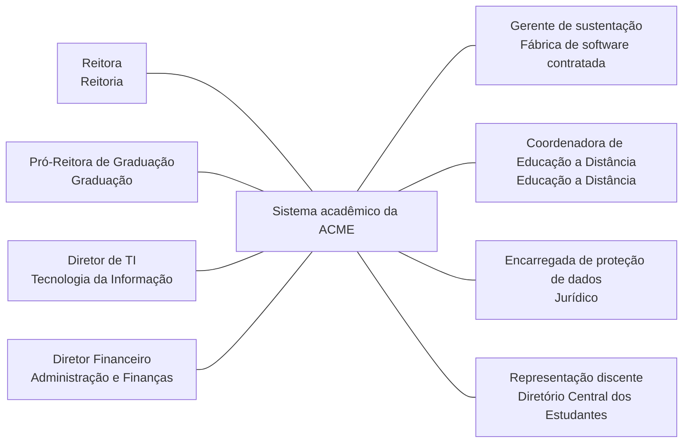

# Partes interessadas, pontos de vista e escopo

Quando a ACME decidiu modernizar o sistema acadêmico, a Reitora, o Diretor Financeiro e a empresa que mantém o sistema passaram a ter interesses diferentes sobre o que mudar. Este bloco trata de quem decide sobre a solução, de como essas pessoas são identificadas e avaliadas, de como suas preocupações são tratadas por pontos de vista e visões e de como o escopo da mudança é declarado. Parte interessada é qualquer pessoa, equipe ou organização com interesse na solução, como a Reitora ou a empresa que mantém o sistema, e escopo é a delimitação do que a mudança altera e do que continua como está.

## Antes de começar

- [Parte interessada](../referencia/glossario.md#parte-interessada)
- [Ponto de vista](../referencia/glossario.md#ponto-de-vista)
- [Visão](../referencia/glossario.md#visao)
- [Bloco de construção da solução](../referencia/glossario.md#bloco-de-construcao-da-solucao)

## Conceito

Uma solução precisa responder às necessidades e aos limites das partes interessadas. Elas trazem conhecimento, usam ou sustentam a solução, sofrem seus efeitos ou possuem autoridade sobre decisões específicas. Nem toda parte interessada aprova decisões: a autoridade de cada pessoa ou grupo deve estar declarada. A norma ISO/IEC/IEEE 42010 define parte interessada como o indivíduo, a equipe, a organização ou a classe desses que tem interesse em um sistema, definição já adotada no [bloco 3 da Aula 1](../modulo-1-fundamentos/bloco-3-papel-do-arquiteto-de-solucao.md#conceito).

<figure markdown="span">
{ .module-diagram }
</figure>

Para saber quem incluir, o arquiteto usa uma lista de quatro perguntas: é parte interessada quem precisa de informação sobre a solução, quem fornece conhecimento essencial do negócio ou do domínio, quem tem autoridade sobre orçamento, recursos ou outras decisões organizacionais, e quem participa do desenho, da implementação ou da implantação.

A comunicação com essas pessoas tem quatro motivos distintos, e confundi-los gera atrito: a **informação** mantém todos cientes do andamento, em fluxo predominantemente de mão única, a **consulta** captura conhecimento de negócio, é de mão dupla e exige registro para rastrear insumo e decisão, a **prestação de contas** registra a aprovação de decisões arquiteturais por pessoas determinadas, e a **responsabilidade** aloca e acompanha tarefas atribuídas a partes interessadas.

### Categorias de parte interessada

| Categoria | Quem é | Preocupação típica |
| --- | --- | --- |
| Donos do negócio e gestores seniores | Quem responde em última instância pelo resultado da organização | Metas estratégicas, posição financeira e resiliência a mudança externa |
| Patrocinador de negócio | Responsável único pela solução, que decide a passagem de cada fase | Sucesso da solução dentro do prazo e do orçamento aprovados |
| Usuários finais e atores de negócio | Quem opera o processo alterado pela solução | Viabilidade da rotina nova e continuidade do trabalho |
| Clientes e usuários dos serviços | Quem recebe o serviço afetado | Qualidade percebida do serviço |
| Arquitetura corporativa e subdomínios | Quem responde pelos domínios de negócio, dados, aplicações, infraestrutura e segurança | Aderência às diretrizes e reuso do que já existe |
| Participantes do desenho | Quem desenha partes da solução | Consistência entre as partes desenhadas |
| Participantes da implantação | Quem constrói, implanta e sustenta | Exequibilidade do desenho e condições de sustentação |
| Fornecedores de produto e serviço | Quem provê tecnologia ou serviço contratado | Escopo contratual e continuidade da receita |
| Reguladores e entidades setoriais | Quem impõe exigência externa | Conformidade demonstrável |

A responsabilidade pela seleção correta é dos donos do negócio e dos gestores seniores, a quem cabe também atribuir papéis como o de patrocinador a pessoas com autoridade e capacidade para exercê-los. A identificação pode ocorrer em qualquer fase, e a atividade principal está na descoberta. A troca de representante ao longo do percurso é comum e indesejável, porque interrompe a relação construída entre a equipe de arquitetura e o negócio.

### Preocupações, pontos de vista e visões

Registre o que cada pessoa precisa saber ou teme que aconteça. Essa preocupação entra no registro de preocupações, fica ligada a uma ou mais partes interessadas e orienta as decisões de desenho que precisam respondê-la. A equipe de arquitetura mantém o registro, e o patrocinador responde por assegurar que as preocupações sejam levantadas e tratadas.

A técnica que organiza esse tratamento tem dois termos que não são sinônimos, apresentados na fase de validação do [bloco 4 da Aula 1](../modulo-1-fundamentos/bloco-4-processo-de-definicao-da-arquitetura.md#as-oito-fases) e detalhados a seguir. O **ponto de vista** define como preparar uma representação para responder a certas preocupações: o que selecionar da descrição de arquitetura, como organizar a informação e como apresentá-la para aquela audiência. A **visão** é o resultado concreto de aplicar um ponto de vista à descrição de arquitetura.

A consequência prática aparece na validação do desenho. Aplicar o mesmo ponto de vista à [arquitetura de linha de base](../referencia/glossario.md#arquitetura-de-linha-de-base) e à [arquitetura alvo](../referencia/glossario.md#arquitetura-alvo) produz duas visões comparáveis, e a comparação mostra o efeito da mudança sob a perspectiva daquela parte interessada, sem obrigá-la a ler o modelo inteiro.

### Pontos de vista na prática

Antes de escolher uma representação, o arquiteto identifica quem vai lê-la, qual preocupação ela precisa responder e qual decisão aquela pessoa pode apoiar. Interesse na solução não significa autoridade para aprová-la.

| Leitor | Preocupação | Representação | Decisão apoiada |
| --- | --- | --- | --- |
| Patrocinador | Escopo, valor e dependências | Contexto C1 | Priorizar e aprovar o recorte da mudança |
| Equipe de segurança | Dados, exposições e controles | Contêineres C2 | Definir ou revisar controles necessários |
| Gestor | Cobertura das preocupações | Matriz de rastreabilidade | Acompanhar lacunas, evidências e responsáveis |

As três visões a seguir descrevem a mesma solução da ACME para audiências diferentes, e por isso não são intercambiáveis: cada uma seleciona os elementos, as relações e as informações adequados a uma preocupação, e o detalhe indispensável para uma equipe pode ser ruído para outra.

#### Visão de contexto C1 para o patrocinador

O patrocinador precisa decidir sobre escopo, valor e dependências organizacionais. Por isso, o ponto de vista seleciona os usuários, o Sistema Acadêmico como uma única caixa e os sistemas externos com que ele se relaciona. O nível C1 do [modelo C4](../referencia/glossario.md#modelo-c4), notação que descreve um sistema em quatro níveis de detalhe, responde quem usa a solução, qual é sua fronteira e de que outros sistemas ela depende. Portais, banco de dados e tecnologias internas ficam de fora porque não ajudam essa audiência a tomar a decisão em pauta. A legenda temporal identifica a visão como representação da linha de base atual da ACME em 2026, e não como arquitetura alvo.

<figure markdown="span">
{ .module-diagram }
<figcaption>Visão C1 para o patrocinador, linha de base atual da ACME em 2026: fronteira, usuários e dependências externas, sem detalhe interno.</figcaption>
</figure>

#### Visão de segurança C2 para a equipe de segurança

A equipe de segurança precisa localizar superfícies expostas, dados pessoais, integrações frágeis e pontos onde os controles devem operar. O nível C2 do modelo C4 decompõe o Sistema Acadêmico em contêineres e preserva sua fronteira de responsabilidade. Um contêiner, nesse modelo, é uma parte do sistema que executa por conta própria e guarda ou processa dados, como um portal web, o núcleo COBOL ou o banco de dados. As relações em laranja destacam exposições da linha de base, enquanto as relações verdes mostram controles requeridos. A tecnologia dos portais é identificada como Java legado com JSF 1.2 e EJB 2.0, isto é, tecnologias Java dos anos 2007 a 2009 para montar as telas web e os componentes de servidor, cujo servidor de aplicação saiu de suporte do fornecedor em 2018, o que a visão registra para documentar a situação atual, não para recomendá-la. A trilha de auditoria aparece como controle exigido pelo requisito R9 da lista do caso, que determina o registro de toda leitura de dado pessoal de aluno, e não como componente já existente.

<figure markdown="span">
{ .module-diagram }
<figcaption>Visão C2 de segurança, linha de base atual da ACME em 2026: contêineres, fronteiras de confiança, riscos existentes e controles requeridos.</figcaption>
</figure>

A legenda da figura cita fronteiras de confiança, que são as linhas que separam partes do sistema com níveis diferentes de confiança, como a fronteira entre o navegador do aluno e o portal. Tudo o que atravessa uma dessas linhas precisa ser verificado e protegido, e por isso a equipe de segurança olha primeiro para elas. O [glossário](../referencia/glossario.md#fronteira-de-confianca) traz a definição completa.

#### Visão de rastreabilidade para o gestor

O gestor precisa saber se cada preocupação chegou a uma decisão acompanhável. Para essa audiência, uma planilha é mais útil do que um diagrama estrutural. O ponto de vista seleciona a origem da necessidade, o requisito que a formaliza, o elemento arquitetural afetado, a evidência esperada e a situação da decisão. A planilha permite localizar lacunas, como um requisito sem elemento responsável ou uma decisão sem forma de verificação.

<figure markdown="span">
{ .module-diagram }
<figcaption>Visão de rastreabilidade: da preocupação da parte interessada até a evidência que permite acompanhar a decisão.</figcaption>
</figure>

O contraste mostra que o ponto de vista seleciona conteúdo diferente para cada audiência, além de mudar o nível de detalhe. O patrocinador recebe um mapa de contexto, a equipe de segurança recebe uma decomposição orientada a controles, e o gestor recebe uma matriz de cobertura. As três visões podem derivar da mesma descrição de arquitetura sem apresentar a mesma informação.

### Definição do escopo

O escopo da solução registra o que a mudança altera e o que permanece. Para isso, considera pessoas, estruturas organizacionais, processos, informação e tecnologia, além dos blocos de construção. Um bloco de construção de arquitetura é genérico e reutilizável. O bloco de construção da solução realiza esse bloco no projeto concreto. A declaração é documentada e aprovada formalmente, porque delimita o que será mudado e, por exclusão, o que permanece. Cada exclusão deve apontar sua origem e quem a aprovou.

Na ACME, universidade privada brasileira fictícia com 38.400 alunos ativos e sistema acadêmico em operação desde 2004, a declaração de escopo precisa registrar que o ambiente virtual de aprendizagem e o ERP financeiro permanecem, por decisão da Reitoria de 12/03/2026, e que o trabalho sobre eles é de integração e de governança.

## Uso pelo arquiteto

Antes de fechar o desenho, o arquiteto aplica as quatro perguntas à lista de pessoas da ACME para localizar quem falta. Quem tem autoridade sobre orçamento, como o Diretor Financeiro, e quem responde por exigência regulatória costumam ser lembrados. O Gerente de sustentação da fábrica, que mantém o sistema depois da implantação, costuma aparecer tarde, e por isso o arquiteto o inclui cedo, já que a operação pode recusar um desenho que não consegue sustentar.

Ao apresentar o desenho, o arquiteto escolhe o ponto de vista conforme a decisão que cada audiência precisa tomar. Ao patrocinador leva a visão de contexto C1, com o Sistema Acadêmico em uma só caixa, para decidir escopo e dependências. À equipe de segurança leva a visão C2, que mostra contêineres e fronteiras de confiança onde os controles devem operar. Ao gestor entrega a planilha de rastreabilidade, para conferir se cada preocupação chegou a uma decisão acompanhável. As três visões saem da mesma descrição de arquitetura, e por isso o arquiteto mantém um só modelo. Se mostrasse o mesmo desenho ao Diretor Financeiro e ao Gerente de sustentação, teria duas conversas improdutivas, porque cada um precisa de um recorte diferente.

Ao declarar o escopo, o arquiteto registra o que permanece, como o ambiente virtual de aprendizagem e o ERP financeiro por decisão da Reitoria de 12/03/2026, e informa à equipe que sobre eles o trabalho é de integração e de governança. A declaração aprovada formalmente delimita o que será mudado, e o que ficou fora dela não entra no orçamento da solução.

## No caderno arquitetural

{{ficha:2}}

**Para que serve.** Um projeto de modernização mexe com pessoas que não querem a mesma coisa. A Reitora quer resultado em 12 meses, o Diretor Financeiro teme pagar o legado e a nuvem no mesmo ano, e o Gerente de sustentação da fábrica teme perder o contrato. A seção 2 do caderno registra quem são essas pessoas, que recorte da arquitetura cada uma precisa ver e o que a mudança do primeiro ciclo toca ou deixa como está, para que os conflitos apareçam antes do desenho.

**O que você faz neste exercício.** O enunciado traz o mapa de atores da ACME, com oito papéis, e dez elementos do sistema numerados de E1 a E10, como o ambiente virtual de aprendizagem (E2) e os programas COBOL do núcleo (E4). Você enquadra cada papel numa das nove categorias de parte interessada, aponta as categorias sem representante, escreve o ponto de vista de três papéis e marca em cada elemento se ele muda ou permanece no primeiro ciclo, com a origem de cada exclusão. As respostas viram a classificação das partes interessadas, os pontos de vista e a declaração de escopo do caderno.

| Campo do caderno | Como preencher | Item |
| --- | --- | --- |
| Categoria | Diga a que categoria de parte interessada cada um dos oito papéis pertence e qual deles exerce o patrocínio do negócio | 1 |
| Papel que representa a categoria | Para cada uma das nove categorias, escreva o papel do mapa de atores que fala por ela, ou deixe a categoria sem representante | 2 |
| Risco da ausência | Nas categorias sem representante, explique o que pode dar errado quando ninguém fala por elas | 2 |
| Preocupação principal | Escreva a principal preocupação do papel, partindo do que ele teme | 3 |
| Critério de seleção | Diga o que entra no recorte da arquitetura que o papel recebe | 3 |
| Estrutura do artefato | Diga em que formato o documento chega ao papel, como tabela, fluxo ou lista | 3 |
| Forma de apresentação | Diga como a informação é mostrada ao papel, por exemplo lado a lado com outro dado ou com marcações | 3 |
| Muda ou permanece | Diga se cada elemento muda ou fica como está nos 12 meses do primeiro ciclo | 4 |
| Origem da exclusão | Nos elementos que permanecem, diga qual restrição, contrato ou decisão de governança os manteve fora da mudança | 4 |

**O que você já tem.** As restrições RT1 a RT7 e a decisão D5 da seção 1, que servem de origem para as exclusões do escopo, e o catálogo de requisitos da seção 3, que mostra quem declarou cada exigência.

**Quando está pronto.** Os oito papéis têm categoria, as categorias sem representante têm o risco explicado, três papéis têm ponto de vista completo e os dez elementos têm decisão e origem.

[Ver esta seção no template](../caderno/template.md#2-partes-interessadas){ .caderno-botao }
[Ver o gabarito do exercício 8](../gabaritos/gabarito-exercicio-08.md){ .caderno-botao }

{{/ficha}}

## Exercício 8

Nas conversas com as partes interessadas, o arquiteto da ACME registrou oito papéis, como a Reitora e o Gerente de sustentação da fábrica de software, que formam o mapa de atores do dossiê e aparecem no Item 1. Quem decide sobre a solução, o que cada pessoa teme e o que fica dentro da mudança são perguntas que o arquiteto responde antes de desenhar, e o exercício as pratica em quatro itens: o Item 1 classifica os papéis, o Item 2 procura categorias de parte interessada sem representante, o Item 3 define pontos de vista para três papéis e o Item 4 declara o escopo do primeiro ciclo.

A ACME é uma universidade privada brasileira fictícia, com 38.400 alunos ativos, 2.150 professores, 1.480 técnico-administrativos e 4 campi, cujo sistema acadêmico está em operação desde 2004 e é mantido por uma fábrica de software contratada, sob contrato de sustentação vigente até 30/09/2027. A declaração de escopo marcada no Item 4 é o ponto de partida do [exercício 13](../modulo-4-dominios-da-solucao/bloco-1-arquitetura-de-negocio.md#exercicio-13) da Aula 4.

### Item 1: Categoria de cada papel

Cada papel do mapa de atores traz um tipo de interesse, e o tipo define como o arquiteto se comunica com ele. O diagrama abaixo mostra os oito papéis do mapa de atores do caso, com a área a que cada um pertence, e o quadro seguinte reproduz o que cada papel quer e o que teme.

| Papel | O que quer | O que teme |
| --- | --- | --- |
| Reitora | Resultado visível em 12 meses e aplicativo móvel do aluno em operação antes do vestibular de 2027 | Investimento de R$ 6,2 milhões sem efeito perceptível e queda de nota na avaliação regulatória |
| Pró-Reitora de Graduação | Matrícula sem falha e notas publicadas dentro do calendário | Repetição de incidente na janela de matrícula e nova prorrogação |
| Diretor de TI | Reduzir a dependência de especialistas em COBOL e o custo anual de manutenção | Perder os profissionais de COBOL e ficar sem quem sustente o núcleo |
| Diretor Financeiro | Preservar os contratos vigentes até o fim do prazo, já provisionados no plano plurianual | Desembolso duplicado, com legado e nuvem cobrados no mesmo exercício |
| Gerente de sustentação da fábrica | Manter o escopo e a previsibilidade do contrato até 30/09/2027 | Perder receita e escopo com a internalização do conhecimento do núcleo |
| Coordenadora de Educação a Distância | Notas e turmas propagadas ao ambiente virtual de aprendizagem em minutos | Continuar dependente do lote diário, com reclamação de aluno a cada fechamento |
| Encarregada de proteção de dados | Conformidade com a LGPD, base legal declarada e trilha de auditoria sobre dado pessoal | Transferência de dado de aluno para fora do território nacional sem amparo |
| Representação discente | Aplicativo móvel e matrícula que não falhe na abertura | Perda de vaga em disciplina por indisponibilidade do portal |

1. Classifique cada um dos oito papéis em uma das nove categorias de parte interessada apresentadas na seção [Categorias de parte interessada](#categorias-de-parte-interessada) deste bloco, e registre a categoria ao lado do papel.
2. Indique qual dos oito papéis exerce o papel de patrocinador de negócio, com justificativa.

Suas respostas viram o campo Categoria, na seção 2 do caderno.

### Item 2: Categorias sem representante

Quando nenhum dos oito papéis fala por uma categoria de parte interessada, o arquiteto corre o risco de ignorar uma preocupação importante. O quadro abaixo lista as nove categorias de parte interessada da seção [Categorias de parte interessada](#categorias-de-parte-interessada), com uma coluna em branco para o papel do mapa de atores que representa cada uma.

| Categoria | Papel do mapa de atores que a representa |
| --- | --- |
| Donos do negócio e gestores seniores | |
| Patrocinador de negócio | |
| Usuários finais e atores de negócio | |
| Clientes e usuários dos serviços | |
| Arquitetura corporativa e subdomínios | |
| Participantes do desenho | |
| Participantes da implantação | |
| Fornecedores de produto e serviço | |
| Reguladores e entidades setoriais | |

1. Preencha a coluna com os papéis classificados no Item 1 e identifique duas categorias que ficaram sem representante.
2. Explique, em até três linhas por categoria, que risco a ausência de cada uma introduz no processo.

Suas respostas viram os campos Papel que representa a categoria e Risco da ausência, na seção 2 do caderno.

### Item 3: Ponto de vista para três papéis

A Reitora e o Gerente de sustentação não leem o mesmo documento, porque cada parte interessada precisa de um recorte diferente da descrição da arquitetura, e o ponto de vista é a regra que define esse recorte. Um [ponto de vista](../referencia/glossario.md#ponto-de-vista) declara o critério de seleção, isto é, o que entra no recorte, a estrutura do artefato, isto é, o formato do documento, e a forma de apresentação, isto é, como a informação é mostrada. A [visão](../referencia/glossario.md#visao) é o resultado de aplicá-lo à descrição de arquitetura. O quadro abaixo traz, na primeira linha, o exemplo do gestor descrito na seção [Pontos de vista na prática](#pontos-de-vista-na-pratica), e deixa três linhas em branco para o aluno preencher.

| Papel | Preocupação principal | Critério de seleção | Estrutura do artefato | Forma de apresentação |
| --- | --- | --- | --- | --- |
| Gestor (exemplo) | Saber se cada preocupação chegou a uma decisão acompanhável | Origem da necessidade, requisito, elemento afetado, evidência esperada e situação da decisão | Planilha de rastreabilidade | Uma linha por preocupação, com filtro por situação |
| | | | | |
| | | | | |
| | | | | |

1. Escolha três papéis do mapa de atores do Item 1 e preencha uma linha do quadro para cada um, seguindo o exemplo do gestor. Use como ponto de partida a coluna O que teme do quadro do Item 1 para escrever a preocupação principal.

Suas respostas viram os campos Preocupação principal, Critério de seleção, Estrutura do artefato e Forma de apresentação, na seção 2 do caderno.

### Item 4: Declaração de escopo do primeiro ciclo

A declaração de escopo diz o que a mudança altera e o que fica de fora, e cada exclusão precisa de uma origem para que ninguém a reabra sem saber quem a decidiu. O quadro abaixo lista dez elementos do sistema acadêmico e do seu entorno, numerados de E1 a E10, com duas colunas em branco. Dois deles são o ambiente virtual de aprendizagem, E2, a plataforma de ensino a distância da ACME, e os programas COBOL do núcleo, E4. O E10, responsabilidade pela correção de dado cadastral de aluno, refere-se a quem corrige o dado de cadastro, como nome ou situação do aluno, quando ele está errado. Hoje a correção é feita pela equipe de sustentação, que pertence à fábrica de software contratada, e a decisão registrada na [Aula 1](../modulo-1-fundamentos/bloco-1-arquitetura-de-solucoes-e-de-software.md#exercicio-1) é que a Secretaria Acadêmica passe a responder por ela. O item pergunta se essa responsabilidade muda ou permanece no primeiro ciclo.

| Código | Elemento | Muda ou permanece | Origem da exclusão |
| --- | --- | --- | --- |
| E1 | Integração de notas e turmas com o ambiente virtual de aprendizagem | | |
| E2 | Ambiente virtual de aprendizagem | | |
| E3 | ERP financeiro | | |
| E4 | Programas COBOL do núcleo acadêmico | | |
| E5 | Portal do aluno, na renovação de matrícula pelo telefone celular | | |
| E6 | Autenticação de alunos e professores por padrões abertos | | |
| E7 | Trilha de auditoria de leitura de dado pessoal de aluno | | |
| E8 | Contrato de capacidade do mainframe | | |
| E9 | Região de implantação dos componentes em nuvem | | |
| E10 | Responsabilidade pela correção de dado cadastral de aluno | | |

1. Marque cada um dos dez elementos como muda ou permanece no primeiro ciclo de 12 meses, na coluna Muda ou permanece.
2. Indique, para cada elemento que permanece, a origem da exclusão na coluna Origem da exclusão, escolhendo entre as restrições fechadas do caso (as sete listadas no Item 5 do [exercício 7](bloco-3-cenarios-linha-de-base-e-restricoes.md#exercicio-7)), os contratos vigentes e as decisões de governança registradas no dossiê. O quadro preenchido constitui a declaração de escopo do primeiro ciclo.

Suas respostas viram os campos Muda ou permanece e Origem da exclusão, na seção 2 do caderno.

## Fontes

As referências seguem o formato APA, 7ª edição, e constam da [bibliografia](../referencia/bibliografia.md) do curso. O trecho consultado aparece entre parênteses ao fim de cada entrada.

- Lovatt, M. (2021). *Solution architecture foundations*. BCS, The Chartered Institute for IT. (seções 6.1, 6.2, 6.3 e 6.5)
- International Organization for Standardization/International Electrotechnical Commission/Institute of Electrical and Electronics Engineers. (2022). *Systems and software engineering — Architecture description* (ISO/IEC/IEEE 42010:2022). (definições de parte interessada, ponto de vista e visão)
- Clements, P., Bachmann, F., Bass, L., Garlan, D., Ivers, J., Little, R., Merson, P., Nord, R., & Stafford, J. (2010). *Documenting software architectures: Views and beyond* (2nd ed.). Addison-Wesley. (visões e pontos de vista na documentação de arquitetura)

**Material do curso.** Glossário, entradas [parte interessada](../referencia/glossario.md#parte-interessada), [ponto de vista](../referencia/glossario.md#ponto-de-vista), [visão](../referencia/glossario.md#visao) e [bloco de construção da solução](../referencia/glossario.md#bloco-de-construcao-da-solucao). Dossiê da instituição fictícia [ACME](../caso-acme/index.md), mapa de atores, interesses em conflito e restrições fechadas.
