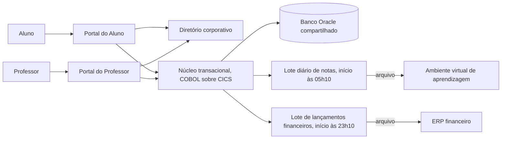

# Princípios de design e passagem ao desenho lógico

Este bloco inicia a cadeia de decisão da aula e responde a duas perguntas que antecedem qualquer escolha de estilo ou de tecnologia. A primeira é quais regras devem orientar o desenho da solução. A segunda é como essas regras produzem um primeiro desenho lógico, isto é, um desenho em elementos com responsabilidades, sem produto nem tecnologia definidos. Um elemento lógico é uma parte do sistema descrita pelo que ela faz, como "atendimento ao requerente" ou "emissão de documento", e não pelo programa ou pelo banco de dados que a realizará.

## Antes de começar

- [Princípio de design](../referencia/glossario.md#principio-de-design)
- [Desenho conceitual](../referencia/glossario.md#desenho-conceitual)
- [Desenho lógico](../referencia/glossario.md#desenho-logico)
- [Requisito de atributo de qualidade](../referencia/glossario.md#requisito-de-atributo-de-qualidade)
- [Restrição](../referencia/glossario.md#restricao)

## Princípios de design

A Aula 2 terminou com as exigências sobre a solução já formuladas, que são os [direcionadores de mudança](../modulo-2-requisitos-e-partes-interessadas/bloco-1-direcionadores-de-mudanca.md) (os fatos que levam a organização a mudar o sistema), os requisitos classificados, os cenários de atributo de qualidade, que descrevem uma situação com a medida a cumprir, e as restrições, que já chegam impostas ao arquiteto. Nenhuma dessas exigências diz, sozinha, como a solução deve ser organizada. Entre a lista de exigências e o desenho existe uma etapa intermediária, na qual o arquiteto converte as exigências em regras que orientam muitas decisões ao mesmo tempo, e este bloco trata dessa etapa.

### Do objetivo ao elemento lógico

Cinco conceitos aparecem juntos em qualquer discussão de desenho, e confundi-los leva a decisões mal justificadas. A tabela abaixo fixa o papel de cada um, e o exemplo que a segue mostra os cinco encadeados.

| Conceito | Papel |
| --- | --- |
| Objetivo | Resultado de negócio pretendido |
| Requisito | Necessidade, capacidade, condição ou restrição verificável |
| Princípio | Regra durável que orienta um conjunto de decisões |
| Decisão | Escolha situada entre alternativas |
| Elemento lógico | Responsabilidade ou colaboração sem compromisso prematuro com tecnologia |

A Rede de Clínicas ACME, com doze unidades, ilustra o encadeamento. O objetivo é reduzir de 18% para 8% a taxa de pacientes que faltam à consulta agendada. Um requisito derivado desse objetivo é que o paciente receba lembrete 48 horas antes da consulta e possa confirmar ou cancelar pela mesma mensagem. Um princípio que orienta várias decisões a partir desse requisito é que a agenda de cada unidade seja a única fonte de verdade sobre horários, de modo que nenhum canal de comunicação mantenha cópia própria da disponibilidade. Uma decisão situada é devolver o horário cancelado à agenda da unidade no mesmo instante do cancelamento. O elemento lógico resultante é um serviço de agendamento que publica os horários disponíveis e recebe as confirmações, descrito apenas pela responsabilidade que assume e pelas interfaces que oferece, sem produto de mensageria nem banco de dados escolhidos.

### Anatomia de um princípio

Um **princípio de design** é uma regra durável, derivada de objetivos, requisitos e restrições, que orienta um conjunto de decisões de desenho e admite verificação da sua aplicação. A arquitetura corporativa, que reúne as diretrizes válidas para todas as soluções da organização, define princípios, políticas e regras de negócio. Quando uma solução abre exceção a essas diretrizes para atender uma urgência, a exceção cria uma dívida estratégica, ou seja, um desvio que a organização precisará corrigir depois. Os princípios de uma solução específica ficam no nível seguinte, porque detalham as diretrizes corporativas para o problema em análise sem contrariá-las.

Um princípio só cumpre essa função quando traz três complementos ao nome. A motivação liga o princípio à entrada que o originou, seja um objetivo, um cenário ou uma restrição, e é o que impede sua adoção por hábito. A implicação prática declara o que muda no desenho quando o princípio é seguido, incluindo o que passa a ser proibido. A forma de verificação indica que evidência mostraria que o princípio foi respeitado, como uma revisão de dependências, um teste automatizado ou uma métrica de operação.

Uma lista de princípios genéricos copiada de outra organização, sem motivação e sem implicação, não constitui arquitetura. Enunciados como "o sistema deve ser escalável" ou "usar boas práticas" não excluem nenhuma alternativa de desenho e, por isso, não orientam decisão alguma. O teste prático consiste em perguntar que alternativa o princípio elimina, e um princípio que não elimina nenhuma precisa ser reescrito ou retirado da lista.

### Repertório de princípios

A tabela abaixo reúne nove princípios recorrentes na literatura de arquitetura. Eles servem de repertório para a derivação e não como lista a adotar integralmente, porque cada solução seleciona e prioriza apenas os que suas entradas justificam.

| Princípio | Motivação típica | Implicação no desenho | Evidência de aplicação |
| --- | --- | --- | --- |
| Simplicidade | Custo de entendimento e de manutenção proporcional ao número de partes | Cada elemento novo precisa responder a uma exigência nomeada | Nenhum elemento sem requisito ou cenário associado |
| Separação de responsabilidades | Mudanças de natureza diferente ocorrem em ritmos diferentes | Regra de negócio, apresentação e integração ficam em elementos distintos | Alteração de regra sem mudança em interface de usuário |
| Baixo acoplamento | Falha ou mudança em uma parte não deve se propagar às demais | Elementos se comunicam por interfaces declaradas, sem acesso ao dado interno alheio | Grafo de dependências sem acesso direto a dado de outro elemento |
| Alta coesão | Responsabilidades relacionadas mudam juntas | Cada elemento reúne o que muda pelo mesmo motivo | Mudanças típicas contidas em um único elemento |
| Encapsulamento | Detalhe interno exposto torna-se dependência involuntária | O elemento expõe operações e oculta estrutura de dado e tecnologia | Consumidores sem referência a tabela ou formato interno |
| Desenho para falha | Toda dependência externa falha em algum momento | Cada interação declara tempo limite, comportamento degradado e recuperação | Teste de falha provocada com resposta dentro da medida do cenário |
| Observabilidade | Falha que não se vê não se diagnostica | Cada fluxo relevante emite métricas, registros e rastreamento correlacionáveis | Reconstrução de uma operação a partir dos registros |
| Segurança por desenho | Controle acrescentado depois tende a deixar lacunas | Identidade, autorização e proteção de dado são responsabilidades explícitas do desenho | Trilha de auditoria e matriz de acesso verificáveis |
| Evolução incremental | Mudança grande em uma única entrega concentra risco | O desenho admite substituição parte a parte, com convivência entre o antigo e o novo | Entregas parciais em produção sem interrupção do serviço |

Princípios entram em conflito, e a priorização faz parte do produto. No serviço de licenciamento da Prefeitura ACME, que emite alvarás de funcionamento para cerca de 9.000 estabelecimentos por ano, a simplicidade favorece um único fluxo síncrono entre o pedido, a consulta aos cadastros da vigilância sanitária e do corpo de bombeiros e a emissão do documento. O desenho para falha, motivado pela indisponibilidade frequente do cadastro dos bombeiros, exige que o pedido seja registrado mesmo quando uma das consultas não responde, o que acrescenta estado intermediário e reprocessamento. A escolha entre os dois depende de qual entrada tem prioridade para a Prefeitura ACME, e registrar essa prioridade evita que a mesma discussão seja reaberta a cada decisão seguinte.

### Do conceitual ao lógico

O desenho de uma solução percorre uma hierarquia de idealização que vai do conceitual ao lógico e deste ao físico. O **desenho conceitual** descreve a solução em termos de capacidades, responsabilidades e relações com o ambiente, em nível alto o suficiente para que as partes interessadas avaliem a abordagem sem que o desenho final fique restringido antes da análise. O **desenho lógico** descreve a solução em elementos lógicos com responsabilidades, interfaces e fluxos declarados, e recebe o nome de lógico porque trata de componentes da solução e de suas interações, deixando a implementação física para o trabalho de engenharia posterior.

A passagem do conceitual ao lógico é uma transformação progressiva em cinco passos, listados depois deste parágrafo, apoiada em duas análises. A análise de blocos de construção examina, um a um, os componentes da solução (pessoas, estruturas organizacionais, processos, informação e tecnologia) que serão necessários e verifica se a organização já possui algo que cumpra a função, no todo ou em parte. Para cada componente da solução já existente, decide-se se ele serve como está, se pode ser trocado por outro com as mesmas interfaces, se será mantido em paralelo até a troca futura ou se precisa ser construído ou adquirido, e o resultado é um quadro com nome, categoria, responsável, situação atual e modificações necessárias de cada componente da solução. A análise de interfaces lista todos os pontos de contato entre os componentes da solução, isto é, os lugares em que um entrega algo ao outro, e descreve cada um por origem, destino, evento que o dispara, itens trocados, sequência e condições que valem antes e depois da troca, e o resultado é um catálogo de interfaces.

1. identificar capacidades e responsabilidades
2. agrupar responsabilidades coesas
3. declarar interfaces e fluxos
4. aplicar restrições e princípios
5. localizar riscos e decisões pendentes

No serviço de licenciamento da Prefeitura ACME, o primeiro passo identifica as capacidades de receber pedido, verificar exigências sanitárias, verificar exigências de segurança contra incêndio, calcular taxa, emitir alvará e notificar o requerente. O segundo passo agrupa essas capacidades em quatro elementos lógicos, atendimento ao requerente, análise de exigências, cobrança e emissão, porque as duas verificações mudam pelo mesmo motivo, que é a alteração de norma técnica. O terceiro passo declara que o atendimento entrega o pedido à análise, que a análise consulta os dois cadastros externos e devolve um parecer, e que a emissão só ocorre depois da confirmação de pagamento pela cobrança. O quarto passo aplica o princípio de desenho para falha e acrescenta à análise a responsabilidade de manter o pedido pendente quando um cadastro não responde. O quinto passo registra como risco a indisponibilidade do cadastro dos bombeiros e como decisão pendente o prazo máximo de pendência antes de o requerente ser avisado. Em nenhum dos cinco passos aparece linguagem de programação, provedor de nuvem, banco de dados ou framework, porque essas escolhas pertencem às aulas 4 e 5.

<figure markdown="span">
{ .module-diagram }
</figure>

*Figura 1 — Cadeia das entradas arquiteturais até o desenho lógico e os cinco passos da passagem do conceitual ao lógico. Fonte: material do curso, com base em Lovatt (2021, seções 3.5 a 3.7).*

### Aplicação à ACME

Na ACME, universidade privada brasileira fictícia usada como caso da disciplina, quatro entradas já levantadas na Aula 2 têm efeito direto sobre a distribuição de responsabilidades lógicas. A continuidade operacional exige que qualquer elemento novo conviva com o núcleo legado, o sistema em COBOL em operação desde 2004, durante a transição. A residência de dados, que é a exigência de que o dado pessoal de aluno seja processado em território nacional, delimita onde cada responsabilidade que manipula esse dado pode ser executada. A redução da dependência do legado pede que responsabilidades hoje concentradas no núcleo possam ser assumidas por elementos novos, uma a uma. A propagação de notas em minutos exige repensar a responsabilidade hoje atribuída ao lote diário, a rotina que exporta as notas ao ambiente virtual de aprendizagem às 05h10. O exercício deste bloco pede que o aluno transforme essas quatro entradas em princípios e em um esboço lógico, e as entradas aparecem detalhadas no próprio exercício.

## Uso pelo arquiteto

O arquiteto usa princípios priorizados para tomar decisões sucessivas com o mesmo critério, sem reabrir a cada escolha a discussão sobre o que a solução deve privilegiar. Os mesmos princípios servem para revisar um desenho proposto por outra equipe, porque a pergunta a responder é se o desenho respeita as regras acordadas e a evidência declarada. O esboço lógico produzido a partir deles é o objeto sobre o qual o estilo arquitetural do bloco 2 e os padrões do bloco 3 serão escolhidos.

## No caderno arquitetural

{{ficha:6}}

**Para que serve.** Antes de decidir qualquer coisa sobre o sistema acadêmico, o arquiteto da ACME precisa de regras que valham para todas as decisões seguintes. Sem elas, cada proposta nova reabre a discussão do zero, e alguém acaba sugerindo mexer no núcleo, que só a fábrica de software pode alterar até 30/09/2027. Por isso a seção 6 do caderno guarda esses princípios e um primeiro esboço lógico, que mostra como a solução se divide em partes, e uma proposta que quebre um princípio pode ser recusada com base no que está escrito.

**O que você faz neste exercício.** O enunciado traz quatro exigências do caso, como a de que o sistema acadêmico não pare em período letivo, e oito responsabilidades que a solução precisa cumprir, numeradas de RS1 a RS8, como receber o pedido de renovação de matrícula (RS1) e entregar a nota ao ambiente virtual de aprendizagem (RS4). Primeiro você escolhe de três a cinco princípios do repertório de nove da aula, porque cada exigência pede uma regra, e ordena os princípios por prioridade para saber qual vence num conflito. Depois agrupa as oito responsabilidades em elementos lógicos e marca um risco e uma decisão pendente, e tudo isso entra na seção 6 do caderno.

| Campo do caderno | Como preencher | Item |
| --- | --- | --- |
| Princípio | Escolha, no repertório de nove da aula, de três a cinco princípios que as quatro exigências justificam e escreva o nome de cada um | 1 |
| Motivação | Diga qual das quatro exigências originou o princípio | 1 |
| Implicação no desenho | Descreva o que muda na solução quando o princípio é seguido e o que passa a ser proibido | 1 |
| Evidência esperada | Diga o que se poderia medir ou conferir para provar que o princípio foi aplicado | 1 |
| Prioridade | Numere os princípios do mais importante ao menos importante e explique qual vence quando dois entram em conflito | 1 |
| Elemento lógico | Agrupe RS1 a RS8 em três a cinco elementos e dê a cada um um nome que diga o que ele faz, sem citar produto, linguagem ou provedor | 2 |
| Situação do elemento | Diga se o elemento continua atendido pelo núcleo legado durante a transição ou se passa a ser um elemento novo | 2 |
| Risco | Aponte ao menos uma coisa que pode dar errado no esboço e o princípio que ela ameaça | 2 |
| Decisão pendente | Aponte ao menos uma escolha que ainda não pode ser feita e o princípio que ela afeta | 2 |

**O que você já tem.** As restrições da seção 1 e os requisitos e cenários da seção 3, de onde saem as quatro exigências do enunciado.

**Quando está pronto.** Os princípios têm motivação, implicação e evidência, estão em ordem de prioridade, e as oito responsabilidades estão distribuídas em elementos lógicos com situação, ao menos um risco e ao menos uma decisão pendente.

[Ver esta seção no template](../caderno/template.md#6-principios){ .caderno-botao }
[Ver o gabarito do exercício 9](../gabaritos/gabarito-exercicio-09.md){ .caderno-botao }

{{/ficha}}

## Exercício 9

Este exercício treina a passagem das exigências do caso ACME aos princípios de design e destes a um primeiro desenho lógico. Sem essa passagem, a escolha do estilo arquitetural no exercício seguinte não teria critério. A ACME é uma universidade privada brasileira com 38.400 alunos ativos, cujo sistema acadêmico, em operação desde 2004, passa por modernização incremental, isto é, por troca gradual de partes, sem parar o sistema. Os dados abaixo foram reproduzidos da [página inicial do caso](../caso-acme/index.md) e da [arquitetura de linha de base](../caso-acme/linha-de-base.md), e o aluno não precisa consultá-las para resolver. O exercício tem dois itens. No item 1, o aluno produz a tabela de princípios priorizados. No item 2, produz o esboço lógico, uma lista de elementos com as responsabilidades de cada um. Os dois produtos são a entrada da comparação de estilos do exercício 10, no [bloco 2](bloco-2-estilos-arquiteturais.md).

### Item 1: Princípios a partir das entradas

Um princípio de design só tem utilidade quando nasce de uma exigência concreta. O enunciado traz quatro exigências do caso, levantadas junto às partes interessadas na Aula 2, e a tabela abaixo as reúne, cada uma com a área da ACME que a apresentou. A lista do caso numera as declarações das partes interessadas de R1 a R15, e a última linha da tabela cita a R7, que trata da chegada da nota ao ambiente virtual de aprendizagem, o sistema em que os alunos acessam o material das disciplinas a distância.

| Entrada | Conteúdo | Origem |
| --- | --- | --- |
| Continuidade operacional | O sistema acadêmico não pode parar em período letivo, e toda estratégia é incremental, com o legado em operação durante a transição | Pró-Reitoria de Graduação |
| Residência de dados | Dado pessoal de aluno processado em território nacional, o que restringe a região de implantação e o uso de serviços gerenciados | Jurídico, parecer de 28/04/2026 |
| Dependência do legado | Manutenção do núcleo COBOL sob contrato até 30/09/2027, com 6 especialistas, dos quais 2 se aposentam em 2027, e apenas 1 domina o módulo de matrícula | Contrato de sustentação e inventário técnico |
| Propagação de notas | Requisito R7, a nota lançada pelo professor chega ao ambiente virtual de aprendizagem em até 10 minutos, contra a exportação atual em lote diário iniciado às 05h10 | Educação a Distância |

1. Escolha, no repertório de nove princípios apresentado neste bloco, entre três e cinco princípios que as quatro entradas justificam. Para cada princípio escolhido, registre quatro informações, o nome, a motivação, a implicação no desenho e a evidência esperada de que o princípio foi aplicado, como no exemplo da Rede de Clínicas ACME mostrado acima. A motivação deve apontar a entrada da tabela que originou o princípio.
2. Ordene os princípios escolhidos por prioridade e indique, com base nas entradas, qual deles prevalece quando entra em conflito com os demais. Registre a ordem na mesma tabela de princípios.

Suas respostas viram os campos Princípio, Motivação, Implicação no desenho, Evidência esperada e Prioridade, na seção 6 do caderno.

### Item 2: Esboço lógico a partir das responsabilidades

O esboço lógico mostra como a solução se divide em partes, e para dividi-la é preciso saber como o sistema funciona hoje. O diagrama abaixo resume o caminho atual da matrícula, da nota e do lançamento financeiro no sistema legado, conforme a arquitetura de linha de base. COBOL é a linguagem do núcleo, CICS é o monitor que executa as transações do núcleo, e Oracle é o banco de dados compartilhado. Um lote é uma rotina que processa muitos registros de uma só vez, em horário fixo, como o lote de notas das 05h10, que gera um arquivo e o entrega ao ambiente virtual de aprendizagem.

A tabela abaixo traz oito responsabilidades, numeradas de RS1 a RS8, extraídas dos requisitos e da linha de base do caso. Uma responsabilidade é uma tarefa que a solução precisa cumprir, e duas delas são a RS1, receber o pedido de renovação de matrícula feito pelo aluno, e a RS4, entregar a nota lançada ao ambiente virtual de aprendizagem. O esboço lógico distribui essas oito tarefas entre os elementos. ERP é o sistema de gestão financeira da ACME, e ICP-Brasil é o padrão brasileiro de certificação digital.

| Código | Responsabilidade |
| --- | --- |
| RS1 | Receber o pedido de renovação de matrícula feito pelo aluno |
| RS2 | Aplicar a regra de prioridade de vaga na confirmação da matrícula |
| RS3 | Registrar a nota lançada pelo professor |
| RS4 | Entregar a nota lançada ao ambiente virtual de aprendizagem |
| RS5 | Enviar os lançamentos financeiros do dia ao ERP financeiro |
| RS6 | Autenticar os perfis de acesso por padrão aberto de identidade |
| RS7 | Registrar em trilha de auditoria toda leitura de dado pessoal de aluno |
| RS8 | Emitir histórico escolar com assinatura digital no padrão ICP-Brasil |

1. Agrupe as oito responsabilidades em três a cinco elementos lógicos e dê a cada elemento um nome que descreva a responsabilidade assumida, sem nomear produto, linguagem, provedor de nuvem ou framework. Registre o esboço como uma lista de elementos, cada um com os códigos RS que reúne.
2. Indique quais elementos permanecem atendidos pelo núcleo legado durante a transição e quais passam a elementos novos, com base nas entradas do Item 1.
3. Marque no esboço ao menos um risco, que é algo que pode dar errado, e ao menos uma decisão pendente, que é uma escolha que ainda não pode ser feita, indicando qual princípio do Item 1 cada um afeta.

Suas respostas viram os campos Elemento lógico, Situação do elemento, Risco e Decisão pendente, na seção 6 do caderno.

## Fontes

As referências seguem o formato APA, 7ª edição, e constam da [bibliografia](../referencia/bibliografia.md) do curso. O trecho consultado aparece entre parênteses ao fim de cada entrada.

- Lovatt, M. (2021). *Solution architecture foundations*. BCS, The Chartered Institute for IT. (seção 2.2, diretrizes da arquitetura corporativa, seções 3.5 a 3.7, desenho conceitual, análise de blocos de construção e de interfaces, e desenho lógico)
- Bass, L., Clements, P., & Kazman, R. (2021). *Software architecture in practice* (4th ed.). Addison-Wesley. (atributos de qualidade como critério de desenho)
- Ford, N., & Richards, M. (2020). *Fundamentals of software architecture*. O'Reilly. (acoplamento, coesão e características arquiteturais)

**Material do curso.** O bloco usa as entradas [princípio de design](../referencia/glossario.md#principio-de-design), [desenho conceitual](../referencia/glossario.md#desenho-conceitual) e [desenho lógico](../referencia/glossario.md#desenho-logico) do glossário, além do dossiê da instituição fictícia [ACME](../caso-acme/index.md) e da sua [arquitetura de linha de base](../caso-acme/linha-de-base.md).
