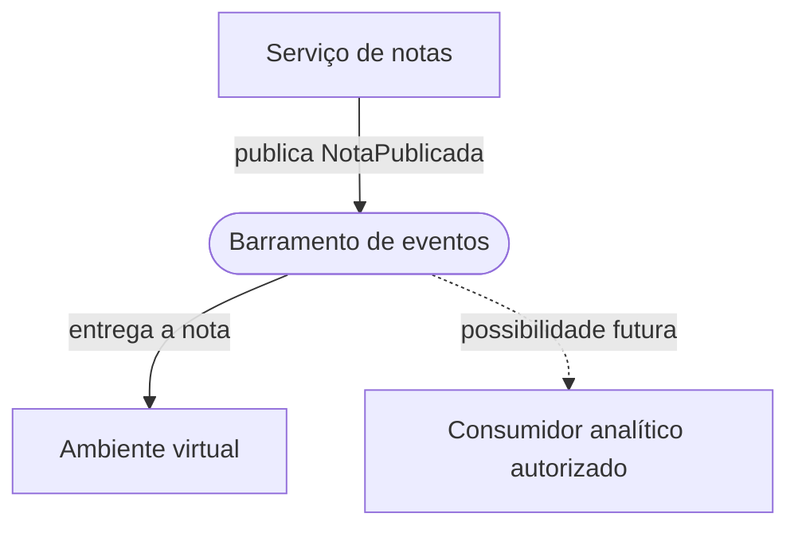
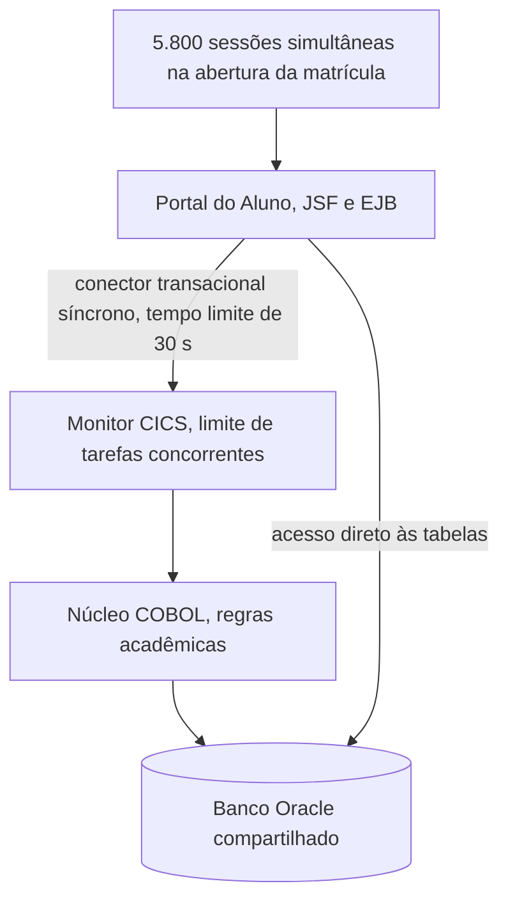

# Estilos arquiteturais e sua relação com atributo de qualidade

Este bloco parte dos princípios priorizados no [bloco 1](bloco-1-principios-de-design.md#repertorio-de-principios) e dos cenários de qualidade do [bloco 3 da Aula 2](../modulo-2-requisitos-e-partes-interessadas/bloco-3-cenarios-linha-de-base-e-restricoes.md). Ele responde qual forma de organizar o sistema sustenta melhor essas exigências. Cada forma, chamada de estilo arquitetural, traz compromissos: ao favorecer certas qualidades, torna outras mais difíceis de alcançar.

## Antes de começar

- [Estilo arquitetural](../referencia/glossario.md#estilo-arquitetural)
- [Princípio de design](../referencia/glossario.md#principio-de-design)
- [Cenário de atributo de qualidade](../referencia/glossario.md#cenario-de-atributo-de-qualidade)

## Conceito

Quando a ACME decide como organizar o sistema como um todo, toma uma decisão de estilo arquitetural. Um estilo arquitetural define três coisas: os tipos de componentes, como eles se conectam e quais relações são proibidas. Tipos de componentes são categorias recorrentes, como camada, serviço ou produtor de evento, e não instâncias específicas. As formas de conexão definem se a comunicação é síncrona ou assíncrona, direta ou mediada. As restrições proíbem relações como uma camada inferior chamar uma camada superior ou um serviço acessar diretamente o banco de outro serviço. O estilo descreve a forma macro do sistema. A organização interna de cada parte fica para os padrões tratados no [bloco 3](bloco-3-padroes-arquiteturais-e-de-design.md).

A arquitetura civil ajuda a fixar a ideia. Uma casa de madeira com telhado pontudo faz sentido em região de neve, porque a forma segue a função, já que o telhado inclinado impede o acúmulo de neve e a madeira funciona como isolamento térmico. Cada uma das duas escolhas responde a uma condição do ambiente em que a casa vai ser usada, e a mesma lógica vale em software, onde o estilo responde às condições de carga, de mudança e de falha em que o sistema vai executar.

*Figura 1 — Três estilos construtivos, cada um respondendo a condições diferentes de clima, terreno e uso. Fonte: ShutterStock, reproduzida do material base do professor.*

A escolha de estilo está entre as decisões de maior impacto sobre a arquitetura porque ela define, de antemão, quais [atributos de qualidade](../referencia/glossario.md#atributo-de-qualidade) o sistema consegue sustentar com naturalidade e quais exigirão esforço extra ou mecanismo compensatório. Um estilo que concentra processamento em um único processo favorece consistência transacional e simplicidade operacional, mas tende a limitar a escalabilidade independente de partes do sistema com carga desigual. Um estilo que distribui processamento em unidades independentes favorece escalabilidade seletiva e implantação isolada, mas introduz consistência eventual, latência de rede e superfície maior de falha parcial. Ford e Richards (2020) descrevem essa comparação de estilos por atributo de qualidade como o instrumento central da decisão, porque nenhum estilo maximiza todos os atributos ao mesmo tempo, e a escolha declara, de forma implícita, quais atributos o arquiteto está disposto a sacrificar em favor de outros.

O quadro abaixo apresenta sete estilos, os tipos de componente que cada um define, a forma de comunicação entre eles, os atributos de qualidade que cada um tende a favorecer ou a prejudicar e os princípios do repertório apresentado no [bloco 1](bloco-1-principios-de-design.md) que a estrutura do estilo tende a sustentar sem mecanismo adicional. Cada linha da tabela descreve um estilo. As colunas Favorece e Prejudica indicam as qualidades que o estilo ajuda e as que ele atrapalha por causa da própria estrutura, de modo que ler uma linha de ponta a ponta mostra o que se ganha e o que se paga ao escolhê-lo.

| Estilo | Componentes | Comunicação | Favorece | Prejudica | Princípios que tende a sustentar |
| --- | --- | --- | --- | --- | --- |
| Arquitetura em camadas | Camadas horizontais com responsabilidade fixa, como apresentação, negócio e persistência | Síncrona, sempre da camada superior para a imediatamente inferior | Simplicidade de raciocínio, manutenibilidade dentro de cada camada, curva de aprendizado baixa para equipe nova | Escalabilidade independente de partes do sistema, porque a unidade de implantação costuma ser o sistema inteiro | Simplicidade, separação de responsabilidades |
| Arquitetura de microsserviços | Serviços autônomos, cada um dono de seu próprio dado e implantado de forma independente | Síncrona por chamada de rede ou assíncrona por mensageria, sempre entre processos distintos | Escalabilidade seletiva, implantação independente, isolamento de falha entre serviços | Consistência transacional entre serviços, complexidade operacional, latência de comunicação entre processos | Baixo acoplamento, alta coesão, evolução incremental |
| Arquitetura orientada a eventos | Produtores e consumidores de evento, conectados por um intermediário que distribui a mensagem | Assíncrona, mediada por um barramento ou tópico, sem acoplamento direto entre quem publica e quem consome | Desacoplamento temporal entre componentes, absorção de pico de carga por enfileiramento, extensibilidade por novo consumidor sem alterar o produtor | Rastreabilidade do fluxo completo de processamento, consistência imediata, previsibilidade de ordem de entrega | Baixo acoplamento, desenho para falha |
| Arquitetura microkernel | Um núcleo mínimo com as regras essenciais e plugins que estendem funcionalidade sem alterar o núcleo | O núcleo expõe pontos de extensão fixos, e cada plugin se conecta a esses pontos sem se comunicar diretamente com outro plugin | Extensibilidade controlada, isolamento de funcionalidade opcional, ciclo de liberação independente para cada plugin | Desempenho quando o volume de plugins ativos cresce, coordenação de comportamento que atravessa vários plugins ao mesmo tempo | Encapsulamento, evolução incremental |
| Arquitetura hexagonal | Um núcleo com a lógica de negócio e adaptadores que o ligam ao mundo externo, através de portas declaradas pelo próprio núcleo | O núcleo nunca chama o adaptador diretamente, ele declara a porta e o adaptador se conecta a ela, o que inverte a direção da dependência | Testabilidade do núcleo em isolamento, substituição de banco, interface ou integração externa sem tocar na regra de negócio | Esforço inicial de desenho, porque cada porta precisa ser declarada antes de haver ganho visível, e custo de indireção em sistema pequeno | Encapsulamento, separação de responsabilidades |
| Pipes and filters | Filtros que transformam o dado recebido e pipes que transportam o dado entre eles | Unidirecional e em sequência, sem estado compartilhado entre filtros, cada um recebendo apenas o que o anterior produziu | Substituição e reordenação de etapa sem afetar o restante, reuso do mesmo filtro em outro fluxo, escalabilidade por etapa | Latência acumulada e sobrecarga de comunicação em fluxo longo, e dificuldade de operação que precise de visão do dado inteiro | Alta coesão, simplicidade |
| Arquitetura orientada a APIs | Serviços que expõem capacidade por contrato formal, e um gateway que centraliza o acesso a eles | Síncrona e sempre através da API publicada, com contrato declarado e versionado, nunca por acesso direto ao dado alheio | Interoperabilidade, reuso da mesma capacidade em contextos diferentes, desacoplamento entre consumidor e provedor, integração rápida de parceiro novo | Gestão do ciclo de vida da API, porque versionamento mal conduzido recria dependência rígida entre consumidor e provedor | Encapsulamento, baixo acoplamento |

A última coluna indica uma tendência, que a implantação pode contrariar. Um estilo que tende a sustentar baixo acoplamento pode ser implantado com acoplamento alto, como mostra o anti-padrão do monólito distribuído descrito na seção de microsserviços abaixo, e um princípio que o estilo não sustenta por estrutura pode ser atendido por mecanismo acrescentado, com custo. A comparação útil cruza, para cada estilo candidato, os princípios priorizados com o que o estilo oferece por estrutura e com o que exigiria de mecanismo compensatório.

A figura abaixo resume o contraste entre os estilos em quatro forças genéricas. Acoplamento baixo significa que as partes dependem pouco umas das outras, implantação independente significa publicar uma parte sem publicar as demais, consistência imediata significa que todos enxergam o mesmo dado atualizado no mesmo instante, e simplicidade operacional significa pouco esforço para manter o sistema funcionando. Cada linha da figura é um estilo, cada coluna é uma força, e cada célula indica se o estilo favorece, é neutro ou prejudica aquela força.

<figure markdown="span">
{ .module-diagram }
</figure>

*Figura 2 — Tendência de cada estilo diante de quatro forças genéricas de desenho. Fonte: material do curso, com base em Ford e Richards (2020).*

As sete seções seguintes descrevem cada estilo na mesma ordem de aspectos, forma estrutural, componentes e comunicação, atributos favorecidos, atributos prejudicados, quando usar, quando evitar e o anti-padrão com a heurística que o denuncia.

### Arquitetura em camadas

A arquitetura em camadas organiza apresentação, regras de negócio e persistência. Na Universidade ACME, uma proposta para o serviço de notas poderia separar a tela do professor, a validação do lançamento e o acesso aos dados. Isso facilita entender responsabilidades. Se todas as camadas forem implantadas juntas, porém, ampliar a capacidade da consulta de notas exige ampliar a unidade inteira. Os exemplos deste bloco são alternativas para analisar, e a escolha é feita no exercício 10.

| Aspecto | Descrição |
| --- | --- |
| Forma estrutural | Camadas horizontais empilhadas, cada uma com responsabilidade fixa |
| Componentes e comunicação | Apresentação, negócio e persistência, com chamada síncrona sempre da camada superior para a inferior |
| Favorece | Simplicidade de raciocínio, manutenibilidade e testabilidade de cada camada em isolamento |
| Prejudica | Escalabilidade independente, porque a unidade de implantação costuma ser o sistema inteiro |
| Quando usar | Escopo estável, carga homogênea entre funcionalidades e equipe que precisa de estrutura de aprendizado rápido |
| Quando evitar | Partes do sistema com carga muito desigual ou com ritmos de mudança muito diferentes |
| Anti-padrão e heurística de alerta | O **sumidouro**, quando uma camada apenas repassa a chamada adiante. Se mais de 80% das chamadas atravessam as camadas sem decisão, validação ou transformação, o estilo provavelmente deixou de ser adequado |

A heurística do sumidouro vem de Ford e Richards (2020). A travessia de uma camada cobra tempo e esforço de manutenção. No serviço de notas, o sinal de alerta aparece quando a camada de negócio apenas repassa consultas ao banco, sem aplicar nenhuma regra que justifique sua presença.

### Arquitetura de microsserviços

A arquitetura de microsserviços permite ampliar e implantar partes de forma independente. Na Universidade ACME, os serviços de matrícula e notas podem ter cargas e ciclos de mudança diferentes. Separá-los permite aumentar a capacidade da matrícula sem ampliar tudo. A divisão também cobra operação distribuída e cuidado com dados que precisam ser coerentes entre serviços. No primeiro ciclo, o núcleo continua responsável pelas transações acadêmicas existentes, o que limita a independência dos serviços novos.

| Aspecto | Descrição |
| --- | --- |
| Forma estrutural | Serviços autônomos, cada um dono do seu dado e implantado de forma independente |
| Componentes e comunicação | Serviços ligados por chamada de rede síncrona ou por mensageria assíncrona, sempre entre processos distintos |
| Favorece | Escalabilidade seletiva, implantação independente e isolamento de falha entre serviços |
| Prejudica | Consistência transacional entre serviços, simplicidade operacional e latência entre processos |
| Quando usar | Capacidades com carga e ritmo de mudança diferentes, sob responsabilidade de equipes autônomas |
| Quando evitar | Equipe pequena sem automação de implantação e de observabilidade, ou domínio cuja regra exige transação única entre as partes |
| Anti-padrão e heurística de alerta | O **monólito distribuído**, com serviços separados fisicamente mas acoplados por cadeia síncrona longa. Se uma operação do usuário depende de mais de dois ou três serviços em sequência síncrona, a independência de implantação deixou de existir na prática |

A heurística olha para o comprimento da cadeia síncrona. Quando concluir uma operação exige a resposta de vários serviços em sequência, a falha de qualquer um deles interrompe a operação inteira, e nenhum serviço consegue evoluir sem considerar o comportamento dos demais na mesma cadeia.

A fronteira dos serviços tem também uma explicação organizacional. A Lei de Conway descreve que organizações produzem arquiteturas que espelham sua própria estrutura de comunicação, e uma organização dividida em equipes autônomas responsáveis por uma capacidade de negócio inteira tende a produzir serviços com a mesma fronteira dessas equipes. Na Universidade ACME, a divisão em matrícula e notas só se sustenta se houver responsabilidades claras pela evolução e operação de cada serviço, e uma divisão de serviços que contrarie a divisão de equipes tende a reintroduzir o acoplamento por coordenação entre pessoas.

### Arquitetura orientada a eventos

A arquitetura orientada a eventos liga quem publica um fato a quem precisa reagir a ele. Na Universidade ACME, o serviço de notas publica a nota e o ambiente virtual a recebe. Um consumidor analítico poderia ser acrescentado no futuro sem alterar o produtor, desde que autorizado e dentro do escopo. O desenho abaixo mostra essa possibilidade, sem transformar o consumidor futuro em entrega do primeiro ciclo.

O barramento guarda a mensagem até que o consumidor possa processá-la. Na Universidade ACME, isso ajuda a absorver o fechamento de notas, mas o atraso precisa continuar dentro dos 10 minutos do R7. O custo é acompanhar o caminho de cada nota, tratar duplicidade e detectar mensagens que não chegaram ao destino.

| Aspecto | Descrição |
| --- | --- |
| Forma estrutural | Produtores e consumidores de evento sem conhecimento mútuo, ligados por um intermediário |
| Componentes e comunicação | Publicação e consumo assíncronos por barramento ou tópico |
| Favorece | Desacoplamento temporal, absorção de pico por enfileiramento e extensão por novo consumidor sem alterar o produtor |
| Prejudica | Rastreabilidade do fluxo completo, consistência imediata e previsibilidade de ordem de entrega |
| Quando usar | Integração entre partes que reagem ao mesmo fato em ritmos diferentes, ou carga com picos que o consumidor não acompanha em tempo real |
| Quando evitar | Fluxo que exige resposta imediata ao usuário com o resultado de todos os consumidores, ou regra que depende de ordem garantida entre tópicos diferentes |
| Anti-padrão e heurística de alerta | A ausência de identificador de correlação entre eventos relacionados. Se a lógica de negócio depende de ordem garantida entre eventos de tópicos diferentes, o estilo provavelmente não é adequado para essa parte do fluxo |

A garantia de ordem depende do intermediário e da forma de particionar as mensagens. No fluxo de notas da Universidade ACME, cada mensagem precisa identificar o aluno, a disciplina, o evento e a versão do lançamento. Assim o consumidor pode correlacionar mensagens, reconhecer uma repetição e evitar que uma nota antiga sobrescreva uma correção mais recente.

### Arquitetura microkernel

A arquitetura microkernel mantém um núcleo estável e oferece pontos de extensão para plugins. Como possibilidade de desenho na Universidade ACME, a emissão de documentos poderia ter extensões para formatos diferentes, mantendo fixas as regras de autorização e identificação do aluno. O ganho seria acrescentar um formato sem alterar o núcleo. Se os formatos precisarem interferir uns nos outros ou mudar as regras centrais, essa divisão deixa de ajudar. O exemplo não propõe ampliar o escopo do primeiro ciclo.

| Aspecto | Descrição |
| --- | --- |
| Forma estrutural | Um núcleo mínimo com as regras essenciais e plugins conectados a pontos de extensão fixos |
| Componentes e comunicação | O núcleo aciona cada plugin pelo ponto de extensão, e os plugins não se comunicam entre si |
| Favorece | Extensibilidade controlada e ciclo de liberação independente para cada plugin |
| Prejudica | Desempenho com muitos plugins ativos e coordenação de comportamento que atravessa vários plugins |
| Quando usar | Produto com núcleo estável e variação delimitada por cliente, mercado ou regulação |
| Quando evitar | Variação que exige interação entre extensões ou que altera as regras essenciais com frequência |
| Anti-padrão e heurística de alerta | O **core creep**, quando o núcleo absorve regra específica de um plugin. Se o núcleo precisa ser alterado a cada plugin novo, ele deixou de ser estável |

Na emissão de documentos, o core creep apareceria se o núcleo passasse a conter regras específicas de cada formato. Acrescentar uma extensão exigiria então alterar o próprio núcleo, contrariando o motivo de usar plugins.

### Arquitetura hexagonal

A arquitetura hexagonal, ou portas e adaptadores, protege regras de negócio das tecnologias e integrações externas. Na Universidade ACME, o serviço de matrícula pode declarar uma porta para consultar a situação acadêmica. Um adaptador traduz essa operação para a transação do núcleo COBOL. A regra de matrícula usa a porta e pode ser testada com um substituto, sem acessar o CICS. Quando o acesso ao legado mudar, o adaptador pode mudar preservando o contrato da porta.

| Aspecto | Descrição |
| --- | --- |
| Forma estrutural | Um núcleo de regra de negócio cercado por portas declaradas e adaptadores que as implementam |
| Componentes e comunicação | O núcleo declara a porta, e o adaptador se conecta a ela, o que inverte a direção da dependência |
| Favorece | Testabilidade do núcleo em isolamento e substituição de dependência externa sem alterar a regra |
| Prejudica | Esforço inicial de desenho e custo de indireção em sistema pequeno |
| Quando usar | Regra de negócio valiosa e duradoura, cercada por integrações que tendem a mudar |
| Quando evitar | Sistema pequeno, de regra trivial, em que as portas não teriam mais de uma implementação |
| Anti-padrão e heurística de alerta | O vazamento do adaptador para dentro do núcleo. Se o núcleo não compila sem a biblioteca do fornecedor externo, a porta não existe de fato |

Na matrícula, o vazamento aparece se a regra de negócio recebe diretamente uma estrutura proprietária do conector CICS. A partir daí, trocar o conector exige alterar a regra, e a proteção oferecida pela porta deixa de funcionar.

### Pipes and filters

O estilo pipes and filters organiza uma sequência de transformações independentes. Na Universidade ACME, a extração anual para o órgão regulador pode ser analisada como filtros que selecionam os registros, validam campos, convertem códigos e geram o arquivo de entrega. Trocar a conversão de um código não deveria exigir alterar a seleção. O exemplo explica o estilo usando uma rotina existente, cuja modernização está fora do primeiro ciclo.

| Aspecto | Descrição |
| --- | --- |
| Forma estrutural | Sequência de filtros independentes ligados por pipes unidirecionais |
| Componentes e comunicação | Cada filtro recebe apenas o que o anterior produziu, sem estado compartilhado entre filtros |
| Favorece | Substituição, reordenação e reuso de etapa sem afetar o restante, e escalabilidade por etapa |
| Prejudica | Latência acumulada em fluxo longo e operação que precise de visão do dado inteiro |
| Quando usar | Processamento em etapas bem definidas sobre fluxo de dado, como integração, conversão e cálculo em lote |
| Quando evitar | Interação com o usuário que exige resposta imediata ou regra que depende de várias etapas ao mesmo tempo |
| Anti-padrão e heurística de alerta | O filtro que guarda estado entre execuções ou depende de saber qual filtro veio antes. Se um filtro precisa conhecer a etapa anterior para produzir o resultado correto, ele deixou de ser substituível |

Na extração acadêmica, o sinal de alerta apareceria se o filtro de geração do arquivo precisasse consultar o estado interno do filtro de validação. O resultado da validação deveria viajar junto com o registro, para manter as etapas independentes.

### Arquitetura orientada a APIs

A arquitetura orientada a APIs oferece capacidades por contratos publicados e versionados. Na Universidade ACME, o aplicativo e os portais podem consultar serviços acadêmicos pelas mesmas interfaces, sem acessar suas tabelas. Uma integração com parceiro exige contrato e autorização próprios. APIs públicas só fazem sentido para informações abertas, como a oferta de cursos, após decisão explícita de escopo e proteção. Um gateway pode centralizar autenticação, autorização, limites de uso e registros.

| Aspecto | Descrição |
| --- | --- |
| Forma estrutural | Capacidades expostas por contratos formais, com acesso centralizado por um gateway |
| Componentes e comunicação | Chamada síncrona sempre pela API publicada, com contrato declarado e versionado |
| Favorece | Interoperabilidade, reuso da mesma capacidade em contextos diferentes e integração rápida de parceiro novo |
| Prejudica | Gestão do ciclo de vida da API, porque versionamento mal conduzido recria dependência rígida |
| Quando usar | Capacidade consumida por vários canais ou parceiros, com necessidade de governança do acesso |
| Quando evitar | Integração interna única e estável, em que o custo de contrato formal e de gateway não tem retorno |
| Anti-padrão e heurística de alerta | A mudança incompatível publicada sem nova versão. Se publicar uma alteração exige combinar a data com cada consumidor, o contrato não está desacoplando nada |

Na consulta de notas, uma mudança incompatível obrigaria aplicativo e portal a serem atualizados no mesmo dia. Esse é um sinal de que o contrato não permite evolução independente. A abordagem por APIs pode organizar a fronteira de uma solução que internamente usa camadas ou microsserviços.

## Uso pelo arquiteto

Na ACME, a abertura da matrícula chega a 5.800 sessões simultâneas e o incidente de 04/02/2026 mostrou o risco, porque sessões abandonadas esgotaram as tarefas simultâneas que o núcleo aceita e deixaram a matrícula fora do ar por 4h20. Diante desse problema, as partes interessadas defendem estilos diferentes, e o arquiteto precisa mostrar ao patrocinador o que cada estilo favorece e o que cada um sacrifica. Por isso ele compara os estilos candidatos por atributo de qualidade, associa cada atributo ao cenário de qualidade que a organização já reconheceu como prioritário e apresenta o resultado como uma tabela de trocas explícitas, que transforma uma preferência técnica em uma escolha que o patrocinador pode aprovar ou contestar com argumento.

Quando dois estilos empatam diante dos cenários, o arquiteto recorre aos princípios priorizados do [bloco 1](bloco-1-principios-de-design.md#anatomia-de-um-principio) como critério de desempate, e registra qual princípio decidiu. Sem essa comparação, a escolha fica sustentada pela preferência de quem a propôs e pode ser reaberta a cada reunião, enquanto com ela só um dado novo justifica reabri-la.

## No caderno arquitetural

{{ficha:7:3}}

**Para que serve.** Na abertura da matrícula, a ACME chega a 5.800 sessões simultâneas e o núcleo tem um limite de tarefas simultâneas, e em 04/02/2026 sessões abandonadas esgotaram esse limite e deixaram a matrícula fora do ar por 4h20. A forma de organizar o sistema, que se chama estilo arquitetural, muda o que a solução aguenta e o que ela sacrifica, e por isso a escolha precisa de justificativa. A seção 7 do caderno guarda essa justificativa, para que quem ler o caderno meses depois entenda por que o estilo foi escolhido e o que se aceitou perder.

**O que você faz neste exercício.** O enunciado traz os dois cenários da Aula 2, o pico de matrícula e o incidente de 04/02/2026, e três princípios de referência, como manter a operação disponível durante toda a transição. Você escolhe três dos sete estilos da aula e verifica como cada um se comporta nos dois cenários, porque um estilo que ajuda no pico pode não ajudar no incidente. Em seguida aponta o risco de cada estilo e o recurso que o compensa, e recomenda um deles, e a comparação entra na seção 7 do caderno.

| Campo do caderno | Como preencher | Item |
| --- | --- | --- |
| Estilo | Escolha três dos sete estilos da aula e escreva o nome de cada um | 1 |
| Adequação ao cenário 1 | Para cada estilo, diga se é favorável, neutro ou desfavorável ao pico de matrícula, com o motivo em uma linha | 1 |
| Adequação ao cenário 2 | Faça o mesmo para o incidente de 04/02/2026 | 1 |
| Adequação aos princípios | Diga quais princípios o estilo sustenta e quais ele contraria | 2 |
| Risco do estilo | Descreva o que o estilo traz de problema para a ACME | 2 |
| Mecanismo compensatório | Diga o recurso que se acrescenta ao desenho para neutralizar o risco | 2 |
| Estilo recomendado | Escolha um dos três estilos | 2 |
| Justificativa da recomendação | Explique a escolha pelo atributo de qualidade favorecido, pelo prejudicado e pelo princípio que desempata | 2 |

**O que você já tem.** Os cenários de qualidade da seção 3 e os princípios priorizados da seção 6, que o exercício 9 produziu.

**Quando está pronto.** Os três estilos têm as seis classificações, o risco e o mecanismo compensatório, e um deles está recomendado com a justificativa completa.

[Ver esta seção no template](../caderno/template.md#7-decisoes){ .caderno-botao }
[Ver o gabarito do exercício 10](../gabaritos/gabarito-exercicio-10.md){ .caderno-botao }

{{/ficha}}

## Exercício 10

A escolha do estilo da ACME precisa resistir a duas situações reais, o pico de matrícula e o incidente de 04/02/2026, e este exercício treina a comparação de estilos diante delas, para que a recomendação tenha justificativa. O aluno escolhe três dos sete estilos do bloco, verifica como cada um se comporta nos dois cenários de qualidade e à luz dos princípios, e recomenda um deles. A ACME é uma universidade privada brasileira cujo sistema acadêmico legado tem um núcleo transacional em COBOL sobre o monitor CICS (o programa que executa as transações do núcleo), uma camada web em Java, construída com as tecnologias JSF (telas web) e EJB (regras de negócio executadas no servidor), e integrações por arquivo em lote com o ERP financeiro e o ambiente virtual de aprendizagem, tudo em modernização incremental. A comparação usa os princípios priorizados no [exercício 9](bloco-1-principios-de-design.md#exercicio-9), e o estilo recomendado aqui é a entrada da seleção de padrões do exercício 11, no [bloco 3](bloco-3-padroes-arquiteturais-e-de-design.md). O exercício tem dois itens, e cada um produz uma tabela de comparação, a do item 1 com as classificações por cenário e a do item 2 com a análise por princípio e a recomendação.

### Item 1: Adequação aos cenários de qualidade

Um estilo só é adequado se ajudar a cumprir a medida de cada cenário de qualidade, e por isso o item pede que cada estilo seja confrontado com os dois cenários abaixo. Um cenário de qualidade descreve uma situação do sistema e a medida que ele deve atingir, em seis elementos: fonte (quem origina a situação), estímulo (o que acontece), ambiente (em que condições), artefato (a parte do sistema afetada), resposta (o que o sistema faz) e medida (o valor a cumprir). Os dois cenários foram formulados nesse formato, apresentado no [bloco 3 da Aula 2](../modulo-2-requisitos-e-partes-interessadas/bloco-3-cenarios-linha-de-base-e-restricoes.md). O primeiro trata do pico de acessos na abertura da matrícula, e o segundo trata do incidente de 04/02/2026, em que sessões abandonadas esgotaram a capacidade do núcleo. Quem já escreveu os próprios cenários naquele bloco pode usá-los no lugar destes, que servem de versão de referência.

Cenário 1, pico de sazonalidade

| Elemento | Especificação |
| --- | --- |
| Fonte | Alunos veteranos e ingressantes da ACME |
| Estímulo | Acesso simultâneo ao Portal do Aluno para confirmar matrícula |
| Ambiente | Abertura da janela de matrícula, pico de 5.800 sessões simultâneas nos 30 minutos iniciais, razão de 7,1 sobre a média anual ponderada de 815 sessões |
| Artefato | Portal do Aluno e núcleo transacional |
| Resposta | Processar as tentativas de confirmação sem degradar acima de um limite aceitável de erro |
| Medida | Taxa de erro abaixo de 1%, contra os 6,3% observados atualmente no mesmo intervalo |

Cenário 2, incidente de 04/02/2026

| Elemento | Especificação |
| --- | --- |
| Fonte | Sessões web abandonadas pelo aluno sem encerramento explícito |
| Estímulo | Transação do monitor CICS permanece aberta após o abandono do navegador, sem tempo limite de sessão configurado |
| Ambiente | Abertura da matrícula de 04/02/2026, sob o mesmo pico de 5.800 sessões simultâneas |
| Artefato | Monitor CICS e núcleo transacional |
| Resposta | Encerrar a transação por tempo limite de sessão antes de esgotar o limite de tarefas concorrentes do CICS |
| Medida | Indisponibilidade contida dentro dos 43 minutos tolerados por mês pelo acordo de nível de serviço, contra os 260 minutos consumidos no incidente registrado, com 62% de erro nas tentativas de matrícula e 9.400 alunos sem inscrição concluída no dia |

O diagrama abaixo mostra o caminho que as duas situações percorrem no sistema atual, do Portal do Aluno ao núcleo que permanece em operação durante a transição.

Como o núcleo COBOL permanece em operação durante a transição, nenhum estilo pode ignorá-lo, e a leitura de cada estilo nos dois cenários parte dessa condição. O item pede dois passos, o da escolha dos três estilos e o da classificação de cada par de estilo e cenário.

1. Escolha três dos [sete estilos](#conceito) apresentados neste bloco, considerando o núcleo COBOL sobre CICS como parte que permanece em operação durante a transição.
2. Para cada um dos três estilos, registre a adequação ao cenário 1 e ao cenário 2, classificando cada par de estilo e cenário como favorável, neutro ou desfavorável e indicando em uma linha o motivo. O produto é uma tabela com seis classificações, duas para cada estilo escolhido.

Suas respostas viram os campos Estilo, Adequação ao cenário 1 e Adequação ao cenário 2, na seção 7 do caderno.

### Item 2: Princípios, risco e recomendação

Este item verifica se cada estilo escolhido respeita os princípios de design e qual risco ele traz para a ACME. Quem ainda não tem os princípios do exercício 9 pode partir dos três enunciados de referência abaixo, formulados sem motivação nem implicação, que o aluno completa ao usá-los, conforme a [anatomia de um princípio](bloco-1-principios-de-design.md#anatomia-de-um-principio).

| Princípio de referência | Entrada que o origina |
| --- | --- |
| A operação acadêmica continua disponível durante toda a transição. | Continuidade operacional |
| Dado pessoal de aluno é tratado apenas em território nacional. | Residência de dados |
| Responsabilidades do núcleo legado são assumidas por elementos novos uma a uma, sem substituição simultânea. | Dependência do legado |

Um estilo que ajuda no pico ainda pode quebrar uma regra do projeto, e por isso a segunda leitura confronta cada estilo com os princípios e com o risco que ele traz. O item pede dois passos, o da análise de cada estilo e o da recomendação de um deles.

1. Para cada um dos três estilos escolhidos no Item 1, registre a adequação aos princípios priorizados, o risco introduzido pelo estilo no contexto da ACME e o mecanismo compensatório, que é o recurso que se acrescenta ao desenho para neutralizar esse risco.
2. Recomende um dos três estilos para um contexto de modernização incremental de um sistema legado crítico, justificando a escolha pelo atributo de qualidade favorecido, pelo atributo de qualidade prejudicado e pelo princípio que desempata a comparação.

Suas respostas viram os campos Adequação aos princípios, Risco do estilo, Mecanismo compensatório, Estilo recomendado e Justificativa da recomendação, na seção 7 do caderno.

## Fontes

As referências seguem o formato APA, 7ª edição, e constam da [bibliografia](../referencia/bibliografia.md) do curso. O trecho consultado aparece entre parênteses ao fim de cada entrada.

- Ford, N., & Richards, M. (2020). *Fundamentals of software architecture*. O'Reilly. (comparação de estilos por atributo de qualidade)
- Bass, L., Clements, P., & Kazman, R. (2021). *Software architecture in practice* (4th ed.). Addison-Wesley. (relação entre estilo e atributo de qualidade)
- Mendes, M. (2026b). *Guias de projeto de arquitetura de software* [Material de curso, versão arquivada]. https://github.com/aulas-marco/projeto-arquitetura-software/tree/30f15cd (guia 1.3, fonte da analogia da casa e da caracterização dos estilos hexagonal, pipes and filters e orientada a APIs)
- Mendes, M. (2026a). *Arquitetura de software* [Material de curso]. https://marco-mendes.github.io/arquitetura-software/ (material publicado do professor)
- Vernon, V. (2013). *Implementing domain-driven design*. Addison-Wesley. (arquitetura hexagonal, leitura indicada por Mendes (2026b))
- Hohpe, G., & Woolf, B. (2003). *Enterprise integration patterns: Designing, building, and deploying messaging solutions*. Addison-Wesley. (pipes and filters, leitura indicada por Mendes (2026b))

**Material do curso.** O bloco usa a entrada [estilo arquitetural](../referencia/glossario.md#estilo-arquitetural) do glossário, os princípios do [bloco 1](bloco-1-principios-de-design.md) e o dossiê da instituição fictícia [ACME](../caso-acme/index.md), com a sua [arquitetura de linha de base](../caso-acme/linha-de-base.md) e os seus [dados operacionais](../caso-acme/dados-operacionais.md).
