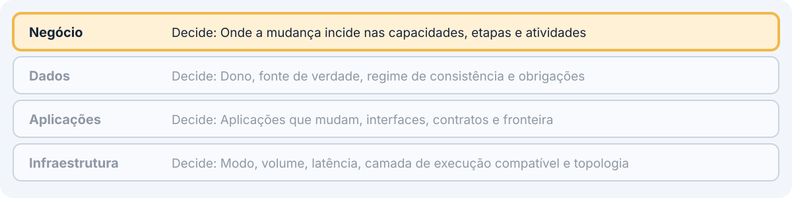
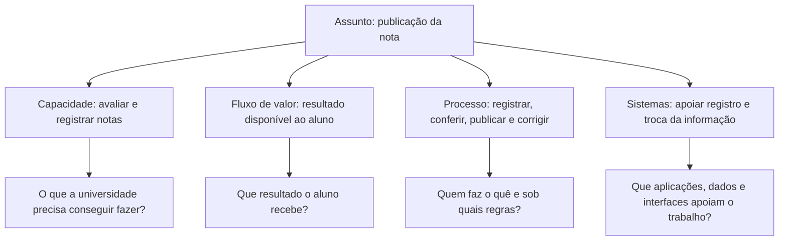
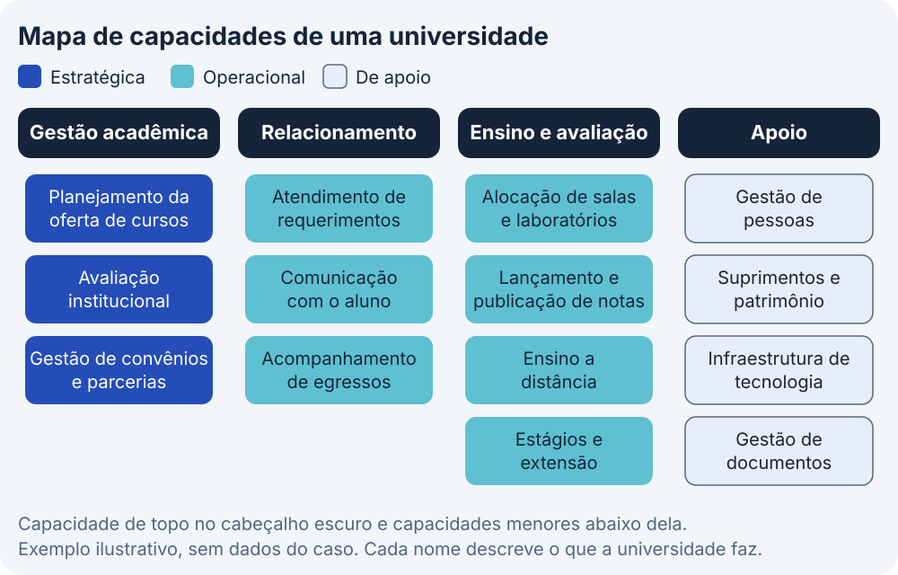
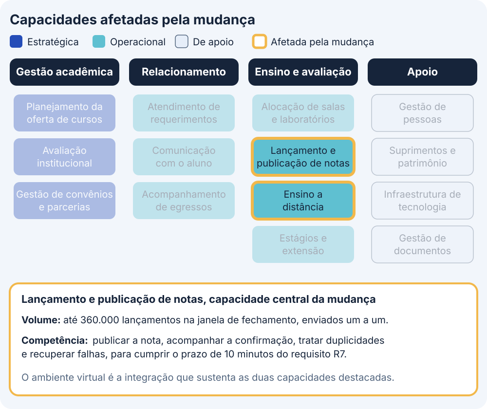
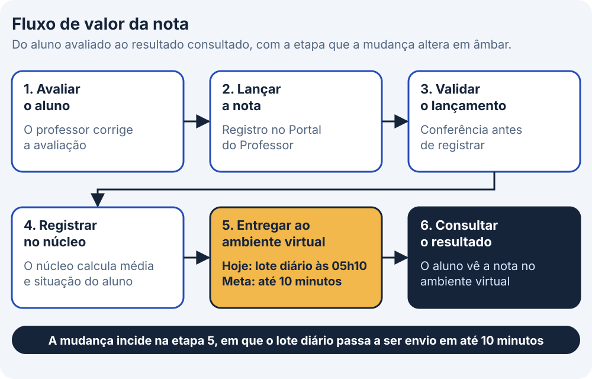
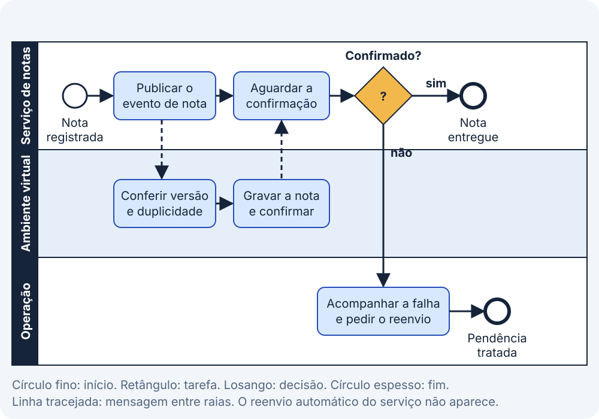
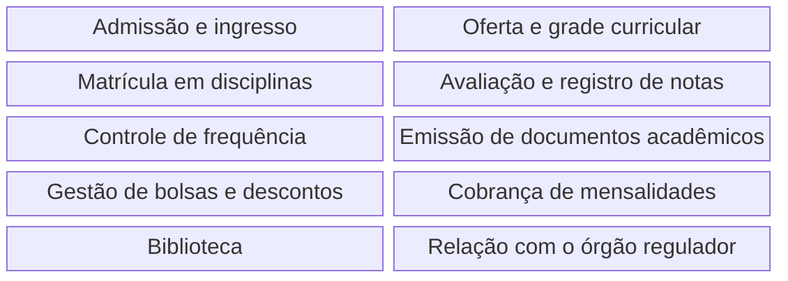
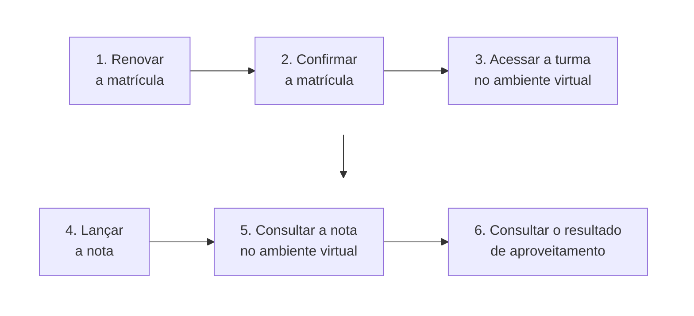
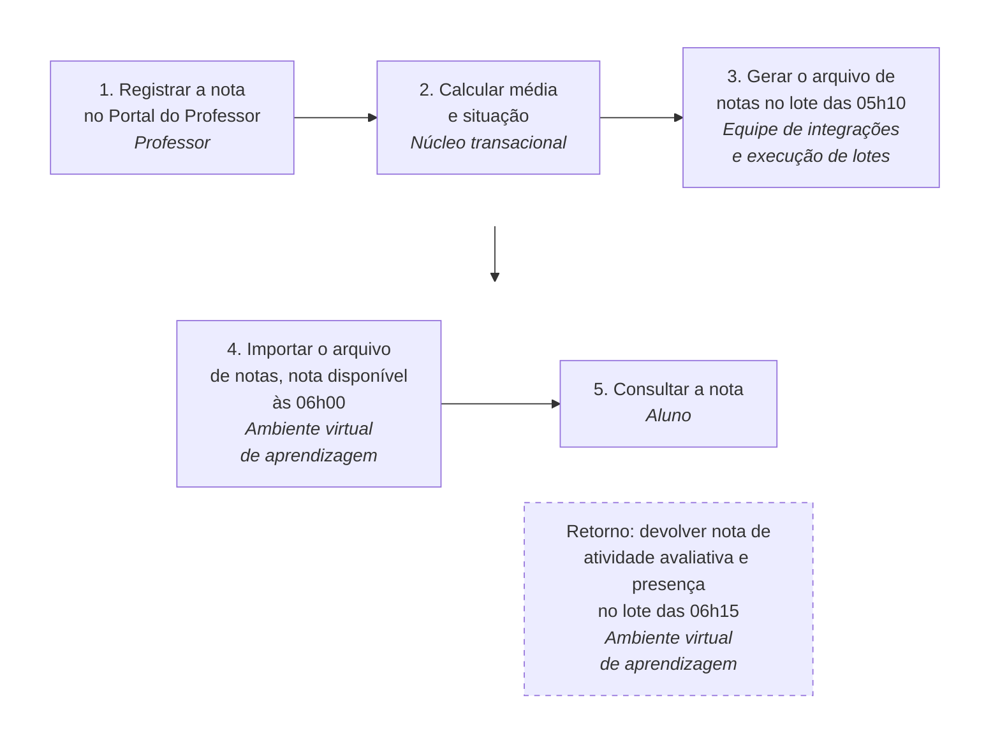

# Arquitetura de negócio da solução

Antes de decidir sobre dados, aplicações ou infraestrutura, o arquiteto da ACME precisa saber onde a modernização muda o trabalho da universidade. Este é o primeiro dos quatro domínios da Aula 4: negócio, dados, aplicações e infraestrutura. Ele trata do que a solução muda na organização e dos modelos que permitem localizar essa mudança. No exercício 13, o aluno aplica esses modelos ao sistema acadêmico da ACME.

## Antes de começar

- [Arquitetura de negócio](../referencia/glossario.md#arquitetura-de-negocio)
- [Capacidade](../referencia/glossario.md#capacidade)
- [Fluxo de valor](../referencia/glossario.md#fluxo-de-valor)
- [Componentes da solução](../referencia/glossario.md#componentes-da-solucao)
- [Arquitetura de solução](../referencia/glossario.md#arquitetura-de-solucao)

## Modelos de arquitetura de negócio

<figure markdown="span">
{ .module-diagram }
</figure>

No mapa do [bloco 0](bloco-0-espinha-dorsal-dos-dominios.md), este bloco trata do domínio de negócio. O arquiteto recebe o mapa de capacidades, o fluxo de valor e o modelo de processo mantidos pela arquitetura corporativa e pela análise de negócio. Ele decide quais capacidades, etapas e atividades a mudança afeta. Depois, entrega essa lista ao bloco 2, junto com a forma estrutural registrada no [ADR](../modulo-3-design-e-padroes/bloco-4-registro-de-decisao-arquitetural.md) da Aula 3.

Para localizar o que a solução muda, o arquiteto precisa de uma representação da organização que não dependa de nenhum sistema em particular, e é isso que a arquitetura de negócio oferece. A **arquitetura de negócio** é definida pelo Business Architecture Guild, associação profissional da área, como uma representação da organização que oferece entendimento comum sobre ela e serve para alinhar objetivos estratégicos e demandas táticas. O TOGAF, método de arquitetura corporativa mantido pela The Open Group, descreve a mesma arquitetura como um conjunto de visões do negócio sobre capacidades, entrega de valor de ponta a ponta, informação e estrutura organizacional, com as relações entre essas visões e as estratégias, os produtos, as políticas e as partes interessadas. As duas definições atribuem ao domínio dois papéis na arquitetura de solução, o de origem da necessidade de mudança, já tratada como [direcionador de mudança](../modulo-2-requisitos-e-partes-interessadas/bloco-1-direcionadores-de-mudanca.md) na Aula 2, e o de alvo da mudança que a solução entrega.

### Quando a arquitetura de solução se aplica

A arquitetura de solução trabalha reduzindo um sistema a suas partes por meio de um modelo, e por isso nem todo problema de negócio admite esse tratamento. Quatro perguntas decidem a aplicação do método:

1. A área do problema é um sistema?
2. O sistema pode ser modelado?
3. O modelo exibe o problema?
4. O modelo pode ser alterado para tratar o problema?

Uma resposta negativa a qualquer das quatro indica que outro método é mais adequado. Quando o problema é grande demais para ser modelado de uma vez, a alternativa recomendada é reduzir o escopo, por exemplo a uma linha de produtos, a uma região ou a um grupo delimitado de unidades organizacionais. Para o problema complexo que não se reduz a um modelo, uma alternativa comum é a mudança feita a partir da experiência dos envolvidos, avaliada depois de um período de observação do efeito. Quando o problema é simples demais para ser chamado de sistema, o ciclo completo de arquitetura acrescenta complexidade sem revelar causa, e só algumas técnicas isoladas continuam úteis.

A Figura 1 organiza as quatro perguntas como árvore de decisão com três saídas possíveis. Toda resposta negativa conduz a uma quinta pergunta, sobre o tamanho do problema, que separa a redução de escopo, seguida de nova aplicação das quatro perguntas, do uso de outro método.

<figure markdown="span">
{ .module-diagram }
</figure>

*Figura 1 — As quatro perguntas de aplicabilidade da arquitetura de solução e as três saídas possíveis. Fonte: material do curso, com base em Lovatt (2021).*

### Quatro modelos

Os quatro modelos podem examinar o mesmo assunto sem significar a mesma coisa. No exemplo da publicação de nota, o esquema abaixo separa a capacidade da universidade, o valor percebido pelo aluno, o processo de trabalho e os sistemas que o apoiam.

Uma capacidade pode apoiar mais de um processo, um processo pode envolver vários sistemas e um sistema pode apoiar vários processos, de modo que o esquema serve para distinguir os quatro recortes, cada um detalhado numa das seções seguintes, a começar pelo mapa de capacidades.

Para saber onde a mudança incide, o arquiteto de solução consulta modelos que a arquitetura de negócio já mantém, cada um com uma pergunta própria. A tabela abaixo resume os quatro mais usados, a pergunta que cada um responde e o que ele oferece ao arquiteto.

| Modelo | Pergunta que responde | O que oferece ao arquiteto |
| --- | --- | --- |
| Mapa de capacidades | O que a organização precisa conseguir fazer? | As capacidades afetadas pela solução e os recursos que as habilitam |
| Fluxo de valor | Por quais etapas o valor chega ao cliente? | As etapas em que a solução altera o valor percebido |
| Decomposição funcional | Que unidade realiza cada função? | As unidades organizacionais afetadas |
| Modelo de processo de negócio | Que atividades compõem o trabalho e quem as executa? | As atividades que mudam, desaparecem ou passam a ser automatizadas |

A Figura 2 reúne os quatro modelos com a pergunta de cada um e os situa sobre o ciclo de mudança de negócio, apresentado ao fim desta seção, com os estágios de definir e projetar destacados.

<figure markdown="span">
![Diagrama com quatro cartões, um para cada modelo de arquitetura de negócio, mapa de capacidades, fluxo de valor, decomposição funcional e modelo de processo, cada um com a pergunta que responde. Abaixo, uma faixa com os cinco estágios do ciclo de mudança de negócio, alinhar, definir, projetar, implementar e realizar, com definir e projetar destacados como os estágios em que a arquitetura de solução se concentra, e uma nota final que lembra que todo componente da solução sustenta um ou mais serviços de negócio.](../assets/images/modulo-4-modelos-de-negocio.svg){ .module-diagram }
</figure>

*Figura 2 — Os quatro modelos de arquitetura de negócio e a pergunta de cada um, sobre o ciclo de mudança de negócio. Fonte: material do curso, com base em Lovatt (2021).*

### Mapa de capacidades

Quando o arquiteto pergunta o que a organização precisa conseguir fazer, a resposta organizada é o **mapa de capacidades**, que decompõe as capacidades de topo em capacidades menores. Uma **capacidade** é aquilo que a organização precisa conseguir fazer para entregar seus serviços e executar sua estratégia, e pode ainda não existir, constando apenas do plano. O nome da capacidade descreve uma habilidade da organização e omite quem a exerce e com qual sistema, o que mantém o mapa estável quando a estrutura organizacional ou as aplicações mudam. Cada capacidade tem dois atributos adicionais, o volume, que é quanto se entrega em paralelo, e a competência, que é o nível de habilidade exigido, e é habilitada por recursos como pessoas, unidades organizacionais, tecnologia e conhecimento especializado. O mapa classifica as capacidades em estratégicas, operacionais e de apoio, e outras classificações, como maturidade ou núcleo e periferia, também são usadas.

A Figura 3 mostra, como exemplo ilustrativo, o mapa de capacidades de uma universidade, com quatro capacidades de topo e catorze capacidades menores. Gestão acadêmica reúne as capacidades estratégicas, que orientam a oferta e a qualidade dos cursos. Relacionamento e Ensino e avaliação reúnem as operacionais, que entregam o serviço ao aluno. Apoio reúne as que sustentam as demais. O mapa permite discutir a mudança com as áreas de negócio antes de falar em software. As dez capacidades acadêmicas da ACME aparecem no exercício 13, sem classificação, e é o aluno quem as classifica.

<figure markdown="span">
{ .module-diagram }
</figure>

*Figura 3 — Mapa de capacidades de uma universidade, em exemplo ilustrativo. Fonte: material do curso.*

### Uma mudança na Universidade ACME

Na Universidade ACME, o professor registra a nota no sistema acadêmico, mas ela chega ao ambiente virtual apenas pelo lote diário das 05h10. No incidente de 09/07/2026, uma mudança de layout deixou 61.400 lançamentos fora do ambiente virtual. A mudança pretende fazer a nota chegar em até 10 minutos, como pede o R7, preservando o núcleo COBOL durante a transição.

A proposta troca o envio diário por uma mensagem a cada publicação de nota. O serviço de notas envia a identificação do aluno, da disciplina e da nota, e o ambiente virtual confirma o recebimento. A interface precisa prever versão da mensagem, reenvio e tratamento de duplicidade. O professor continua responsável pelo lançamento, enquanto a equipe de TI acompanha as entregas e trata falhas de integração.

A Figura 4 retoma o mapa ilustrativo da Figura 3 e destaca as duas capacidades que esse recorte afeta, Lançamento e publicação de notas e Ensino a distância, que usa o ambiente virtual. A integração com o ambiente virtual sustenta as duas. O exercício 13 amplia a análise para as dez capacidades acadêmicas da ACME, e é o aluno quem decide ali quais delas o primeiro ciclo altera.

<figure markdown="span">
{ .module-diagram }
</figure>

*Figura 4 — Capacidades afetadas pela publicação de notas, no mapa ilustrativo da Figura 3. Fonte: material do curso.*

Os dois atributos ajudam a dimensionar a mudança, pois o volume considera até 360.000 lançamentos na janela de fechamento e a competência inclui publicar a nota, acompanhar a confirmação, tratar duplicidades e recuperar falhas, para cumprir o prazo de 10 minutos do R7.

### Capacidade e fluxo de valor em ArchiMate

Em repositórios de arquitetura corporativa, o mapa de capacidades e o fluxo de valor podem ser registrados em ArchiMate, linguagem de modelagem de arquitetura corporativa mantida pela The Open Group. A versão vigente da linguagem é a ArchiMate 4, publicada em abril de 2026 com compatibilidade declarada em relação às versões anteriores (The Open Group, 2026). As definições a seguir são as da versão 3.2, que define, na camada de estratégia, o elemento capacidade (*capability*), descrito como uma habilidade que um elemento de estrutura ativa, como uma organização, uma pessoa ou um sistema, possui, e o elemento fluxo de valor (*value stream*), descrito como uma sequência de atividades que cria um resultado global para um cliente, uma parte interessada ou um usuário final (The Open Group, 2022). A ferramenta de código aberto Archi é um exemplo de editor que cria e mantém modelos nessa linguagem.

### Fluxo de valor

O mapa de capacidades diz o que a organização sabe fazer, mas não diz por onde o cliente percebe o serviço, e essa lacuna é coberta pelo **fluxo de valor**, o conjunto de etapas de ponta a ponta que entrega valor a um cliente, do primeiro contato com a organização até a realização desse valor. Cada etapa é nomeada por um verbo no infinitivo seguido do objeto, como lançar a nota ou consultar o resultado, porque a etapa descreve o que acontece para que o valor avance. A técnica tem origem na produção enxuta, que procura eliminar as etapas que não acrescentam valor suficiente, e combina bem com a arquitetura de solução porque as duas analisam o problema em termos de estrutura e de comportamento.

A Figura 5 acompanha a nota em seis etapas: avaliar o aluno, lançar a nota, validar o lançamento, registrar no núcleo, entregar ao ambiente virtual e consultar o resultado. Hoje a entrega depende do lote diário. A proposta altera essa etapa para que o aluno veja a nota em até 10 minutos, sem confundir esse prazo com o tempo que o professor leva para corrigir a avaliação.

<figure markdown="span">
{ .module-diagram }
</figure>

*Figura 5 — Fluxo de valor da nota na Universidade ACME. Fonte: material do curso.*

O fluxo e o mapa se ligam pela responsabilidade de cada etapa, pois avaliar, lançar e validar dependem da capacidade de avaliar e registrar notas, e registrar no núcleo e entregar ao ambiente virtual dependem também das aplicações e da integração. Consultar o resultado mostra o valor percebido pelo aluno, e essa ligação ajuda a localizar o que muda em pessoas, processos, dados e tecnologia.

### Decomposição funcional e modelo de processo

Depois das capacidades e das etapas, falta saber quem realiza cada função e em que atividades o trabalho se divide, e é isso que a decomposição funcional e o modelo de processo de negócio mostram. Nesta disciplina, os dois são tratados como artefatos que o arquiteto de solução lê e consulta, mantidos pela área de negócio ou pela análise de processos, que respondem pela elaboração deles. O modelo de motivação de negócio, que liga direcionadores de mudança a fins e meios, também pertence à arquitetura de negócio e foi tratado, pelo lado dos direcionadores, no [bloco 1 da Aula 2](../modulo-2-requisitos-e-partes-interessadas/bloco-1-direcionadores-de-mudanca.md).

O modelo de processo de negócio é desenhado com frequência em BPMN (*Business Process Model and Notation*), notação padronizada pelo Object Management Group (OMG), cuja versão 2.0.2 foi publicada em janeiro de 2014 e que a própria OMG descreve como padrão de fato para diagramas de processo de negócio (Object Management Group, 2014). A notação distribui o processo em raias, uma por participante ou unidade responsável, e usa um conjunto básico de símbolos, o evento de início, a tarefa, o gateway de decisão e o evento de fim, ligados por fluxos de sequência. A Figura 6 representa, em notação simplificada, o processo proposto para entregar a nota ao ambiente virtual. O desenho detalha a etapa 5 do fluxo da Figura 5.

<figure markdown="span">
{ .module-diagram }
</figure>

*Figura 6 — Processo proposto de entrega da nota, em BPMN simplificado. Fonte: material do curso.*

O arquiteto de solução lê um modelo de processo como esse em quatro passos:

1. Identificar as raias, que indicam os papéis e as unidades envolvidos, e confrontá-las com a decomposição funcional da organização.
2. Localizar as tarefas de publicação, envio e confirmação da nota, que dependem de troca de informação entre sistemas.
3. Examinar cada decisão e sua regra, como a confirmação de recebimento, para definir quando o envio pode ser encerrado.
4. Marcar as tarefas de cada sistema, que indicam as interfaces entre o serviço de notas e o ambiente virtual tratadas no bloco 3.

Com a integração proposta, a nota deixa de esperar pelo lote diário, porque o sistema acompanha cada entrega, repete envios que falharam e evita lançar a mesma mensagem duas vezes. A equipe de operação trata as pendências que não foram resolvidas automaticamente, e por isso automatizar o envio exige definir essa rotina de recuperação e quem responde por ela.

Nesta disciplina, o arquiteto de solução obtém esses modelos do repositório de arquitetura corporativa da organização ou da área de análise de processos, sem desenhá-los. Ferramentas como o Camunda Modeler e o Bizagi Modeler editam diagramas BPMN e permitem exportá-los no formato XML de intercâmbio definido pela especificação, o que permite abrir o mesmo modelo em ferramentas diferentes, e o Archi cumpre papel equivalente para os modelos ArchiMate. A escolha de ferramenta ou de produto para a ACME não é objeto deste bloco e pertence à Aula 5.

### O que os modelos revelam na Universidade ACME

Os quatro modelos explicam a mesma mudança por ângulos diferentes: o mapa localiza as capacidades afetadas, o fluxo mostra onde o aluno percebe o atraso e o processo detalha lançamento, validação, envio, confirmação e recuperação de falha. A decomposição funcional identifica professores, Secretaria Acadêmica, Educação a Distância e TI como participantes, e a lista de capacidades afetadas é a entrada do bloco de dados, que vem a seguir.

### Componentes de negócio da solução

Quando a modernização muda a atividade de lançar a nota, ela muda também quem a executa e como a organização se arranja em torno dela. Por isso pessoas, estruturas organizacionais e processos de negócio fazem parte da arquitetura de solução como componentes da solução, apresentados no [bloco 2 da Aula 1](../modulo-1-fundamentos/bloco-2-a-solucao-como-sistema.md). Todos os componentes da solução, inclusive os processos, sustentam em última instância um ou mais serviços de negócio. Essa relação organiza os blocos seguintes desta aula, porque dados, aplicações e infraestrutura só se justificam pelo serviço de negócio que sustentam, e o [bloco 3](bloco-3-arquitetura-de-aplicacoes-e-integracao.md) retoma essa relação na hierarquia que vai do serviço de negócio ao serviço de tecnologia.

### O ciclo de mudança de negócio

Em que momento da mudança o arquiteto de solução entra em cena? A resposta está num ciclo de mudança de negócio em cinco estágios, usado por analistas de negócio e arquitetos:

1. Alinhar, que examina os ambientes externo e interno em busca de oportunidades e é fonte de conceitos de solução.
2. Definir, que identifica requisitos e restrições, articula benefícios e constrói o caso de negócio.
3. Projetar, que é o foco principal da arquitetura de solução.
4. Implementar, em que a arquitetura de solução fornece o roteiro de entrega e mantém papel de governança.
5. Realizar, em que a solução é entregue ao negócio e a arquitetura acompanha a entrega.

A arquitetura de solução concentra seu trabalho nos estágios de definir e projetar, e os modelos de arquitetura de negócio são a principal entrada de ambos, ao lado dos [requisitos e restrições](../modulo-2-requisitos-e-partes-interessadas/bloco-3-cenarios-linha-de-base-e-restricoes.md) levantados na Aula 2.

## Uso pelo arquiteto

A pergunta do arquiteto neste domínio, no roteiro do [bloco 0](bloco-0-espinha-dorsal-dos-dominios.md), é a seguinte. Que capacidades, etapas do fluxo de valor e atividades a solução altera, segundo os modelos que a arquitetura de negócio já mantém?

O arquiteto da ACME recebe o requisito de que a nota chegue ao ambiente virtual em até 10 minutos e precisa dizer ao patrocinador o que a universidade terá de mudar para atendê-lo. Para isso consulta os modelos que a arquitetura de negócio já mantém, porque cada um responde a uma parte da dúvida: o mapa de capacidades mostra onde a mudança incide, o fluxo de valor mostra em que etapa o aluno a percebe, e o modelo de processo lista as atividades que as áreas responsáveis precisam rever. Com as três respostas ele delimita o escopo do primeiro ciclo, registra no caderno o efeito da solução no negócio e entrega as capacidades afetadas ao domínio de dados. Quando um dos modelos não existe, ele registra a ausência como risco e solicita o artefato à área de negócio, porque sem o modelo o escopo ficaria baseado na opinião de cada área e o arquiteto teria de modelar processos que pertencem à análise de negócio.

## No caderno arquitetural

{{ficha:7:4}}

**Para que serve.** A seção 7 do caderno reúne as escolhas principais da solução, cada uma com a razão que levou a ela. A primeira escolha do arquiteto é saber onde a modernização toca o trabalho da ACME, porque só então as decisões sobre dados, aplicações e infraestrutura têm um alvo claro. Por isso o caderno registra, antes de tudo, quais capacidades da universidade o primeiro ciclo altera e em quais etapas do serviço o aluno percebe a mudança.

**O que você faz neste exercício.** O enunciado traz dez capacidades acadêmicas da ACME, como Matrícula em disciplinas e Avaliação e registro de notas, o fluxo de valor do aluno em seis etapas e o processo de lançamento de nota em cinco atividades. Você classifica as capacidades, marca as que o primeiro ciclo altera e aponta as etapas e as atividades que mudam, porque a Coordenação de Educação a Distância quer a nota no ambiente virtual em até 10 minutos e o aluno quer renovar a matrícula pelo celular. As respostas entram no caderno na parte Efeito da solução no negócio.

| Campo do caderno | Como preencher | Item |
| --- | --- | --- |
| Classificação da capacidade | Diga se a capacidade é estratégica, quando orienta a oferta e a qualidade do serviço, operacional, quando entrega o serviço ao aluno, ou de apoio, quando sustenta as demais | 1 |
| Capacidade afetada | Marque as capacidades que o primeiro ciclo altera, conforme a declaração de escopo do exercício 8, e escreva uma linha de justificativa para cada marcação | 1 |
| Etapa com problema | Aponte as etapas do fluxo de valor do aluno em que ele percebe atraso, restrição de acesso ou falta de função | 2 |
| Requisito da etapa | Para cada etapa apontada, diga se o problema é o do R1, do R7 ou do R13, ou registre que nenhum dos três se aplica | 2 |
| Atividade que muda | Aponte as atividades do processo de lançamento de nota que mudam quando a nota passa a chegar ao ambiente virtual em até 10 minutos | 3 |
| Unidade afetada | Diga qual unidade da organização sente essa mudança e qual atividade deixa de existir | 3 |

**O que você já tem.** A declaração de escopo do primeiro ciclo, produzida no exercício 8, que diz o que muda e o que permanece nos primeiros 12 meses, e os três requisitos reproduzidos no enunciado, o R1, o R7 e o R13, que servem de guia nos itens 2 e 3.

**Quando está pronto.** As dez capacidades têm classificação, as afetadas têm justificativa, cada etapa com problema tem o requisito ao lado, e o processo de lançamento de nota mostra as atividades que mudam e a unidade que sente a mudança.

[Ver esta seção no template](../caderno/template.md#7-decisoes){ .caderno-botao }
[Ver o gabarito do exercício 13](../gabaritos/gabarito-exercicio-13.md){ .caderno-botao }

{{/ficha}}

## Exercício 13

O exercício 13 aplica à ACME os modelos de negócio deste bloco. A ACME é uma universidade privada brasileira fictícia, com 38.400 alunos ativos, cujo sistema acadêmico, em operação desde 2004, passa por modernização incremental, isto é, por troca gradual de partes, sem parar o sistema. Antes de decidir qualquer coisa sobre dados ou sistemas, o arquiteto precisa saber onde a modernização mexe no trabalho da universidade, e cada modelo ajuda a localizar um tipo de mudança. O mapa de capacidades mostra o que a universidade precisa conseguir fazer, o fluxo de valor mostra as etapas pelas quais o aluno recebe o serviço, e o modelo de processo mostra as atividades de um trabalho e quem as executa.

O exercício parte de dois insumos. O primeiro é a declaração de escopo do primeiro ciclo, produzida no [exercício 8](../modulo-2-requisitos-e-partes-interessadas/bloco-4-partes-interessadas-e-pontos-de-vista.md#exercicio-8), um quadro em que o aluno marcou, para dez elementos do sistema acadêmico e do seu entorno, como a integração de notas e turmas com o ambiente virtual de aprendizagem e o ERP financeiro, o que muda e o que permanece nos primeiros 12 meses. O ambiente virtual de aprendizagem é a plataforma de ensino a distância em que o aluno vê turmas e notas, e o ERP financeiro é o sistema de gestão financeira da universidade. O segundo insumo são três requisitos, que são pedidos das partes interessadas feitos nas entrevistas e identificados por um código que começa com R. Eles foram reproduzidos da [página inicial do caso](../caso-acme/index.md) na tabela abaixo e são usados nos itens 2 e 3.

| Código | Declaração | Origem |
| --- | --- | --- |
| R1 | O aluno deve renovar a matrícula pelo telefone celular, sem acesso ao portal em computador | Representação discente |
| R7 | A nota lançada pelo professor chega ao ambiente virtual de aprendizagem em até 10 minutos | Educação a Distância |
| R13 | O aluno consulta o resultado da solicitação de aproveitamento de disciplina pelo portal | Secretaria Acadêmica |

### Item 1: Capacidades acadêmicas

Quando a universidade diz que precisa matricular alunos ou registrar notas, ela fala de capacidades, isto é, daquilo que precisa conseguir fazer, sem dizer quem faz nem com qual sistema. O enunciado traz dez capacidades acadêmicas da ACME, reunidas no mapa abaixo, montadas pelo material do curso a partir do dossiê do caso e ainda sem classificação. Duas delas são Matrícula em disciplinas e Avaliação e registro de notas, e a tabela seguinte descreve as dez. A classificação dá a cada capacidade um papel na universidade, porque as estratégicas orientam a oferta e a qualidade do serviço, as operacionais entregam o serviço ao aluno e as de apoio sustentam as demais, e a marcação das afetadas delimita onde o primeiro ciclo atua e define a entrada do exercício 14. Você registra, para cada capacidade, a classificação e, para as afetadas, a justificativa de uma linha.

| Capacidade | Descrição |
| --- | --- |
| Admissão e ingresso | Seleção de candidatos e registro do ingresso do aluno |
| Oferta e grade curricular | Montagem semestral da oferta de 4.900 turmas |
| Matrícula em disciplinas | Inscrição do aluno nas turmas de cada período |
| Avaliação e registro de notas | Lançamento de notas, cálculo de média e situação do aluno |
| Controle de frequência | Apuração de faltas e de reprovação por infrequência |
| Emissão de documentos acadêmicos | Histórico, declaração, atestado e diploma digital |
| Gestão de bolsas e descontos | Regras de financiamento estudantil e de convênio |
| Cobrança de mensalidades | Lançamento financeiro e acompanhamento de pagamento |
| Biblioteca | Empréstimo, reserva e débito |
| Relação com o órgão regulador | Extração anual do censo da educação superior |

1. Classifique cada uma das dez capacidades em estratégica, operacional ou de apoio.
2. Marque as capacidades afetadas pelo primeiro ciclo, conforme a declaração de escopo do exercício 8, com uma linha de justificativa para cada marcação.

Suas respostas viram os campos Classificação da capacidade e Capacidade afetada, na seção 7 do caderno.

### Item 2: Fluxo de valor do aluno

Para o aluno da ACME, receber o serviço da universidade é passar por uma sequência de etapas, e essa sequência é o fluxo de valor. O enunciado traz o fluxo de valor do aluno em seis etapas, numeradas de 1 a 6, que vão de renovar a matrícula até consultar o resultado do pedido de aproveitamento de disciplina, isto é, o pedido para que a universidade reconheça uma disciplina já cursada. A tabela registra a situação de cada etapa na [arquitetura de linha de base](../caso-acme/linha-de-base.md), ou seja, como o sistema atual a realiza. Em cada etapa, a latência é o atraso entre um fato acontecer e a informação chegar a quem precisa dela. O item serve para descobrir em que etapas o aluno percebe um problema e ligar cada problema ao requisito que pede a melhoria, entre os três da tabela do início do exercício. O R1 trata da renovação de matrícula pelo celular, o R7 trata do prazo de 10 minutos para a nota chegar ao ambiente virtual, e o R13 trata da consulta do resultado de aproveitamento pelo portal, e você registra, nos campos Etapa com problema e Requisito da etapa, as etapas com problema e o requisito de cada uma.

| Etapa | Situação na linha de base |
| --- | --- |
| 1. Renovar a matrícula | Feita no Portal do Aluno, sem versão responsiva e com componente de calendário que restringe o uso em telefone celular |
| 2. Confirmar a matrícula | Confirmada no núcleo transacional durante a sessão do aluno |
| 3. Acessar a turma no ambiente virtual | Uma matrícula confirmada às 09h00 aparece no ambiente virtual às 04h55 do dia seguinte, pela carga de turmas das 04h00 |
| 4. Lançar a nota | Registrada pelo professor no Portal do Professor durante o dia letivo |
| 5. Consultar a nota no ambiente virtual | Uma nota lançada às 15h00 chega ao ambiente virtual às 06h00 do dia seguinte, pela exportação das 05h10 |
| 6. Consultar o resultado de aproveitamento | A linha de base não registra consulta desse resultado pelo portal |

1. Indique as etapas em que a latência, a restrição de acesso ou a ausência de função compromete o valor para o aluno.
2. Para cada etapa indicada, informe qual requisito, R1, R7 ou R13, ela afeta, ou registre que nenhum dos três se aplica.

Suas respostas viram os campos Etapa com problema e Requisito da etapa, na seção 7 do caderno.

### Item 3: Processo de lançamento de nota

Quando o professor lança uma nota, ele inicia um processo de negócio, que é o conjunto de atividades que produz um resultado, cada uma com um responsável. O enunciado traz o processo atual de lançamento de nota em cinco atividades, numeradas de 1 a 5, mais uma atividade de retorno, e o diagrama mostra em itálico quem executa cada uma. O professor registra a nota no Portal do Professor, o site em que ele lança notas, e o núcleo transacional, que é o sistema central da ACME em que ficam as regras acadêmicas, calcula a média e a situação do aluno. Depois, a equipe de integrações gera o arquivo de notas no lote das 05h10, que é uma rotina automática que roda em horário fixo da madrugada e envia arquivos de um sistema a outro. O item serve para ver o que muda no processo quando o requisito R7 passa a valer e quais unidades da organização sentem essa mudança. No diagrama, a nota fica disponível no ambiente virtual às 06h00 do dia seguinte ao lançamento, e a atividade de retorno, desenhada com borda tracejada e separada do caminho da nota, é o lote diário das 06h15, em que o ambiente virtual devolve à ACME a nota de atividade avaliativa e a presença registradas nele.

1. Indique quais atividades do diagrama mudam se a nota passar a chegar ao ambiente virtual em até 10 minutos, como pede o R7.
2. Indique qual unidade organizacional é afetada por essa mudança e qual atividade deixa de existir.

Suas respostas viram os campos Atividade que muda e Unidade afetada, na seção 7 do caderno.

As capacidades marcadas como afetadas no item 1 são a entrada da grade de dados do exercício 14, no [bloco 2](bloco-2-arquitetura-de-dados.md), porque as entidades dessa grade são as que sustentam essas capacidades.

## Fontes

As referências seguem o formato APA, 7ª edição, e constam da [bibliografia](../referencia/bibliografia.md) do curso. O trecho consultado aparece entre parênteses ao fim de cada entrada.

- Lovatt, M. (2021). *Solution architecture foundations*. BCS, The Chartered Institute for IT. (seção 2.3, definições de arquitetura de negócio do Business Architecture Guild e do TOGAF, quatro perguntas de aplicabilidade, modelos de arquitetura de negócio e ciclo de mudança de negócio, e seção 2.4, componentes de negócio da solução. Os exemplos de capacidades, fluxo e processo foram adaptados ao caso da Universidade ACME)
- Object Management Group. (2014). *Business process model and notation (BPMN)* (Versão 2.0.2, formal/13-12-09). https://www.omg.org/spec/BPMN/2.0.2 (finalidade da notação, versão vigente e data de publicação)
- The Open Group. (2022). *ArchiMate® 3.2 specification: Reference cards* (N221). https://www.opengroup.org/sites/default/files/docs/downloads/n221p.pdf (definições dos elementos de estratégia *capability* e *value stream*)
- The Open Group. (2026, 27 de abril). *The Open Group announces ArchiMate® 4 specification* (C260). https://www.opengroup.org/The-Open-Group-Announces-ArchiMate%C2%AE-4-Specification (publicação da versão 4 e compatibilidade com as versões anteriores)

**Material do curso.** O bloco usa as entradas [arquitetura de negócio](../referencia/glossario.md#arquitetura-de-negocio), [capacidade](../referencia/glossario.md#capacidade) e [fluxo de valor](../referencia/glossario.md#fluxo-de-valor) do glossário, além do dossiê da instituição fictícia [ACME](../caso-acme/index.md) e da sua [arquitetura de linha de base](../caso-acme/linha-de-base.md).
