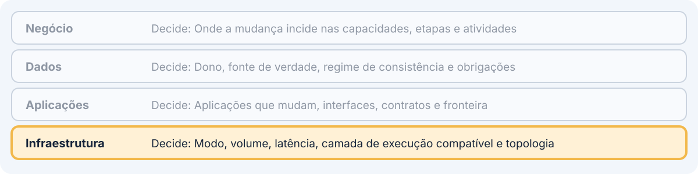
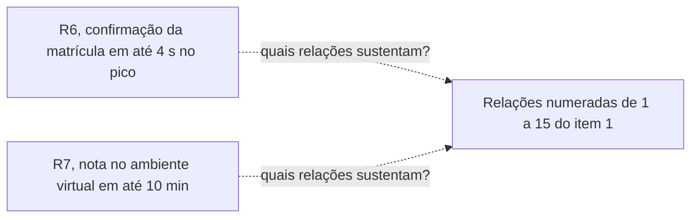
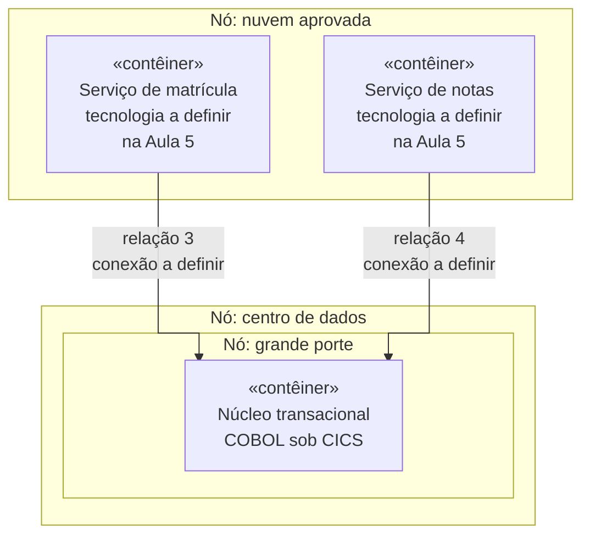

# Arquitetura de infraestrutura da solução

Quando 5.800 alunos tentam se matricular ao mesmo tempo, o tempo de confirmação depende de onde cada parte da solução executa e de como elas se conectam. Este é o quarto e último domínio da Aula 4. Infraestrutura é o conjunto de equipamentos, redes e serviços sobre o qual a solução executa. O bloco responde onde ela executa, como suas partes se conectam e o que cada interface exige da comunicação. A escolha de produto ou provedor de nuvem fica para a Aula 5.

## Antes de começar

- [Arquitetura de infraestrutura](../referencia/glossario.md#arquitetura-de-infraestrutura)
- [Modelo C4](../referencia/glossario.md#modelo-c4)
- [Bloco de construção da solução](../referencia/glossario.md#bloco-de-construcao-da-solucao)
- Diagrama de contexto corrigido no [exercício 15](bloco-3-arquitetura-de-aplicacoes-e-integracao.md#exercicio-15), que fixa quais elementos ficam dentro e fora da fronteira da solução

## Infraestrutura e contêineres

<figure markdown="span">
{ .module-diagram }
</figure>

No mapa do [bloco 0](bloco-0-espinha-dorsal-dos-dominios.md), este bloco trata do domínio de infraestrutura, o último dos quatro. O arquiteto recebe os contêineres e as relações definidos no [bloco 3](bloco-3-arquitetura-de-aplicacoes-e-integracao.md), decide o modo, o volume e a latência de cada relação, a camada de execução compatível e a topologia, e entrega o diagrama de implantação e as exigências que a definição tecnológica da Aula 5 recebe.

Para dizer onde a solução executa, o arquiteto trabalha com a **arquitetura de infraestrutura**, que é a arquitetura dos componentes e serviços tecnológicos que sustentam as atividades da organização, chamada de arquitetura de tecnologia no TOGAF. Ela inclui equipamentos, sistemas operacionais, plataformas intermediárias, redes, comunicações, capacidade de processamento e padrões técnicos, e também ativos intangíveis, como contratos com fornecedores.

### Infraestrutura na solução

Os objetivos da arquitetura de infraestrutura são maximizar a eficácia e a eficiência do provimento e do uso da infraestrutura, eliminar duplicação de componentes e manter a infraestrutura alinhada às necessidades operacionais do negócio, que mudam com a estratégia e com a tecnologia disponível. Muitos componentes de infraestrutura são invisíveis às partes interessadas de negócio, embora sustentem requisitos não funcionais como desempenho e confiabilidade, e por isso os modelos de infraestrutura servem de base para as visões de quem tem essas preocupações.

Os artefatos do domínio incluem o catálogo de tecnologia de infraestrutura, o modelo técnico de referência, o catálogo de padrões técnicos, a visão de configuração, a matriz entre aplicação e tecnologia e o modelo de plataforma. A declaração formal da infraestrutura exigida por uma solução, chamada de definição tecnológica da solução, e o modelo técnico de referência são tratados na Aula 5. Este bloco permanece no nível lógico, com os contêineres que a solução precisa, no sentido do [diagrama de contêineres](bloco-3-arquitetura-de-aplicacoes-e-integracao.md#diagrama-de-conteineres) do bloco 3, e as exigências de cada interface entre eles.

### Catálogo de blocos da solução da ACME

Antes de escolher tecnologia, o projeto precisa nomear as partes que serão realizadas. Esta é a lista de blocos lógicos do primeiro ciclo da ACME. Ela serve como entrada para a Aula 5: lá, cada linha receberá alternativas concretas de produto, serviço ou componente configurado.

| Bloco lógico | Responsabilidade no projeto | Situação no primeiro ciclo |
| --- | --- | --- |
| Interface do aplicativo do aluno | Permitir matrícula e consulta de notas no canal móvel | Novo |
| Portal do Professor | Permitir o lançamento de notas no canal já usado pelos professores | Modificado |
| Portal da Secretaria | Sustentar as operações acadêmicas da secretaria durante a transição | Modificado |
| Provedor de identidade | Autenticar e autorizar alunos, professores e equipe com padrões abertos | Novo, realizado por serviço contratado, gerenciado ou operado pela ACME |
| Serviço de matrícula | Receber solicitações e aplicar regras acadêmicas | Novo |
| Serviço de notas | Registrar, consultar e disponibilizar notas | Novo |
| Banco do serviço de matrícula | Persistir os dados próprios da matrícula | Novo |
| Banco do serviço de notas | Persistir os dados próprios das notas | Novo |
| Evento de nota | Comunicar a publicação de notas ao ambiente virtual | Novo |
| Camada anticorrupção | Isolar os serviços novos das particularidades do COBOL | Novo |
| Observabilidade | Correlacionar eventos, métricas e registros dos serviços novos | Novo |
| Núcleo transacional COBOL sob CICS | Executar regras acadêmicas durante a transição | Permanece |

O catálogo não escolhe React, Keycloak, PostgreSQL ou outro produto, pois só declara **o que a solução precisa ter e fazer**. Evento de nota, camada anticorrupção e observabilidade são blocos lógicos transversais, que podem aparecer dentro de contêineres ou nas relações entre eles, sem ganhar uma caixa própria no diagrama C4. O ambiente virtual, o gateway de pagamento, o ERP, o assinador digital e o órgão regulador são dependências externas, que entram no desenho de contexto e nas relações, mas não são blocos que a ACME realiza neste ciclo. A [Aula 5](../modulo-5-frameworks-e-tecnologias/bloco-1-definicao-tecnologica-e-trm.md#exemplos-de-abb-para-sbb-na-acme) transforma cada bloco novo ou modificado em opções concretas e registra por que uma delas foi escolhida.

### A solução como grafo

Para não esquecer nenhuma troca entre as partes, o arquiteto pode representar a solução como um grafo, em que cada [bloco de construção](../referencia/glossario.md#bloco-de-construcao-da-solucao) é um vértice e cada interface, descrita pelos seis atributos apresentados no [bloco 3](bloco-3-arquitetura-de-aplicacoes-e-integracao.md#descricao-de-uma-interface), é uma aresta. O grau de um vértice é o número de arestas ligadas a ele, e a soma dos graus de todos os vértices, dividida por dois, dá o número de interfaces da solução. Registrar o número de interfaces de cada bloco de construção permite, portanto, calcular o total de interfaces que a solução precisa sustentar.

Num exemplo genérico com cinco blocos de construção, dois blocos têm grau 3 e três blocos têm grau 2. A soma dos graus é 12, e a solução tem 6 interfaces. Cada uma dessas interfaces é examinada separadamente quanto ao tipo e ao volume de tráfego que passa por ela, porque é desse exame que sai a exigência de comunicação que a infraestrutura precisa atender. Nem toda interface usa rede, já que uma passagem entre dois processos pode ser manual, e mesmo assim todas as interfaces são examinadas para que nenhuma seja esquecida.

<figure markdown="span">
{ .module-diagram }
</figure>

*Figura 1 — Solução como grafo de blocos de construção e interfaces. Fonte: material do curso, com base em Lovatt (2021, seção 7.5).*

### Camadas de execução

A mesma aplicação pode executar em ambientes muito diferentes, e a escolha muda quem responde por manter o ambiente funcionando. Uma camada de execução é o nível de abstração em que um bloco de construção da solução recebe processamento, memória e rede, e cada camada define quais responsabilidades ficam com a equipe da solução e quais ficam com a operação de infraestrutura ou com o provedor de nuvem. A escolha da camada para cada contêiner pertence à definição tecnológica da solução, tratada na Aula 5, mas o arquiteto precisa conhecer as camadas para declarar o que cada contêiner exige de isolamento, de elasticidade e de tempo de inicialização. A lista abaixo define as cinco camadas representadas na Figura 2, do servidor físico à função sem servidor, e acrescenta os conceitos de nó e de cluster do Kubernetes.

- Servidor físico é o equipamento dedicado em que o sistema operacional executa diretamente sobre o hardware, com toda a capacidade reservada a uma carga e com a manutenção do equipamento a cargo da organização que o possui.
- Máquina virtual é um computador simulado por um hipervisor, como VMware ESXi ou KVM, ou oferecido como serviço, como o Amazon EC2, e cada máquina virtual tem sistema operacional próprio sobre uma fatia do servidor físico.
- Contêiner é um processo isolado que compartilha o núcleo do sistema operacional do hospedeiro e leva a aplicação e as dependências dela numa imagem, formato popularizado pelo Docker e executado também por alternativas como o Podman.
- Orquestrador é a plataforma que distribui contêineres por um conjunto de máquinas, reinicia instâncias que falham e ajusta o número de réplicas, papel cumprido pelo Kubernetes, em que o pod é a menor unidade implantável e agrupa um ou mais contêineres com rede e armazenamento compartilhados (The Kubernetes Authors, n.d.-b).
- No Kubernetes, o nó é a máquina virtual ou física que executa pods, e o cluster é o conjunto de nós gerenciados por um plano de controle, que mantém em cada nó os serviços necessários para executar pods (The Kubernetes Authors, n.d.-a).
- Função sem servidor é uma unidade de código executada em resposta a um evento ou a uma chamada, com servidores, capacidade, escalonamento e atualizações gerenciados pelo provedor, como no AWS Lambda e no Azure Functions (Amazon Web Services, n.d.-b).

<figure markdown="span">
{ .module-diagram }
</figure>

*Figura 2 — Camadas de execução, responsável por camada e itens declarados pelo arquiteto. Fonte: material do curso, com base em Lovatt (2021, seção 2.7), The Kubernetes Authors (n.d.-a, n.d.-b) e Amazon Web Services (n.d.-b).*

O que o arquiteto declara diminui à medida que a plataforma assume camadas. Num servidor físico ou numa máquina virtual, a declaração inclui processadores, memória, disco e sistema operacional, enquanto num contêiner ela se concentra na imagem, nas portas e nos limites de recursos, e numa função sem servidor ela se reduz ao código, ao gatilho, à memória reservada e ao tempo máximo de execução, que no AWS Lambda é de 15 minutos por invocação (Amazon Web Services, n.d.-b).

Sistemas corporativos antigos acrescentam uma sexta plataforma de execução, o mainframe com monitor transacional, em que um monitor como o IBM CICS ou o IBM IMS TM coordena transações curtas de muitos usuários simultâneos sobre programas e bases de dados do próprio mainframe. Essa plataforma não se encaixa nas colunas da Figura 2, porque a capacidade é contratada e operada como um conjunto, e um bloco de construção que permanece no mainframe aparece no diagrama de implantação como nó próprio, ligado aos demais nós por uma conexão cuja latência e cuja largura de banda o arquiteto precisa declarar.

### Topologia de implantação

Para saber o que acontece quando uma parte da solução falha ou fica distante das outras, o arquiteto desenha a topologia de implantação, que é a disposição dos nós de execução e de rede da solução, com a localização física ou lógica de cada nó e os caminhos que as requisições e os dados percorrem entre eles. Os elementos que aparecem na maior parte das topologias de soluções em nuvem estão listados abaixo, cada um com exemplos de serviço da AWS e da Microsoft Azure.

- DNS é o serviço que traduz o nome do sistema para o endereço do ponto de entrada e que pode direcionar o usuário para outro endereço quando o primeiro deixa de responder, papel cumprido pelo Amazon Route 53 e pelo Azure DNS.
- CDN é uma rede de servidores distribuídos geograficamente que guarda cópias do conteúdo estático perto do usuário, como Amazon CloudFront e Azure Front Door, e reduz a latência percebida e a carga sobre os serviços de origem.
- Balanceador de carga é o componente que recebe as requisições e as distribui entre as réplicas de um serviço, retirando da distribuição as réplicas que deixam de responder à verificação de saúde, como o Elastic Load Balancing da AWS e o Azure Load Balancer.
- Região é uma área geográfica separada do provedor, e zona de disponibilidade é um dos vários locais isolados dentro de uma região, de modo que distribuir instâncias entre zonas protege a aplicação da falha de um único local (Amazon Web Services, n.d.-a).
- Conexão dedicada é um enlace privado entre a rede da organização e o provedor, que não passa pela internet pública, como o AWS Direct Connect (Amazon Web Services, n.d.-c) e o Azure ExpressRoute (Microsoft, 2026).
- VPN é um túnel cifrado que atravessa a internet pública entre o centro de dados local e o provedor, com custo de implantação menor que o da conexão dedicada e com latência que depende das condições da internet.

<figure markdown="span">
{ .module-diagram }
</figure>

*Figura 3 — Topologia de implantação com DNS, CDN, balanceador de carga, duas zonas de disponibilidade e conexão ao centro de dados local. Fonte: material do curso, com base em Amazon Web Services (n.d.-a, n.d.-c) e Microsoft (2026).*

O número de zonas de disponibilidade decorre da disponibilidade exigida. Com réplicas numa única zona, a solução fica indisponível sempre que aquela zona falha, e com réplicas em duas zonas a indisponibilidade simultânea das duas passa a ser o evento que interrompe o serviço. Num cálculo ilustrativo, que supõe falhas independentes entre as zonas, duas zonas com 99,5% de disponibilidade cada resultam em 1 − 0,005 × 0,005, ou 99,9975%, valor que não considera falhas da região inteira nem de componentes compartilhados entre as zonas.

A redundância entre zonas também tem custo de capacidade. Se o pico de uso exige quatro réplicas do serviço, cada zona precisa sustentar as quatro réplicas sozinha para que a falha de uma zona não reduza o desempenho, o que leva a oito réplicas provisionadas ou a uma regra de escalonamento automático capaz de dobrar a capacidade da zona remanescente em poucos minutos.

Os componentes de infraestrutura invisíveis às partes interessadas de negócio, citados no início do bloco, sustentam requisitos não funcionais de desempenho e confiabilidade, e a topologia é o artefato em que essa ligação aparece de modo verificável. O requisito de disponibilidade define o número de zonas e a replicação do banco, o requisito de tempo de resposta define a capacidade de cada réplica e a presença de CDN, e o requisito de integração com sistemas que permanecem no centro de dados local define a escolha entre conexão dedicada e VPN. A seleção de provedor, de região e de serviços para a ACME pertence à definição tecnológica da Aula 5.

### Diagrama de implantação em C4

Depois de saber quais contêineres a solução tem, falta dizer em que nó cada um executa, e é isso que descreve o diagrama de implantação, o diagrama de apoio do modelo C4 que mostra como instâncias de sistemas de software e de contêineres do modelo estático são implantadas na infraestrutura de um ambiente de implantação, como produção, homologação ou desenvolvimento (Brown, n.d.). Cada contêiner do [diagrama de contêineres](bloco-3-arquitetura-de-aplicacoes-e-integracao.md#diagrama-de-conteineres) do bloco 3 é mapeado em nós de implantação aninhados, que vão do ambiente à região do provedor, à zona de disponibilidade, ao cluster Kubernetes e à máquina virtual que serve de nó do cluster, dentro da qual executa a instância de contêiner. Um serviço gerenciado, como um banco oferecido pelo provedor, aparece como nó próprio dentro da zona de disponibilidade. A notação do modelo C4 e os diagramas de contexto e de contêineres estão no [bloco 3](bloco-3-arquitetura-de-aplicacoes-e-integracao.md#modelo-c4), e o público do diagrama de implantação é técnico, de dentro e de fora da equipe de desenvolvimento, incluindo arquitetos de software, desenvolvedores, arquitetos de infraestrutura e pessoal de operação e suporte.

O diagrama de implantação segue quatro regras de construção, derivadas da definição publicada no sítio oficial do modelo C4 (Brown, n.d.):

1. Cada diagrama cobre um único ambiente de implantação, e a solução que tem produção, homologação e desenvolvimento recebe três diagramas, porque a quantidade de réplicas e de zonas costuma variar entre os ambientes.
2. O nó de implantação representa o lugar onde uma instância executa e pode ser infraestrutura física, máquina virtual, contêiner Docker ou ambiente de execução, e os nós se aninham na mesma ordem do parágrafo anterior, do ambiente à região, à zona de disponibilidade, ao cluster Kubernetes e à máquina virtual que serve de nó do cluster, dentro da qual executa a instância de contêiner.
3. Cada instância de contêiner corresponde a um contêiner do [diagrama de contêineres](bloco-3-arquitetura-de-aplicacoes-e-integracao.md#diagrama-de-conteineres) e leva o mesmo nome, e um contêiner com quatro réplicas aparece como quatro instâncias sem que o diagrama de contêineres mude.
4. Os nós de infraestrutura, como DNS, balanceador de carga e firewall, aparecem como elementos de apoio, ligados às instâncias que atendem.

O contêiner do modelo C4 é uma unidade executável ou de armazenamento, como aplicação, serviço ou banco. Ele pode executar em contêiner de sistema operacional, máquina virtual ou função sem servidor. A Figura 4 usa os serviços de matrícula e notas da Universidade ACME para mostrar essa distinção. É um esquema de implantação a detalhar na Aula 5, quando a equipe escolher tecnologias e confirmar capacidade, disponibilidade e recuperação.

<figure markdown="span">
{ .module-diagram }
</figure>

*Figura 4 — Localização das partes da solução da Universidade ACME, a detalhar na definição tecnológica. Fonte: material do curso.*

O aplicativo do aluno executa no telefone, e os portais são abertos nos navegadores de professores e secretaria. Esses nós de cliente ficam fora do ambiente de produção da ACME. Os serviços novos acessam o núcleo pelas transações existentes e integram sistemas externos pelos contratos definidos, e o diagrama mantém essas fronteiras mesmo ao mostrar que o núcleo, seu banco e os portais ficam no centro de dados da universidade.

As relações repetem o caminho da arquitetura alvo: canal do usuário, serviço, banco e integração com o núcleo. Na implantação, o arquiteto acrescenta a localização de cada parte, as fronteiras de rede e os recursos necessários. Se a localização impedir o R14, de processamento nacional, ou o R12, de disponibilidade na matrícula, a proposta precisa ser revista antes de aprovada.

## Uso pelo arquiteto

A pergunta do arquiteto neste domínio, no roteiro do [bloco 0](bloco-0-espinha-dorsal-dos-dominios.md), é a seguinte. Em que nó cada contêiner executa, com que modo, volume e latência cada relação opera e o que fica como exigência para a definição tecnológica?

O arquiteto da ACME chega a este domínio com o diagrama de contêineres e precisa dizer à equipe da Aula 5 o que cada peça exige do lugar onde executa, sem escolher produto. Para isso converte cada contêiner do [diagrama de contêineres](bloco-3-arquitetura-de-aplicacoes-e-integracao.md#diagrama-de-conteineres) e cada interface do grafo em exigências de execução e de comunicação, que a Aula 5 recebe como entrada. Para cada contêiner ele registra a camada de execução compatível, o número de réplicas e de zonas de disponibilidade imposto pelo requisito de disponibilidade e a capacidade necessária no pico, e para cada interface registra o modo de comunicação, o volume, a latência e se ela cruza a fronteira entre a nuvem e o centro de dados local, caso em que exige conexão dedicada ou VPN. Ele desenha o diagrama de implantação desse estágio com nós genéricos, como máquina virtual, cluster Kubernetes ou função sem servidor, e não nomeia provedor, região nem serviço gerenciado do provedor, porque a definição tecnológica da solução e o modelo técnico de referência, que fazem essa escolha, são o assunto da Aula 5. O Kubernetes entra nesse estágio como tecnologia de orquestração genérica, oferecida por vários provedores, e o nome do serviço de Kubernetes de cada provedor é decidido na Aula 5. Sem esse registro, a Aula 5 escolhe tecnologia sem saber que uma relação atende 5.800 sessões simultâneas na abertura da matrícula e outra leva 4.800 lançamentos de nota em dia letivo comum, e a escolha precisa ser revista depois.

## No caderno arquitetural

{{ficha:7:4}}

**Para que serve.** Quando a solução se divide em contêineres, cada seta entre eles vira uma exigência. Uma relação que atende 5.800 sessões no pico não pode ser tratada como um envio noturno de arquivo, e o núcleo COBOL, que a equipe da ACME não pode alterar até 30/09/2027, precisa estar no lugar certo do desenho. A seção 7 guarda esse desenho com as relações rotuladas, porque ele é a lista de exigências que a Aula 5 recebe para escolher a tecnologia.

**O que você faz neste exercício.** O enunciado traz o diagrama de contêineres da arquitetura alvo, com 15 relações numeradas, entre elas a que leva o aplicativo do aluno ao serviço de matrícula (relação 1) e a que leva o serviço de notas ao ambiente virtual (relação 6). Você rotula cada relação com modo, volume e latência, indica as que sustentam o R6 e o R7 e decide se o núcleo fica dentro ou fora da fronteira. As respostas entram no caderno na parte Contêineres e relações da arquitetura alvo.

| Campo do caderno | Como preencher | Item |
| --- | --- | --- |
| Modo de comunicação | Para cada uma das 15 relações, diga se é síncrona, quando quem chama espera a resposta, ou assíncrona, quando segue adiante | 1 |
| Volume e latência | Para cada relação, escreva quanto passa por ela e quanto tempo a troca pode levar, e escreva não informado quando o dossiê não trouxer o dado | 1 |
| Relações do R6 | Indique, pelo número, as relações que fazem parte do caminho da confirmação da matrícula em até 4 segundos | 2 |
| Relações do R7 | Indique, pelo número, as relações que fazem parte do caminho da nota até o ambiente virtual em até 10 minutos | 2 |
| Posição do núcleo transacional | Diga se o núcleo COBOL fica dentro ou fora da fronteira da solução e por quê | 3 |

**O que você já tem.** O diagrama de contexto corrigido no exercício 15, que fixou os elementos de dentro e de fora da fronteira, e os fatos dos dados operacionais reproduzidos no enunciado.

**Quando está pronto.** As 15 relações têm modo, volume e latência, as relações de cada requisito estão indicadas pelo número e a posição do núcleo transacional está justificada pela fronteira de responsabilidade.

[Ver esta seção no template](../caderno/template.md#7-decisoes){ .caderno-botao }
[Ver o gabarito do exercício 16](../gabaritos/gabarito-exercicio-16.md){ .caderno-botao }

{{/ficha}}

## Exercício 16

O exercício 16 mostra como a infraestrutura converte o desenho da solução em exigências para a Aula 5. A ACME é uma universidade privada brasileira fictícia, com 38.400 alunos ativos, cujo sistema acadêmico, em operação desde 2004, passa por modernização incremental. O enunciado traz o diagrama de contêineres da arquitetura alvo do primeiro ciclo, com 15 relações numeradas. Um contêiner, no modelo C4, é uma aplicação, um serviço ou um banco de dados executável que compõe o sistema, como o Serviço de notas ou o Banco Oracle. Uma relação é uma seta entre dois elementos do diagrama, por onde um deles chama o outro. O aluno faz três coisas, uma por item. No item 1, rotula cada relação com o que ela exige da comunicação. No item 2, liga as relações aos requisitos R6 e R7. No item 3, decide a posição do núcleo transacional, o sistema central da ACME escrito em COBOL, em relação à fronteira da solução.

O exercício parte do diagrama de contexto corrigido no [exercício 15](bloco-3-arquitetura-de-aplicacoes-e-integracao.md#exercicio-15), que fixou quais elementos ficam dentro e fora da fronteira, e de fatos reproduzidos dos [dados operacionais](../caso-acme/dados-operacionais.md), da [arquitetura de linha de base](../caso-acme/linha-de-base.md) e da [página inicial do caso](../caso-acme/index.md).

### Item 1: Modo, volume e latência das relações

Uma relação que atende 5.800 sessões simultâneas na abertura da matrícula e outra que leva 4.800 lançamentos de nota em dia letivo comum exigem coisas muito diferentes da comunicação, e este item descreve o que cada relação entre contêineres exige. O modo de comunicação é síncrono, quando quem chama espera a resposta, ou assíncrono, quando quem chama segue adiante e a resposta ou o efeito chega depois. O volume é quanto passa pela relação, por exemplo o número de sessões ou de lançamentos de nota, e a latência é o tempo que a troca pode levar. O diagrama abaixo é o diagrama de contêineres da arquitetura alvo do primeiro ciclo, coerente com o diagrama de contexto corrigido no exercício 15. Os contêineres novos, que são o aplicativo do aluno, o serviço de matrícula, o serviço de notas e o banco próprio de cada um desses dois serviços, levam o rótulo tecnologia a definir na Aula 5. O Portal do Professor e o Portal da Secretaria são contêineres existentes, mantidos no primeiro ciclo, e o núcleo transacional COBOL continua gravando no banco Oracle existente. As relações estão apenas numeradas, sem rótulo de comunicação, e as relações 12 a 15 ligam os serviços novos aos seus bancos, o aplicativo do aluno ao serviço de notas e o Portal da Secretaria ao núcleo.

<figure markdown="span">
![Diagrama de contêineres da arquitetura alvo do primeiro ciclo da ACME. No alto, professor, aluno e secretaria acadêmica. Dentro da fronteira do sistema acadêmico, o Portal do Professor e o Portal da Secretaria existentes, o aplicativo do aluno, os serviços de notas e de matrícula com banco próprio cada um e tecnologia a definir, e o núcleo transacional COBOL existente com o banco Oracle existente. À direita, fora da fronteira, provedor de identidade, assinador digital ICP-Brasil, ambiente virtual de aprendizagem, gateway de pagamento, ERP financeiro e órgão regulador. As relações estão numeradas de 1 a 15, em linhas ortogonais e sem rótulo de comunicação.](../assets/images/acme-ex16-diagrama-de-conteineres.svg){ .module-diagram }
</figure>

A tabela abaixo diz quais elementos cada relação liga, com a origem na ponta de quem chama, e não traz o modo, o volume nem a latência, que são a resposta do item.

| Relação | Origem | Destino |
| --- | --- | --- |
| 1 | Aplicativo do aluno | Serviço de matrícula |
| 2 | Portal do Professor | Serviço de notas |
| 3 | Serviço de matrícula | Núcleo transacional COBOL |
| 4 | Serviço de notas | Núcleo transacional COBOL |
| 5 | Núcleo transacional COBOL | Banco Oracle |
| 6 | Serviço de notas | Ambiente virtual de aprendizagem |
| 7 | Serviço de matrícula | Gateway de pagamento |
| 8 | Aplicativo do aluno | Provedor de identidade |
| 9 | Portal da Secretaria | Assinador digital ICP-Brasil |
| 10 | Núcleo transacional COBOL | ERP financeiro |
| 11 | Núcleo transacional COBOL | Órgão regulador |
| 12 | Serviço de matrícula | Banco do serviço de matrícula |
| 13 | Serviço de notas | Banco do serviço de notas |
| 14 | Aplicativo do aluno | Serviço de notas |
| 15 | Portal da Secretaria | Núcleo transacional COBOL |

A tabela seguinte traz os volumes registrados nos dados operacionais.

| Fato | Valor |
| --- | --- |
| Sessões simultâneas no pico, nos 30 minutos seguintes à abertura da matrícula | 5.800 |
| Matrículas confirmadas nesses 30 minutos | 2.400 |
| Sessões simultâneas em dia letivo comum | 640 |
| Lançamentos de nota exportados ao ambiente virtual em dia letivo comum | 4.800 |
| Lançamentos de nota exportados na janela de fechamento | até 360.000 |

1. Rotule cada relação numerada com o modo de comunicação, síncrono ou assíncrono, e com o volume e a latência exigidos, usando os fatos da tabela quando se aplicarem e escrevendo não informado quando o dossiê não trouxer o dado.

Suas respostas viram os campos Modo de comunicação e Volume e latência, na seção 7 do caderno.

As relações rotuladas neste item são a lista de exigências de comunicação que a definição tecnológica da Aula 5 recebe como entrada.

### Item 2: Relações ligadas aos requisitos

Dos 15 caminhos do diagrama, só alguns importam para o aluno que espera a confirmação da matrícula e para a nota que precisa chegar ao ambiente virtual, e este item mostra quais relações do desenho sustentam os requisitos de desempenho do caso. Uma relação sustenta diretamente um requisito quando faz parte do caminho percorrido pela operação que o requisito mede, no R6 a confirmação da matrícula e no R7 a chegada da nota ao ambiente virtual. Os dois requisitos abaixo, da página inicial do caso, fixam tempo de resposta e prazo de propagação para relações do diagrama do item 1. O percentil 95 do R6 é o valor abaixo do qual ficam 95% das respostas.

| Código | Declaração |
| --- | --- |
| R6 | Percentil 95 do tempo de confirmação da matrícula em até 4 segundos, com 5.800 sessões simultâneas |
| R7 | Nota lançada pelo professor no ambiente virtual em até 10 minutos |

1. Indique, pelo número, quais relações do diagrama do item 1 sustentam diretamente o requisito R6 e quais sustentam o requisito R7.

Suas respostas viram os campos Relações do R6 e Relações do R7, na seção 7 do caderno.

### Item 3: Núcleo transacional na arquitetura alvo

Como a equipe interna da ACME não pode alterar o núcleo COBOL até 30/09/2027, surge a dúvida de ele pertencer à solução ou apenas se ligar a ela, e este item decide se o núcleo fica dentro ou fora da fronteira da solução, a partir de quem responde por ele. A fronteira é a linha do diagrama de contêineres que separa o que a equipe da solução evolui e opera do que outra parte mantém. O núcleo transacional executa sob o monitor CICS, o programa que recebe e processa cada transação, em ambiente de grande porte, o computador central da instituição, no centro de dados da ACME. As restrições abaixo constam da página inicial do caso e dos dados operacionais. A ACME detém a responsabilidade pelo núcleo e terceiriza à fábrica contratada apenas a manutenção dos programas COBOL. O diagrama de implantação parcial, na notação C4 da seção [Diagrama de implantação em C4](#diagrama-de-implantacao-em-c4), mostra onde ficam o núcleo e os dois serviços novos que o chamam, os serviços de matrícula e de notas, que são as relações 3 e 4 da tabela do item 1.

| Restrição | Origem |
| --- | --- |
| R10, a manutenção dos programas COBOL do núcleo permanece sob o contrato da fábrica até 30/09/2027 | Contrato de sustentação |
| A equipe interna não pode alterar o núcleo, mesmo para expor interfaces | Contrato de sustentação |
| R4, a solução opera em um dos dois provedores de nuvem aprovados em 12/03/2026 | Conselho Universitário |

1. Responda, em uma frase, que consequência essa divisão de responsabilidade tem para a posição do núcleo transacional COBOL no diagrama de contêineres do item 1, com base no critério de fronteira de responsabilidade da seção [Confira a fronteira nos dois níveis](bloco-3-arquitetura-de-aplicacoes-e-integracao.md#confira-a-fronteira-nos-dois-niveis) do bloco 3.

Sua resposta vira o campo Posição do núcleo transacional, na seção 7 do caderno.

## Fontes

As referências seguem o formato APA, 7ª edição, e constam da [bibliografia](../referencia/bibliografia.md) do curso. O trecho consultado aparece entre parênteses ao fim de cada entrada.

- Lovatt, M. (2021). *Solution architecture foundations*. BCS, The Chartered Institute for IT. (seção 2.7, arquitetura de infraestrutura, objetivos, artefatos e relação com a solução, e seção 7.5, infraestrutura de rede e solução como grafo)
- Brown, S. (n.d.). *The C4 model for visualising software architecture*. https://c4model.com (diagrama de implantação, https://c4model.com/diagrams/deployment, escopo de um ambiente, nós de implantação aninhados, nós de infraestrutura, instâncias de contêiner e público técnico)
- Amazon Web Services. (n.d.-a). *Regions and zones*. Amazon EC2 User Guide. https://docs.aws.amazon.com/AWSEC2/latest/UserGuide/using-regions-availability-zones.html (definição de região e de zona de disponibilidade e distribuição de instâncias entre zonas)
- Amazon Web Services. (n.d.-b). *What is AWS Lambda?* AWS Lambda Developer Guide. https://docs.aws.amazon.com/lambda/latest/dg/welcome.html (computação sem servidor, infraestrutura gerenciada pelo provedor e limite de 15 minutos por invocação)
- Amazon Web Services. (n.d.-c). *What is Direct Connect?* AWS Direct Connect User Guide. https://docs.aws.amazon.com/directconnect/latest/UserGuide/Welcome.html (ligação por fibra entre a rede interna e a AWS sem passar por provedores de internet)
- Microsoft. (2026). *Azure ExpressRoute overview: Connect over a private connection*. Microsoft Learn. https://learn.microsoft.com/en-us/azure/expressroute/expressroute-introduction (conexão privada entre a rede local e a nuvem da Microsoft, que não passa pela internet pública)
- The Kubernetes Authors. (n.d.-a). *Nodes*. Kubernetes Documentation. https://kubernetes.io/docs/concepts/architecture/nodes/ (nó como máquina virtual ou física gerenciada pelo plano de controle, com os serviços necessários para executar pods)
- The Kubernetes Authors. (n.d.-b). *Pods*. Kubernetes Documentation. https://kubernetes.io/docs/concepts/workloads/pods/ (pod como menor unidade implantável, com um ou mais contêineres e rede e armazenamento compartilhados)

**Material do curso.** O bloco usa as entradas [arquitetura de infraestrutura](../referencia/glossario.md#arquitetura-de-infraestrutura), [modelo C4](../referencia/glossario.md#modelo-c4) e [bloco de construção da solução](../referencia/glossario.md#bloco-de-construcao-da-solucao) do glossário, além do dossiê da instituição fictícia [ACME](../caso-acme/index.md) e dos seus [dados operacionais](../caso-acme/dados-operacionais.md).
