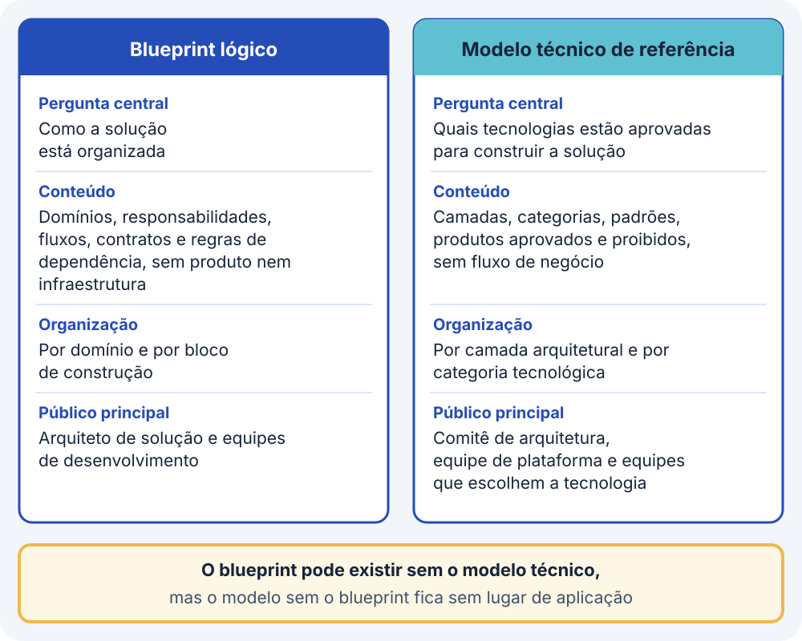
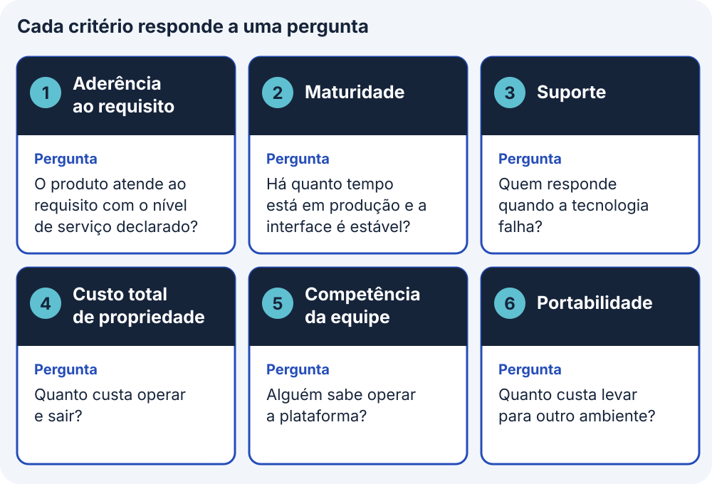
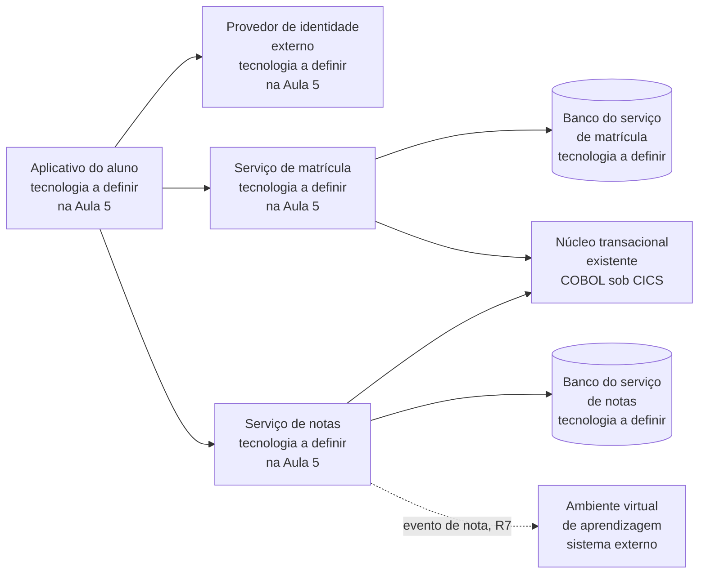

# Definição tecnológica e modelo técnico de referência

Este bloco ensina a transformar o desenho lógico da Aula 4 em escolha de tecnologia. Na Aula 4, o desenho mostrou os contêineres, que são as partes executáveis da solução, como um aplicativo, um serviço ou um banco de dados, e deixou os contêineres novos com o rótulo tecnologia a definir. O bloco explica como registrar as restrições que limitam a escolha, como comparar alternativas por seis critérios e como deixar anotado o motivo da alternativa escolhida. O exercício 17, no fim da página, aplica esse método à ACME, a universidade fictícia que serve de caso ao curso.

## Antes de começar

- [Modelo técnico de referência](../referencia/glossario.md#modelo-tecnico-de-referencia)
- [Definição tecnológica da solução](../referencia/glossario.md#definicao-tecnologica-da-solucao)
- [Lacuna de provisão](../referencia/glossario.md#lacuna-de-provisao)
- [Bloco de construção da solução](../referencia/glossario.md#bloco-de-construcao-da-solucao)
- [Dependência de fornecedor](../referencia/glossario.md#dependencia-de-fornecedor)
- [ADR](../referencia/glossario.md#adr)

## Do bloco de construção ao produto

O [bloco de construção da solução](../referencia/glossario.md#bloco-de-construcao-da-solucao) descreve uma capacidade de que a solução precisa antes de estar decidido qual produto ou serviço a realiza. Um bloco chamado serviço de identidade, por exemplo, ainda não informa se a capacidade virá de um software instalado e operado pela equipe, de um serviço contratado de terceiro ou de um recurso gerenciado de um provedor de nuvem, e cada uma dessas realizações produz consequências de operação, de contrato e de manutenção que duram anos.

A **definição tecnológica da solução** é a etapa que faz essa conversão e responde a três perguntas, que tipo e que nível de infraestrutura técnica a solução exige para ser implantada, quais áreas da infraestrutura atual precisam mudar e quanto custo, tempo e recurso essas mudanças consomem. O risco mais comum nessa etapa é escolher pela familiaridade, adotando a tecnologia que a equipe já conhece ou a que o fornecedor recomendou sem confrontar a escolha com os requisitos registrados. No caso da ACME, a etapa parte do diagrama de contêineres do [exercício 16](../modulo-4-dominios-da-solucao/bloco-4-arquitetura-de-infraestrutura.md#exercicio-16), em que aparecem contêineres novos, como o aplicativo do aluno, o serviço de matrícula e o serviço de notas, todos com o rótulo tecnologia a definir na Aula 5.

### Restrições antes da comparação

Antes de comparar produtos, o arquiteto registra as restrições tecnológicas, no sentido de [restrição](../modulo-2-requisitos-e-partes-interessadas/bloco-3-cenarios-linha-de-base-e-restricoes.md#restricoes-ao-desenho) apresentado no bloco 3 da Aula 2, como decisão tomada fora do processo de projeto que limita as alternativas sem ser negociável pelo arquiteto. A lista abaixo traz os sete tipos de restrição tecnológica que a definição tecnológica examina.

<figure markdown="span">
{ .module-diagram }
</figure>

*Figura 1 — As sete restrições tecnológicas reduzem as opções de produto antes da comparação pelos seis critérios. Fonte: material do curso, com base em Lovatt (2021, seção 7.3).*

1. Tecnologias aprovadas ou preferidas, registradas numa lista ou num modelo mantido pela organização, limitam os componentes de infraestrutura que a solução pode usar.
2. Padrões técnicos adotados pela arquitetura de infraestrutura obrigam a solução a aderir a eles, como uma norma de gestão de energia ou um protocolo de identidade obrigatório.
3. O orçamento fixa o limite de gasto em tecnologia e a prioridade de uso do dinheiro, e com isso restringe as mudanças de infraestrutura que a solução pode exigir.
4. O prazo pesa quando uma tecnologia necessária não estará disponível a tempo ou quando a organização marcou data para deixar de usar outra tecnologia.
5. Os contratos vigentes precisam ser respeitados e podem impedir a troca de um componente antes do vencimento ou fora do escopo contratado.
6. A geografia restringe a escolha quando um serviço de infraestrutura não está disponível em todas as localidades ou quando um governo limita o uso de certos serviços no seu território.
7. As competências da equipe limitam a solução quando faltam pessoas capazes de implementar, implantar ou operar um componente, e certas ferramentas ou ambientes deixam de ser opção.

As restrições reduzem o conjunto de opções antes de qualquer comparação de produto, e a alternativa que viola uma delas sai da lista sem receber nota em nenhum dos seis critérios de seleção apresentados mais adiante neste bloco.

### Do bloco ao serviço de infraestrutura

O passo central da definição tecnológica é a cadeia que liga cada bloco de construção aos componentes de infraestrutura que o sustentam. Cada bloco tem requisitos funcionais e não funcionais, e parte deles se converte em requisito de serviço de infraestrutura, sempre com o nível de serviço declarado, como disponibilidade, capacidade ou tempo de resposta. Um exemplo é o requisito de que médicos e enfermeiros entrem uma só vez nos sistemas clínicos, que vira o requisito de um serviço de identidade disponível 24 horas por dia. O requisito de serviço corresponde a um serviço de infraestrutura que consta do catálogo de infraestrutura, a lista dos serviços que a organização já oferece ou planeja oferecer às equipes, e esse serviço recebe um ou mais componentes concretos que o entregam.

Quando um requisito de serviço não encontra correspondente no catálogo, o modelo registra uma **lacuna de provisão**, que pode exigir um serviço novo, a substituição, a modificação ou a remoção de um serviço existente. A lacuna entra no custo da solução e no roteiro de entrega, e a classificação das lacunas por tipo é tratada no [bloco 4](bloco-4-adr-de-plataforma.md) desta aula.

<figure markdown="span">
{ .module-diagram }
</figure>

*Figura 2 — Do bloco de construção ao componente de infraestrutura, com a saída para lacuna de provisão. Fonte: material do curso, com base em Lovatt (2021, seção 7.4, figura 7.1).*

### O modelo técnico de referência

Para escolher o produto de cada componente da cadeia da Figura 2, a organização consulta uma lista das tecnologias permitidas, chamada **modelo técnico de referência**. O nome tem a sigla TRM, do inglês Technical Reference Model, que aparece em textos em inglês, e esta página usa sempre o nome por extenso. A arquitetura de infraestrutura mantém esse modelo como um vocabulário comum dos componentes da infraestrutura. Na definição adotada pelo curso, o modelo cataloga, por camada arquitetural e por categoria tecnológica, quais padrões, protocolos e produtos estão aprovados, quais estão proibidos e quais estão em avaliação. Um padrão ou protocolo é um conjunto de regras de comunicação que os sistemas seguem, como o REST e o OpenID Connect, que aparecem nas tabelas adiante. Uma lista de tecnologias aprovadas limita a quantidade de tecnologias diferentes em uso e assegura que cada uma passou por avaliação e por teste antes de ser adotada, de modo que a escolha do provedor de identidade ou do banco de um serviço novo parte de uma lista que a organização já avaliou.

O modelo técnico de referência e o blueprint lógico da solução são artefatos distintos. O blueprint lógico é o desenho da Aula 4 com a organização da solução em domínios, responsabilidades e fluxos, sem escolha de produto, e a tabela abaixo compara os dois artefatos em quatro dimensões.

<figure markdown="span">
{ .module-diagram }
</figure>

*Figura 3 — O blueprint lógico e o modelo técnico de referência comparados em quatro dimensões. Fonte: material do curso.*

| Dimensão | Blueprint lógico | Modelo técnico de referência |
| --- | --- | --- |
| Pergunta central | Como a solução está organizada | Quais tecnologias estão aprovadas para construir a solução |
| Conteúdo | Domínios, responsabilidades, fluxos, contratos e regras de dependência, sem produto nem infraestrutura | Camadas, categorias, padrões, produtos aprovados e produtos proibidos, sem fluxo de negócio |
| Organização | Por domínio e por bloco de construção | Por camada arquitetural e por categoria tecnológica |
| Público principal | Arquiteto de solução e equipes de desenvolvimento | Comitê de arquitetura, equipe de plataforma e equipes que escolhem a tecnologia de cada serviço |

A dependência entre os dois artefatos é assimétrica, porque o blueprint pode existir sem o modelo técnico, já que a estrutura da solução pode ser entendida antes de se saber qual tecnologia a realiza. O modelo técnico sem o blueprint fica sem lugar de aplicação, porque informa que uma tecnologia de mensageria está aprovada e deixa em aberto o fluxo em que ela será usada. A coluna de padrão do modelo emprega padrão técnico no sentido de especificação adotada por uma organização ou por um organismo de normalização, conforme a distinção feita no [bloco 3 da Aula 4](../modulo-4-dominios-da-solucao/bloco-3-arquitetura-de-aplicacoes-e-integracao.md#padrao-tecnico-protocolo-especificacao-e-contrato) entre padrão técnico e padrão arquitetural.

### Estrutura em cinco colunas

O modelo técnico de referência é organizado como uma tabela de cinco colunas. A camada agrupa as tecnologias por posição na arquitetura, como apresentação, API e integração, negócio, dados, infraestrutura e segurança transversal, e a categoria subdivide a camada em grupos como framework web, mensageria ou banco relacional. O padrão ou protocolo é a especificação obrigatória ou recomendada para a categoria, a coluna de exemplos aprovados lista produtos que atendem ao padrão e foram avaliados positivamente, e a coluna de exemplos não aprovados lista produtos excluídos de forma explícita, com uma justificativa breve. A tabela abaixo mostra duas linhas de exemplo, a de exposição de serviços, com REST e OpenAPI 3.x, e a de identidade e acesso, com OpenID Connect como padrão obrigatório.

| Camada | Categoria | Padrão ou protocolo | Exemplos aprovados | Exemplos não aprovados |
| --- | --- | --- | --- | --- |
| API e integração | Exposição de serviços | REST com OpenAPI 3.x | Spring Boot, FastAPI, NestJS | WCF, ASMX |
| Segurança transversal | Identidade e acesso | OpenID Connect obrigatório | Keycloak, Auth0, Azure AD B2C | Produto que não implementa OpenID Connect |

O padrão obrigatório permite que as equipes escolham o produto dentro de parâmetros definidos, porque um modelo que fixasse um produto único por categoria obrigaria cada projeto com requisito diferente a pedir exceção. O modelo se completa com duas seções, a de princípios, que declara as razões que sustentam as linhas da tabela e que no curso reúne três princípios, nativo de nuvem por padrão, API em primeiro lugar e segurança desde o projeto, e a de tecnologias descontinuadas, que lista o que não deve ser adotado em projeto novo.

A classificação em três cores é um mecanismo separado da tabela de cinco colunas, aplicado a cada tecnologia do modelo ou do catálogo, e registra o estado de cada uma delas. As tecnologias da seção de tecnologias descontinuadas recebem vermelho. Verde indica a tecnologia preferida, que é a primeira escolha, âmbar indica uso permitido mediante aprovação da arquitetura de infraestrutura ou de outra autoridade designada, e vermelho indica tecnologia proibida em projeto novo, que deve ser removida da infraestrutura quando houver oportunidade e só permanece num sistema legado sob plano de migração documentado. Pela nota de uso adotada no curso, toda adoção fora dos exemplos aprovados exige um [ADR](../modulo-3-design-e-padroes/bloco-4-registro-de-decisao-arquitetural.md), o registro de decisão arquitetural, com a justificativa do desvio, no formato apresentado no bloco 4 da Aula 3.

<figure markdown="span">
![Tabela do modelo técnico de referência com as cinco colunas camada, categoria, padrão ou protocolo, exemplos aprovados e exemplos não aprovados, e uma linha genérica de identidade e acesso na camada de segurança transversal. Abaixo, num quadro separado da tabela, o quadro de classificação de cada tecnologia mostra verde, tecnologia preferida, âmbar, uso com aprovação, e vermelho, proibida em projeto novo, com a indicação de que a seção de tecnologias descontinuadas reúne as vermelhas, e um rodapé lembra que a adoção fora da lista aprovada exige ADR.](../assets/images/modulo-5-trm-cinco-colunas-v3.svg){ .module-diagram }
</figure>

*Figura 4 — O modelo técnico de referência em cinco colunas e, à parte da tabela, a classificação de cada tecnologia em verde, âmbar e vermelho, com as vermelhas reunidas na seção de tecnologias descontinuadas. Fonte: material do curso, com base em Lovatt (2021, seção 7.3).*

### Seis critérios de seleção

A escolha entre os exemplos aprovados de uma mesma linha do modelo técnico de referência é feita em cada projeto, com os seis critérios de seleção definidos na lista abaixo.

<figure markdown="span">
{ .module-diagram }
</figure>

*Figura 5 — Os seis critérios de seleção e a pergunta que cada um responde. Fonte: material do curso.*

1. A aderência ao requisito verifica se a alternativa atende aos requisitos funcionais e não funcionais registrados para o bloco, com o nível de serviço declarado.
2. A maturidade avalia há quanto tempo a tecnologia está em uso em produção e quão estável é a sua interface entre versões.
3. O suporte avalia quem responde quando a tecnologia falha, que pode ser um fornecedor com contrato, uma comunidade ativa ou a própria equipe.
4. O custo total de propriedade soma desenho, implementação, implantação, gestão e manutenção ao longo da operação, inclusive o custo de saída, que cobra treinamento e migração quando a decisão é revertida.
5. A competência da equipe pesa porque uma plataforma que ninguém no time sabe operar tem custo real maior do que o preço da licença indica.
6. A portabilidade avalia o esforço de levar a solução para outro ambiente de execução ou para outro fornecedor.

O arquiteto organiza a comparação numa **matriz de avaliação**, com as alternativas nas linhas, os seis critérios nas colunas e, em cada célula, uma anotação curta que cita o dado verificável que sustenta a avaliação, como o código do requisito, a cláusula do contrato ou a medição de origem. A matriz cumpre sua função quando as alternativas vêm da lista de exemplos aprovados do modelo técnico de referência e quando a alternativa descartada é avaliada pelos mesmos critérios aplicados à escolhida.

Uma restrição pode eliminar alternativas antes da comparação, e o registro precisa declarar essa eliminação para que a decisão não seja lida como resultado de uma soma de notas. O exemplo é a ferramenta de infraestrutura como código numa organização que opera em dois provedores de nuvem, AWS e Azure, com um modelo técnico que aprova Terraform, AWS CDK e Bicep. O AWS CDK descreve recursos da AWS, o Bicep descreve recursos da Azure e o Terraform descreve recursos dos dois provedores, de modo que a restrição de portabilidade entre os dois provedores elimina duas alternativas antes que custo e maturidade sejam comparados. A matriz preenchida, com a eliminação declarada, alimenta o campo de alternativas do [ADR](../modulo-3-design-e-padroes/bloco-4-registro-de-decisao-arquitetural.md), que é a parte do registro em que se listam as opções consideradas, e o campo de revisão do ADR define um gatilho observável para reavaliar a escolha.

Versões anteriores da disciplina e materiais mais antigos usavam outra lista, a dos sete fatores, e os seis critérios acima a substituem. Quem encontrar a lista antiga pode convertê-la assim. Os requisitos funcionais, não funcionais e arquiteturais, juntos, formam a aderência ao requisito. O conhecimento técnico do time corresponde à competência da equipe, e os custos de aquisição e de renovação formam o custo total de propriedade. A confiabilidade do fornecedor corresponde ao suporte. A portabilidade é critério novo, sem fator equivalente na lista antiga, e a facilidade de uso, que constava da lista antiga, não tem critério correspondente na lista atual.

### Dependência de fornecedor

O critério de portabilidade leva ao risco de [dependência de fornecedor](../referencia/glossario.md#dependencia-de-fornecedor), que é a dificuldade de trocar ou de negociar uma dependência técnica ou organizacional adotada pelo sistema, e cujo registro em seis dimensões e cujas formas de mitigação são tratados no [bloco 4](bloco-4-adr-de-plataforma.md). O padrão aberto é a mitigação mais visível na escolha de tecnologia, porque, quando o modelo técnico de referência exige OpenID Connect na linha de identidade, um provedor de identidade pode ser substituído por outro que implemente o mesmo protocolo, e as aplicações clientes mantêm o mesmo contrato de autenticação.

### O exemplo do Hospital ACME

O Hospital ACME precisa de um serviço de identidade para médicos e enfermeiros, com dois requisitos que se convertem em requisito de serviço de infraestrutura. O primeiro é o logon único, que permite ao profissional autenticar-se uma vez e acessar os sistemas clínicos, e o segundo é a operação contínua, vinte e quatro horas por dia e sete dias por semana, porque o atendimento hospitalar não é interrompido à noite nem no fim de semana. Esses requisitos apontam para o serviço de gestão de identidade e acesso do catálogo de infraestrutura, ainda sem produto escolhido, e a escolha do produto segue a linha de identidade do modelo técnico de referência e a matriz dos seis critérios.

Se o catálogo do hospital não tiver um serviço de gestão de identidade e acesso, o requisito de serviço gera uma lacuna de provisão do tipo serviço novo, que entra no custo da solução e no roteiro de entrega antes de qualquer comparação de produto. Se o catálogo tiver o serviço, mas sem operação contínua declarada, a lacuna é do tipo modificação, porque o serviço existente precisa ter o nível de serviço ampliado para vinte e quatro horas por dia.

## Uso pelo arquiteto

O arquiteto parte do modelo técnico de referência publicado pela organização, localiza a linha que corresponde a cada requisito de serviço de infraestrutura e registra as restrições que eliminam alternativas antes de somar qualquer anotação na matriz de avaliação. A matriz preenchida, com o dado que sustenta cada célula e com a eliminação declarada, segue para o campo de alternativas do ADR de seleção. A lista de exemplos aprovados é o ponto de partida da escolha, que só se conclui quando o ADR registra a alternativa escolhida, as alternativas descartadas e o gatilho de revisão.

## No caderno arquitetural

{{ficha:8}}

**Para que serve.** A ACME precisa de um serviço de matrícula que aguente 5.800 sessões simultâneas, mas o desenho da Aula 4 deixou todos os contêineres novos com a etiqueta tecnologia a definir. Se cada equipe escolher o produto que já conhece, a universidade termina com padrões diferentes em cada serviço e com tecnologias antigas copiadas para o sistema novo. Por isso a seção 8 do caderno começa pelo que a ACME já aprovou e pelo que quer abandonar, e só depois compara as opções de um produto, de modo que quem ler o caderno meses depois encontre o motivo de cada escolha.

**O que você faz neste exercício.** O enunciado reúne o que é preciso para esse primeiro passo: as oito caixas do desenho de contêineres do exercício 16, que são as partes executáveis da solução, como o serviço de matrícula e o banco do serviço de notas, um recorte de seis linhas do modelo técnico de referência da ACME, seis tecnologias que a universidade já usa, como o COBOL sob CICS e o banco Oracle 12c, e três formas de obter um provedor de identidade, chamadas A, B e C. Você liga cada contêiner à linha do modelo que vale para ele, porque é essa linha que diz o padrão a seguir, depois classifica cada tecnologia atual em verde, âmbar ou vermelho para mostrar o que fica e o que sai, e por fim começa a comparar as três formas com o dado que o caso traz, já que o restante ainda precisa ser levantado.

| Campo do caderno | Como preencher | Item |
| --- | --- | --- |
| Linha do modelo e padrão obrigatório | Para o provedor de identidade, o serviço de matrícula, o banco do serviço de notas e o evento de nota, diga qual linha do modelo técnico vale e qual padrão ela exige | 1 |
| Linhas válidas para todos os contêineres | Indique as duas linhas do recorte que valem para qualquer contêiner novo, qualquer que seja a função dele, e explique em uma frase | 1 |
| Classificação da tecnologia | Classifique cada tecnologia da linha de base em verde, âmbar ou vermelho e justifique em uma linha com o dado da tabela | 2 |
| Tecnologias sob plano de migração | Entre as vermelhas, diga quais continuam em uso hoje e só podem ficar enquanto houver plano de migração documentado | 2 |
| Aderência e portabilidade das alternativas | Para cada forma de obter o provedor de identidade (A, B e C), escreva o dado do caso que sustenta a aderência ao requisito e a portabilidade, citando o código do requisito ou da restrição | 3 |
| Dado que falta por critério | Para maturidade, suporte, custo total de propriedade e competência da equipe, diga qual informação o caso não traz e precisa ser levantada | 3 |
| Alternativa eliminada pela restrição | Escolha o R8 ou o R14, diga qual alternativa a restrição elimina antes da comparação e qual documento do fornecedor comprova o atendimento | 3 |

**O que você já tem.** O diagrama de contêineres do exercício 16, com os contêineres novos ainda marcados como tecnologia a definir, e os requisitos e restrições registrados nas seções 1 e 3.

**Quando está pronto.** Os quatro contêineres têm linha e padrão, as seis tecnologias têm cor e justificativa, as três alternativas têm aderência e portabilidade com o código de origem e cada critério sem dado diz o que falta.

[Ver esta seção no template](../caderno/template.md#8-tecnologia-e-plataforma){ .caderno-botao }
[Ver o gabarito do exercício 17](../gabaritos/gabarito-exercicio-17.md){ .caderno-botao }

{{/ficha}}

## Exercício 17

A ACME é uma universidade privada brasileira com 38.400 alunos ativos, cujo sistema acadêmico passa por modernização incremental, isto é, é trocado por partes. O núcleo transacional, que é o conjunto de programas em COBOL que executa as operações acadêmicas, como a matrícula e o lançamento de notas, continua em operação sob o monitor CICS durante toda a transição. O monitor CICS é o programa que recebe e processa cada transação desse núcleo.

O exercício 16, da Aula 4, desenhou os contêineres da solução nova e deixou cada um com o rótulo tecnologia a definir. Este exercício dá o passo seguinte, em três itens. No primeiro, o aluno liga cada contêiner à linha do modelo técnico de referência da ACME que vale para ele. No segundo, decide o destino de seis tecnologias que a universidade já usa. No terceiro, começa a comparar três formas de obter um provedor de identidade. O enunciado traz o diagrama de contêineres do [exercício 16](../modulo-4-dominios-da-solucao/bloco-4-arquitetura-de-infraestrutura.md#exercicio-16) e fatos reproduzidos da [arquitetura de linha de base](../caso-acme/linha-de-base.md), dos [dados operacionais](../caso-acme/dados-operacionais.md) e da [página inicial do caso](../caso-acme/index.md), de modo que nenhuma resposta depende de dado externo ao enunciado.

### Item 1: Contêineres e categorias do modelo técnico

O objetivo deste item é ligar cada contêiner novo à linha do modelo técnico de referência que diz qual padrão ele deve seguir, para que cada equipe saiba de antemão o que precisa respeitar. O diagrama traz oito caixas do exercício 16. Seis são contêineres novos, com o rótulo tecnologia a definir: o aplicativo do aluno, o provedor de identidade, que é o serviço que confirma quem é o usuário, os serviços de matrícula e de notas e os dois bancos desses serviços. As outras duas são o núcleo transacional existente e o ambiente virtual de aprendizagem, um sistema externo onde o aluno acessa as turmas e consulta as notas. A tabela traz um recorte do modelo técnico de referência da ACME com seis linhas, e cada linha indica, para uma categoria de tecnologia, o padrão obrigatório, os produtos aprovados e os não aprovados. O R7 citado no diagrama é o requisito de que a nota lançada pelo professor chegue ao ambiente virtual de aprendizagem em até 10 minutos, e o evento de nota é a mensagem que avisa o ambiente virtual de que uma nota foi lançada.

| Camada | Categoria | Padrão ou protocolo | Exemplos aprovados | Exemplos não aprovados |
| --- | --- | --- | --- | --- |
| Segurança transversal | Identidade e acesso | OpenID Connect obrigatório, OAuth 2.0, SAML 2.0 | Keycloak, Auth0, Azure AD B2C | Diretório corporativo por LDAP nos canais novos |
| API e integração | Exposição de serviços | REST com OpenAPI 3.x | Spring Boot, FastAPI, NestJS | WCF, ASMX |
| API e integração | Mensageria | Tópico com retenção, contrato AsyncAPI | Kafka ou compatível, RabbitMQ | Arquivo posicional sem versão |
| Infraestrutura | Infraestrutura como código | Descrição declarativa e versionada | Terraform, AWS CDK, Bicep | Scripts manuais |
| Infraestrutura | Observabilidade | OpenTelemetry | Coletores compatíveis | Registro sem correlação |
| Dados | Banco de serviço novo | SQL, banco por serviço, região nacional | PostgreSQL ou compatível | Oracle sem ADR de desvio |

1. Para cada um dos quatro elementos a seguir, indique a linha do recorte que se aplica e o padrão ou protocolo obrigatório dessa linha: o provedor de identidade, o serviço de matrícula, o banco do serviço de notas e a comunicação por evento do serviço de notas com o ambiente virtual de aprendizagem, que o R7 exige.
2. Entre as seis linhas do recorte, indique as duas cujo padrão vale para todos os contêineres novos, qualquer que seja a função do serviço, e justifique a escolha em uma frase.

Suas respostas viram os campos Linha do modelo e padrão obrigatório e Linhas válidas para todos os contêineres, na seção 8 do caderno.

### Item 2: Tecnologias da linha de base

O objetivo deste item é decidir quais tecnologias já em uso na ACME podem continuar, quais exigem aprovação e quais devem ser abandonadas, para que o plano de modernização saiba o que manter e o que substituir. A linha de base é a descrição do sistema acadêmico como ele funciona hoje. A tabela reúne seis tecnologias da arquitetura de linha de base da ACME, como o COBOL sob CICS e o banco Oracle 12c, cada uma com o dado registrado no dossiê do caso. O recorte do modelo técnico de referência do item 1 é a segunda fonte da classificação, ao lado do dado da tabela. As três cores têm o sentido apresentado na seção Estrutura em cinco colunas: verde é a tecnologia preferida, âmbar é o uso permitido mediante aprovação e vermelho é a tecnologia proibida em projeto novo.

| Tecnologia | Dado da linha de base |
| --- | --- |
| JSF 1.2 e EJB 2.0 | 410.000 linhas de Java escritas entre 2007 e 2009, sobre servidor de aplicação cuja versão saiu de suporte do fornecedor em 2018, em 220 telas distribuídas em quatro aplicações |
| Oracle 12c Release 2 | 740 tabelas e 11 TB de dados, suporte estendido encerrado em 31/03/2022 e licenciamento com renovação anual em 30/06 |
| Acesso direto ao banco | 2.300 pontos no código Java que leem ou gravam tabelas do núcleo, contornando as transações do CICS |
| COBOL sob CICS | 6 especialistas da fábrica contratada, com 2 aposentadorias previstas para 2027, e manutenção sob contrato exclusivo até 30/09/2027 |
| Diretório corporativo | Autenticação de todos os perfis pelos portais, por LDAP síncrono com tempo limite de 10 s |
| Arquivo posicional sem versão | Mudança de layout no lote de exportação de notas que causou o incidente de 09/07/2026, com 61.400 lançamentos de nota que não chegaram ao ambiente virtual de aprendizagem |

1. Classifique cada uma das seis tecnologias da tabela em verde, âmbar ou vermelho, conforme a classificação apresentada na seção [Estrutura em cinco colunas](#estrutura-em-cinco-colunas), e justifique cada classificação em uma linha com base no dado da tabela e no recorte do modelo técnico do item 1.
2. Entre as tecnologias que classificou em vermelho, indique as que continuam em uso no sistema atual e, por isso, só podem permanecer sob plano de migração documentado, com uma linha de justificativa para cada uma.

Suas respostas viram os campos Classificação da tecnologia e Tecnologias sob plano de migração, na seção 8 do caderno.

### Item 3: Matriz de seleção do provedor de identidade

O objetivo deste item é começar a comparar três formas de obter um provedor de identidade, o serviço que autentica os usuários, usando apenas o que o dossiê registra, para ver até onde os dados do caso sustentam uma escolha. A primeira tabela reproduz quatro requisitos, R6, R8, R12 e R14, e uma restrição do caso que pesam na escolha, com a origem de cada um. Um requisito é uma exigência que a solução precisa cumprir, e a restrição é uma decisão já tomada pela organização que limita as alternativas. No R6, o percentil 95 do tempo de confirmação em até 4 segundos significa que 95% das confirmações levam no máximo 4 segundos. Neste exercício, o R8 é lido como exigência do protocolo aberto de identidade OpenID Connect, sem proibir produto que o implemente. A segunda tabela é a parte da matriz de avaliação que o caso permite preencher, com as células de aderência ao requisito e de portabilidade em branco para três alternativas: a A, em que o provedor é um software instalado e operado pela equipe da ACME, a B, em que é um serviço contratado de terceiro, e a C, em que é um recurso gerenciado do provedor de nuvem.

| Código | Requisito ou restrição | Origem |
| --- | --- | --- |
| R8 | A autenticação usa padrões abertos de identidade, sem produto proprietário | Comitê de Segurança da Informação, página inicial do caso |
| R6 | O portal sustenta 5.800 sessões simultâneas na abertura da matrícula, com percentil 95 do tempo de confirmação em até 4 segundos | Diretoria de TI, página inicial do caso |
| R12 | A disponibilidade na janela de matrícula é de 99,9%, o que corresponde a 43 minutos de indisponibilidade tolerada por mês | Pró-Reitoria de Graduação, página inicial do caso e dados operacionais |
| R14 | Nenhum dado pessoal de aluno é processado fora do território nacional | Jurídico, parecer de 28/04/2026 |
| Restrição de nuvem | Dois provedores de nuvem pré-aprovados, com decisões de plataforma portáveis entre os dois | Conselho Universitário, 12/03/2026 |

| Alternativa | Aderência ao requisito | Portabilidade |
| --- | --- | --- |
| A, instalado e operado pela equipe |  |  |
| B, serviço de terceiro |  |  |
| C, gerenciado da nuvem |  |  |

A terceira tabela lista os quatro critérios restantes dos seis, para os quais o dossiê da ACME não registra dado sobre as alternativas, e o aluno indica nela o dado que faltaria.

| Critério | Dado que o caso não traz e precisa ser levantado |
| --- | --- |
| Maturidade |  |
| Suporte |  |
| Custo total de propriedade |  |
| Competência da equipe |  |

1. Preencha as três células de aderência ao requisito e as três de portabilidade com o dado do caso que as sustenta, citando o código do requisito ou a restrição de origem.
2. Para cada um dos quatro critérios da terceira tabela, escreva uma frase que diga qual dado o caso não traz e precisaria ser levantado com o fornecedor ou com a equipe, sem atribuir valor às alternativas.
3. Escolha uma das duas restrições, R8, que exige padrões abertos de identidade, ou R14, que proíbe processar dado pessoal de aluno fora do território nacional. Explique como ela elimina uma das alternativas A, B ou C antes da comparação e indique que documento do fornecedor comprova o atendimento.

Suas respostas viram os campos Aderência e portabilidade das alternativas, Dado que falta por critério e Alternativa eliminada pela restrição, na seção 8 do caderno.

## Fontes

As referências seguem o formato APA, 7ª edição, e constam da [bibliografia](../referencia/bibliografia.md) do curso. O trecho consultado aparece entre parênteses ao fim de cada entrada.

- Lovatt, M. (2021). *Solution architecture foundations*. BCS, The Chartered Institute for IT. (seção 2.7.2, modelo técnico de referência entre os artefatos da arquitetura de infraestrutura, seção 7.1, as três perguntas e os passos da definição tecnológica e a figura 7.1, seção 7.3, os sete tipos de restrição tecnológica, o benefício da lista de tecnologias aprovadas e a classificação em vermelho, âmbar e verde, e seção 7.4, o mapeamento dos blocos de construção em serviços de infraestrutura e o catálogo de serviços, com a gestão de identidade e acesso. O Hospital ACME é a versão portuguesa do caso Fallowdale Hospital, que o livro usa nas seções 7.1 a 7.4 com o serviço de comunicação com pacientes, adaptado aqui ao serviço de identidade.)

**Material do curso.** A estrutura em cinco colunas do modelo técnico de referência, os três princípios, a nota de uso que exige ADR para a adoção fora da lista aprovada e os seis critérios de seleção são convenções do curso. O bloco usa as entradas [modelo técnico de referência](../referencia/glossario.md#modelo-tecnico-de-referencia), [definição tecnológica da solução](../referencia/glossario.md#definicao-tecnologica-da-solucao), [lacuna de provisão](../referencia/glossario.md#lacuna-de-provisao), [bloco de construção da solução](../referencia/glossario.md#bloco-de-construcao-da-solucao), [dependência de fornecedor](../referencia/glossario.md#dependencia-de-fornecedor) e [ADR](../referencia/glossario.md#adr) do glossário, além do dossiê da instituição fictícia [ACME](../caso-acme/index.md), da [arquitetura de linha de base](../caso-acme/linha-de-base.md) e dos [dados operacionais](../caso-acme/dados-operacionais.md).
