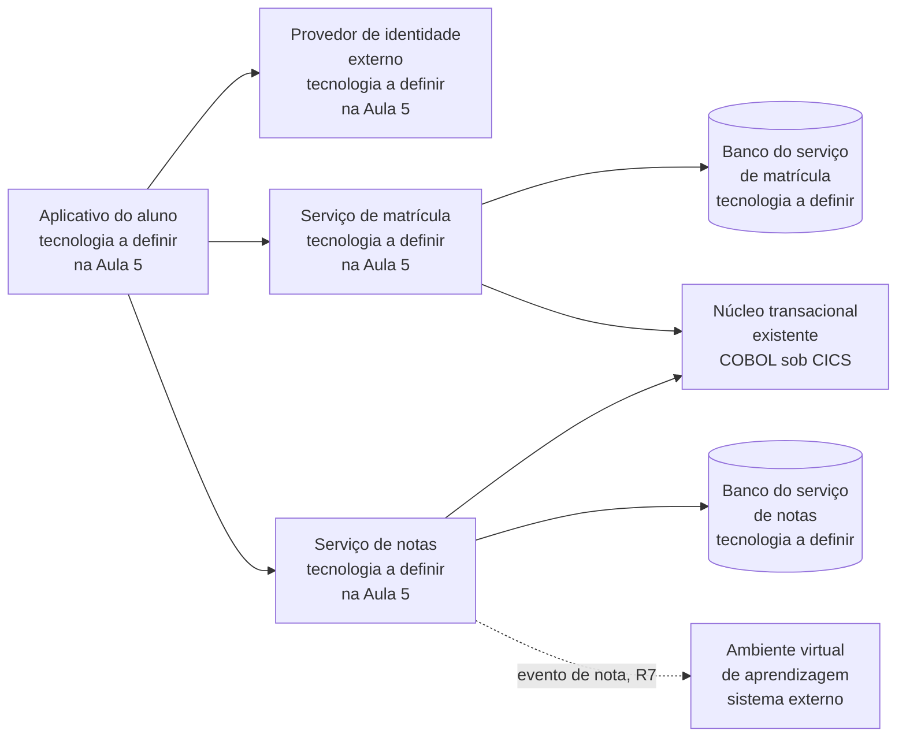

# Definição tecnológica e modelo técnico de referência

Quando o desenho da Aula 4 ficou pronto, a ACME tinha oito caixas no diagrama. Seis ainda diziam “tecnologia a definir”. Essas caixas são contêineres, partes executáveis da solução, como aplicativo, serviço ou banco de dados. Este bloco mostra como escolher o produto que realizará cada uma: primeiro registra as restrições, depois compara as alternativas permitidas por seis critérios e documenta o motivo da escolha. O exercício 17 aplica esse caminho à ACME.

## Antes de começar

- [Modelo técnico de referência](../referencia/glossario.md#modelo-tecnico-de-referencia)
- [Definição tecnológica da solução](../referencia/glossario.md#definicao-tecnologica-da-solucao)
- [Lacuna de provisão](../referencia/glossario.md#lacuna-de-provisao)
- [Bloco de construção da solução](../referencia/glossario.md#bloco-de-construcao-da-solucao)
- [Dependência de fornecedor](../referencia/glossario.md#dependencia-de-fornecedor)
- [ADR](../referencia/glossario.md#adr)

## O que vamos fazer

Nesta aula, você vai transformar uma necessidade do desenho em uma escolha tecnológica que possa ser defendida no Projeto de Arquitetura de Solução. O caminho é sempre o mesmo: identificar o que a solução precisa fazer, eliminar opções que desrespeitam as restrições, comparar as candidatas que restaram e registrar a decisão.

<figure markdown="span">
{ .module-diagram }
<figcaption>Da responsabilidade à decisão tecnológica: a escolha parte de uma necessidade comprovada e termina em uma decisão justificável.</figcaption>
</figure>

No desenho lógico, um bloco descreve uma responsabilidade, e não um produto. Nesta aula, **ABB** (*Architecture Building Block*) é o mesmo nível lógico chamado de [bloco de construção da solução](../referencia/glossario.md#bloco-de-construcao-da-solucao) no restante do curso. A realização concreta é o **SBB** (*Solution Building Block*): o produto, serviço contratado ou componente configurado que executará aquela responsabilidade. O aluno parte de ABBs, aprende a comparar candidatos e só então propõe SBBs para cada bloco.

### Passo 1: identifique o que precisa ser realizado

Comece pelo diagrama de contêineres do [exercício 16](../modulo-4-dominios-da-solucao/bloco-4-arquitetura-de-infraestrutura.md#exercicio-16). A tabela transforma o desenho em uma lista de responsabilidades, de modo que, por exemplo, “serviço de matrícula” diz o que precisa existir, e a escolha de como construí-lo fica para os passos 3 e 4.

| ABB, bloco lógico | Responsabilidade | Situação no primeiro ciclo |
| --- | --- | --- |
| Interface do aplicativo do aluno | Permitir matrícula e consulta de notas no canal móvel | Novo |
| Portal do Professor | Permitir o lançamento de notas no canal já usado pelos professores | Modificado |
| Portal da Secretaria | Sustentar as operações acadêmicas da secretaria durante a transição | Modificado |
| Provedor de identidade | Autenticar e autorizar alunos, professores e equipe com padrões abertos | Novo, realizado por serviço contratado, gerenciado ou operado pela ACME |
| Serviço de matrícula | Receber solicitações e aplicar regras acadêmicas | Novo |
| Serviço de notas | Registrar, consultar e disponibilizar notas | Novo |
| Banco do serviço de matrícula | Persistir os dados próprios da matrícula | Novo |
| Banco do serviço de notas | Persistir os dados próprios das notas | Novo |
| Evento de nota | Comunicar a publicação de notas ao ambiente virtual | Novo |
| Camada anticorrupção | Isolar os serviços novos das particularidades do COBOL | Novo |
| Observabilidade | Correlacionar eventos, métricas e registros dos serviços novos | Novo |
| Núcleo transacional COBOL sob CICS | Executar regras acadêmicas durante a transição | Permanece |

Evento de nota, camada anticorrupção e observabilidade atravessam mais de um contêiner. Por isso, podem ficar nas relações ou dentro dos contêineres, sem uma caixa própria no C4. O ambiente virtual, o gateway de pagamento, o ERP, o assinador digital e o órgão regulador são sistemas externos. Eles influenciam os contratos e a escolha, mas a ACME não precisa construí-los neste ciclo.

### Passo 2: elimine o que não atende às restrições

Uma equipe que compara produtos sem olhar o que já foi decidido perde tempo com opções inviáveis. Por isso, o arquiteto registra primeiro as [restrições que limitam as alternativas tecnológicas](../modulo-2-requisitos-e-partes-interessadas/bloco-3-cenarios-linha-de-base-e-restricoes.md#restricoes-ao-desenho). Elas vêm de decisões tomadas fora do processo de projeto, não podem ser alteradas pelo arquiteto sozinho e se dividem nos sete tipos de restrição tecnológica da lista abaixo.

<figure markdown="span">
{ .module-diagram }
</figure>

*Figura 1 — As sete restrições tecnológicas reduzem as opções de produto antes da comparação pelos seis critérios. Fonte: material do curso, com base em Lovatt (2021, seção 7.3).*

1. Tecnologias aprovadas ou preferidas, registradas numa lista ou num modelo mantido pela organização, limitam os componentes de infraestrutura que a solução pode usar.
2. Padrões técnicos adotados pela arquitetura de infraestrutura obrigam a solução a aderir a eles, como uma norma de gestão de energia ou um protocolo de identidade obrigatório.
3. O orçamento fixa o limite de gasto em tecnologia e a prioridade de uso do dinheiro, e com isso restringe as mudanças de infraestrutura que a solução pode exigir.
4. O prazo pesa quando uma tecnologia necessária não estará disponível a tempo ou quando a organização marcou data para deixar de usar outra tecnologia.
5. Os contratos vigentes precisam ser respeitados e podem impedir a troca de um componente antes do vencimento ou fora do escopo contratado.
6. A geografia restringe a escolha quando um serviço de infraestrutura não está disponível em todas as localidades ou quando um governo limita o uso de certos serviços no seu território.
7. As competências da equipe limitam a solução quando faltam pessoas capazes de implementar, implantar ou operar um componente, e certas ferramentas ou ambientes deixam de ser opção.

As restrições reduzem o conjunto de opções antes de qualquer comparação de produto, de modo que a alternativa que viola uma delas sai da lista sem receber nota em nenhum dos seis critérios de seleção apresentados mais adiante neste bloco.

#### Transforme a responsabilidade em uma necessidade técnica

Para cada bloco da ACME, escreva o que a tecnologia precisa oferecer: o provedor de identidade, por exemplo, deve autenticar pelos padrões do R8, atender à janela de matrícula e processar dados pessoais no Brasil, enquanto os requisitos R6 e R12 orientam os testes de capacidade e disponibilidade. Depois verifique se a organização já oferece esse serviço, com os níveis necessários, numa lista de serviços disponíveis que se chama catálogo de infraestrutura.

Às vezes o catálogo simplesmente não tem o serviço de que o requisito precisa. Nesse caso o modelo registra uma **lacuna de provisão**, que pode exigir um serviço novo, a substituição, a modificação ou a remoção de um serviço existente, e a lacuna entra no custo da solução e no roteiro de entrega. A classificação das lacunas por tipo é tratada no [bloco 4](bloco-4-adr-de-plataforma.md) desta aula.

<figure markdown="span">
{ .module-diagram }
</figure>

*Figura 2 — Do bloco de construção ao componente de infraestrutura, com a saída para lacuna de provisão. Fonte: material do curso, com base em Lovatt (2021, seção 7.4, figura 7.1).*

### Passo 3: encontre candidatas permitidas

Percorrida a cadeia da Figura 2, falta saber qual produto pode ocupar cada lugar, e para isso a organização consulta uma lista das tecnologias permitidas, chamada **modelo técnico de referência**. O nome tem a sigla TRM, do inglês Technical Reference Model, que aparece em textos em inglês, e esta página usa sempre o nome por extenso. A arquitetura de infraestrutura mantém esse modelo como um vocabulário comum dos componentes da infraestrutura. Na definição adotada pelo curso, o modelo cataloga, por camada arquitetural e por categoria tecnológica, quais padrões, protocolos e produtos estão aprovados, quais estão proibidos e quais estão em avaliação. Um padrão ou protocolo é um conjunto de regras de comunicação que os sistemas seguem, como o REST e o OpenID Connect, que aparecem nas tabelas adiante. Uma lista de tecnologias aprovadas limita a quantidade de tecnologias diferentes em uso e assegura que cada uma passou por avaliação e por teste antes de ser adotada, de modo que a escolha do provedor de identidade ou do banco de um serviço novo parte de uma lista que a organização já avaliou.

É fácil confundir o modelo técnico de referência com o blueprint lógico da solução, mas os dois são artefatos distintos e respondem a perguntas diferentes. O blueprint lógico é o desenho da Aula 4 com a organização da solução em domínios, responsabilidades e fluxos, sem escolha de produto, e a tabela abaixo compara os dois artefatos em quatro dimensões.

<figure markdown="span">
{ .module-diagram }
</figure>

*Figura 3 — O blueprint lógico e o modelo técnico de referência comparados em quatro dimensões. Fonte: material do curso.*

| Dimensão | Blueprint lógico | Modelo técnico de referência |
| --- | --- | --- |
| Pergunta central | Como a solução está organizada | Quais tecnologias estão aprovadas para construir a solução |
| Conteúdo | Domínios, responsabilidades, fluxos, contratos e regras de dependência, sem produto nem infraestrutura | Camadas, categorias, padrões, produtos aprovados e produtos proibidos, sem fluxo de negócio |
| Organização | Por domínio e por bloco de construção | Por camada arquitetural e por categoria tecnológica |
| Público principal | Arquiteto de solução e equipes de desenvolvimento | Comitê de arquitetura, equipe de plataforma e equipes que escolhem a tecnologia de cada serviço |

A dependência entre os dois artefatos é assimétrica, porque o blueprint pode existir sem o modelo técnico, já que a estrutura da solução pode ser entendida antes de se saber qual tecnologia a realiza. O modelo técnico sem o blueprint fica sem lugar de aplicação, porque informa que uma tecnologia de mensageria está aprovada e deixa em aberto o fluxo em que ela será usada. A coluna de padrão do modelo emprega padrão técnico no sentido de especificação adotada por uma organização ou por um organismo de normalização, conforme a distinção feita no [bloco 3 da Aula 4](../modulo-4-dominios-da-solucao/bloco-3-arquitetura-de-aplicacoes-e-integracao.md#padrao-tecnico-protocolo-especificacao-e-contrato) entre padrão técnico e padrão arquitetural.

#### Estrutura em cinco colunas

Para que a consulta seja rápida, o modelo técnico de referência é organizado como uma tabela de cinco colunas. A camada agrupa as tecnologias por posição na arquitetura, como apresentação, API e integração, negócio, dados, infraestrutura e segurança transversal, e a categoria subdivide a camada em grupos como framework web, mensageria ou banco relacional. O padrão ou protocolo é a especificação obrigatória ou recomendada para a categoria, a coluna de exemplos aprovados lista produtos que atendem ao padrão e foram avaliados positivamente, e a coluna de exemplos não aprovados lista produtos excluídos de forma explícita, com uma justificativa breve. A tabela abaixo mostra duas linhas de exemplo, a de exposição de serviços, com REST e OpenAPI 3.x, e a de identidade e acesso, com OpenID Connect como padrão obrigatório.

| Camada | Categoria | Padrão ou protocolo | Exemplos aprovados | Exemplos não aprovados |
| --- | --- | --- | --- | --- |
| API e integração | Exposição de serviços | REST com OpenAPI 3.x | Spring Boot, FastAPI, NestJS | WCF, ASMX |
| Segurança transversal | Identidade e acesso | OpenID Connect obrigatório | Keycloak, Auth0, Azure AD B2C | Produto que não implementa OpenID Connect |

O padrão obrigatório permite que as equipes escolham o produto dentro de parâmetros definidos, porque um modelo que fixasse um produto único por categoria obrigaria cada projeto com requisito diferente a pedir exceção. O modelo se completa com duas seções, a de princípios, que declara as razões que sustentam as linhas da tabela e que no curso reúne três princípios, nativo de nuvem por padrão, API em primeiro lugar e segurança desde o projeto, e a de tecnologias descontinuadas, que lista o que não deve ser adotado em projeto novo.

Além das cinco colunas, cada tecnologia do modelo ou do catálogo recebe uma cor que registra o seu estado, num mecanismo separado da tabela. As tecnologias da seção de tecnologias descontinuadas recebem vermelho. Verde indica a tecnologia preferida, que é a primeira escolha, âmbar indica uso permitido mediante aprovação da arquitetura de infraestrutura ou de outra autoridade designada, e vermelho indica tecnologia proibida em projeto novo, que deve ser removida da infraestrutura quando houver oportunidade e só permanece num sistema legado sob plano de migração documentado. Pela nota de uso adotada no curso, toda adoção fora dos exemplos aprovados exige um [ADR](../modulo-3-design-e-padroes/bloco-4-registro-de-decisao-arquitetural.md), o registro de decisão arquitetural, com a justificativa do desvio, no formato apresentado no bloco 4 da Aula 3.

<figure markdown="span">
![Tabela do modelo técnico de referência com as cinco colunas camada, categoria, padrão ou protocolo, exemplos aprovados e exemplos não aprovados, e uma linha genérica de identidade e acesso na camada de segurança transversal. Abaixo, num quadro separado da tabela, o quadro de classificação de cada tecnologia mostra verde, tecnologia preferida, âmbar, uso com aprovação, e vermelho, proibida em projeto novo, com a indicação de que a seção de tecnologias descontinuadas reúne as vermelhas, e um rodapé lembra que a adoção fora da lista aprovada exige ADR.](../assets/images/modulo-5-trm-cinco-colunas-v3.svg){ .module-diagram }
</figure>

*Figura 4 — O modelo técnico de referência em cinco colunas e, à parte da tabela, a classificação de cada tecnologia em verde, âmbar e vermelho, com as vermelhas reunidas na seção de tecnologias descontinuadas. Fonte: material do curso, com base em Lovatt (2021, seção 7.3).*

### Passo 4: compare as candidatas que restaram

#### Seis critérios de seleção

Quando a linha do modelo traz mais de um produto aprovado, como Keycloak, Auth0 e Azure AD B2C na linha de identidade, a escolha é feita em cada projeto, com os seis critérios de seleção definidos na lista abaixo.

<figure markdown="span">
{ .module-diagram }
</figure>

*Figura 5 — Os seis critérios de seleção e a pergunta que cada um responde. Fonte: material do curso.*

1. A aderência ao requisito verifica se a alternativa atende aos requisitos funcionais e não funcionais registrados para o bloco, com o nível de serviço declarado.
2. A maturidade avalia há quanto tempo a tecnologia está em uso em produção e quão estável é a sua interface entre versões.
3. O suporte avalia quem responde quando a tecnologia falha, que pode ser um fornecedor com contrato, uma comunidade ativa ou a própria equipe.
4. O custo total de propriedade soma desenho, implementação, implantação, gestão e manutenção ao longo da operação, inclusive o custo de saída, que cobra treinamento e migração quando a decisão é revertida.
5. A competência da equipe pesa porque uma plataforma que ninguém no time sabe operar tem custo real maior do que o preço da licença indica.
6. A portabilidade avalia o esforço de levar a solução para outro ambiente de execução ou para outro fornecedor.

O arquiteto organiza a comparação numa **matriz de avaliação**, com as alternativas nas linhas, os seis critérios nas colunas e, em cada célula, uma anotação curta que cita o dado verificável que sustenta a avaliação, como o código do requisito, a cláusula do contrato ou a medição de origem. A matriz cumpre sua função quando as alternativas vêm da lista de exemplos aprovados do modelo técnico de referência e quando a alternativa descartada é avaliada pelos mesmos critérios aplicados à escolhida.

Uma restrição pode eliminar alternativas antes da comparação, e o registro precisa declarar essa eliminação para que a decisão não seja lida como resultado de uma soma de notas. O exemplo é a ferramenta de infraestrutura como código numa organização que opera em dois provedores de nuvem, AWS e Azure, com um modelo técnico que aprova Terraform, AWS CDK e Bicep. O AWS CDK descreve recursos da AWS, o Bicep descreve recursos da Azure e o Terraform descreve recursos dos dois provedores, de modo que a restrição de portabilidade entre os dois provedores elimina duas alternativas antes que custo e maturidade sejam comparados. A matriz preenchida, com a eliminação declarada, alimenta o campo de alternativas do [ADR](../modulo-3-design-e-padroes/bloco-4-registro-de-decisao-arquitetural.md), que é a parte do registro em que se listam as opções consideradas, e o campo de revisão do ADR define um gatilho observável para reavaliar a escolha.

Versões anteriores da disciplina usavam outra lista, a dos sete fatores, e os seis critérios acima a substituem. Quem encontrar a lista antiga pode convertê-la assim: os requisitos funcionais, não funcionais e arquiteturais, juntos, formam a aderência ao requisito, o conhecimento técnico do time corresponde à competência da equipe, os custos de aquisição e de renovação formam o custo total de propriedade e a confiabilidade do fornecedor corresponde ao suporte. A portabilidade é um critério que a lista antiga não tinha, e a facilidade de uso, que constava da lista antiga, deixou de ter critério correspondente na lista atual.

### Passo 5: proponha e registre a realização

#### Exemplos de ABB para SBB na ACME

Agora que o método de comparação está definido, os exemplos ficam concretos. Cada linha liga um bloco do catálogo do Passo 1 a um SBB candidato, e o nome do bloco é o mesmo do catálogo. Nas linhas de provedor de identidade, serviços, bancos, evento de nota e observabilidade, o candidato é um exemplo aprovado na linha correspondente do recorte do modelo técnico de referência usado no exercício 17. Nas linhas sem linha no recorte, o candidato é só um exemplo de realização que a equipe precisa avaliar, e nenhum produto está escolhido.

| ABB, bloco lógico | SBB candidato | Por que esse candidato entra na comparação | Evidência que precisa decidir |
| --- | --- | --- | --- |
| Interface do aplicativo do aluno | React Native | Exemplo a avaliar, sem linha no recorte: pode realizar o aplicativo do aluno em dispositivos móveis | Canal definido no escopo, suporte aos dispositivos dos alunos, desempenho e manutenção |
| Portal do Professor | React para web | Exemplo a avaliar, sem linha no recorte, para a camada web que pode suceder o JSF 1.2 e o EJB 2.0, e só entra se o plano de migração trocar o portal | Plano de migração, as 46 telas do portal, acessibilidade, desempenho percebido e competência da equipe |
| Portal da Secretaria | React para web | Exemplo a avaliar, sem linha no recorte, para a camada web que pode suceder o JSF 1.2 e o EJB 2.0, e só entra se o plano de migração trocar o portal | Plano de migração, as 62 telas do portal, acessibilidade, desempenho percebido e competência da equipe |
| Provedor de identidade | Keycloak operado pela ACME | Implementa OpenID Connect e pode executar sob controle da instituição | Residência nacional, disponibilidade na matrícula, operação e custo |
| Provedor de identidade | Auth0 contratado | Implementa padrões abertos como serviço de terceiro | Região de processamento, contrato, custo total e portabilidade |
| Provedor de identidade | Azure AD B2C gerenciado | Realiza identidade como serviço do provedor de nuvem | Aderência à restrição de nuvem, região, custo de saída e dependência de fornecedor |
| Serviço de matrícula | Spring Boot | Pode expor a API REST e implementar regras do serviço | Capacidade para o pico, competência Java, observabilidade e suporte |
| Serviço de matrícula | FastAPI | Pode expor a API REST como serviço independente | Capacidade para o pico, competência Python, operação e integração existente |
| Serviço de matrícula | NestJS | Pode expor a API REST como serviço independente, na mesma linha de exposição de serviços | Capacidade para o pico, competência TypeScript, operação e integração existente |
| Serviço de notas | Spring Boot | Pode expor API REST e publicar o evento de nota | Contrato OpenAPI e AsyncAPI, prazo do R7 e competência Java |
| Serviço de notas | FastAPI | Pode expor API REST e publicar o evento de nota, na mesma linha de exposição de serviços | Contrato OpenAPI e AsyncAPI, prazo do R7 e competência Python |
| Serviço de notas | NestJS | Pode expor API REST e publicar o evento de nota | Contrato OpenAPI e AsyncAPI, prazo do R7 e competência TypeScript |
| Banco do serviço de matrícula | PostgreSQL em região nacional | Implementa o armazenamento SQL próprio do serviço, na mesma linha de banco de serviço novo | Proteção do dado, recuperação, custo e operação da base |
| Banco do serviço de notas | PostgreSQL em região nacional | Implementa o armazenamento SQL próprio do serviço | Proteção do dado, recuperação, custo e operação da base |
| Evento de nota | Kafka ou compatível | Publica eventos com retenção e contrato AsyncAPI | Volume, retenção, reentrega e rastreabilidade da mensagem |
| Evento de nota | RabbitMQ | Pode realizar mensageria entre produtor e consumidor | Garantias de entrega, operação, retenção e compatibilidade com o contrato |
| Camada anticorrupção | Candidato a levantar | O recorte e o dossiê não trazem produto nem exemplo para isolar os serviços novos do COBOL, e a equipe levanta candidatos antes da comparação | Transações CICS existentes, tempo limite dos conectores e competência da equipe |
| Observabilidade | Coletores compatíveis com OpenTelemetry | Coletam métricas, logs e rastros para operar os serviços | Correlação, retenção, acesso aos dados e integração com a operação existente |

Leia cada linha da esquerda para a direita. “Interface do aplicativo do aluno → React Native” ou “evento de nota → Kafka” é um ponto de partida para a comparação. Antes de escolher, o aluno verifica as restrições, procura evidências para os seis critérios e registra no ADR por que a opção escolhida atende melhor ao caso.

Fica sem linha na tabela o Núcleo transacional COBOL sob CICS, que permanece como está no primeiro ciclo e não recebe SBB novo. A infraestrutura como código também não é bloco do catálogo, mas a linha do recorte que a trata vale para todos os contêineres novos, e a ferramenta, entre Terraform, AWS CDK e Bicep, é escolhida pelos seis critérios, como no exemplo de eliminação do Passo 4.

#### Inclua o risco de dependência na comparação

O critério de portabilidade leva ao risco de [dependência de fornecedor](../referencia/glossario.md#dependencia-de-fornecedor), que é a dificuldade de trocar ou de negociar uma dependência técnica ou organizacional adotada pelo sistema, e cujo registro em seis dimensões e cujas formas de mitigação são tratados no [bloco 4](bloco-4-adr-de-plataforma.md). O padrão aberto é a mitigação mais visível na escolha de tecnologia, porque, quando o modelo técnico de referência exige OpenID Connect na linha de identidade, um provedor de identidade pode ser substituído por outro que implemente o mesmo protocolo, e as aplicações clientes mantêm o mesmo contrato de autenticação.

#### Veja o caminho completo na ACME

O provedor de identidade é uma boa primeira escolha para treinar o método. A responsabilidade é autenticar e autorizar alunos, professores e equipe. O R8 exige OpenID Connect, o R14 limita o processamento de dados pessoais ao território nacional e a restrição de nuvem exige que a decisão possa funcionar nos dois provedores aprovados, e por isso uma candidata que não comprove atendimento ao R8, ao R14 ou à restrição de nuvem sai da comparação.

As candidatas que restarem, como Keycloak, Auth0 e Azure AD B2C, entram na matriz. Para cada uma, a equipe procura evidência de disponibilidade na matrícula, suporte, custo, competência para operar e portabilidade. O ADR registra a candidata escolhida, as descartadas, as evidências usadas e o fato que exigiria rever a decisão. O exercício 17 faz esse percurso com os dados disponíveis e deixa explícito o que ainda precisa ser levantado.

## Uso pelo arquiteto

Ao concluir os cinco passos, o arquiteto registra no ADR a opção escolhida, as opções descartadas, as evidências e o evento que exigirá rever a decisão.

## No caderno arquitetural

{{ficha:8}}

**Para que serve.** A ACME precisa de um serviço de matrícula que aguente 5.800 sessões simultâneas, mas o desenho da Aula 4 deixou todos os contêineres novos com a etiqueta tecnologia a definir. Se cada equipe escolher o produto que já conhece, a universidade termina com padrões diferentes em cada serviço e com tecnologias antigas copiadas para o sistema novo. Por isso a seção 8 do caderno começa pelo que a ACME já aprovou e pelo que quer abandonar, e só depois compara as opções de um produto, de modo que quem ler o caderno meses depois encontre o motivo de cada escolha.

**O que você faz neste exercício.** O enunciado reúne o que é preciso para esse primeiro passo: as oito caixas do desenho de contêineres do exercício 16, que são as partes executáveis da solução, como o serviço de matrícula e o banco do serviço de notas, o catálogo de doze blocos do mesmo exercício, um recorte de seis linhas do modelo técnico de referência da ACME, seis tecnologias que a universidade já usa, como o COBOL sob CICS e o banco Oracle 12c, e três formas de obter um provedor de identidade, chamadas A, B e C. Você liga cada bloco do catálogo à linha do modelo que vale para ele, porque é essa linha que diz o padrão a seguir e quais produtos aprovados entram como candidatos, depois classifica cada tecnologia atual em verde, âmbar ou vermelho para mostrar o que fica e o que sai, e por fim começa a comparar as três formas com o dado que o caso traz, já que o restante ainda precisa ser levantado.

| Campo do caderno | Como preencher | Item |
| --- | --- | --- |
| Linha do modelo e candidatos por bloco | Para cada bloco do catálogo, exceto o núcleo transacional que permanece, diga qual linha do modelo técnico vale, qual padrão ela exige e quais exemplos aprovados da linha são os produtos candidatos, ou escreva candidato a levantar quando não houver linha | 1 |
| Linhas válidas para todos os contêineres | Indique as duas linhas do recorte que valem para qualquer contêiner novo, qualquer que seja a função dele, e explique em uma frase | 1 |
| Classificação da tecnologia | Classifique cada tecnologia da linha de base em verde, âmbar ou vermelho e justifique em uma linha com o dado da tabela | 2 |
| Tecnologias sob plano de migração | Entre as vermelhas, diga quais continuam em uso hoje e só podem ficar enquanto houver plano de migração documentado | 2 |
| Aderência e portabilidade das alternativas | Para cada forma de obter o provedor de identidade (A, B e C), escreva o dado do caso que sustenta a aderência ao requisito e a portabilidade, citando o código do requisito ou da restrição | 3 |
| Dado que falta por critério | Para maturidade, suporte, custo total de propriedade e competência da equipe, diga qual informação o caso não traz e precisa ser levantada | 3 |
| Regra de eliminação pela restrição | Escolha R8 ou R14, escreva a condição que elimina uma candidata e indique o documento necessário para verificar o atendimento | 3 |

**O que você já tem.** O diagrama de contêineres e o catálogo de blocos do exercício 16, com os contêineres novos ainda marcados como tecnologia a definir, e os requisitos e restrições registrados nas seções 1 e 3.

**Quando está pronto.** Os onze blocos têm linha, padrão e candidatos, ou a marca de candidato a levantar, as seis tecnologias têm cor e justificativa, as três alternativas têm exigências e evidências a confirmar, e a regra de eliminação informa qual documento verificar.

[Ver esta seção no template](../caderno/template.md#8-tecnologia-e-plataforma){ .caderno-botao }
[Ver o gabarito do exercício 17](../gabaritos/gabarito-exercicio-17.md){ .caderno-botao }

{{/ficha}}

## Exercício 17

A ACME é uma universidade privada brasileira com 38.400 alunos ativos, cujo sistema acadêmico passa por modernização incremental, isto é, é trocado por partes. O núcleo transacional, que é o conjunto de programas em COBOL que executa as operações acadêmicas, como a matrícula e o lançamento de notas, continua em operação sob o monitor CICS durante toda a transição. O monitor CICS é o programa que recebe e processa cada transação desse núcleo.

O exercício 16, da Aula 4, desenhou os contêineres da solução nova e deixou cada um com o rótulo tecnologia a definir. Este exercício dá o passo seguinte, em três itens. No primeiro, o aluno liga cada bloco do catálogo à linha do modelo técnico de referência da ACME que vale para ele e levanta os produtos candidatos dessa linha. No segundo, decide o destino de seis tecnologias que a universidade já usa. No terceiro, começa a comparar três formas de obter um provedor de identidade. O enunciado traz o diagrama de contêineres do [exercício 16](../modulo-4-dominios-da-solucao/bloco-4-arquitetura-de-infraestrutura.md#exercicio-16) e fatos reproduzidos da [arquitetura de linha de base](../caso-acme/linha-de-base.md), dos [dados operacionais](../caso-acme/dados-operacionais.md) e da [página inicial do caso](../caso-acme/index.md), de modo que nenhuma resposta depende de dado externo ao enunciado.

### Item 1: Blocos do catálogo e linhas do modelo técnico

Cada equipe da ACME tende a escolher o produto que já conhece, e é a linha do modelo técnico de referência que diz de antemão qual padrão o bloco novo precisa respeitar e quais produtos já foram aprovados, de modo que o item pede que cada bloco do catálogo seja ligado à sua linha. O produto que poderia realizar um bloco é o SBB candidato, apresentado no bloco 1 desta aula. O diagrama traz oito caixas do exercício 16. Seis são contêineres novos, com o rótulo tecnologia a definir: o aplicativo do aluno, o provedor de identidade, que é o serviço que confirma quem é o usuário, os serviços de matrícula e de notas e os dois bancos desses serviços. As outras duas são o núcleo transacional existente e o ambiente virtual de aprendizagem, um sistema externo onde o aluno acessa as turmas e consulta as notas. A primeira tabela traz um recorte do modelo técnico de referência da ACME com seis linhas, e cada linha indica, para uma categoria de tecnologia, o padrão obrigatório, os produtos aprovados e os não aprovados. O R7 citado no diagrama é o requisito de que a nota lançada pelo professor chegue ao ambiente virtual de aprendizagem em até 10 minutos, e o evento de nota é a mensagem que avisa o ambiente virtual de que uma nota foi lançada.

| Camada | Categoria | Padrão ou protocolo | Exemplos aprovados | Exemplos não aprovados |
| --- | --- | --- | --- | --- |
| Segurança transversal | Identidade e acesso | OpenID Connect obrigatório, OAuth 2.0, SAML 2.0 | Keycloak, Auth0, Azure AD B2C | Diretório corporativo por LDAP nos canais novos |
| API e integração | Exposição de serviços | REST com OpenAPI 3.x | Spring Boot, FastAPI, NestJS | WCF, ASMX |
| API e integração | Mensageria | Tópico com retenção, contrato AsyncAPI | Kafka ou compatível, RabbitMQ | Arquivo posicional sem versão |
| Infraestrutura | Infraestrutura como código | Descrição declarativa e versionada | Terraform, AWS CDK, Bicep | Scripts manuais |
| Infraestrutura | Observabilidade | OpenTelemetry | Coletores compatíveis | Registro sem correlação |
| Dados | Banco de serviço novo | SQL, banco por serviço, região nacional | PostgreSQL ou compatível | Oracle sem ADR de desvio |

O catálogo de blocos do exercício 16 tem doze linhas, e a tabela a seguir reproduz onze delas com as duas colunas que o aluno preenche. A décima segunda é o núcleo transacional COBOL sob CICS, que permanece como está no primeiro ciclo e por isso não recebe candidato. O diagrama mostra seis contêineres novos, e o catálogo acrescenta blocos que podem ficar dentro de um contêiner ou nas relações entre eles, como o evento de nota, a camada anticorrupção e a observabilidade.

| Bloco do catálogo | Responsabilidade | Linha do recorte e padrão obrigatório | SBBs candidatos |
| --- | --- | --- | --- |
| Interface do aplicativo do aluno | Permitir matrícula e consulta de notas no canal móvel |  |  |
| Portal do Professor | Permitir o lançamento de notas no canal já usado pelos professores |  |  |
| Portal da Secretaria | Sustentar as operações acadêmicas da secretaria durante a transição |  |  |
| Provedor de identidade | Autenticar e autorizar alunos, professores e equipe com padrões abertos |  |  |
| Serviço de matrícula | Receber solicitações e aplicar regras acadêmicas |  |  |
| Serviço de notas | Registrar, consultar e disponibilizar notas |  |  |
| Banco do serviço de matrícula | Persistir os dados próprios da matrícula |  |  |
| Banco do serviço de notas | Persistir os dados próprios das notas |  |  |
| Evento de nota | Comunicar a publicação de notas ao ambiente virtual |  |  |
| Camada anticorrupção | Isolar os serviços novos das particularidades do COBOL |  |  |
| Observabilidade | Correlacionar eventos, métricas e registros dos serviços novos |  |  |

1. Para cada um dos onze blocos da tabela, indique a linha do recorte que vale para ele e o padrão ou protocolo obrigatório dessa linha, e copie os exemplos aprovados da linha como SBBs candidatos. Quando nenhuma das seis linhas tratar do bloco, escreva “sem linha no recorte” e “candidato a levantar”.
2. Entre as seis linhas do recorte, indique as duas cujo padrão vale para todos os contêineres novos, qualquer que seja a função do serviço, e justifique a escolha em uma frase.

Suas respostas viram os campos Linha do modelo e candidatos por bloco e Linhas válidas para todos os contêineres, na seção 8 do caderno.

### Item 2: Tecnologias da linha de base

O plano de modernização da ACME precisa saber o que manter e o que substituir, e isso depende de olhar as tecnologias que a universidade já usa e decidir quais podem continuar, quais exigem aprovação e quais devem ser abandonadas. A linha de base é a descrição do sistema acadêmico como ele funciona hoje. A tabela reúne seis tecnologias da arquitetura de linha de base da ACME, como o COBOL sob CICS e o banco Oracle 12c, cada uma com o dado registrado no dossiê do caso. O recorte do modelo técnico de referência do item 1 é a segunda fonte da classificação, ao lado do dado da tabela. As três cores têm o sentido apresentado na seção Estrutura em cinco colunas: verde é a tecnologia preferida, âmbar é o uso permitido mediante aprovação e vermelho é a tecnologia proibida em projeto novo.

| Tecnologia | Dado da linha de base |
| --- | --- |
| JSF 1.2 e EJB 2.0 | 410.000 linhas de Java escritas entre 2007 e 2009, sobre servidor de aplicação cuja versão saiu de suporte do fornecedor em 2018, em 220 telas distribuídas em quatro aplicações |
| Oracle 12c Release 2 | 740 tabelas e 11 TB de dados, suporte estendido encerrado em 31/03/2022 e licenciamento com renovação anual em 30/06 |
| Acesso direto ao banco | 2.300 pontos no código Java que leem ou gravam tabelas do núcleo, contornando as transações do CICS |
| COBOL sob CICS | 6 especialistas da fábrica contratada, com 2 aposentadorias previstas para 2027, e manutenção sob contrato exclusivo até 30/09/2027 |
| Diretório corporativo | Autenticação de todos os perfis pelos portais, por LDAP síncrono com tempo limite de 10 s |
| Arquivo posicional sem versão | Mudança de layout no lote de exportação de notas que causou o incidente de 09/07/2026, com 61.400 lançamentos de nota que não chegaram ao ambiente virtual de aprendizagem |

1. Classifique cada uma das seis tecnologias da tabela em verde, âmbar ou vermelho, conforme a classificação apresentada na seção [Estrutura em cinco colunas](#estrutura-em-cinco-colunas), e justifique cada classificação em uma linha com base no dado da tabela e no recorte do modelo técnico do item 1.
2. Entre as tecnologias que classificou em vermelho, indique as que continuam em uso no sistema atual e, por isso, só podem permanecer sob plano de migração documentado, com uma linha de justificativa para cada uma.

Suas respostas viram os campos Classificação da tecnologia e Tecnologias sob plano de migração, na seção 8 do caderno.

### Item 3: Matriz de seleção do provedor de identidade

Você vai começar a comparação do serviço que confirma a identidade dos usuários da Universidade ACME. Use os requisitos da primeira tabela e compare três formas de obter esse serviço:

| Alternativa | Quem instala e opera | O que a equipe precisa verificar |
| --- | --- | --- |
| A: software operado pela ACME | A equipe da universidade | Produto, localização, capacidade, disponibilidade e pessoas para operar |
| B: serviço contratado | Uma empresa terceira | Produto oferecido, contrato, locais de processamento e formas de exportação |
| C: serviço da nuvem | O provedor de nuvem | Recursos disponíveis, locais de processamento, contrato e possibilidade de troca de provedor |

Ainda não há informações suficientes para escolher uma vencedora, e seu trabalho é dizer o que precisa ser comprovado em cada alternativa e quais dados faltam, porque a forma de contratação (instalado, contratado ou gerenciado) não serve de prova de que um requisito foi atendido.

| Código | Requisito ou restrição | Origem |
| --- | --- | --- |
| R8 | A autenticação usa padrões abertos de identidade, sem produto proprietário | Comitê de Segurança da Informação, página inicial do caso |
| R6 | O portal sustenta 5.800 sessões simultâneas na abertura da matrícula, com percentil 95 do tempo de confirmação em até 4 segundos | Diretoria de TI, página inicial do caso |
| R12 | A disponibilidade na janela de matrícula é de 99,9%, o que corresponde a 43 minutos de indisponibilidade tolerada por mês | Pró-Reitoria de Graduação, página inicial do caso e dados operacionais |
| R14 | Nenhum dado pessoal de aluno é processado fora do território nacional | Jurídico, parecer de 28/04/2026 |
| Restrição de nuvem | Dois provedores de nuvem pré-aprovados, com decisões de plataforma portáveis entre os dois | Conselho Universitário, 12/03/2026 |

| Alternativa | Aderência ao requisito | Portabilidade |
| --- | --- | --- |
| A, instalado e operado pela equipe |  |  |
| B, serviço de terceiro |  |  |
| C, gerenciado da nuvem |  |  |

Use a tabela abaixo para pedir as informações dos quatro critérios restantes. Escreva o que perguntaria ao fornecedor ou à equipe da ACME.

| Critério | Dado que o caso não traz e precisa ser levantado |
| --- | --- |
| Maturidade |  |
| Suporte |  |
| Custo total de propriedade |  |
| Competência da equipe |  |

1. Para A, B e C, preencha **Aderência ao requisito** com o que precisa ser comprovado para R6, R8, R12 e R14. Em **Portabilidade**, explique o que precisa ser verificado para trocar entre os dois provedores aprovados. Cite o código de origem e escreva “a confirmar” quando faltar evidência.
2. Para cada um dos quatro critérios da terceira tabela, escreva uma frase que diga qual dado o caso não traz e precisaria ser levantado com o fornecedor ou com a equipe, sem atribuir valor às alternativas.
3. Escolha R8 ou R14. Escreva uma **regra de eliminação**: qual condição faria uma candidata ser descartada e qual documento você pediria para comprovar o atendimento. Exemplo: “Descartar a candidata que processa dados pessoais fora do Brasil. Pedir contrato e descrição dos locais de processamento, inclusive cópias e suporte”. Não é possível descartar A, B ou C apenas por sua forma de contratação.

Suas respostas viram os campos Aderência e portabilidade das alternativas, Dado que falta por critério e Regra de eliminação pela restrição, na seção 8 do caderno.

## Fontes

As referências seguem o formato APA, 7ª edição, e constam da [bibliografia](../referencia/bibliografia.md) do curso. O trecho consultado aparece entre parênteses ao fim de cada entrada.

- Lovatt, M. (2021). *Solution architecture foundations*. BCS, The Chartered Institute for IT. (seção 2.7.2, modelo técnico de referência entre os artefatos da arquitetura de infraestrutura, seção 7.1, as três perguntas e os passos da definição tecnológica e a figura 7.1, seção 7.3, os sete tipos de restrição tecnológica, o benefício da lista de tecnologias aprovadas e a classificação em vermelho, âmbar e verde, e seção 7.4, o mapeamento dos blocos de construção em serviços de infraestrutura e o catálogo de serviços, com a gestão de identidade e acesso. Os conceitos foram adaptados ao caso da Universidade ACME)

**Material do curso.** A estrutura em cinco colunas do modelo técnico de referência, os três princípios, a nota de uso que exige ADR para a adoção fora da lista aprovada e os seis critérios de seleção são convenções do curso. O bloco usa as entradas [modelo técnico de referência](../referencia/glossario.md#modelo-tecnico-de-referencia), [definição tecnológica da solução](../referencia/glossario.md#definicao-tecnologica-da-solucao), [lacuna de provisão](../referencia/glossario.md#lacuna-de-provisao), [bloco de construção da solução](../referencia/glossario.md#bloco-de-construcao-da-solucao), [dependência de fornecedor](../referencia/glossario.md#dependencia-de-fornecedor) e [ADR](../referencia/glossario.md#adr) do glossário, além do dossiê da instituição fictícia [ACME](../caso-acme/index.md), da [arquitetura de linha de base](../caso-acme/linha-de-base.md) e dos [dados operacionais](../caso-acme/dados-operacionais.md).
