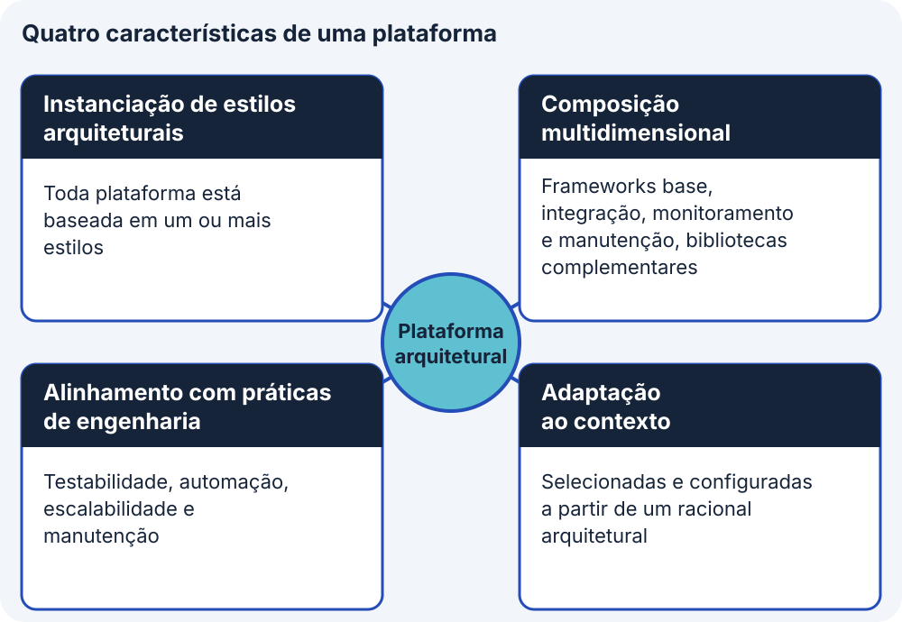
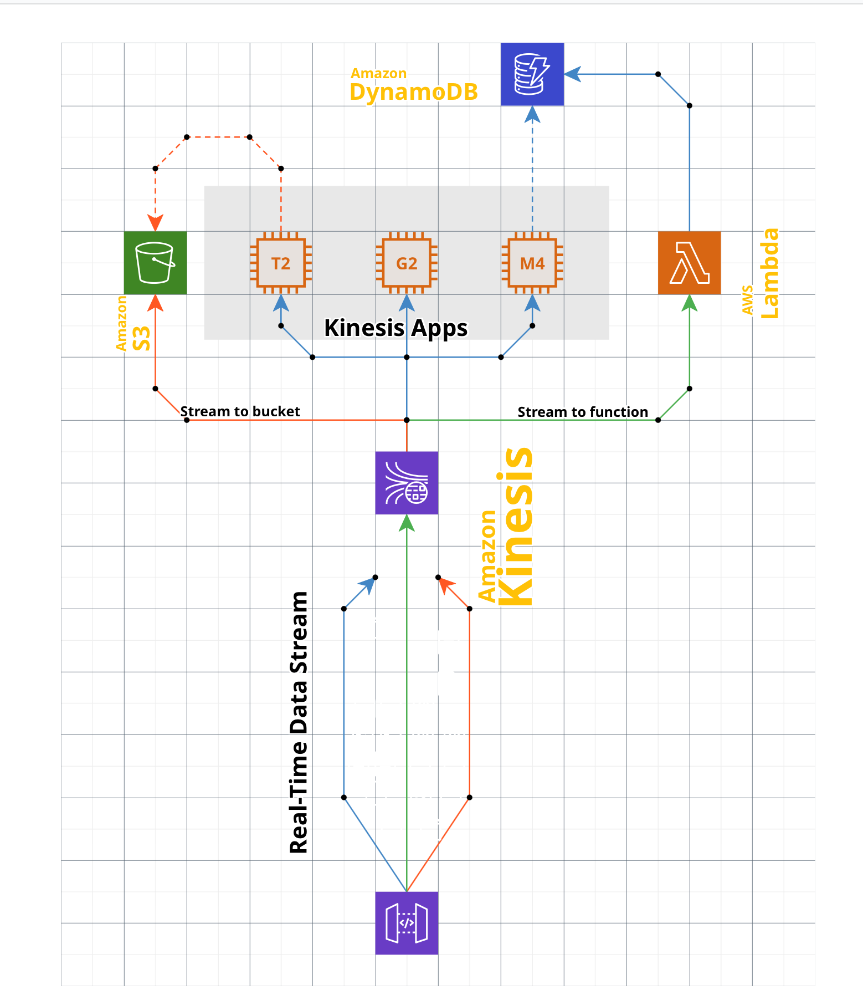
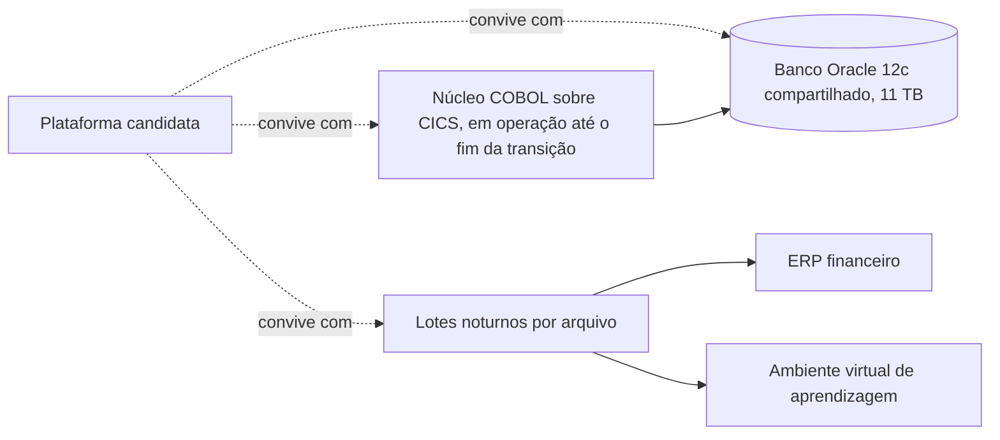
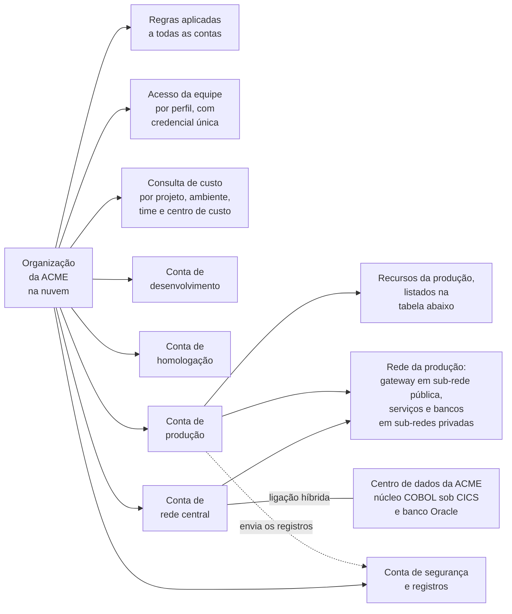

# Plataforma arquitetural

Na Aula 3, o projeto escolheu um estilo arquitetural, a forma geral de organizar o sistema, como em camadas, em microsserviços ou orientado a eventos. Escolhido o estilo, surgem duas perguntas práticas: qual conjunto de tecnologias, chamado de plataforma arquitetural, concretiza esse estilo no desenvolvimento e na operação do sistema, e sobre qual fundação em nuvem, chamada de zona de pouso, esse conjunto vai executar. Este bloco responde às duas, e o exercício 18, no fim da página, aplica as respostas à ACME, a universidade fictícia que serve de caso ao curso.

## Antes de começar

- [Plataforma arquitetural](../referencia/glossario.md#plataforma-arquitetural)
- [Racional arquitetural](../referencia/glossario.md#racional-arquitetural)
- [Zona de pouso](../referencia/glossario.md#zona-de-pouso)
- [Infraestrutura como código](../referencia/glossario.md#infraestrutura-como-codigo)

## Conceito

Quando um estilo como microsserviços é escolhido, ainda falta decidir com que ferramentas ele será construído e operado, e esse conjunto de decisões forma a **plataforma arquitetural**: um conjunto estruturado e consistente de ferramentas, frameworks, bibliotecas e práticas de desenho, organizadas para implementar um ou mais [estilos arquiteturais](../modulo-3-design-e-padroes/bloco-2-estilos-arquiteturais.md). Diferentemente de um framework isolado ou de uma biblioteca, a plataforma é um ambiente integrado que cobre todos os aspectos do ciclo de vida do software, incluindo desenvolvimento, integração, implantação e manutenção, e por isso funciona como a concretização prática do estilo, alinhando o princípio teórico às demandas operacionais de construir e executar o sistema.

Como a plataforma executa o estilo já escolhido, essa decisão vem depois da decisão de estilo. Se a equipe decidisse framework, banco de dados ou orquestrador de execução antes de fixar o padrão estrutural, inverteria a ordem de dependência entre as duas decisões.

### Quatro características de uma plataforma arquitetural

<figure markdown="span">
{ .module-diagram }
</figure>

*Figura 1 — As quatro características de uma plataforma arquitetural. Fonte: material do curso, com base em Mendes (2026b).*

Para reconhecer uma plataforma e distingui-la de um conjunto solto de bibliotecas, vale observar quatro características. A primeira é a instanciação de estilos arquiteturais, porque toda plataforma está baseada em um ou mais estilos. O Java EE implementa a [arquitetura em camadas](../modulo-3-design-e-padroes/bloco-2-estilos-arquiteturais.md#arquitetura-em-camadas) para sistemas web, o Spring Boot com Spring Cloud concretiza a [arquitetura de microsserviços](../modulo-3-design-e-padroes/bloco-2-estilos-arquiteturais.md#arquitetura-de-microsservicos), e o Event Store e o Apache Kafka dão suporte à [arquitetura orientada a eventos](../modulo-3-design-e-padroes/bloco-2-estilos-arquiteturais.md#arquitetura-orientada-a-eventos).

A segunda é a composição multidimensional, pois uma plataforma não é monolítica e reúne quatro tipos de peça. Frameworks base definem o núcleo funcional e estrutural, como o Spring Framework ou o ASP.NET Core, e ferramentas de integração cuidam da comunicação e da orquestração, como o RabbitMQ ou o gRPC. Ferramentas de monitoramento e manutenção acompanham a execução, como o Prometheus e o Grafana, e bibliotecas complementares resolvem necessidades pontuais, como o Axios para acesso HTTP e o Zod para validação de dados.

A terceira é o alinhamento com práticas de engenharia. A plataforma promove testabilidade, com ferramentas como o Jest e o JUnit, automação, com integração contínua, que verifica automaticamente cada alteração de código, e esteiras de implantação, que levam o código aprovado ao ambiente de execução sem etapas manuais, e escalabilidade e manutenção, com orquestração de execução em Kubernetes ou Service Fabric.

A quarta é a adaptação ao contexto, porque plataformas não são universais e são selecionadas e configuradas a partir de um racional arquitetural, o conjunto de razões que justifica uma decisão de desenho, apresentado no Conceito do [bloco 4 da Aula 3](../modulo-3-design-e-padroes/bloco-4-registro-de-decisao-arquitetural.md), e a comparação entre plataformas candidatas usa os seis critérios de seleção do [bloco 1](bloco-1-definicao-tecnologica-e-trm.md#seis-criterios-de-selecao), que são aderência ao requisito, maturidade, suporte, custo total de propriedade, competência da equipe e portabilidade. Uma plataforma tecnicamente superior que ninguém no time sabe operar tem custo real maior do que o preço de licença sugere, e é o critério de competência da equipe que captura isso.

### Exemplos de plataforma por estilo

Os quatro exemplos abaixo ilustram a composição de plataformas para estilos da Aula 3 e não constituem recomendação de uso. Cada um começa pelo estilo que materializa e pela função da plataforma, ou seja, o caminho que o trabalho percorre de ponta a ponta dentro dela, e só então nomeia as peças principais e o que cada uma faz. Todos vêm acompanhados de desenho, com os serviços transversais na base ou, quando o desenho é do fornecedor de nuvem, com o nome do produto em amarelo.

#### Plataforma Java EE e Jakarta EE

Materializa o [estilo em camadas](../modulo-3-design-e-padroes/bloco-2-estilos-arquiteturais.md#arquitetura-em-camadas). O pedido entra pelo navegador ou por um cliente móvel, sempre sobre HTTPS, e chega a um servidor de aplicação que executa tudo em um processo só. Dentro dele o trabalho atravessa três contêineres com responsabilidades separadas. O contêiner web recebe a requisição e cuida da apresentação. O contêiner de negócio executa a regra de domínio e delimita a transação. O contêiner de integração conversa com sistemas externos, com a mensageria e com os sistemas corporativos que a organização já tem. A persistência sai do contêiner de negócio para o banco por um mapeador objeto-relacional. Quatro serviços transversais, segurança, transação, observabilidade e configuração, valem para os três contêineres ao mesmo tempo, e é isso que distingue uma plataforma de um conjunto de bibliotecas, porque esses serviços não são instalados componente a componente.

Entre as peças, o Servlet é a base de tudo no contêiner web, a interface de programação que recebe a requisição HTTP e devolve a resposta. Sobre ela, o JSF monta a tela no servidor a partir de componentes reutilizáveis, e o JAX-RS expõe a mesma lógica como serviço REST para quem consome por programa. No contêiner de negócio, o CDI injeta dependências e controla o ciclo de vida dos objetos, o EJB reúne a regra de negócio em componentes cuja transação é aberta e fechada pelo próprio servidor, sem código explícito, e o Bean Validation declara a regra de validação junto do dado que ela protege. No contêiner de integração, o JMS troca mensagens assíncronas, o conector JCA é a ponte padronizada com sistemas legados e o agendador dispara rotinas em horário fixo. Entre negócio e banco, o JPA define o mapeamento objeto-relacional e o Hibernate é a implementação mais usada dele.

![Plataforma Java EE e Jakarta EE. À esquerda, navegador e cliente móvel acessam por HTTPS e REST. No centro, um servidor de aplicação Java reúne três contêineres, o web com JSF, Servlet e JAX-RS, o de negócio com CDI, EJB e Bean Validation, e o de integração com JMS, conector JCA e agendador. Abaixo, JPA e Hibernate persistem em PostgreSQL e Oracle. À direita, mensageria Kafka ou ActiveMQ e sistemas externos de ERP, CRM e legado. Na base, serviços transversais de segurança, transações, observabilidade e configuração.](../assets/images/plataforma-java-ee.png)

*Plataforma Java EE e Jakarta EE, em que os três contêineres são a divisão estrutural que o estilo em camadas impõe e a faixa de serviços transversais na base é o que nenhum framework isolado entrega. Fonte: material base do professor.*

Esta é a plataforma em que a camada web da ACME funciona hoje, descrita na [arquitetura de linha de base](../caso-acme/linha-de-base.md) como JSF e EJB sobre servidor de aplicação fora de suporte desde 2018.

#### Plataforma web elástica em nuvem

Materializa um [estilo em camadas](../modulo-3-design-e-padroes/bloco-2-estilos-arquiteturais.md#arquitetura-em-camadas) distribuído entre zonas de disponibilidade, que são instalações fisicamente separadas dentro da mesma região. A função aqui é sobreviver à perda de uma zona inteira sem interrupção perceptível, e absorver variação de carga sem intervenção manual. O nome do domínio é resolvido por um serviço de DNS gerenciado. O conteúdo estático sai de uma rede de distribuição apoiada em armazenamento de objetos, o que alivia os servidores desse tráfego. O pedido dinâmico chega a um balanceador, que distribui entre máquinas virtuais organizadas em grupos de autoescalonamento, replicados nas duas zonas. Há dois níveis desses grupos, um para a camada web e outro para a de aplicação, e o banco fica em serviço gerenciado com réplica na segunda zona.

A peça que define essa plataforma é o grupo de autoescalonamento, que cria e destrói máquinas conforme a métrica observada, e é ele que transforma capacidade fixa em capacidade elástica. O balanceador é o que torna isso invisível para o cliente, porque o endereço não muda quando o número de máquinas muda. A réplica do banco entre zonas é o que impede que a perda de uma zona leve o dado junto.

*Plataforma web elástica sobre serviços da AWS, em que as duas colunas cinza são as zonas de disponibilidade e as setas amarelas horizontais são os grupos de autoescalonamento que atravessam as duas. Fonte: material base do professor.*

#### Plataforma de microsserviços

Materializa o [estilo de microsserviços](../modulo-3-design-e-padroes/bloco-2-estilos-arquiteturais.md#arquitetura-de-microsservicos). A função é permitir que times diferentes construam, implantem e escalem partes do sistema de forma independente, e toda a plataforma existe para tornar essa independência operacionalmente viável. O cliente entra por um único ponto, o gateway de API, que aplica o padrão [API Gateway](../modulo-3-design-e-padroes/bloco-3-padroes-arquiteturais-e-de-design.md#api-gateway), roteia para o serviço correto e concentra o que seria repetido em cada um, como terminação de HTTPS e limite de requisição. Dentro do agrupamento, cada serviço roda em contêiner próprio, com seu armazenamento, e se comunica com os demais por chamada direta quando precisa de resposta imediata ou por barramento de eventos quando não precisa. A observabilidade é obrigatória, porque com o sistema dividido em muitos processos não existe mais um registro único onde olhar. A esteira de entrega, que automatiza o caminho do código até a implantação, faz parte da plataforma, porque a implantação independente de cada serviço depende dessa automação.

Entre as peças, o Kubernetes é o orquestrador que decide em qual máquina cada contêiner roda, reinicia o que falha e escala o que satura, e o Docker é o formato de empacotamento que torna o serviço idêntico em qualquer máquina. Na entrada, o NGINX Ingress traduz o endereço externo para o serviço interno, e entre os serviços o Kafka guarda o evento publicado e permite que vários consumidores o leiam no próprio ritmo. Para acompanhar o conjunto, o Prometheus coleta métricas, o Grafana as apresenta em painel e o OpenTelemetry padroniza a coleta de rastros que atravessam vários serviços, o que permite responder em que serviço um pedido demorou.

![Plataforma de microsserviços. À esquerda, clientes web, móvel e usuários entram por HTTP e HTTPS num gateway de API com NGINX Ingress. No centro, um agrupamento Kubernetes com camada de serviço e três pods em contêineres Docker, um serviço de catálogo em Java, um de pedidos em .NET e um de pagamentos em Node.js, apoiados por Redis, PostgreSQL e um barramento Kafka. À direita, observabilidade com Prometheus para métricas, Grafana para painéis e OpenTelemetry para rastros. Na base, a esteira de integração e entrega, do código ao GitHub Actions, ao registro de contêineres e à implantação no Kubernetes.](../assets/images/plataforma-microsservicos.png)

*Plataforma de microsserviços, em que os três serviços usam linguagens diferentes, o que o estilo permite e a plataforma precisa sustentar, e a esteira na base mostra que a implantação independente é parte da plataforma. Fonte: material base do professor.*

Na variante Java dessa pilha, o Spring Boot é o framework base de cada serviço, o Spring Cloud Config centraliza a configuração fora do código, o Eureka permite que um serviço descubra o endereço do outro sem endereço fixo, o Spring Cloud Gateway faz o papel do gateway de API, o Keycloak cuida de autenticação e autorização, o Elastic Stack concentra os registros de todos os serviços em um lugar só, e o WireMock simula as APIs externas durante o teste.

#### Plataforma orientada a eventos

Materializa o [estilo orientado a eventos](../modulo-3-design-e-padroes/bloco-2-estilos-arquiteturais.md#arquitetura-orientada-a-eventos). A função é desacoplar quem produz de quem consome no tempo, de modo que o produtor não espere resposta e o consumidor processe no seu próprio ritmo, o que é justamente o que permite absorver pico. O produtor publica um evento num fluxo, e o fluxo o retém por um período configurado. A partir dele, consumidores independentes fazem coisas diferentes com o mesmo evento, um grava em armazenamento bruto para análise posterior, outro dispara uma função que atualiza um banco de resposta rápida, outro alimenta uma aplicação de processamento contínuo. Acrescentar um quarto consumidor depois não exige mudar o produtor, e essa propriedade é o principal ganho do estilo.

Entre as peças, o fluxo de eventos é o centro da plataforma, e o que o distingue de uma fila tradicional é a retenção, porque a fila entrega e descarta, enquanto o fluxo guarda e permite releitura. O processamento contínuo sobre o fluxo é o que transforma evento em agregação sem passar por banco intermediário. O armazenamento de eventos guarda a sequência completa como fonte da verdade, de modo que o estado atual possa ser recalculado. Um mediador de integração cuida de rotas e conversões entre formatos quando as pontas usam formatos diferentes, e um gateway de API publica para fora o que é consumido por terceiros.

*Plataforma orientada a eventos sobre serviços da AWS, em que um mesmo fluxo alimenta três destinos diferentes ao mesmo tempo, que é a propriedade que o estilo busca. Fonte: material base do professor.*

Na pilha aberta equivalente, o Apache Kafka é o fluxo, o Kafka Streams o processamento contínuo, o Event Store o armazenamento de eventos, o Apache Camel o mediador de integração, o Kong API Gateway a publicação externa e o Confluent Control Center o monitoramento do fluxo.

### Zona de pouso, a fundação da plataforma

A plataforma escolhida precisa de um ambiente que a receba, e esse ambiente é a **[zona de pouso](../referencia/glossario.md#zona-de-pouso)**, do inglês *landing zone*, a fundação do ambiente em nuvem preparada antes da primeira carga de trabalho. Ela organiza contas, rede, identidade, políticas e monitoramento para que cada solução futura chegue a um ambiente já definido e herde os padrões de segurança, governança e operação da organização. A zona de pouso é o lugar onde a carga executa, e a [infraestrutura em nuvem](../modulo-4-dominios-da-solucao/bloco-4-arquitetura-de-infraestrutura.md) descrita na Aula 4 fornece as camadas de execução e a topologia sobre as quais ela se apoia.

Os provedores oferecem estruturas oficiais para essa fundação. Na AWS, o AWS Control Tower configura e governa um ambiente de várias contas conforme práticas prescritivas, e o Landing Zone Accelerator on AWS, solução de código aberto construída sobre o AWS CDK, complementa o Control Tower em cargas altamente reguladas. Na Azure, a Azure landing zone é uma arquitetura para governar, proteger e escalar um ambiente de várias assinaturas, composta por uma landing zone de plataforma, com recursos centralizados, e por landing zones de carga de trabalho. O detalhe de configuração de cada estrutura fica na documentação do provedor, e este bloco trata dos pilares que elas têm em comum.

Os pilares são cinco, e a Figura 2 os apresenta sobre uma base comum de infraestrutura como código e etiquetas.

<figure markdown="span">
{ .module-diagram }
</figure>

*Figura 2 — Os cinco pilares da zona de pouso sobre uma base comum. Fonte: material do curso, com base na documentação de zona de pouso da AWS e da Azure.*

1. As contas, na AWS, ou assinaturas, na Azure, separam os ambientes de desenvolvimento, homologação e produção, de modo que a credencial usada por um desenvolvedor em desenvolvimento deixe de alcançar os dados de produção e que um erro de teste fique contido na conta onde ocorreu.
2. A segmentação de rede segue a topologia hub-spoke, em que uma rede central compartilhada se liga a redes privadas dedicadas a cada carga de trabalho, com apenas o ponto de entrada, como o gateway de APIs ou o balanceador de carga, em sub-rede pública, e com serviços de retaguarda e bancos de dados em sub-redes privadas. Quando parte da solução permanece num centro de dados próprio, a rede central concentra também a ligação com ele, por enlace dedicado ou por VPN.
3. A identidade centralizada reúne num só lugar o controle de quem da equipe acessa cada conta e com qual perfil, o que facilita a auditoria das operações sensíveis.
4. As políticas de conformidade automatizadas valem para todas as contas e recusam o recurso que viole as regras da organização, como o recurso criado fora da região permitida ou sem as etiquetas obrigatórias.
5. O monitoramento com faturamento consolidado permite acompanhar no mesmo lugar o comportamento e o custo de todos os ambientes.

Os dois primeiros pilares, ambientes separados e rede segmentada, também funcionam como controles de segurança, e o [bloco 3](bloco-3-seguranca-fim-a-fim.md) os trata nesse papel.

#### Infraestrutura como código e etiquetas

Se a equipe criasse cada ambiente clicando no console do provedor, ninguém saberia dizer depois quem mudou uma regra de rede nem como refazer o ambiente do zero. A **[infraestrutura como código](../referencia/glossario.md#infraestrutura-como-codigo)** responde a esse problema ao descrever a infraestrutura em arquivos declarativos, versionados e revisados como o código da aplicação. Com essa descrição, o ambiente pode ser recriado a partir dos arquivos, cada mudança de rede, de política ou de capacidade passa a ter autor, data e revisão no histórico, e os três ambientes podem ser criados da mesma descrição com parâmetros diferentes, o que reduz a diferença entre homologação e produção. A descrição declarativa também reduz a [dependência de fornecedor](../referencia/glossario.md#dependencia-de-fornecedor), e uma ferramenta portável entre provedores, como o Terraform, mantém uma só base de código quando a organização opera em mais de uma nuvem.

<figure markdown="span">
{ .module-diagram }
</figure>

*Figura 3 — Da descrição declarativa ao ambiente recriado, com as quatro etiquetas obrigatórias. Fonte: material do curso.*

Quando a direção pergunta quanto custa o ambiente de produção de um serviço, só as etiquetas permitem responder. As etiquetas obrigatórias são quatro, projeto, ambiente, time e centro de custo, aplicadas pelo código e exigidas por uma política que recusa recurso sem etiqueta, e com elas também se sabe quanto uma equipe consome em homologação.

#### Observabilidade como camada transversal

Quando um serviço demora a responder, a equipe precisa saber onde o tempo foi gasto, e é a observabilidade que oferece essa resposta, por isso ela atravessa todas as camadas da plataforma. Ela se organiza em três sinais, o registro estruturado de eventos, as métricas e o rastreamento, e o OpenTelemetry é o padrão aberto de coleta de métricas e rastros. Quando a solução se divide em vários serviços, deixa de existir um registro único onde olhar, e o rastreamento que atravessa os serviços é a forma de responder em que trecho do caminho o tempo foi gasto.

<figure markdown="span">
{ .module-diagram }
</figure>

*Figura 4 — Os três sinais de observabilidade sobre as camadas da plataforma, com o OpenTelemetry na coleta. Fonte: material do curso.*

Região, zonas de disponibilidade e camadas de execução já foram tratadas no [bloco 4 da Aula 4](../modulo-4-dominios-da-solucao/bloco-4-arquitetura-de-infraestrutura.md), e este bloco não as repete.

## Uso pelo arquiteto

Assim como o estilo arquitetural é a maior decisão que um arquiteto toma em um projeto, a plataforma arquitetural é a maior decisão tecnológica do projeto. Por consequência, ela precisa ser justificada e registrada em um ADR próprio, escrito no [bloco 4](bloco-4-adr-de-plataforma.md) desta aula, e a zona de pouso que recebe a plataforma é registrada na mesma decisão.

O arquiteto documenta a comparação antes de decidir, em um quadro comparativo que lista as plataformas candidatas nas linhas e os seis critérios de seleção do [bloco 1](bloco-1-definicao-tecnologica-e-trm.md#seis-criterios-de-selecao) nas colunas, com uma nota curta em cada célula. Esse quadro entra no ADR de plataforma como evidência de que a escolha considerou alternativas reais e não só a plataforma mais familiar ao time, e essa evidência permite defender a decisão quando ela for questionada meses depois.

## No caderno arquitetural

{{ficha:8}}

**Para que serve.** Com os produtos definidos, a ACME enfrenta a dúvida seguinte: sobre que plataforma os serviços novos vão rodar e em que base de nuvem. A plataforma é o conjunto de ferramentas que põe em prática o estilo escolhido na Aula 3, e a zona de pouso é a base de nuvem, com contas, rede e regras, que precisa existir antes do primeiro serviço. Se cada equipe montasse o próprio ambiente, o custo e a segurança variariam de um serviço para outro, então o caderno registra a plataforma escolhida e confere se a zona de pouso cumpre os padrões da organização.

**O que você faz neste exercício.** Você começa pelo estilo que recomendou no exercício 10 e escolhe duas plataformas que poderiam concretizá-lo, listando as ferramentas de cada uma, como o Spring Boot e o Kubernetes. Em seguida compara as duas pelos seis critérios de seleção, mas o dossiê só dá dado para quatro deles, e por isso maturidade e suporte ficam registrados como informação que falta. Com a comparação feita, você escolhe uma plataforma pela convivência com o sistema antigo e depois confere o diagrama da zona de pouso, ligando cada elemento a um dos cinco pilares, apontando as etiquetas que faltam em seis recursos e dizendo qual requisito justifica a conta de segurança e registros.

| Campo do caderno | Como preencher | Item |
| --- | --- | --- |
| Plataformas candidatas e ferramentas | Indique duas plataformas capazes de concretizar o estilo recomendado no exercício 10 e liste as ferramentas concretas de cada uma | 1 |
| Comparação pelos critérios com dado | Para aderência ao requisito, custo total de propriedade, competência da equipe e portabilidade, diga qual plataforma atende melhor, ou se empatam, e o motivo em uma linha | 2 |
| Dado que falta em maturidade e suporte | Escreva qual informação falta nesses dois critérios e quem poderia fornecê-la, sem dar valor às plataformas | 2 |
| Plataforma escolhida | Escolha uma das duas e justifique pela convivência com o sistema antigo | 2 |
| Pilar de cada elemento da zona de pouso | Ligue cada elemento do diagrama ao pilar da zona de pouso que ele realiza | 3 |
| Etiquetas que faltam | Para cada recurso da tabela, diga quais das quatro etiquetas obrigatórias (projeto, ambiente, time e centro de custo) estão ausentes | 3 |
| Requisito da conta de segurança e registros | Diga em uma linha qual requisito justifica a existência dessa conta | 3 |

**O que você já tem.** O estilo recomendado no exercício 10, na seção 7, e a matriz de seleção do exercício 17, cujos seis critérios o quadro comparativo reaproveita.

**Quando está pronto.** As duas plataformas têm ferramentas e comparação pelos critérios com dado, a escolha está justificada, cada elemento da zona de pouso tem pilar, cada recurso tem as etiquetas que faltam e a conta de segurança tem o requisito de origem.

[Ver esta seção no template](../caderno/template.md#8-tecnologia-e-plataforma){ .caderno-botao }
[Ver o gabarito do exercício 18](../gabaritos/gabarito-exercicio-18.md){ .caderno-botao }

{{/ficha}}

## Exercício 18

A ACME é a universidade privada brasileira em modernização incremental do sistema acadêmico, isto é, o sistema é trocado por partes. O núcleo transacional em COBOL, que executa as operações acadêmicas, segue em operação sobre o monitor CICS durante toda a transição. Há também uma camada web em JSF e EJB, e as integrações com o ERP financeiro, o sistema de gestão financeira da universidade, e com o ambiente virtual de aprendizagem, onde o aluno acessa as turmas, são resolvidas por arquivo, em lote noturno.

A equipe da ACME precisa agora escolher a plataforma que concretiza o estilo arquitetural e conferir se a fundação em nuvem proposta cumpre os pilares da zona de pouso, e o exercício reproduz esse trabalho com dados do caso. Ele parte do estilo que o aluno recomendou no [exercício 10](../modulo-3-design-e-padroes/bloco-2-estilos-arquiteturais.md#exercicio-10) da Aula 3, e a plataforma escolhida aqui é a entrada do ADR de plataforma, o registro de decisão do exercício 20, no [bloco 4](bloco-4-adr-de-plataforma.md). São três itens, e o aluno registra a resposta de cada um com o dado do enunciado que a sustenta.

### Item 1: Plataformas candidatas para o estilo escolhido

Como o sistema antigo da ACME continua em operação, qualquer plataforma nova precisa conviver com ele, e é nesse cenário que o item pede duas plataformas que poderiam concretizar o estilo recomendado no exercício 10 da Aula 3, o estilo arquitetural indicado para a ACME naquela aula. Uma plataforma candidata é uma das opções que entram na comparação do item 2, e o diagrama abaixo mostra as partes do sistema atual com as quais a convivência acontece: o núcleo COBOL sobre CICS, o banco Oracle 12c de 11 TB compartilhado, os lotes noturnos por arquivo e, ligados a esses lotes, o ERP financeiro e o ambiente virtual de aprendizagem, conforme a [arquitetura de linha de base](../caso-acme/linha-de-base.md).

1. Indique, entre os quatro exemplos da seção Exemplos de plataforma por estilo, duas plataformas candidatas capazes de concretizar o estilo recomendado no exercício 10.
2. Para cada plataforma candidata, liste as ferramentas concretas que a compõem, como o Spring Boot e o Kubernetes no exemplo de microsserviços, no nível de detalhe dos exemplos da seção.

Sua resposta vira o campo Plataformas candidatas e ferramentas, na seção 8 do caderno.

### Item 2: Quadro comparativo pelos seis critérios

Duas plataformas só podem ser comparadas com justiça se passarem pelos mesmos critérios, e por isso o item pede que as duas candidatas sejam avaliadas pelos seis critérios, para que a escolha tenha dado que a sustente. A tabela abaixo traz uma linha para cada um dos seis critérios de seleção apresentados no [bloco 1](bloco-1-definicao-tecnologica-e-trm.md#seis-criterios-de-selecao), com os dados do [dossiê da ACME](../caso-acme/index.md) e da linha de base que valem para o critério. Quatro critérios têm dado, e os dois restantes, maturidade e suporte, estão sem dado no dossiê. R4 e R6 são códigos de requisitos do caso e vêm explicados na própria linha. O quadro que o aluno preenche, com as duas plataformas candidatas nas linhas e os seis critérios nas colunas, é o que alimenta o campo de alternativas do ADR de plataforma do exercício 20, no [bloco 4](bloco-4-adr-de-plataforma.md).

| Critério | Dado do caso |
| --- | --- |
| Aderência ao requisito | R6, o portal sustenta 5.800 sessões simultâneas na abertura da matrícula, com percentil 95 do tempo de confirmação em até 4 segundos, e R4, a solução opera em um dos dois provedores de nuvem aprovados em 12/03/2026 |
| Maturidade | O dossiê não registra dado sobre a maturidade das plataformas candidatas |
| Suporte | O dossiê não registra dado sobre o suporte das plataformas candidatas |
| Custo total de propriedade | Orçamento de R$ 6,2 milhões para o primeiro ciclo de 12 meses, e licenciamento Oracle que obriga a licenciar todos os núcleos físicos de qualquer ambiente virtualizado |
| Competência da equipe | Camada web em Java sustentada por 9 pessoas, 6 internas e 3 da fábrica, sem escassez, mas sem experiência em JSF 1.2 nos contratados desde 2021 |
| Portabilidade | Dois provedores de nuvem pré-aprovados pelo Conselho Universitário em 12/03/2026, com decisões de plataforma portáveis entre os dois, e autenticação por padrões abertos de identidade |

1. Para cada um dos quatro critérios com dado do caso, que são aderência ao requisito, custo total de propriedade, competência da equipe e portabilidade, marque qual das duas plataformas candidatas do Item 1 atende melhor, ou se as duas empatam, e registre o motivo em uma linha com base no dado.
2. Para os critérios maturidade e suporte, escreva uma frase que diga qual dado falta e quem poderia fornecê-lo, sem atribuir valor às plataformas, conforme o Item 3 do [exercício 17](bloco-1-definicao-tecnologica-e-trm.md#exercicio-17).
3. Escolha uma das duas plataformas e justifique a escolha considerando a restrição de convivência com o legado mostrada no diagrama do Item 1.

Suas respostas viram os campos Comparação pelos critérios com dado, Dado que falta em maturidade e suporte e Plataforma escolhida, na seção 8 do caderno.

### Item 3: Zona de pouso da solução

Antes de o primeiro serviço novo ir para a nuvem, a ACME precisa saber se a fundação proposta já nasce com os padrões de segurança e de custo da organização, e por isso o item pede que se confira se ela cumpre os cinco pilares da Figura 2 e as etiquetas obrigatórias. O diagrama abaixo descreve a zona de pouso proposta para a solução nova da ACME, com a organização na nuvem, as cinco contas, a ligação híbrida ao centro de dados onde permanecem o núcleo COBOL e o Oracle, e os recursos da conta de produção. Conta é o espaço separado da nuvem em que ficam os recursos de um ambiente, e a ligação híbrida é o enlace que conecta a nuvem ao centro de dados próprio da ACME.

Três requisitos do [dossiê](../caso-acme/index.md) orientam o desenho dessa fundação, e a tabela a seguir os reproduz.

| Código | Requisito | Origem |
| --- | --- | --- |
| R4 | A solução opera em um dos dois provedores de nuvem aprovados em 12/03/2026 | Conselho Universitário |
| R14 | Nenhum dado pessoal de aluno é processado fora do território nacional | Jurídico, parecer de 28/04/2026 |
| R9 | Toda leitura de dado pessoal de aluno é registrada em trilha de auditoria, com retenção de 5 anos | Encarregada de proteção de dados |

A tabela a seguir lista seis recursos da conta de produção com as etiquetas que cada um traz. Etiqueta é um rótulo preso ao recurso, e as quatro obrigatórias são projeto, ambiente, time e centro de custo. O gateway de APIs é o ponto de entrada das chamadas externas, e o bucket é um armazenamento de arquivos na nuvem. Os recursos e as etiquetas são ilustrativos e não constam do dossiê.

| Recurso | Etiquetas que o recurso traz |
| --- | --- |
| Serviço de matrícula | projeto, ambiente, time |
| Banco do serviço de matrícula | projeto, time, centro de custo |
| Gateway de APIs | ambiente, time, centro de custo |
| Serviço de notas | projeto, ambiente, time, centro de custo |
| Fila de eventos de notas | projeto, ambiente |
| Bucket de trilha de auditoria | projeto, ambiente, centro de custo |

1. Associe cada elemento do diagrama, como a conta de rede central ou o acesso da equipe por perfil, ao pilar da zona de pouso, entre os cinco da Figura 2, que ele realiza.
2. Indique as etiquetas obrigatórias que faltam em cada recurso da tabela, ou indique que não falta nenhuma.
3. Responda em uma linha qual requisito justifica a existência da conta de segurança e registros.

Suas respostas viram os campos Pilar de cada elemento da zona de pouso, Etiquetas que faltam e Requisito da conta de segurança e registros, na seção 8 do caderno.

## Fontes

As referências seguem o formato APA, 7ª edição, e constam da [bibliografia](../referencia/bibliografia.md) do curso. O trecho consultado aparece entre parênteses ao fim de cada entrada.

- Mendes, M. (2026b). *Guias de projeto de arquitetura de software* [Material de curso, versão arquivada]. https://github.com/aulas-marco/projeto-arquitetura-software/tree/30f15cd (guia 2.2, fonte da definição, das quatro características e dos exemplos de plataforma por estilo e das representações visuais reproduzidas nesta página)
- Ford, N., & Richards, M. (2020). *Fundamentals of software architecture*. O'Reilly. (comparação por atributo de qualidade, aplicada aqui a plataformas)
- Lovatt, M. (2021). *Solution architecture foundations*. BCS, The Chartered Institute for IT. (seção 7.5, definição da infraestrutura de rede, em que cada interface entre componentes recebe o serviço de rede que a sustenta, base da segmentação de rede e da ligação híbrida da zona de pouso)
- Amazon Web Services. (n.d.-d). *What is AWS Control Tower?* AWS Control Tower User Guide. Acesso em 15 de outubro de 2026. https://docs.aws.amazon.com/controltower/latest/userguide/what-is-control-tower.html
- Amazon Web Services. (n.d.-e). *Landing Zone Accelerator on AWS: Solution overview*. Landing Zone Accelerator on AWS Implementation Guide. Acesso em 15 de outubro de 2026. https://docs.aws.amazon.com/solutions/latest/landing-zone-accelerator-on-aws/solution-overview.html
- Microsoft. (2025). *What is an Azure landing zone?* Cloud Adoption Framework, Microsoft Learn. Acesso em 15 de outubro de 2026. https://learn.microsoft.com/en-us/azure/cloud-adoption-framework/ready/landing-zone/

**Material do curso.** Glossário, entradas [plataforma arquitetural](../referencia/glossario.md#plataforma-arquitetural), [racional arquitetural](../referencia/glossario.md#racional-arquitetural), [zona de pouso](../referencia/glossario.md#zona-de-pouso) e [infraestrutura como código](../referencia/glossario.md#infraestrutura-como-codigo). Dossiê da instituição fictícia [ACME](../caso-acme/index.md) e [arquitetura de linha de base](../caso-acme/linha-de-base.md), sendo a estrutura dos cinco pilares, as quatro etiquetas obrigatórias e a figura 2 convenções do curso.
