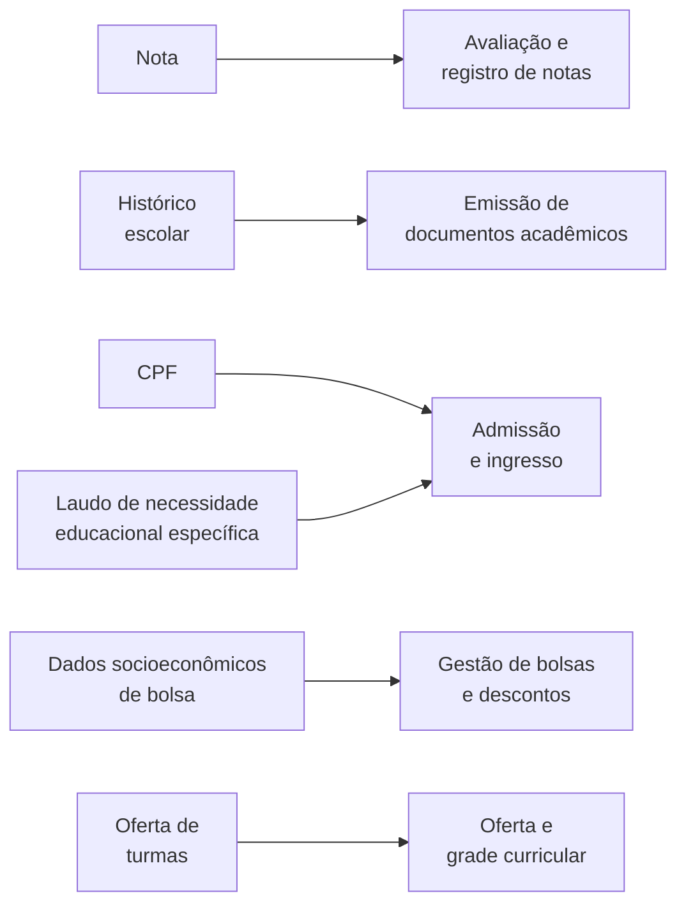
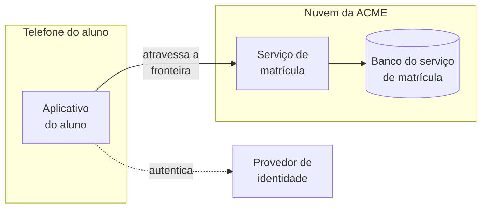

# Segurança fim a fim

Este bloco avalia, sobre a tecnologia escolhida no bloco 1 e sobre a plataforma e a zona de pouso definidas no bloco 2, se a solução protege os ativos que precisa proteger, do dado pessoal gravado no banco à chamada que atravessa a rede.

## Antes de começar

- [Menor privilégio](../referencia/glossario.md#menor-privilegio)
- [Fronteira de confiança](../referencia/glossario.md#fronteira-de-confianca)
- [Grade de permissões](../referencia/glossario.md#grade-de-permissoes)
- [STRIDE](../referencia/glossario.md#stride)
- [Autoridade de design de segurança](../referencia/glossario.md#autoridade-de-design-de-seguranca)
- [Dado pessoal sensível](../referencia/glossario.md#dado-pessoal-sensivel)
- [Zona de pouso](../referencia/glossario.md#zona-de-pouso)

## Segurança como passo da definição tecnológica

A definição tecnológica apresentada no [bloco 1](bloco-1-definicao-tecnologica-e-trm.md) termina com um passo dedicado à segurança da solução de ponta a ponta, que examina o desenho inteiro depois que produtos, plataforma e zona de pouso já foram escolhidos. Esse passo consulta especialistas de fora da equipe de solução, porque as ameaças mudam com frequência e o conhecimento necessário para avaliá-las exige atualização constante.

### Segurança da informação e arquitetura de segurança

A **segurança da informação** protege todos os ativos de informação da organização, em papel ou em meio digital. A cibersegurança é uma parte dela, voltada a proteger os sistemas computacionais contra acesso não autorizado, dano ou indisponibilidade provocada por terceiros mal-intencionados. Toda solução que trata dado de cliente, de paciente ou de aluno precisa das duas, e a cibersegurança aparece no desenho como proteção contra ataque a cada componente exposto.

A arquitetura de segurança é o domínio que incorpora o desenho de segurança a toda a organização, persegue os quatro objetivos mínimos da lista abaixo e se distingue das operações de segurança. As operações cuidam do dia a dia, com auditoria, testes, manutenção de componentes de infraestrutura e tratamento de incidentes. A arquitetura de segurança cuida da mudança e garante que um componente, uma aplicação ou uma solução nova não comprometa a segurança por desenho inadequado.

1. Reduzir as vulnerabilidades de segurança desde o desenho.
2. Fazer valer os padrões de segurança em toda a organização.
3. Garantir que todos os desenhos sejam robustos contra ataque.
4. Reduzir o efeito dos incidentes de segurança quando eles ocorrem.

### Quatro formas de especificar segurança

Numa solução, a segurança chega ao desenho por quatro caminhos diferentes, e a tabela abaixo traz um exemplo de cada um. Os dois primeiros seguem a distinção entre requisito funcional e requisito não funcional apresentada no [bloco 2 da Aula 2](../modulo-2-requisitos-e-partes-interessadas/bloco-2-qualidade-e-tipos-de-requisito.md), e o último usa padrão técnico no sentido definido no [bloco 3 da Aula 4](../modulo-4-dominios-da-solucao/bloco-3-arquitetura-de-aplicacoes-e-integracao.md#padrao-tecnico-protocolo-especificacao-e-contrato), como especificação adotada pela organização e reconhecida fora dela.

| Forma | O que especifica | Exemplo |
| --- | --- | --- |
| Requisito funcional | Controle que faz parte da funcionalidade, como acesso por papel, regra de negócio que impede atividade indevida ou auditoria | Somente o perfil de secretaria acadêmica emite histórico escolar |
| Requisito não funcional | Medida que impede ataque e tentativa de desviar a solução da finalidade | Toda transmissão de dado pessoal é cifrada |
| Diretiva corporativa | Princípio ou política que define como a segurança se aplica numa área da organização | Todo acesso a dado é registrado e fica disponível para auditoria |
| Padrão técnico | Especificação adotada pela organização que garante tipo e nível de comportamento de segurança | Autenticação por OpenID Connect em toda aplicação exposta ao usuário |

Os requisitos funcionais de segurança costumam chegar a este passo já negociados com as partes interessadas, mas parte deles se sobrepõe aos requisitos não funcionais, e por isso a avaliação de ponta a ponta examina as quatro formas em conjunto.

### Ativos e sua classificação

Ativo é tudo o que tem valor para a organização e que, por isso, pode sofrer ataque ou comprometimento com efeito negativo sobre ela. Os ativos existem em todos os domínios da arquitetura, entre eles os papéis e as unidades organizacionais no domínio de negócio, as definições de dado e de informação no domínio de dados, os sistemas e os sítios na internet no domínio de aplicações e os nós de servidor no domínio de infraestrutura. Uma diretiva válida em toda a organização exige que cada ativo seja avaliado e classificado, e os ativos de dado são classificados por três propriedades, a confidencialidade, a integridade e a disponibilidade, cada uma com um nível, como baixo, médio ou alto.

No Brasil, a classificação dos ativos de dado se completa com a Lei Geral de Proteção de Dados Pessoais, Lei nº 13.709/2018, já apresentada no [bloco 2 da Aula 4](../modulo-4-dominios-da-solucao/bloco-2-arquitetura-de-dados.md#requisitos-de-dados-qualidade-e-protecao). Dado pessoal é a informação relacionada a pessoa natural identificada ou identificável (art. 5º, I), e o dado pessoal sensível é o dado pessoal sobre origem racial ou étnica, convicção religiosa, opinião política, filiação a sindicato ou a organização de caráter religioso, filosófico ou político, dado referente à saúde ou à vida sexual, dado genético ou biométrico, quando vinculado a uma pessoa natural (art. 5º, II). A classificação de um ativo como pessoal ou como pessoal sensível eleva, em geral, o nível de confidencialidade que ele recebe.

A base legal é a hipótese que autoriza o tratamento do dado pessoal, e o art. 7º lista dez hipóteses, entre elas o consentimento do titular (inciso I), o cumprimento de obrigação legal ou regulatória pelo controlador (inciso II) e a execução de contrato (inciso V). A transferência internacional de dado pessoal só é permitida nos casos do art. 33, entre eles o país ou organismo internacional com grau de proteção adequado (inciso I) e a autorização da autoridade nacional (inciso V). Quando uma organização proíbe por decisão própria qualquer processamento fora do território nacional, essa decisão é mais restritiva do que a lei e entra na solução como restrição registrada, conforme o mesmo bloco 2 da Aula 4.

### Grade de permissões e menor privilégio

O controle de acesso é a parte da segurança que admite especificação precisa, porque declara quais pessoas e sistemas podem executar cada tarefa e acessar cada recurso. Na forma mais simples, essa especificação é uma grade de permissões, uma tabela que cruza recursos ou tarefas num eixo com entidades no outro, e a entidade pode ser uma pessoa, um grupo, um papel ou um sistema. Toda entidade ausente da grade para um recurso fica impedida de acessá-lo, e cada interseção preenchida indica o tipo de acesso permitido, leitura ou gravação, e a condição que precisa ser satisfeita para que o acesso ocorra, como acessar somente o próprio registro.

A grade recebe ainda o nível de segurança de cada recurso, baixo, médio ou alto, atribuído pela gravidade de uma violação. Esse nível é um requisito não funcional e orienta os especialistas de segurança e de infraestrutura na escolha da proteção, e a Figura 1 mostra uma grade genérica com três entidades, três recursos e o nível de cada recurso.

<figure markdown="span">
{ .module-diagram }
</figure>

*Figura 1 — Grade de permissões com tipo de acesso e nível de segurança. Fonte: material do curso, com base em Lovatt (2021, seção 4.6.7).*

O princípio que orienta o preenchimento da grade é o **menor privilégio**, segundo o qual cada entidade recebe o conjunto mínimo de recursos, com o menor nível de privilégio, que ainda permite executar as atividades de negócio que lhe cabem. Na prática, a leitura é concedida a quem precisa consultar, a gravação fica reservada a quem não consegue concluir a tarefa sem ela, e a condição restringe o alcance do acesso, como na célula do usuário final da Figura 1, que lê e grava somente o próprio pedido.

### Controles da zona de pouso

Três pilares da zona de pouso apresentada no [bloco 2](bloco-2-plataforma-arquitetural.md#zona-de-pouso-a-fundacao-da-plataforma) funcionam também como controles de segurança, e a avaliação de ponta a ponta confere se a solução os usa. A lista abaixo descreve o papel de segurança de cada um.

1. Os ambientes separados em contas ou assinaturas distintas criam três fronteiras. A fronteira de permissão impede que a credencial de desenvolvimento alcance os dados de produção, a fronteira de conformidade permite aplicar políticas diferentes a cada ambiente e restringir a produção a poucos perfis, e a fronteira de efeito mantém um erro de teste contido na conta onde ocorreu.
2. A sub-rede privada abriga os serviços de retaguarda e os bancos de dados, que nunca ficam expostos diretamente à internet, e a sub-rede pública contém apenas o ponto de entrada, como o gateway de APIs ou o balanceador de carga.
3. A identidade centralizada por padrão aberto, como o OpenID Connect da linha de identidade do [modelo técnico de referência](bloco-1-definicao-tecnologica-e-trm.md#estrutura-em-cinco-colunas), reúne num só lugar o controle de quem acessa cada conta e com qual perfil, o que permite auditar as operações sensíveis e trocar o provedor sem alterar as aplicações clientes.

### Fronteira de confiança e STRIDE

Uma **fronteira de confiança** é a linha que separa partes de uma solução que operam sob níveis diferentes de confiança, como o aplicativo instalado no telefone do usuário e o serviço que executa na nuvem da organização. Todo dado e toda chamada que atravessam essa linha precisam ser autenticados, validados e protegidos, porque o lado de menor confiança pode estar sob controle de quem ataca.

A modelagem de ameaças examina cada fronteira com o **STRIDE**, uma classificação de ameaças em seis categorias cujo nome vem das iniciais das categorias em inglês, *spoofing*, *tampering*, *repudiation*, *information disclosure*, *denial of service* e *elevation of privilege*. Cada categoria viola uma propriedade de segurança, e a tabela abaixo traz a categoria em português, a propriedade violada e um controle típico.

| Categoria | Propriedade violada | Controle típico |
| --- | --- | --- |
| Falsificação de identidade | Autenticidade | Autenticação forte, por padrão aberto de identidade |
| Adulteração | Integridade | Assinatura da mensagem e verificação de integridade no destino |
| Repúdio | Não repúdio | Registro de auditoria imutável, com autor e horário de cada operação |
| Divulgação de informação | Confidencialidade | Criptografia em trânsito e em repouso |
| Negação de serviço | Disponibilidade | Limite de taxa por cliente e reserva de capacidade |
| Elevação de privilégio | Autorização | Autorização por papel verificada no próprio serviço |

A Figura 2 aplica as seis categorias a uma única fronteira, com cada seta numerada representando uma forma de ataque à mesma travessia entre cliente e serviço.

<figure markdown="span">
{ .module-diagram }
</figure>

*Figura 2 — Uma fronteira de confiança e as seis categorias STRIDE aplicadas a ela. Fonte: material do curso, com base em Shostack (2014).*

### Autoridade de design de segurança

Como a avaliação de segurança é um campo especializado, as organizações reúnem cada vez mais uma **autoridade de design de segurança**, grupo que decide sobre os aspectos de segurança de todas as soluções e recebe boa parte da responsabilidade por assegurar a segurança de ponta a ponta. Ela aplica dois testes ao desenho de cada solução e entrega uma avaliação com recomendações, que a equipe de solução e a equipe de arquitetura de infraestrutura executam.

1. A conformidade com as diretivas audita o desenho contra os princípios, as políticas e os padrões de segurança adotados pela organização, como a ISO/IEC 27001, cuja edição de 2022 especifica os requisitos para estabelecer, implementar, manter e melhorar continuamente um sistema de gestão de segurança da informação.
2. O teste de vulnerabilidade simula ameaças e atividades maliciosas para testar a resistência da solução, com apoio de catálogos públicos, como a lista OWASP Top 10, cuja edição de 2021 é usada neste bloco, e o CWE, lista de fraquezas de software e de hardware mantida pela MITRE que serve de linguagem comum para descrever falhas de segurança.

A participação dos papéis nessa atividade pode ser registrada numa matriz RACI, que indica para cada papel se ele é responsável pela execução (R), se responde pelo resultado e o aprova (A), se é consultado (C) ou se é informado (I). A distribuição abaixo é a adotada pelo curso para a atividade de assegurar a segurança de ponta a ponta.

| Papel | Participação | Letra |
| --- | --- | --- |
| Autoridade de design de segurança | Executa os dois testes e aprova a avaliação final do desenho | R e A |
| Arquiteto de solução | Apresenta o desenho, fornece ativos e permissões e executa a revisão recomendada | C e R pela revisão |
| Arquiteto de infraestrutura | Informa os controles disponíveis na infraestrutura e executa as mudanças que cabem a ela | C e R pelas mudanças |

### O exemplo do Hospital ACME

O Hospital ACME, hospital geral fictício usado no bloco 1, criou um portal em que o paciente informa suas preferências de contato, como canal e horário. Para associar a preferência ao registro correto, o paciente fornece credenciais que o portal cruza com os dados demográficos do hospital, e esses dados demográficos estão classificados como dado pessoal, com nível alto de confidencialidade.

A autoridade de design de segurança avaliou essa parte do desenho no teste de conformidade e registrou os achados da lista abaixo, todos derivados de políticas do hospital.

1. O acesso a qualquer ativo, informação ou sistema, segue um processo definido de concessão.
2. O segredo de autenticação, como a senha, é controlado por um processo formal de gestão.
3. A identidade dos usuários finais e o nível de acesso de cada um são estabelecidos somente por controles de segurança aprovados, e o modelo técnico de referência do hospital já lista um serviço de identidade aprovado para usuários externos.
4. Todo acesso a dado é registrado e fica disponível para auditoria.

A mesma avaliação apontou três vulnerabilidades, classificadas pelo OWASP Top 10 de 2021. A primeira é o acesso além do necessário, que contraria o menor privilégio e corresponde a A01:2021, controle de acesso quebrado. A segunda é a injeção, porque o portal envia ao banco de dados a informação digitada pelo usuário, o que corresponde a A03:2021, injeção. A terceira é o registro e o monitoramento insuficientes, que correspondem a A09:2021, falhas de registro e monitoramento de segurança. A recomendação da autoridade foi revisar o desenho para atender aos quatro achados e às três vulnerabilidades antes da implementação.

## Uso pelo arquiteto

O arquiteto leva à autoridade de design de segurança um desenho que já traz os ativos classificados por confidencialidade, integridade e disponibilidade e pela Lei Geral de Proteção de Dados, a grade de permissões preenchida pelo menor privilégio, as fronteiras de confiança identificadas e os controles da zona de pouso declarados. Com esse material, a autoridade concentra os dois testes nos pontos em que o desenho pode falhar e dispensa o levantamento de informações que cabe à equipe de solução.

A recomendação da autoridade retorna à equipe de solução como revisão de desenho, e cada recomendação aceita altera um artefato concreto, como uma célula da grade de permissões, um controle na fronteira ou uma mudança de infraestrutura. A recomendação que exige serviço de infraestrutura ausente do catálogo vira lacuna de provisão, classificada no [bloco 4](bloco-4-adr-de-plataforma.md) desta aula.

## Exercício 19

A ACME é a universidade privada brasileira com 38.400 alunos ativos cujo sistema acadêmico passa por modernização incremental, com o núcleo transacional mantido em operação durante a transição. O exercício parte do diagrama de contêineres do [exercício 16](../modulo-4-dominios-da-solucao/bloco-4-arquitetura-de-infraestrutura.md#exercicio-16) e da zona de pouso do [exercício 18](bloco-2-plataforma-arquitetural.md#exercicio-18), e examina a segurança da solução pela LGPD, pelo menor privilégio e pelo STRIDE.

Os dois requisitos e a restrição abaixo constam da [página inicial do caso](../caso-acme/index.md) e valem para os três itens.

| Código | Declaração | Origem |
| --- | --- | --- |
| R9 | Toda leitura de dado pessoal de aluno é registrada em trilha de auditoria, com retenção de 5 anos | Encarregada de proteção de dados |
| R14 | Nenhum dado pessoal de aluno é processado fora do território nacional | Jurídico |
| Restrição | Dado pessoal de aluno processado em território nacional, o que restringe a região de implantação e o uso de serviços gerenciados | Jurídico, parecer de 28/04/2026 |

### Item 1: Ativos de dado e LGPD

O dossiê não detalha os campos de cada módulo, e os ativos e as ligações abaixo são os considerados neste exercício. O diagrama liga cada ativo à capacidade acadêmica que o usa, entre as capacidades do [exercício 13](../modulo-4-dominios-da-solucao/bloco-1-arquitetura-de-negocio.md#exercicio-13).

A tabela indica o módulo do núcleo, conforme a [arquitetura de linha de base](../caso-acme/linha-de-base.md), relacionado a cada ativo. Todos os módulos gravam no banco compartilhado entre o núcleo e a camada web.

| Ativo | Módulo do núcleo relacionado |
| --- | --- |
| Nota | Avaliação e notas |
| Histórico escolar | Histórico e documentos |
| CPF | Ativo considerado neste exercício, sem módulo registrado no dossiê |
| Dados socioeconômicos de bolsa | Bolsas e descontos |
| Laudo de necessidade educacional específica | O dossiê não registra o módulo |
| Oferta de turmas | Oferta e grade curricular |

1. Classifique cada ativo em não pessoal, pessoal ou pessoal sensível, conforme o art. 5º da LGPD.
2. Atribua a cada ativo um nível de confidencialidade baixo, médio ou alto, e justifique em uma linha o nível do ativo pessoal sensível.
3. Responda em uma linha quais ativos a restrição R14 impede de serem processados fora do território nacional e qual serviço externo do diagrama do exercício 16 recebe hoje, pelos lotes noturnos descritos na linha de base, um desses ativos.

### Item 2: Grade de permissões

A grade abaixo, em que três células concedem privilégio além do necessário, foi proposta para a arquitetura alvo, com os perfis e os serviços nas linhas e três recursos nas colunas. L indica leitura, E indica gravação e o traço indica nenhum acesso, e a condição aparece depois da vírgula, como em somente a própria. No sistema atual, o ambiente virtual de aprendizagem recebe a nota consolidada por exportação e devolve apenas nota de atividade, recurso que não consta desta grade.

| Perfil ou serviço | Nota consolidada | Matrícula | Histórico escolar |
| --- | --- | --- | --- |
| Aluno | L E, somente a própria | L E, somente a própria | L, somente o próprio |
| Professor | L E, nas turmas que leciona | L, em todas as turmas | – |
| Secretaria acadêmica | L | L E | L E |
| Serviço de notas | L E | L | – |
| Serviço de matrícula | – | L E | – |
| Ambiente virtual de aprendizagem | L E | L | – |

1. Aponte as três células que violam o princípio do menor privilégio, pelo perfil e pelo recurso.
2. Indique o acesso correto de cada uma das três células, com a condição quando houver.

### Item 3: Ameaças na fronteira do aplicativo do aluno

A fronteira de confiança deste item é a relação 1 do diagrama do [exercício 16](../modulo-4-dominios-da-solucao/bloco-4-arquitetura-de-infraestrutura.md#exercicio-16), entre o aplicativo do aluno, instalado no telefone, e o serviço de matrícula, que o R1 e o R6 exigem. A execução do serviço de matrícula na conta de produção da zona de pouso do [exercício 18](bloco-2-plataforma-arquitetural.md#exercicio-18) é suposição do exercício. A tabela reproduz da [página inicial do caso](../caso-acme/index.md) os requisitos R1, R6 e R8, que este item cita.

| Código | Declaração | Origem |
| --- | --- | --- |
| R1 | O aluno deve renovar a matrícula pelo telefone celular, sem acesso ao portal em computador | Representação discente |
| R6 | O portal sustenta 5.800 sessões simultâneas na abertura da matrícula, com percentil 95 do tempo de confirmação em até 4 segundos | Diretoria de TI |
| R8 | A autenticação usa padrões abertos de identidade, sem produto proprietário | Comitê de Segurança da Informação |

A tabela descreve seis ameaças a essa fronteira.

| Ameaça | Cenário |
| --- | --- |
| T1 | Os dados do pedido, com CPF e turmas escolhidas, trafegam sem cifra e são lidos por quem observa a rede do telefone |
| T2 | Alguém usa a senha obtida de outro aluno e envia pedidos de matrícula em nome dele |
| T3 | Um programa envia milhares de pedidos por segundo na abertura da matrícula e esgota a capacidade do serviço |
| T4 | Um aluno afirma que não pediu o cancelamento de uma disciplina, e o serviço não consegue mostrar quem enviou o pedido nem quando |
| T5 | Um aluno troca um parâmetro do pedido e executa o ajuste de vaga, operação reservada à secretaria acadêmica |
| T6 | Um intermediário altera, no caminho, a lista de turmas do pedido antes que ela chegue ao serviço |

Os controles disponíveis são os seis da lista abaixo.

- (a) Limite de taxa por cliente e reserva de capacidade.
- (b) Autorização por papel verificada no serviço de matrícula.
- (c) Criptografia em trânsito e em repouso.
- (d) Autenticação forte por OpenID Connect, conforme o R8.
- (e) Registro de auditoria imutável, com autor e horário de cada acesso.
- (f) Assinatura e verificação de integridade da mensagem.

1. Classifique cada ameaça, de T1 a T6, numa das seis categorias STRIDE.
2. Associe a cada ameaça a letra do controle que a trata.
3. Indique qual dos seis controles também atende ao requisito R9.

## Fontes

As referências seguem o formato APA, 7ª edição, e constam da [bibliografia](../referencia/bibliografia.md) do curso. O trecho consultado aparece entre parênteses ao fim de cada entrada.

- Lovatt, M. (2021). *Solution architecture foundations*. BCS, The Chartered Institute for IT. (seção 2.9, arquitetura de segurança, objetivos, diretivas e ativos, seção 4.6.7, segurança como requisito e grade de permissões, e seção 7.7, segurança de ponta a ponta, autoridade de design de segurança e caso do Fallowdale Hospital, aqui vertido como Hospital ACME. O livro cita a ISO/IEC 27001 na edição de 2013 e numera as vulnerabilidades do caso como A1 e A10, numeração da edição de 2017 do OWASP Top 10, e esta página usa a edição de 2022 da norma e a numeração de 2021 do OWASP, A01, A03 e A09)
- Brasil. (2018). *Lei nº 13.709, de 14 de agosto de 2018. Lei Geral de Proteção de Dados Pessoais (LGPD)*. https://www.planalto.gov.br/ccivil_03/_ato2015-2018/2018/lei/l13709.htm (art. 5º, I e II, art. 7º e art. 33, I e V, lidos no texto atualizado da base de legislação da Câmara dos Deputados)
- Shostack, A. (2014). *Threat modeling: Designing for security*. Acesso em 15 de outubro de 2026. https://shostack.org/books/threat-modeling-book (categorias STRIDE e propriedade violada por cada uma, conforme https://shostack.org/resources/threat-modeling)
- OWASP Foundation. (2021). *OWASP Top 10:2021*. Acesso em 15 de outubro de 2026. https://top10.owasp.org/2021 (A01:2021, A03:2021 e A09:2021)
- MITRE Corporation. (n.d.). *Common Weakness Enumeration (CWE)*. Acesso em 15 de outubro de 2026. https://cwe.mitre.org/ (definição do CWE na página de perguntas frequentes)
- International Organization for Standardization/International Electrotechnical Commission. (2022). *Information security, cybersecurity and privacy protection — Information security management systems — Requirements* (ISO/IEC 27001:2022). Acesso em 15 de outubro de 2026. https://webstore.iec.ch/publication/79694 (escopo da norma)

**Material do curso.** Glossário, entradas [grade de permissões](../referencia/glossario.md#grade-de-permissoes), [menor privilégio](../referencia/glossario.md#menor-privilegio), [fronteira de confiança](../referencia/glossario.md#fronteira-de-confianca), [STRIDE](../referencia/glossario.md#stride), [autoridade de design de segurança](../referencia/glossario.md#autoridade-de-design-de-seguranca) e [dado pessoal sensível](../referencia/glossario.md#dado-pessoal-sensivel). Dossiê da instituição fictícia [ACME](../caso-acme/index.md) e [arquitetura de linha de base](../caso-acme/linha-de-base.md), sendo os exemplos da tabela das quatro formas, a matriz RACI, as figuras 1 e 2 e os ativos, a grade e as ameaças do exercício 19 convenções do curso.
