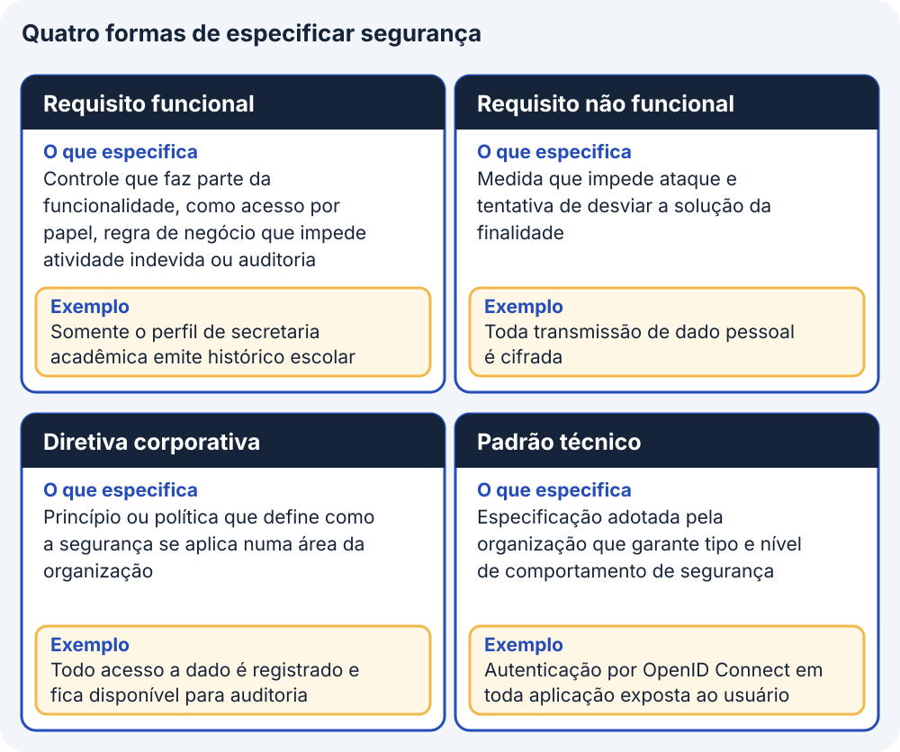
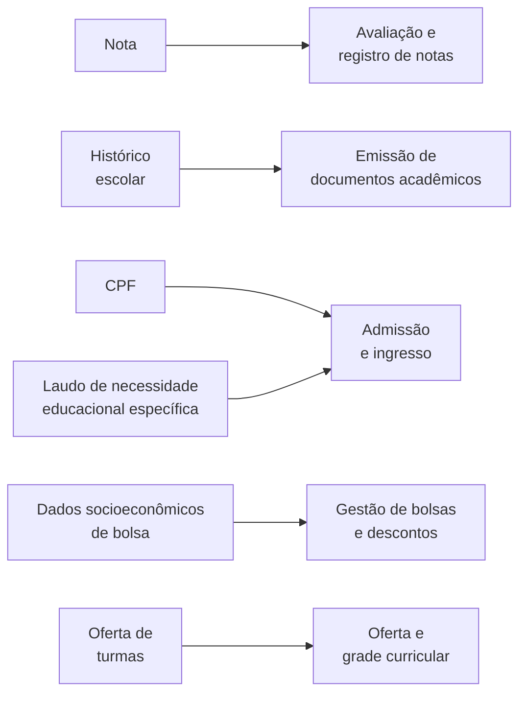
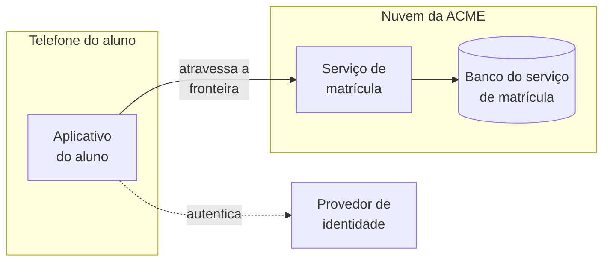

# Segurança ponta a ponta

A ACME já escolheu produtos, plataforma e zona de pouso, e o sistema novo vai guardar a nota, o histórico escolar e o CPF de 38.400 alunos. Antes da implementação, o arquiteto de solução precisa deixar registrado, em decisões que as equipes consigam executar, quão sensível é cada dado, quem pode lê-lo ou gravá-lo, o que protege cada chamada que atravessa a rede e em que lugar cada controle será implantado. Dados e chamadas são ativos, isto é, itens de valor para a organização. Este bloco apresenta cinco passos que levam a essas decisões, com a ferramenta de cada passo, e termina no registro de decisões de segurança, o artefato que o arquiteto entrega às equipes e à revisão de segurança. O exercício 19 aplica os passos à ACME.

## Antes de começar

- [Menor privilégio](../referencia/glossario.md#menor-privilegio)
- [Fronteira de confiança](../referencia/glossario.md#fronteira-de-confianca)
- [Grade de permissões](../referencia/glossario.md#grade-de-permissoes)
- [STRIDE](../referencia/glossario.md#stride)
- [Registro de decisões de segurança](../referencia/glossario.md#registro-de-decisoes-de-seguranca)
- [Dado pessoal sensível](../referencia/glossario.md#dado-pessoal-sensivel)
- [Zona de pouso](../referencia/glossario.md#zona-de-pouso)

## O que cabe ao arquiteto de solução

A definição tecnológica apresentada no [bloco 1](bloco-1-definicao-tecnologica-e-trm.md) termina com um passo dedicado à segurança da solução de ponta a ponta, que examina o desenho inteiro depois que produtos, plataforma e zona de pouso já foram escolhidos. Quando a ACME passa a guardar a nota de um aluno num sistema novo, duas preocupações aparecem nesse passo. A **segurança da informação** protege todos os ativos de informação da organização, em papel ou em meio digital, e a cibersegurança é a parte dela voltada a proteger os sistemas computacionais contra acesso não autorizado, dano ou indisponibilidade provocada por terceiros mal-intencionados. Toda solução que trata dados de alunos ou professores precisa das duas, e a cibersegurança aparece no desenho como proteção contra ataque a cada componente exposto.

Dentro da organização, o trabalho de segurança se divide em dois domínios. As operações de segurança cuidam do dia a dia, com auditoria, testes, manutenção de componentes de infraestrutura e tratamento de incidentes. A arquitetura de segurança cuida da mudança, garantindo que um componente, uma aplicação ou uma solução nova não comprometa a segurança por desenho inadequado, e persegue os quatro objetivos da lista abaixo. Na solução, quem traduz esses objetivos em decisões de desenho é o arquiteto de solução, porque ele conhece os ativos, as chamadas e as equipes que implementam cada parte.

1. Reduzir as vulnerabilidades de segurança desde o desenho.
2. Fazer valer os padrões de segurança em toda a organização.
3. Garantir que todos os desenhos sejam robustos contra ataque.
4. Reduzir o efeito dos incidentes de segurança quando eles ocorrem.

A segurança é um campo especializado e as ameaças mudam com frequência, de modo que o arquiteto consulta especialistas, e a tabela abaixo separa o que ele decide e registra do que outros papéis fornecem, aprovam ou executam. Neste curso, o papel de revisor de segurança é atribuído ao Comitê de Segurança da Informação do dossiê, que é a origem do requisito R8.

| Responsabilidade | Quem responde | Exemplo na ACME |
| --- | --- | --- |
| Propor a classificação dos ativos, a grade de permissões e o controle de cada fronteira, e registrar as decisões no desenho | Arquiteto de solução | Registrar que a nota exige acesso do aluno somente ao próprio registro |
| Implementar os controles no código dos serviços | Equipe de solução | Verificar a permissão de cada chamada no serviço de matrícula |
| Informar os controles disponíveis e executar as mudanças de rede, de conta e de identidade | Equipe de infraestrutura | Manter a conta de segurança e registros e o provedor de identidade |
| Fixar as diretivas e os padrões de segurança, revisar o desenho e aceitar exceções | Comitê de Segurança da Informação | Exigir autenticação por padrão aberto de identidade (R8) |
| Confirmar a base legal e o contrato de tratamento de dado pessoal | Encarregada de proteção de dados e Jurídico | Confirmar que o dado do aluno permanece no território nacional (R14) |

### Quatro formas de especificar segurança

O arquiteto recebe os requisitos de segurança por quatro caminhos diferentes, e a tabela abaixo traz um exemplo de cada um. Os dois primeiros seguem a distinção entre requisito funcional e requisito não funcional apresentada no [bloco 2 da Aula 2](../modulo-2-requisitos-e-partes-interessadas/bloco-2-qualidade-e-tipos-de-requisito.md), e o último usa padrão técnico no sentido definido no [bloco 3 da Aula 4](../modulo-4-dominios-da-solucao/bloco-3-arquitetura-de-aplicacoes-e-integracao.md#padrao-tecnico-protocolo-especificacao-e-contrato), como especificação adotada pela organização e reconhecida fora dela.

<figure markdown="span">
{ .module-diagram }
</figure>

*Figura 1 — As quatro formas de especificar segurança, com o que cada uma especifica e um exemplo. Fonte: material do curso.*

| Forma | O que especifica | Exemplo |
| --- | --- | --- |
| Requisito funcional | Controle que faz parte da funcionalidade, como acesso por papel, regra de negócio que impede atividade indevida ou auditoria | Somente o perfil de secretaria acadêmica emite histórico escolar |
| Requisito não funcional | Medida que impede ataque e tentativa de desviar a solução da finalidade | Toda transmissão de dado pessoal é cifrada |
| Diretiva corporativa | Princípio ou política que define como a segurança se aplica numa área da organização | Todo acesso a dado é registrado e fica disponível para auditoria |
| Padrão técnico | Especificação adotada pela organização que garante tipo e nível de comportamento de segurança | Autenticação por OpenID Connect em toda aplicação exposta ao usuário |

Os requisitos funcionais de segurança costumam chegar a este passo já negociados com as partes interessadas, mas parte deles se sobrepõe aos requisitos não funcionais, e por isso a avaliação de ponta a ponta examina as quatro formas em conjunto.

## Cinco passos até as decisões de segurança

O arquiteto percorre cinco passos, e cada um termina numa decisão que entra no registro de decisões de segurança. A Figura 2 mostra a sequência, e a tabela resume a pergunta, a ferramenta e o produto de cada passo, que as seções seguintes detalham um a um.

<figure markdown="span">
{ .module-diagram }
</figure>

*Figura 2 — Os cinco passos do arquiteto e o registro de decisões de segurança que eles produzem. Fonte: material do curso.*

| Passo | Pergunta | Ferramenta | Produto |
| --- | --- | --- | --- |
| 1. Classificar os ativos | Quão sensível é cada dado e onde ele pode ser processado? | Confidencialidade, integridade, disponibilidade e LGPD | Classificação de cada ativo e restrição de região |
| 2. Definir quem acessa | Quem lê e quem grava cada recurso? | Grade de permissões e menor privilégio | Grade preenchida, com o nível de segurança de cada recurso |
| 3. Examinar as fronteiras | Que ataques cada travessia sofre? | Fronteira de confiança e STRIDE | Ameaças de cada fronteira, com o controle que responde a cada uma |
| 4. Conferir a fundação | Os controles escolhidos existem na plataforma? | Controles da zona de pouso e catálogo de infraestrutura | Controles disponíveis e lacunas de provisão |
| 5. Registrar e revisar | Quem executa cada decisão e como se verifica? | Registro de decisões, diretivas, OWASP Top 10 e CWE | Registro revisado pela segurança |

### Passo 1: classificar os ativos

Para decidir quanto proteger cada coisa, a organização começa por listar o que tem valor e pode, por isso, sofrer ataque ou comprometimento com efeito negativo sobre ela, e cada item dessa lista é um ativo. Os ativos existem em todos os domínios da arquitetura, entre eles os papéis e as unidades organizacionais no domínio de negócio, as definições de dado e de informação no domínio de dados, os sistemas e os sítios na internet no domínio de aplicações e os nós de servidor no domínio de infraestrutura. Uma diretiva válida em toda a organização exige que cada ativo seja avaliado e classificado, e os ativos de dado são classificados por três propriedades, a confidencialidade, a integridade e a disponibilidade, cada uma com um nível, como baixo, médio ou alto.

No Brasil, a classificação dos ativos de dado se completa com a Lei Geral de Proteção de Dados Pessoais, Lei nº 13.709/2018, já apresentada no [bloco 2 da Aula 4](../modulo-4-dominios-da-solucao/bloco-2-arquitetura-de-dados.md#requisitos-de-dados-qualidade-e-protecao). Dado pessoal é a informação relacionada a pessoa natural identificada ou identificável (art. 5º, I), e o dado pessoal sensível é o dado pessoal sobre origem racial ou étnica, convicção religiosa, opinião política, filiação a sindicato ou a organização de caráter religioso, filosófico ou político, dado referente à saúde ou à vida sexual, dado genético ou biométrico, quando vinculado a uma pessoa natural (art. 5º, II). A classificação de um ativo como pessoal ou como pessoal sensível eleva, em geral, o nível de confidencialidade que ele recebe.

A base legal é a hipótese que autoriza o tratamento do dado pessoal, e o art. 7º lista dez hipóteses, entre elas o consentimento do titular (inciso I), o cumprimento de obrigação legal ou regulatória pelo controlador (inciso II) e a execução de contrato (inciso V). A transferência internacional de dado pessoal só é permitida nos casos do art. 33, entre eles o país ou organismo internacional com grau de proteção adequado (inciso I) e a autorização da autoridade nacional (inciso V). Quando uma organização proíbe por decisão própria qualquer processamento fora do território nacional, essa decisão é mais restritiva do que a lei e entra na solução como restrição registrada, conforme o mesmo bloco 2 da Aula 4.

O produto do passo é uma linha de classificação por ativo, com a restrição de região quando houver, e a base legal fica para a encarregada de proteção de dados confirmar. Essa linha dá origem à primeira decisão do registro.

### Passo 2: definir quem acessa

Entre as especificações de segurança, a do controle de acesso é a que admite maior precisão, porque declara quais pessoas e sistemas podem executar cada tarefa e acessar cada recurso. Na forma mais simples, essa especificação é uma grade de permissões, uma tabela que cruza recursos ou tarefas num eixo com entidades no outro, e a entidade pode ser uma pessoa, um grupo, um papel ou um sistema. Toda entidade ausente da grade para um recurso fica impedida de acessá-lo, e cada interseção preenchida indica o tipo de acesso permitido, leitura ou gravação, e a condição que precisa ser satisfeita para que o acesso ocorra, como acessar somente o próprio registro.

A grade recebe ainda o nível de segurança de cada recurso, baixo, médio ou alto, atribuído pela gravidade de uma violação. Esse nível é um requisito não funcional e orienta os especialistas de segurança e de infraestrutura na escolha da proteção, e a Figura 3 mostra uma grade ilustrativa de recursos acadêmicos, com três entidades, três recursos e o nível de cada recurso.

<figure markdown="span">
{ .module-diagram }
</figure>

*Figura 3 — Grade de permissões com tipo de acesso e nível de segurança. Fonte: material do curso, com base em Lovatt (2021, seção 4.6.7).*

O princípio que orienta o preenchimento da grade é o **menor privilégio**, segundo o qual cada entidade recebe o conjunto mínimo de recursos, com o menor nível de privilégio, que ainda permite executar as atividades de negócio que lhe cabem. Na prática, a leitura é concedida a quem precisa consultar, a gravação fica reservada a quem não consegue concluir a tarefa sem ela, e a condição restringe o alcance do acesso, como na célula do usuário final da Figura 3, que lê e grava somente o próprio cadastro. O produto do passo é a grade preenchida, e cada célula corrigida em relação ao primeiro rascunho é uma decisão para o registro.

### Passo 3: examinar as fronteiras

Quando o aluno envia um pedido pelo aplicativo do telefone, o pedido sai de um lugar que a ACME não controla e entra em outro que ela controla. A linha que separa partes de uma solução que operam sob níveis diferentes de confiança, como o aplicativo instalado no telefone do usuário e o serviço que executa na nuvem da organização, é a **fronteira de confiança**. Todo dado e toda chamada que a atravessam precisam ser autenticados, validados e protegidos, porque o lado de menor confiança pode estar sob controle de quem ataca.

A modelagem de ameaças examina cada fronteira com o **STRIDE**, uma classificação de ameaças em seis categorias cujo nome vem das iniciais das categorias em inglês, *spoofing*, *tampering*, *repudiation*, *information disclosure*, *denial of service* e *elevation of privilege*. Cada categoria viola uma propriedade de segurança, e a tabela abaixo traz a categoria em português, a propriedade violada e um controle típico.

| Categoria | Propriedade violada | Controle típico |
| --- | --- | --- |
| Falsificação de identidade | Autenticidade | Autenticação forte, por padrão aberto de identidade |
| Adulteração | Integridade | Assinatura da mensagem e verificação de integridade no destino |
| Repúdio | Não repúdio | Registro de auditoria imutável, com autor e horário de cada operação |
| Divulgação de informação | Confidencialidade | Criptografia em trânsito e em repouso |
| Negação de serviço | Disponibilidade | Limite de taxa por cliente e reserva de capacidade |
| Elevação de privilégio | Autorização | Autorização por papel verificada no próprio serviço |

A Figura 4 aplica as seis categorias a uma única fronteira, com cada seta numerada representando uma forma de ataque à mesma travessia entre cliente e serviço.

<figure markdown="span">
{ .module-diagram }
</figure>

*Figura 4 — Uma fronteira de confiança e as seis categorias STRIDE aplicadas a ela. Fonte: material do curso, com base em Shostack (2014).*

O produto do passo é a lista das ameaças de cada fronteira, cada uma com a categoria e o controle escolhido. Quando mais de um controle trata a mesma ameaça, o arquiteto prefere o que a plataforma ou o modelo técnico de referência já oferecem.

### Passo 4: conferir a fundação

Três pilares da zona de pouso apresentada no [bloco 2](bloco-2-plataforma-arquitetural.md#zona-de-pouso-a-fundacao-da-plataforma) funcionam também como controles de segurança, e o arquiteto confere se a solução os usa antes de contar com eles nas decisões. A lista abaixo descreve o papel de segurança de cada um.

<figure markdown="span">
{ .module-diagram }
</figure>

*Figura 5 — As três fronteiras dos ambientes separados, a sub-rede privada e a identidade centralizada. Fonte: material do curso.*

1. Os ambientes separados em contas ou assinaturas distintas criam três fronteiras. A fronteira de permissão impede que a credencial de desenvolvimento alcance os dados de produção, a fronteira de conformidade permite aplicar políticas diferentes a cada ambiente e restringir a produção a poucos perfis, e a fronteira de efeito mantém um erro de teste contido na conta onde ocorreu.
2. A sub-rede privada abriga os serviços de retaguarda e os bancos de dados, que nunca ficam expostos diretamente à internet, e a sub-rede pública contém apenas o ponto de entrada, como o gateway de APIs ou o balanceador de carga.
3. A identidade centralizada por padrão aberto, como o OpenID Connect da linha de identidade do [modelo técnico de referência](bloco-1-definicao-tecnologica-e-trm.md#estrutura-em-cinco-colunas), reúne num só lugar o controle de quem acessa cada conta e com qual perfil, o que permite auditar as operações sensíveis e trocar o provedor sem alterar as aplicações clientes.

O produto do passo é a lista dos controles que a fundação já entrega e dos que faltam. Um controle escolhido no passo 3 que não consta do catálogo de infraestrutura é uma lacuna de provisão, classificada no [bloco 4](bloco-4-adr-de-plataforma.md) desta aula e levada ao custo e ao roteiro de entrega.

### Passo 5: registrar as decisões e levar à revisão

Classificações, grades e listas de ameaças só protegem a solução quando alguém as executa, e por isso o último passo reúne os resultados dos quatro anteriores no **registro de decisões de segurança**, uma tabela com uma linha por decisão. Cada linha tem os cinco campos da tabela abaixo.

| Campo | O que registra |
| --- | --- |
| Código | Identificador da decisão, como DS1 no registro do caderno, que o requisito do serviço e o teste citam, com numeração própria de cada registro |
| Decisão | O controle adotado e o ativo ou a fronteira em que ele vale |
| Motivo | O requisito, a ameaça, o artigo de lei ou a vulnerabilidade que a decisão responde |
| Quem executa | O papel que altera o código, a infraestrutura ou o contrato |
| Como se verifica | O teste ou a evidência que mostra que a decisão foi cumprida |

O registro tem três leitores. A equipe de solução transforma cada linha em critério de aceite do serviço, a infraestrutura transforma as linhas que lhe cabem em mudança planejada, e a revisão de segurança usa as linhas para saber o que conferir.

#### Revisão do cadastro do aluno da Universidade ACME

Considere a atualização de endereço e telefone pelo aplicativo do aluno da Universidade ACME. O serviço deve confirmar a identidade, autorizar a alteração apenas do próprio cadastro e registrar quem alterou cada dado, de modo a atender o R8, de identidade aberta, e o R9, de rastreabilidade de acesso. Percorridos os quatro primeiros passos, o arquiteto chega às cinco decisões da tabela abaixo, que são proposta de desenho com os testes da última coluna ainda por executar.

| Código | Decisão | Motivo | Quem executa | Como se verifica |
| --- | --- | --- | --- | --- |
| DC1 | Tratar endereço e telefone como dado pessoal de confidencialidade média, processado somente em território nacional | LGPD, art. 5º, I, para a classificação, e R14, do parecer do Jurídico, para o território nacional | Arquiteto de solução registra, e a encarregada de proteção de dados confirma a base legal | Conferência da classificação no caderno e da região no contrato |
| DC2 | O aluno lê e grava somente o próprio cadastro, a secretaria acadêmica lê e grava, e nenhum outro perfil acessa | Menor privilégio e A01:2021 | Equipe de solução, no serviço de cadastro | Teste em que um aluno tenta alterar o cadastro de outro e recebe recusa |
| DC3 | Autenticar o aluno por OpenID Connect no provedor de identidade aprovado no modelo técnico de referência | R8 e falsificação de identidade | Equipe de infraestrutura configura o provedor, e a equipe de solução integra o aplicativo | Chamada sem credencial válida é recusada |
| DC4 | Cifrar toda chamada entre o aplicativo e o serviço, validar cada campo recebido e usar consultas parametrizadas no banco | Divulgação de informação e A03:2021 | Equipe de solução | Teste com entrada maliciosa e conferência da cifra no ponto de entrada |
| DC5 | Registrar autor e horário de cada leitura e alteração do cadastro, com retenção de 5 anos, na conta de segurança e registros | R9, repúdio e A09:2021 | Equipe de solução emite o registro, e a infraestrutura o guarda | Consulta de auditoria que recupera quem alterou um telefone e quando |

#### Revisão de segurança

Antes da implementação, a revisão de segurança confere o registro por dois testes. O primeiro audita o desenho contra os princípios, as políticas e os padrões de segurança adotados pela organização, como o processo definido de concessão de acesso, a gestão formal do segredo de autenticação, a escolha do provedor de identidade conforme o modelo técnico de referência e o registro de todo acesso a dado. A referência mais usada para esse conjunto é a ISO/IEC 27001, cuja edição de 2022 especifica os requisitos para estabelecer, implementar, manter e melhorar continuamente um sistema de gestão de segurança da informação.

O segundo teste simula ameaças e atividades maliciosas para avaliar a resistência da solução, com apoio de catálogos públicos, como a lista OWASP Top 10, que reúne as dez categorias de vulnerabilidade mais frequentes em aplicações web e cuja edição de 2021 é usada neste bloco, e o CWE, lista de fraquezas de software e de hardware mantida pela MITRE que serve de linguagem comum para descrever falhas de segurança. No exemplo, a revisão procura três vulnerabilidades. O acesso além do necessário contraria o menor privilégio e corresponde a A01:2021, controle de acesso quebrado, tratado por DC2. A injeção ocorre porque o portal envia ao banco de dados a informação digitada pelo usuário e corresponde a A03:2021, tratada por DC4. O registro e o monitoramento insuficientes correspondem a A09:2021, falhas de registro e monitoramento de segurança, tratadas por DC5.

Cada achado aceito pela revisão altera uma linha do registro, e a equipe apresenta a evidência da correção antes da implementação. Uma vulnerabilidade sem decisão que a trate gera uma linha nova, com o executor e a verificação definidos.

## Uso pelo arquiteto

O arquiteto usa estes artefatos quando produtos, plataforma e zona de pouso já estão definidos e falta transformar a proteção da nota do aluno e do dado pessoal gravado no banco em trabalho que as equipes executem. Ele parte dos ativos classificados por confidencialidade, integridade e disponibilidade e pela Lei Geral de Proteção de Dados, da grade de permissões preenchida pelo menor privilégio, das ameaças examinadas em cada fronteira de confiança e dos controles que a zona de pouso oferece, e reúne esse material no registro de decisões de segurança.

O registro segue três caminhos. Cada linha da equipe de solução entra no serviço como critério de aceite, cada linha de infraestrutura entra no pedido de mudança, e a linha que exige serviço ausente do catálogo vira lacuna de provisão, classificada no [bloco 4](bloco-4-adr-de-plataforma.md) desta aula e levada ao custo e ao roteiro de entrega. A revisão de segurança recebe o registro completo e concentra os testes nas linhas em que o desenho pode falhar, e as vulnerabilidades como o acesso além do necessário e a injeção só chegam à implementação sem tratamento quando alguma linha deixa de existir. O arquiteto revisa o registro sempre que o desenho ganha um ativo ou uma fronteira nova.

## No caderno arquitetural

{{ficha:8}}

**Para que serve.** O sistema novo vai guardar a nota, o histórico escolar e o CPF de 38.400 alunos, e a lei brasileira trata esses dados de formas diferentes. Antes da implementação, o arquiteto precisa deixar escrito quão sensível é cada dado, quem pode lê-lo ou gravá-lo, que ataques a solução pode sofrer no ponto em que o aluno se conecta e, para cada controle escolhido, quem o executa e como se verifica. A seção 8 do caderno guarda essas respostas, a equipe as usa como lista de trabalho e quem revisa a segurança as lê para encontrar onde o desenho pode falhar.

**O que você faz neste exercício.** O enunciado traz seis ativos de dado, de AT1 a AT6, como a nota (AT1) e o CPF (AT3), uma grade de permissões com seis perfis e três recursos e seis ameaças, de AM1 a AM6, com seis controles identificados pelas letras de (a) a (f). Você classifica cada dado pela LGPD e dá a ele um nível de confidencialidade, aponta e corrige as três células da grade que dão acesso maior que o necessário e associa cada ameaça a uma categoria do STRIDE e ao controle que a trata. Por fim consolida esses achados em cinco decisões de segurança, escrevendo para cada uma o que será decidido, quem executa e como se verifica.

| Campo do caderno | Como preencher | Item |
| --- | --- | --- |
| Classificação LGPD do ativo | Classifique cada um dos seis ativos em não pessoal, pessoal ou pessoal sensível, conforme o art. 5º da LGPD | 1 |
| Nível de confidencialidade | Atribua nível baixo, médio ou alto a cada ativo e justifique em uma linha o nível do ativo pessoal sensível | 1 |
| Ativos restritos pelo R14 | Diga quais ativos não podem ser processados fora do território nacional e qual sistema externo recebe hoje um deles | 1 |
| Células que violam o menor privilégio | Aponte as três células da grade de permissões que dão acesso maior que o necessário, com o perfil e o recurso | 2 |
| Acesso correto | Escreva o acesso correto de cada uma das três células, com a condição quando houver | 2 |
| Categoria STRIDE da ameaça | Classifique cada ameaça, de AM1 a AM6, em uma das seis categorias do STRIDE | 3 |
| Controle da ameaça | Associe a cada ameaça a letra do controle que a trata | 3 |
| Controle que também atende ao R9 | Indique qual dos seis controles também atende ao requisito de trilha de auditoria | 3 |
| Decisão de segurança | Escreva em uma linha o que cada uma das cinco decisões, de DS1 a DS5, estabelece, usando as respostas dos itens 1 a 3 | 4 |
| Quem executa a decisão | Indique, para cada decisão, a equipe ou o papel que a executa, e os dois quando a execução se divide | 4 |
| Como se verifica a decisão | Escreva em uma linha o teste ou a evidência que mostra o cumprimento de cada decisão | 4 |

**O que você já tem.** A zona de pouso do exercício 18, os requisitos R9 e R14 da seção 3, que o exercício cita para justificar a trilha de auditoria e a região dos dados, e as respostas dos itens 1 a 3 do próprio exercício.

**Quando está pronto.** Os seis ativos têm classificação e nível, as três células da grade estão corrigidas, as seis ameaças têm categoria e controle, com o controle do R9 indicado, e as cinco decisões têm texto, executor e verificação.

[Ver esta seção no template](../caderno/template.md#8-tecnologia-e-plataforma){ .caderno-botao }
[Ver o gabarito do exercício 19](../gabaritos/gabarito-exercicio-19.md){ .caderno-botao }

{{/ficha}}

## Exercício 19

A ACME é a universidade privada brasileira com 38.400 alunos ativos cujo sistema acadêmico passa por modernização incremental, com o núcleo transacional, o conjunto de programas que executa as operações acadêmicas, mantido em operação durante a transição. Como o sistema novo vai guardar nota, histórico escolar, CPF e outros dados dos alunos, o exercício verifica se a solução protege esses dados. Para isso, parte do diagrama de contêineres do [exercício 16](../modulo-4-dominios-da-solucao/bloco-4-arquitetura-de-infraestrutura.md#exercicio-16), que mostra as partes executáveis da solução, e da zona de pouso do [exercício 18](bloco-2-plataforma-arquitetural.md#exercicio-18).

A verificação tem quatro itens. No primeiro, o aluno classifica seis dados pela LGPD, a Lei Geral de Proteção de Dados Pessoais. No segundo, corrige uma grade de permissões, a tabela que diz quem pode ler e gravar cada recurso, aplicando o princípio do menor privilégio. No terceiro, associa seis ameaças a categorias do STRIDE, a classificação de ameaças apresentada na seção Fronteira de confiança e STRIDE. No quarto, consolida os achados anteriores em cinco decisões de segurança, dizendo quem executa cada uma e como se verifica. As respostas ficam registradas por item, cada uma com a linha da tabela ou o código do enunciado que a sustenta.

Nos enunciados, um código formado por R e um número, como R9, identifica um requisito do dossiê da ACME, isto é, uma exigência que a solução precisa cumprir. Os dois requisitos e a restrição abaixo constam da [página inicial do caso](../caso-acme/index.md) e valem para os quatro itens. A trilha de auditoria citada no R9 é o registro que permite saber quem leu cada dado e quando, e a retenção de 5 anos é o prazo em que esse registro precisa ser guardado.

| Código | Declaração | Origem |
| --- | --- | --- |
| R9 | Toda leitura de dado pessoal de aluno é registrada em trilha de auditoria, com retenção de 5 anos | Encarregada de proteção de dados |
| R14 | Nenhum dado pessoal de aluno é processado fora do território nacional | Jurídico |
| Restrição | Dado pessoal de aluno processado em território nacional, o que restringe a região de implantação e o uso de serviços gerenciados | Jurídico, parecer de 28/04/2026 |

### Item 1: Ativos de dado e LGPD

O sistema novo da ACME vai guardar dados de natureza muito diferente, e o grau de proteção de cada um determina os controles que o desenho precisa prever. O enunciado traz seis ativos de dado, numerados de AT1 a AT6 no diagrama, entre eles a nota (AT1) e o CPF (AT3). O dossiê não detalha os campos de cada módulo, e os ativos e as ligações abaixo são os considerados neste exercício. O diagrama liga cada ativo à capacidade acadêmica que o usa. Capacidade é uma função que a universidade executa, e o [exercício 13](../modulo-4-dominios-da-solucao/bloco-1-arquitetura-de-negocio.md#exercicio-13) da Aula 4 numerou dez delas, de C1 a C10. O diagrama usa cinco, e a tabela abaixo diz o que cada código designa.

| Código | Capacidade | O que a universidade executa nela |
| --- | --- | --- |
| C1 | Admissão e ingresso | Seleção de candidatos e registro do ingresso do aluno |
| C2 | Oferta e grade curricular | Montagem semestral da oferta de 4.900 turmas |
| C4 | Avaliação e registro de notas | Lançamento de notas, cálculo de média e situação do aluno |
| C6 | Emissão de documentos acadêmicos | Histórico, declaração, atestado e diploma digital |
| C7 | Gestão de bolsas e descontos | Regras de financiamento estudantil e de convênio |

Os códigos C3 e C5, de matrícula em disciplinas e de controle de frequência, e de C8 a C10 não aparecem neste diagrama.

A tabela indica o módulo do núcleo, conforme a [arquitetura de linha de base](../caso-acme/linha-de-base.md), relacionado a cada ativo. Todos os módulos gravam no banco compartilhado entre o núcleo e a camada web.

| Ativo | Módulo do núcleo relacionado |
| --- | --- |
| Nota | Avaliação e notas |
| Histórico escolar | Histórico e documentos |
| CPF | Ativo considerado neste exercício, sem módulo registrado no dossiê |
| Dados socioeconômicos de bolsa | Bolsas e descontos |
| Laudo de necessidade educacional específica | O dossiê não registra o módulo |
| Oferta de turmas | Oferta e grade curricular |

1. Classifique cada ativo, de AT1 a AT6, em não pessoal, pessoal ou pessoal sensível, conforme o art. 5º da LGPD apresentado na seção Ativos e sua classificação.
2. Atribua a cada ativo um nível de confidencialidade baixo, médio ou alto, conforme o dano que a divulgação indevida do dado causaria, e justifique em uma linha o nível do ativo pessoal sensível.
3. Responda em uma linha quais ativos a restrição R14 impede de serem processados fora do território nacional e qual sistema externo do diagrama do exercício 16 recebe hoje, pelos lotes noturnos descritos na linha de base, um desses ativos.

Suas respostas viram os campos Classificação LGPD do ativo, Nível de confidencialidade e Ativos restritos pelo R14, na seção 8 do caderno.

### Item 2: Grade de permissões

Uma grade de permissões costuma ser preenchida com pressa, e cada acesso maior do que o necessário aumenta a chance de erro e de abuso, de modo que o item pede que esses acessos sejam encontrados numa grade já preenchida. O princípio do menor privilégio diz que cada perfil ou serviço recebe apenas o acesso que a tarefa dele exige. A grade abaixo foi proposta para a arquitetura alvo, a solução nova, e três de suas células concedem privilégio além do necessário. As linhas trazem seis perfis e serviços, como Aluno e Serviço de notas, e as colunas trazem três recursos, a nota consolidada, a matrícula e o histórico escolar. L indica leitura, E indica gravação e o traço indica nenhum acesso, e a condição aparece depois da vírgula, como em somente a própria. No sistema atual, o ambiente virtual de aprendizagem recebe a nota consolidada por exportação e devolve apenas nota de atividade, recurso que não consta desta grade.

| Perfil ou serviço | Nota consolidada | Matrícula | Histórico escolar |
| --- | --- | --- | --- |
| Aluno | L E, somente a própria | L E, somente a própria | L, somente o próprio |
| Professor | L E, nas turmas que leciona | L, em todas as turmas | – |
| Secretaria acadêmica | L | L E | L E |
| Serviço de notas | L E | L | – |
| Serviço de matrícula | – | L E | – |
| Ambiente virtual de aprendizagem | L E | L | – |

1. Aponte as três células da grade que violam o princípio do menor privilégio, dizendo para cada uma o perfil e o recurso.
2. Indique o acesso correto de cada uma das três células, com a condição quando houver, usando as letras L e E e o traço.

Suas respostas viram os campos Células que violam o menor privilégio e Acesso correto, na seção 8 do caderno.

### Item 3: Ameaças na fronteira do aplicativo do aluno

O ponto em que o aplicativo do aluno chama o serviço de matrícula está exposto a ataques conhecidos, e o item pede que cada ameaça seja associada a uma categoria do STRIDE e ao controle que a trata, para que o desenho já traga a defesa certa nesse ponto. Ameaça é uma forma de ataque ou de uso indevido, e controle é a medida que a combate. O enunciado traz seis ameaças, numeradas de AM1 a AM6, e seis controles, identificados pelas letras de (a) a (f). A fronteira de confiança analisada é a ligação entre o aplicativo do aluno, instalado no telefone, e o serviço de matrícula, que o R1 e o R6 exigem e que aparece como relação 1 no diagrama do [exercício 16](../modulo-4-dominios-da-solucao/bloco-4-arquitetura-de-infraestrutura.md#exercicio-16). A execução do serviço de matrícula na conta de produção da zona de pouso do [exercício 18](bloco-2-plataforma-arquitetural.md#exercicio-18) é suposição do exercício. A tabela reproduz da [página inicial do caso](../caso-acme/index.md) os requisitos R1, R6 e R8, que este item cita.

| Código | Declaração | Origem |
| --- | --- | --- |
| R1 | O aluno deve renovar a matrícula pelo telefone celular, sem acesso ao portal em computador | Representação discente |
| R6 | O portal sustenta 5.800 sessões simultâneas na abertura da matrícula, com percentil 95 do tempo de confirmação em até 4 segundos | Diretoria de TI |
| R8 | A autenticação usa padrões abertos de identidade, sem produto proprietário | Comitê de Segurança da Informação |

A tabela descreve as seis ameaças, AM1 a AM6, a essa fronteira, e cada linha traz o cenário de um ataque.

| Ameaça | Cenário |
| --- | --- |
| AM1 | Os dados do pedido, com CPF e turmas escolhidas, trafegam sem cifra e são lidos por quem observa a rede do telefone |
| AM2 | Alguém usa a senha obtida de outro aluno e envia pedidos de matrícula em nome dele |
| AM3 | Um programa envia milhares de pedidos por segundo na abertura da matrícula e esgota a capacidade do serviço |
| AM4 | Um aluno afirma que não pediu o cancelamento de uma disciplina, e o serviço não consegue mostrar quem enviou o pedido nem quando |
| AM5 | Um aluno troca um parâmetro do pedido e executa o ajuste de vaga, operação reservada à secretaria acadêmica |
| AM6 | Um intermediário altera, no caminho, a lista de turmas do pedido antes que ela chegue ao serviço |

Os controles disponíveis são os seis da lista abaixo.

- (a) Limite de taxa por cliente e reserva de capacidade.
- (b) Autorização por papel verificada no serviço de matrícula.
- (c) Criptografia em trânsito e em repouso.
- (d) Autenticação forte por OpenID Connect, conforme o R8.
- (e) Registro de auditoria imutável, com autor e horário de cada acesso.
- (f) Assinatura e verificação de integridade da mensagem.

1. Classifique cada ameaça, de AM1 a AM6, numa das seis categorias STRIDE.
2. Associe a cada ameaça a letra do controle que a trata.
3. Indique qual dos seis controles também atende ao requisito R9.

Suas respostas viram os campos Categoria STRIDE da ameaça, Controle da ameaça e Controle que também atende ao R9, na seção 8 do caderno.

### Item 4: Registro de decisões de segurança

Os itens 1 a 3 produziram achados, mas um achado só vira proteção quando alguém o executa e a equipe consegue verificá-lo. Este item consolida cinco achados em decisões do registro de decisões de segurança apresentado no passo 5, de DS1 a DS5. A tabela traz o motivo de cada decisão, isto é, o achado dos itens 1 a 3 que ela responde, e o executor pode ser um destes três: a equipe de solução, que altera o código dos serviços, a equipe de infraestrutura, que altera conta, rede, ponto de entrada ou provedor de identidade, e o Jurídico com a encarregada de proteção de dados, que confirmam a base legal e a cláusula contratual de tratamento do dado pessoal, cabendo à Reitoria a decisão sobre o contrato.

| Decisão | Motivo |
| --- | --- |
| DS1 | Os ativos AT1 a AT5 não podem ser processados fora do território nacional (R14), e o ambiente virtual de aprendizagem recebe a nota consolidada (item 1) |
| DS2 | Três células da grade de permissões dão acesso maior que o necessário (item 2) |
| DS3 | AM2, senha de outro aluno, num serviço cujo R8 exige padrão aberto de identidade (item 3) |
| DS4 | AM1 e AM3, leitura dos dados do pedido na rede e esgotamento da capacidade na abertura da matrícula (item 3) |
| DS5 | AM4 e R9, trilha de auditoria com retenção de 5 anos (item 3) |

1. Escreva em uma linha o que cada decisão estabelece, usando as respostas dos itens 1 a 3.
2. Indique quem executa cada decisão, escolhendo entre os três executores, e escreva os dois quando a execução se divide entre eles.
3. Escreva em uma linha o teste ou a evidência que mostra o cumprimento de cada decisão.

Suas respostas viram os campos Decisão de segurança, Quem executa a decisão e Como se verifica a decisão, na seção 8 do caderno.

## Fontes

As referências seguem o formato APA, 7ª edição, e constam da [bibliografia](../referencia/bibliografia.md) do curso. O trecho consultado aparece entre parênteses ao fim de cada entrada.

- Lovatt, M. (2021). *Solution architecture foundations*. BCS, The Chartered Institute for IT. (seção 2.9, arquitetura de segurança, objetivos, diretivas e ativos, seção 4.6.7, segurança como requisito e grade de permissões, e seção 7.7, segurança de ponta a ponta, testes de revisão de segurança e exemplo de revisão adaptado aqui à Universidade ACME. O livro cita a ISO/IEC 27001 na edição de 2013 e numera as vulnerabilidades do caso como A1 e A10, numeração da edição de 2017 do OWASP Top 10, e esta página usa a edição de 2022 da norma e a numeração de 2021 do OWASP, A01, A03 e A09)
- Brasil. (2018). *Lei nº 13.709, de 14 de agosto de 2018. Lei Geral de Proteção de Dados Pessoais (LGPD)*. https://www.planalto.gov.br/ccivil_03/_ato2015-2018/2018/lei/l13709.htm (art. 5º, I e II, art. 7º e art. 33, I e V, lidos no texto atualizado da base de legislação da Câmara dos Deputados)
- Shostack, A. (2014). *Threat modeling: Designing for security*. Acesso em 15 de outubro de 2026. https://shostack.org/books/threat-modeling-book (categorias STRIDE e propriedade violada por cada uma, conforme https://shostack.org/resources/threat-modeling)
- OWASP Foundation. (2021). *OWASP Top 10:2021*. Acesso em 15 de outubro de 2026. https://top10.owasp.org/2021 (A01:2021, A03:2021 e A09:2021)
- MITRE Corporation. (n.d.). *Common Weakness Enumeration (CWE)*. Acesso em 15 de outubro de 2026. https://cwe.mitre.org/ (definição do CWE na página de perguntas frequentes)
- International Organization for Standardization/International Electrotechnical Commission. (2022). *Information security, cybersecurity and privacy protection — Information security management systems — Requirements* (ISO/IEC 27001:2022). Acesso em 15 de outubro de 2026. https://webstore.iec.ch/publication/79694 (escopo da norma)

**Material do curso.** Glossário, entradas [grade de permissões](../referencia/glossario.md#grade-de-permissoes), [menor privilégio](../referencia/glossario.md#menor-privilegio), [fronteira de confiança](../referencia/glossario.md#fronteira-de-confianca), [STRIDE](../referencia/glossario.md#stride), [registro de decisões de segurança](../referencia/glossario.md#registro-de-decisoes-de-seguranca) e [dado pessoal sensível](../referencia/glossario.md#dado-pessoal-sensivel). Dossiê da instituição fictícia [ACME](../caso-acme/index.md) e [arquitetura de linha de base](../caso-acme/linha-de-base.md), sendo os exemplos da tabela das quatro formas, a divisão de responsabilidades, os cinco passos, o registro de decisões de segurança do exemplo, as figuras 2 e 4 e os ativos, a grade, as ameaças e as decisões do exercício 19 convenções do curso.
