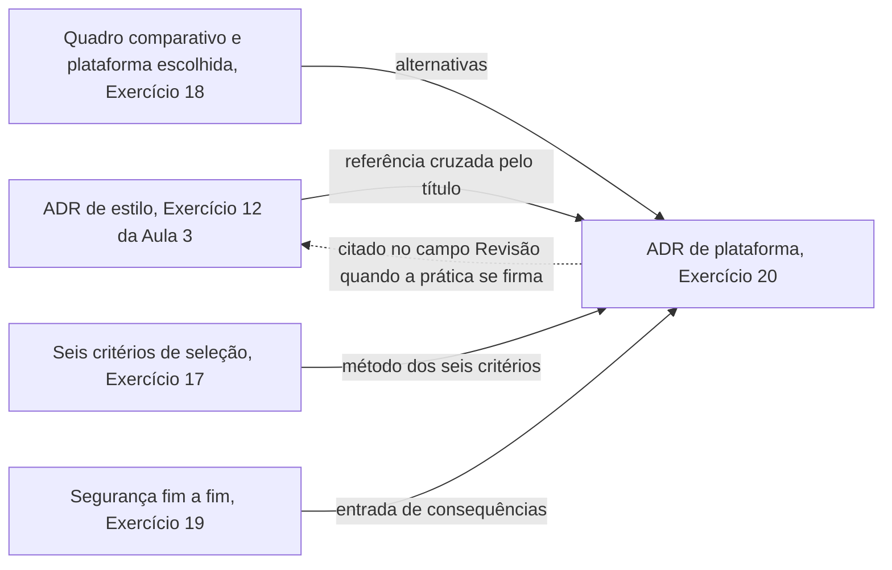
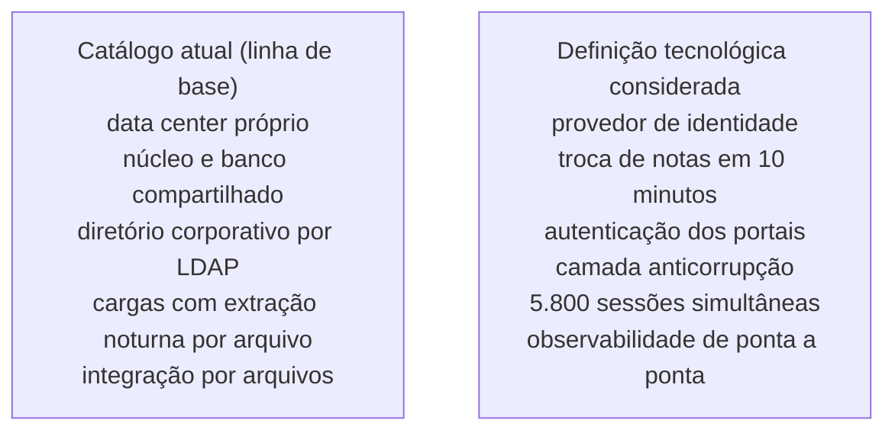

# ADR de plataforma

Este bloco fecha o par de decisões da aula respondendo a uma pergunta que só se coloca depois do bloco anterior, como registrar a escolha de plataforma feita ali, de um jeito que sobreviva à saída de quem a tomou.

## Antes de começar

- [ADR](../referencia/glossario.md#adr)
- [Plataforma arquitetural](../referencia/glossario.md#plataforma-arquitetural)
- [Dependência de fornecedor](../referencia/glossario.md#dependencia-de-fornecedor)

## Conceito

Um **ADR de plataforma** é o segundo ADR do par ensinado na disciplina, escrito no mesmo template de dez campos apresentado no [bloco 4 da Aula 3](../modulo-3-design-e-padroes/bloco-4-registro-de-decisao-arquitetural.md), mas aplicado a uma decisão de natureza diferente da primeira. Aquele ADR registra a escolha de um [estilo arquitetural](../modulo-3-design-e-padroes/bloco-2-estilos-arquiteturais.md). O ADR deste bloco registra a escolha de uma das plataformas candidatas capazes de concretizar esse estilo, comparação que o [bloco 2](bloco-2-plataforma-arquitetural.md) desta aula já apresentou.

O template não muda entre os dois. O conteúdo de cada campo muda, e três campos mudam de forma característica.

### O que muda no campo de forças

Em um ADR de estilo, as forças são [atributos de qualidade](../referencia/glossario.md#atributo-de-qualidade) do sistema, como absorver pico de carga ou isolar falha. Em um ADR de plataforma, elas incluem esses atributos e acrescentam os seis critérios de seleção do [bloco 1](bloco-1-definicao-tecnologica-e-trm.md#seis-criterios-de-selecao), entre eles competência da equipe, custo total de propriedade e maturidade da tecnologia.

A essas forças soma-se uma que só aparece na decisão de plataforma. A **dependência de fornecedor** é a dificuldade de trocar ou negociar uma dependência, técnica ou organizacional. Serviços gerenciados podem ser escolhas excelentes quando reduzem risco operacional, mas precisam ficar explícitos no ADR em seis dimensões.

1. API proprietária
2. formato de dados
3. identidade
4. observabilidade
5. custo de saída de dados
6. habilidades da equipe

Abstrair tudo antecipadamente para fugir dessa dependência cria uma plataforma paralela, que é um custo novo. O caminho é preferir contratos de domínio, exportação testada, infraestrutura declarativa e uma condição mensurável de saída. A dependência de fornecedor é aceitável quando o benefício específico é conhecido e a decisão é revisável.

### O que muda no campo de alternativas

Em um ADR de plataforma, o campo de alternativas já vem pronto do bloco anterior. O quadro comparativo preenchido no [Exercício 18](bloco-2-plataforma-arquitetural.md#exercicio-18), com as plataformas candidatas nas linhas e os seis critérios de seleção do [bloco 1](bloco-1-definicao-tecnologica-e-trm.md#seis-criterios-de-selecao) nas colunas, é exatamente o que o campo pede, cada alternativa com as forças que atende e os riscos que introduz. Transportar o quadro para o registro garante que a plataforma descartada seja avaliada pelos mesmos critérios da escolhida, com as forças e os riscos registrados para cada uma.

### O que muda no campo de consequências

Reverter uma decisão de estilo cobra custo de reestruturação de componentes, porque a fronteira entre as partes do sistema muda. Reverter uma decisão de plataforma cobra custo de treinamento e de migração de código, porque a equipe precisa aprender uma API diferente e o código escrito contra a plataforma anterior precisa ser reescrito contra a nova, mesmo quando o estilo arquitetural permanece o mesmo dos dois lados da troca.

A Seguradora ACME, que já decidiu por uma [arquitetura orientada a eventos](../modulo-3-design-e-padroes/bloco-2-estilos-arquiteturais.md#arquitetura-orientada-a-eventos) para separar emissão de apólice, análise de risco e abertura de sinistro, enfrenta essa segunda decisão ao escolher entre duas plataformas de mensageria candidatas. Se ela troca de plataforma depois que os três serviços já estão em produção, o custo recai sobre o time, que precisa reaprender a API de publicação e consumo, e sobre o código de cada serviço, que precisa ser adaptado. O estilo orientado a eventos em si não muda. A Operadora Logística ACME, que atua em entrega de última milha e decidiu por [microsserviços](../modulo-3-design-e-padroes/bloco-2-estilos-arquiteturais.md#arquitetura-de-microsservicos) para isolar roteamento, despacho e rastreamento, enfrenta a mesma segunda decisão ao escolher entre dois orquestradores de execução, e trocar de orquestrador depois da adoção cobra da equipe de operação o aprendizado de um modelo de implantação diferente e a reescrita dos scripts de infraestrutura, novamente sem alterar a divisão em serviços que define o estilo.

### O par de registros

Os dois ADRs não vivem isolados um do outro. O ADR de plataforma faz uma **referência cruzada** ao título do ADR de estilo no seu campo de contexto, porque a plataforma só faz sentido como resposta a um estilo já fixado, e um leitor que chega ao ADR de plataforma sem ter lido o ADR de estilo precisa encontrar esse encadeamento no próprio texto. Quando a prática se firma, o ADR de estilo passa a citar, no campo de revisão, o ADR de plataforma que veio depois, fechando o par nos dois sentidos.

### Lacunas na provisão de serviços

Quando a definição tecnológica está completa, o arquiteto compara os serviços que ela exige com o **catálogo de infraestrutura**, a lista dos serviços que a organização já provê, e registra tudo o que impede ou atrapalha a implantação da solução. O resultado é um **relatório de lacunas**, em que cada item é uma lacuna de provisão classificada em um dos quatro tipos da tabela abaixo, e a mesma classificação vale para as lacunas que a [autoridade de design de segurança](bloco-3-seguranca-fim-a-fim.md) aponta no bloco anterior.

| Tipo | Descrição |
| --- | --- |
| Nova | O serviço ainda não é provido pela organização |
| Substituição | Um serviço existente é trocado por outro |
| Modificação | O serviço existe e precisa de reconfiguração, ampliação ou extensão a outra região |
| Remoção | O serviço deixa de ser necessário |

<figure markdown="span">
{ .module-diagram }
</figure>

*Figura 1 — Os quatro tipos de lacuna na provisão de serviços de infraestrutura. Fonte: material do curso, com base em Lovatt (2021, seção 7.8).*

Cada lacuna recebe uma estimativa de tamanho, custo, recurso e tempo, porque toda mudança exige esforço e, em geral, algum desembolso. Uma troca de serviço pode reduzir o custo recorrente depois de custar para ser executada, já que o serviço novo pode operar com mais eficiência. A justificativa de algumas soluções é justamente reduzir o custo de operação, e esse resultado raramente se alcança sem investir antes em mudança. Quando o custo total fica acima do esperado, o arquiteto revê a tecnologia de infraestrutura, o desenho da solução, o escopo e a escala ou as oportunidades de linha de base incluídas. As lacunas confirmadas entram no [roteiro de entrega](../modulo-6-lacunas-e-governanca/index.md) da Aula 6, onde a análise de lacunas é tratada como método próprio.

### Validação da definição tecnológica

Concluída a definição, a equipe de arquitetura de solução e a função de infraestrutura conduzem em conjunto a validação com as partes interessadas, que recebem o material por meio eletrônico e depois participam de uma oficina de discussão. As partes interessadas podem exigir revisão da definição, e a oficina cobre cinco pontos.

1. percurso da definição tecnológica com todas as partes presentes ou representadas
2. mudanças e revisões feitas no desenho da solução
3. custos de infraestrutura e economias associadas à solução
4. compromissos assumidos nas escolhas de infraestrutura
5. preocupações levantadas, tratadas na oficina ou em investigação posterior

## Uso pelo arquiteto

O arquiteto escreve este segundo registro logo depois de fechar a comparação de plataformas, no mesmo momento em que as candidatas descartadas e o critério que as eliminou ainda estão claros. O campo de evidências é o que mais se beneficia desse momento, porque é quando ainda existem o teste de carga, a prova de conceito ou a medição que sustentaram a escolha, e é trivial anotar onde cada um pode ser reproduzido. Meses depois, essa informação já se perdeu, e o registro fica com uma justificativa que ninguém consegue verificar. O relatório de lacunas produzido na mesma ocasião alimenta o custo da solução e o roteiro de entrega, e cada lacuna listada leva ao ADR o custo estimado de tornar a plataforma escolhida utilizável.

## Exercício 20

A ACME é a universidade privada brasileira em modernização incremental do sistema acadêmico, usada como caso desta disciplina. Este exercício pede o ADR que registra a escolha de plataforma feita no [Exercício 18](bloco-2-plataforma-arquitetural.md#exercicio-18) do bloco anterior, no mesmo template de dez campos usado no [bloco 4 da Aula 3](../modulo-3-design-e-padroes/bloco-4-registro-de-decisao-arquitetural.md).

### Item 1: Encadeamento com o ADR de estilo

O diagrama abaixo mostra de onde vêm as entradas deste registro e a referência cruzada que liga o par de ADRs.

1. título, estado e data
2. contexto, referenciando pelo título o ADR de estilo escrito no [Exercício 12](../modulo-3-design-e-padroes/bloco-4-registro-de-decisao-arquitetural.md#exercicio-12)
3. alternativas, transportando o quadro comparativo preenchido no [Exercício 18](bloco-2-plataforma-arquitetural.md#exercicio-18), que aplica o método dos seis critérios do [Exercício 17](bloco-1-definicao-tecnologica-e-trm.md#exercicio-17)

### Item 2: Forças e dependência de fornecedor

A tabela abaixo relaciona as seis dimensões de dependência de fornecedor listadas no Conceito a dados do [dossiê da ACME](../caso-acme/index.md) e da [arquitetura de linha de base](../caso-acme/linha-de-base.md).

| Dimensão | Dado do caso |
| --- | --- |
| API proprietária | Os portais chamam o núcleo CICS por conector transacional proprietário, caminho de todas as operações acadêmicas |
| Formato de dados | O banco Oracle 12c guarda 11 TB em 740 tabelas, compartilhadas entre o núcleo COBOL e a camada Java |
| Identidade | O requisito R8 exige autenticação por padrões abertos de identidade, sem produto proprietário |
| Observabilidade | O dossiê não registra ferramenta nem prática de observabilidade para o sistema acadêmico |
| Custo de saída de dados | Dois provedores de nuvem pré-aprovados, com decisões de plataforma portáveis entre os dois |
| Habilidades da equipe | A camada Java tem 9 pessoas sem escassez, e o núcleo COBOL tem 6 especialistas, dos quais 2 se aposentam em 2027 |

1. forças, com pelo menos três dos seis critérios de seleção do [bloco 1](bloco-1-definicao-tecnologica-e-trm.md#seis-criterios-de-selecao), mais ao menos uma das seis dimensões da tabela, indicando o dado do caso que sustenta cada força
2. decisão, nomeando a plataforma escolhida e conectando a justificativa às forças

### Item 3: Consequências, evidências e revisão

A tabela abaixo reúne os dados do caso que limitam as evidências disponíveis e que podem servir de base para o gatilho de revisão.

| Dado | Valor |
| --- | --- |
| Ambientes disponíveis | Produção e homologação, sem ambiente de teste de carga |
| Contrato de sustentação do núcleo COBOL | Exclusividade da fábrica até 30/09/2027 |
| Contrato de capacidade de grande porte | Volume mínimo contratado até 31/12/2028 |

1. consequências, com ao menos uma positiva, uma negativa e uma neutra, levando em conta os achados de segurança do [Exercício 19](bloco-3-seguranca-fim-a-fim.md#exercicio-19)
2. evidências, indicando o que sustentaria a escolha e onde poderia ser reproduzido
3. revisão, com um gatilho observável ligado à convivência com o núcleo COBOL sobre CICS

O campo de evidências é o mais difícil neste exercício, porque a ACME não tem ambiente de teste de carga. Nomear a evidência que seria desejável, e que não existe, é resposta melhor do que inventar uma medição.

### Item 4: Lacunas de provisão

Os itens da tabela abaixo vêm da definição tecnológica considerada neste exercício, montada com o bloco 1 e os exercícios 16 a 19, e não do dossiê. A manutenção do diretório corporativo atrás do provedor de identidade faz parte dessa definição. A coluna de situação traz apenas o que a [arquitetura de linha de base](../caso-acme/linha-de-base.md) registra, e a linha de base faz o papel de catálogo de infraestrutura neste exercício, porque o dossiê não traz um catálogo formal.

| Item da definição tecnológica considerada | Situação no catálogo atual (linha de base) |
| --- | --- |
| Provedor de identidade com OpenID Connect, padrão aberto de identidade, como pede o R8 | Existe só o diretório corporativo, acessado por LDAP de forma síncrona, com tempo limite de 10 s, e ele autentica todos os perfis |
| Troca de notas com o ambiente virtual de aprendizagem em até 10 minutos, como pede o R7 | Lote das 05h10 por arquivo posicional, e o incidente de 09/07/2026 deixou 61.400 lançamentos de nota fora do ambiente virtual, com reprocessamento manual |
| Autenticação dos perfis dos portais existentes, Professor e Secretaria, pelo provedor de identidade, com o diretório corporativo mantido atrás dele | O diretório autentica hoje todos os perfis por LDAP, sem provedor de identidade |
| Todo acesso ao núcleo por camada anticorrupção, sem acesso direto da camada Java ao banco | O código Java tem 2.300 pontos de acesso direto ao banco, fora do núcleo |
| Capacidade para 5.800 sessões simultâneas na abertura da matrícula, como pede o R6 | A camada web e o monitor CICS atendem hoje a abertura da matrícula, e em 04/02/2026 o limite de tarefas concorrentes do CICS foi atingido, com 62% das tentativas de matrícula retornando erro |
| Observabilidade de ponta a ponta, com rastreamento entre os componentes | O dossiê não registra ferramenta de observabilidade para o sistema acadêmico |

1. classificar cada um dos seis itens como lacuna nova, substituição, modificação ou remoção, justificando a classificação com o dado da coluna de situação
2. indicar qual dos seis itens, uma vez atendido, tende a reduzir custo recorrente já registrado nos [dados operacionais](../caso-acme/dados-operacionais.md), e citar o dado

## Fontes

As referências seguem o formato APA, 7ª edição, e constam da [bibliografia](../referencia/bibliografia.md) do curso. O trecho consultado aparece entre parênteses ao fim de cada entrada.

- Mendes, M. (2026a). *Arquitetura de software* [Material de curso]. https://marco-mendes.github.io/arquitetura-software/ ([template de ADR](https://marco-mendes.github.io/arquitetura-software/referencia/template-adr/) de dez campos e a seção [custo e lock-in](https://marco-mendes.github.io/arquitetura-software/modulo-6-nuvem/padroes-e-decisoes/), fonte da definição de dependência de fornecedor e das seis dimensões)
- Lovatt, M. (2021). *Solution architecture foundations*. BCS, The Chartered Institute for IT. (seção 7.8, lacunas na provisão de serviços de infraestrutura e os quatro tipos de lacuna, e seção 7.9, validação da definição tecnológica com as partes interessadas)
- Nygard, M. (2011, 15 de novembro). *Documenting architecture decisions*. Cognitect Blog. https://cognitect.com/blog/2011/11/15/documenting-architecture-decisions (formato de cinco partes)
- MADR. (2024). *Markdown Architectural Decision Records* (Versão 4.0.0). https://adr.github.io/madr/ (campos do formato MADR)

**Material do curso.** O glossário traz as entradas [ADR](../referencia/glossario.md#adr), [plataforma arquitetural](../referencia/glossario.md#plataforma-arquitetural), [dependência de fornecedor](../referencia/glossario.md#dependencia-de-fornecedor) e [lacuna de provisão](../referencia/glossario.md#lacuna-de-provisao), e o dossiê da instituição fictícia [ACME](../caso-acme/index.md) fornece a [arquitetura de linha de base](../caso-acme/linha-de-base.md) e os [dados operacionais](../caso-acme/dados-operacionais.md).
