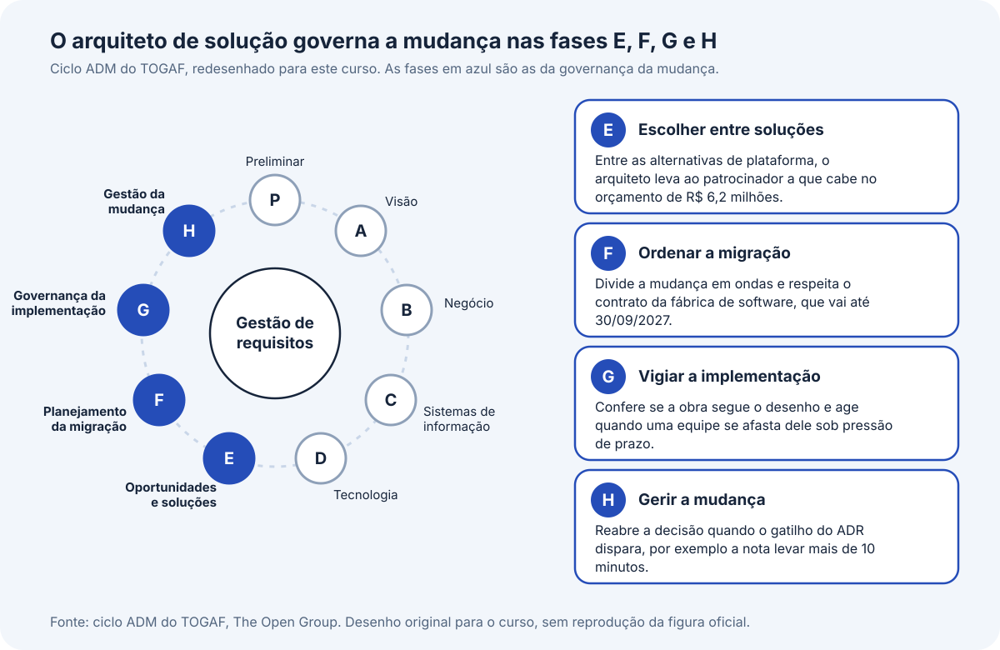
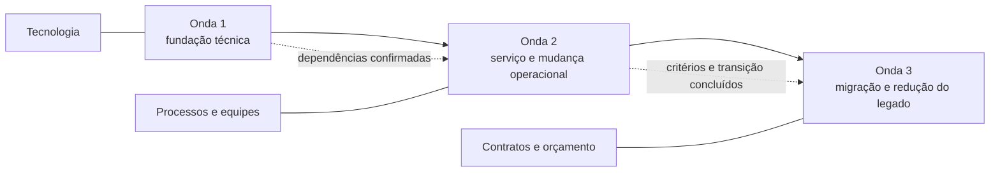
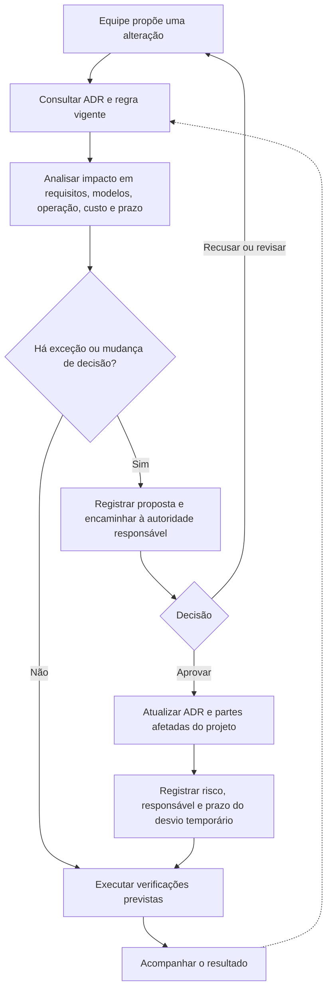

# Governança da mudança

Antes de gastar os R$ 6,2 milhões aprovados para o primeiro ciclo, a ACME precisa responder a duas perguntas: o que separa o sistema atual do sistema desenhado e como garantir que a implementação siga o desenho sob pressão de prazo. Na abertura de matrícula de 04/02/2026, o portal caiu e 62% das tentativas retornaram erro. A solução foi desenhada para suportar 5.800 sessões simultâneas. A distância entre essas situações é o trabalho que precisa ser planejado e acompanhado.

Este bloco ensina a medir essa distância com a análise de lacunas, a ordenar o fechamento das lacunas em ondas de entrega e a vigiar a execução com os mecanismos de governança. Mostra também o ciclo ADM do TOGAF, um método de arquitetura corporativa mantido pelo The Open Group, para situar o arquiteto de solução nas fases em que ele governa a mudança. O aluno faz dois exercícios, o 21, que classifica lacunas e ordena ondas, e o 22, que associa situações de desvio aos mecanismos de governança e a quem decide.

## Antes de começar

- [Arquitetura de linha de base](../referencia/glossario.md#arquitetura-de-linha-de-base)
- [Arquitetura alvo](../referencia/glossario.md#arquitetura-alvo)
- [ADR](../referencia/glossario.md#adr)
- [Lacuna de provisão](../referencia/glossario.md#lacuna-de-provisao)

## Conceito

### Análise de lacunas: o que separa o sistema de hoje do desenhado

Para saber o que a ACME precisa mudar, o arquiteto compara duas descrições. A [arquitetura de linha de base](../referencia/glossario.md#arquitetura-de-linha-de-base) mostra o sistema como ele é hoje, e a [arquitetura alvo](../referencia/glossario.md#arquitetura-alvo) mostra como se pretende deixá-lo ao fim do ciclo. Cada diferença entre as duas é uma **lacuna**, a comparação sistemática que as encontra é a **análise de lacunas**, e a lista de lacunas, com a forma de fechar cada uma, é o **relatório de lacunas**. A [Aula 5](../modulo-5-frameworks-e-tecnologias/bloco-4-adr-de-plataforma.md#lacunas-na-provisao-de-servicos) tratou de um caso particular, as lacunas de provisão de serviços de infraestrutura, e aqui o método vale para o sistema inteiro.

O arquiteto percorre o método em cinco passos, nesta ordem, porque cada passo depende do anterior.

1. Conferir as entradas. Ele verifica a versão, a data e a situação de cada descrição, porque comparar com um modelo desatualizado produz um relatório errado, e torna as duas compatíveis em escopo, em formato e em nível de detalhe. Na ACME, a linha de base vem do dossiê e do inventário técnico concluído em 31/08/2026, e a arquitetura alvo vem do desenho feito nas Aulas 3 a 5.
2. Classificar cada elemento. Cada componente e cada interface entra uma única vez numa tabela, com o tipo de mudança (inalterado, modificado, acrescentado ou removido), o detalhe da mudança e o impacto sobre os demais elementos. Esse é o método de tabela, indicado para soluções com poucos componentes.
3. Procurar também a partir dos requisitos. Todo cenário de qualidade que a linha de base não atende, como o pico de matrícula que hoje derruba o portal, indica uma lacuna, e o arquiteto registra a ligação entre o requisito e o elemento que a fecha.
4. Organizar por domínio e separar o tipo. O relatório usa sete domínios, que são aplicação, dados, integração, segurança, infraestrutura, processo e competência das equipes, e os cinco primeiros reúnem as lacunas técnicas, enquanto processo e competência reúnem as organizacionais.
5. Indicar quem decide, até quando e em que onda entra cada lacuna, para que o relatório sirva de base ao roteiro de entrega.

Os insumos e o produto do método cabem em uma tabela.

| Papel no método | O que é |
| --- | --- |
| Entrada | A arquitetura de linha de base, a arquitetura alvo e o catálogo de requisitos com os cenários de qualidade |
| Saída | O relatório de lacunas, com tipo, domínio, quem decide, prazo e onda de cada lacuna |

A ACME mostra como o método de tabela funciona. Para o aplicativo do aluno, que atende ao requisito R1, a renovação da matrícula pelo celular, a tabela registra o aplicativo como elemento acrescentado. As linhas abaixo são um exemplo, escolhido porque cada uma tem um tipo de mudança diferente, e não a tabela completa do relatório.

| Elemento da ACME | Tipo de mudança | Detalhe |
| --- | --- | --- |
| Aplicativo do aluno | Acrescentado | Canal novo, que exige o gateway de APIs e o provedor de identidade |
| Portal do Aluno em JSF | Modificado | A matrícula e a consulta de notas passam ao portal web e ao aplicativo, e o restante segue em JSF sob plano de migração |
| Diretório corporativo por LDAP | Removido como meio de autenticação dos canais | O provedor de identidade com OpenID Connect o substitui |
| Núcleo COBOL sobre CICS | Inalterado | Nenhum programa é alterado no primeiro ciclo, e a camada anticorrupção passa a chamá-lo |

A diferença entre lacuna técnica e lacuna organizacional decide quem resolve cada item. Um exemplo técnico da ACME é o banco Oracle 12c, sem correção de segurança do fornecedor desde 31/03/2022, que a equipe de TI fecha com controle compensatório e plano de atualização dentro do próprio orçamento. Um exemplo organizacional é o contrato de capacidade de grande porte, que termina em 31/12/2028 com volume mínimo e que nenhum projeto de software resolve, porque a decisão cabe à Reitoria. O relatório leva à diretoria os itens organizacionais com o nome de quem decide e a data limite, que no caso do contrato é 31/12/2028.

### O ciclo ADM e o papel do arquiteto de solução

Com o relatório pronto, a ACME passa do desenho à execução, e o arquiteto de solução continua responsável pelo resultado. O ciclo ADM (do inglês Architecture Development Method), do TOGAF, descreve essa trajetória em fases dispostas em círculo, com a gestão de requisitos no centro. A fase preliminar e as fases A a D tratam da visão, do negócio, dos sistemas de informação e da tecnologia, que são os assuntos das Aulas 1 a 5. As fases E, F, G e H são aquelas em que o arquiteto de solução governa a mudança, e a Figura 1 as destaca.

<figure markdown="span">
{ .module-diagram }
</figure>

*Figura 1. O arquiteto de solução governa a mudança nas fases E, F, G e H do ciclo ADM. Fonte: material do curso, com base no ciclo ADM do TOGAF (The Open Group), em desenho original que não reproduz a figura oficial.*

**Fase E, oportunidades e soluções.** Nesta fase o arquiteto reúne as lacunas do relatório em conjuntos de mudança que podem ser entregues e compara as alternativas de implementação de cada conjunto. O papel dele é levar ao patrocinador, que é quem responde pelas decisões do projeto, a alternativa que cabe nas restrições e explicar o que cada uma custa. Na ACME, entre as alternativas de plataforma comparadas na [Aula 5](../modulo-5-frameworks-e-tecnologias/bloco-2-plataforma-arquitetural.md#exercicio-18), ele leva à Reitoria a que cabe no orçamento de R$ 6,2 milhões.

**Fase F, planejamento da migração.** Aqui o arquiteto ordena as mudanças, porque algumas só podem acontecer depois de outras, e acompanha o custo e o calendário de cada etapa. O papel dele é dividir o caminho em etapas que a ACME consiga sustentar sem parar o sistema em período letivo. Na ACME essas etapas são as ondas de entrega, e a ordem respeita o contrato da fábrica de software, que mantém a exclusividade sobre os programas COBOL até 30/09/2027.

**Fase G, governança da implementação.** Quando as equipes começam a construir, o arquiteto confere se a obra segue o desenho e age quando uma delas se afasta dele. O papel dele é o de guardião do desenho, e para isso ele usa os mecanismos descritos mais adiante neste bloco. Na ACME, a equipe do serviço de matrícula, pressionada pela abertura da matrícula, pode decidir ler as tabelas do banco do núcleo diretamente, e é nesta fase que o arquiteto leva o pedido ao conselho de revisão e impede que o desvio chegue à produção sem decisão.

**Fase H, gestão da mudança.** Depois que a solução entra em operação, o arquiteto acompanha o que mudou no ambiente e decide se a arquitetura precisa ser revista. O papel dele é reabrir uma decisão quando o gatilho de revisão registrado no ADR dispara, e rever a solução em uma análise agendada para seis meses ou um ano após a implantação. Na ACME, se a nota lançada passar a levar mais de 10 minutos para chegar ao ambiente virtual de aprendizagem, o que viola o requisito R7, o arquiteto reabre a decisão da [Aula 5](../modulo-5-frameworks-e-tecnologias/bloco-4-adr-de-plataforma.md#item-3-consequencias-evidencias-e-revisao) e o ciclo recomeça pelos requisitos.

### Roteiro de entrega em ondas

As ondas precisam coordenar tecnologia, trabalho das pessoas e contratos. O esquema mostra que uma frente só avança quando suas dependências técnicas e organizacionais estiverem prontas. Datas propostas permanecem sujeitas à confirmação das autoridades do projeto.



Com as lacunas listadas, a ACME precisa decidir o que entregar primeiro, e a resposta é o **roteiro arquitetural**, a visão estratégica de como a solução evolui no tempo. Ele mostra só as entregas que todas as partes interessadas reconhecem, distribuídas em períodos amplos e ligadas a um benefício de negócio. O cronograma do projeto fica por trás do roteiro, com as tarefas, as datas e as pessoas, sob responsabilidade da gestão de programas e projetos. O roteiro usa o formato agora, em seguida e depois, porque a diretoria o lê sem conhecimento técnico.

Cada período do roteiro é uma **onda de entrega**, e cada onda tem valor de negócio e um critério de conclusão. O **critério de conclusão** é o que precisa estar em produção, validado e operando para que a onda seja considerada completa, e ele impede que se declare concluída uma onda só porque o prazo acabou. A ordem das ondas acompanha as dependências técnicas, e por isso a primeira costuma entregar a fundação de que as seguintes precisam, junto com uma entrega visível ao usuário. A técnica da **arquitetura mínima viável** ajuda a montar cada onda, porque pergunta qual é a menor arquitetura que entrega valor e permite aprender com o uso real.

A tabela mostra as três ondas da ACME. Três requisitos do caso aparecem nela pelo código. A renovação da matrícula pelo celular é o requisito R1, as 5.800 sessões simultâneas na abertura da matrícula, com 95% das confirmações em até 4 segundos, são o R6, e a queda do custo anual de propriedade de R$ 15,83 milhões para R$ 11,0 milhões até o fim de 2029 é o R15.

| Onda | Prazo suposto | Valor de negócio | Entregas principais | Critério de conclusão |
| --- | --- | --- | --- | --- |
| 1, agora | 0 a 6 meses | Base para os canais novos | Zona de pouso, logon único, gateway de APIs, camada anticorrupção sobre o núcleo e portal básico do aluno | Portal básico em produção, autenticação por OpenID Connect no logon único, consulta ao núcleo pela camada anticorrupção sem acesso direto ao banco, registro de auditoria de leitura de dado pessoal com retenção de 5 anos na conta de segurança e registros (R9), teste de carga executado no ambiente novo |
| 2, em seguida | 6 a 12 meses | A matrícula pelo celular que não cai (R1 e R6) e fim da troca manual de arquivos com o ERP financeiro | Matrícula digital, aplicativo móvel mínimo viável e integração automatizada com o ERP financeiro | Matrícula digital operando numa janela real, com o R6 medido em produção, processo de matrícula redesenhado, Secretaria Acadêmica treinada e nenhuma troca manual de arquivos |
| 3, depois | 12 a 24 meses | Caminho para o custo de R$ 11,0 milhões (R15) | Migração das regras de negócio do COBOL | Regras migradas cobertas por teste automatizado, testes de caracterização sem divergência contra o núcleo e custo anual medido no mesmo escopo do R15 |

A ordem segue as dependências, porque a matrícula digital depende do logon único, do gateway e da camada anticorrupção construídos antes. As ondas 1 e 2 formam o primeiro ciclo de 12 meses e precisam caber nos R$ 6,2 milhões da Reitoria, que espera o aplicativo do aluno em operação antes do vestibular de 2027. O critério da onda 2 inclui processo e treinamento, e não só o programa, porque a validação tende a deixar sem teste as pessoas, os processos e a informação.

O calendário e os contratos limitam o roteiro. O dossiê não registra a data de início, e o caderno completo da ACME supõe janeiro de 2027. Como referência, a matrícula do segundo semestre de 2026 foi de 27/07 a 06/08 e o fechamento de notas foi de 07/12 a 11/12, períodos em que a ACME evita mudanças de grande porte. Em 30/09/2027 termina a exclusividade da fábrica, e antes dessa data a equipe interna não pode alterar o núcleo. Em 31/12/2028 termina o contrato de grande porte com volume mínimo, e por isso retirar carga do núcleo só reduz o desembolso a partir de 2029, ano em que o R15 cobra os R$ 11,0 milhões.

Com início em janeiro de 2027, a onda 2 começa em julho, e a janela de matrícula do segundo semestre abre antes de a matrícula digital ficar pronta. A primeira janela real para medir o critério dessa onda seria a do primeiro semestre de 2028, fora dos 12 meses do primeiro ciclo. A escolha entre antecipar o início, aceitar o teste de carga como critério provisório ou colocar a frente da matrícula em produção antes da janela de julho cabe ao patrocinador.

### Desvio arquitetural e os cinco mecanismos de governança

Quando a implementação pede uma exceção ou uma mudança de decisão, a equipe pode usar o fluxo abaixo para localizar o momento de cada mecanismo de governança. Ele complementa as tabelas da seção e não substitui as autoridades nem os critérios definidos para o caso.



Aprovado o roteiro, a obra começa, e com ela o risco de **desvio arquitetural**, que é a construção se afastar do desenho. Imagine que a abertura da matrícula se aproxima e a equipe do serviço de matrícula descobre que ler as tabelas do banco do núcleo diretamente é mais rápido do que chamar o núcleo pela camada anticorrupção. A decisão parece pequena e isolada, mas repetiria no serviço novo os 2.300 pontos de acesso direto ao banco que o código Java já tem e que a camada foi desenhada para eliminar. Pressão de prazo, corte de orçamento e decisão tática isolada são as causas mais comuns desse desvio, e sem governança a arquitetura planejada se afasta aos poucos até se tornar irreconhecível.

Cinco **mecanismos de governança** contêm o desvio, cada um em um momento do caminho.

| Mecanismo | O que define | Como contém o desvio na ACME |
| --- | --- | --- |
| Função de adequação | Um teste automático que confere uma regra da arquitetura a cada mudança | Reprova na esteira a conexão de um serviço novo ao banco do núcleo, antes da implantação |
| ADR versionado junto ao código | Onde os registros de decisão ficam, como são versionados e quando são revisados | Guarda no repositório a decisão de acessar o núcleo pela camada anticorrupção, com o contexto e as consequências |
| Processo de proposta e aprovação | Como uma decisão nova é proposta, revisada e aprovada, no formato de pedido de comentários | Obriga quem quer o acesso direto a abrir uma proposta que cita o ADR afetado |
| Conselho de revisão de arquitetura | Quem participa, com que frequência se reúne e quais decisões examina | Examina a proposta em data fixa, uma delas 30 dias antes de cada janela de matrícula |
| Gestão de dívida técnica | Como os desvios aceitos são registrados, priorizados e tratados | Registra o desvio aceito com prazo e com a onda em que será corrigido |

O conselho de revisão da ACME reúne o arquiteto de solução, que o coordena, o Diretor de TI, um representante das equipes internas e um da segurança da informação. A encarregada de proteção de dados participa quando a pauta toca dado pessoal, e a fábrica quando toca o núcleo. Ele se reúne todo mês, em datas fixas, com uma reunião obrigatória 30 dias antes de cada janela de matrícula e de fechamento de notas e outra ao fim de cada onda, como marco de revisão. O conselho examina decisões como um bloco novo, uma integração nova, uma exceção ao modelo técnico de referência ou o desvio de um ADR, e não examina as decisões internas a um componente de TI, que ficam registradas com uma linha no histórico do repositório.

Cada tipo de decisão tem um responsável e um aprovador definidos, e a tabela traz os cinco tipos que mais aparecem na ACME.

| Tipo da decisão | Quem aprova |
| --- | --- |
| Estrutura da solução, como o estilo arquitetural | Diretor de TI, com a Reitoria para a decisão mais ampla |
| Contrato com fornecedor ou acréscimo de custo | Reitoria, com o material preparado pelo arquiteto de solução |
| Exceção ao modelo técnico de referência | Conselho de revisão |
| Mudança incompatível de contrato de integração | Conselho de revisão |
| Prioridade de atributo de qualidade em conflito | Patrocinador |

O conselho faz o papel de **autoridade de desenho**, o grupo que recebe as decisões que excedem o que foi especificado às equipes de entrega. O que muda a arquitetura vai à arquitetura de solução, o que afeta um requisito ou uma restrição de negócio vai ao patrocinador, e o que afeta a operação vai aos gestores das áreas de negócio, como a Pró-Reitoria de Graduação, a Secretaria Acadêmica e a Coordenação de Educação a Distância. Uma decisão aprovada pelo conselho ainda precisa da autorização do patrocinador antes de alterar os planos de projeto.

### Funções de adequação e governança leve

As reuniões do conselho dependem de pessoas, e por isso a ACME acrescenta uma verificação automática. Uma **função de adequação** é um teste automático que avisa quando uma decisão deixa de ser cumprida, porque confere a cada mudança se uma propriedade da arquitetura continua válida no código. Cada função protege uma decisão já tomada e registrada. A ACME tem duas funções de exemplo: a primeira verifica, a cada mudança, que nenhum componente novo acessa o banco do núcleo e protege a decisão da camada anticorrupção. A segunda roda um teste de carga com 5.800 sessões no ambiente de teste de carga antes de cada janela de matrícula, confere se 95% das confirmações ficam em até 4 segundos e protege o requisito do pico de matrícula, o R6.

Quando uma função de adequação reprova, a mudança volta à equipe ou segue para o conselho, que pode recusá-la ou aceitá-la como desvio. O desvio aceito entra no registro de **dívida técnica**, o conjunto dos atalhos aceitos, com risco, prazo e onda de correção. Um item do registro inicial da ACME é o Portal do Professor em JSF, tecnologia em vermelho no modelo técnico de referência, que só será corrigido quando o serviço de notas assumir o lançamento.

A governança precisa ser leve, porque reuniões longas e pesadas criam resistência nas equipes. Na governança leve, a verificação acontece em pontos curtos e frequentes, as decisões ficam registradas em ADR junto ao código e o conselho se ocupa apenas das decisões que mudam a estrutura da solução. As funções de adequação ajudam nisso porque aliviam as reuniões, já que a esteira barra o que for claramente contrário a uma decisão e o conselho recebe só o que exige julgamento.

### Três exemplos de função de adequação em código

Uma função de adequação é um programa pequeno, e três exemplos mostram como ela se escreve para propriedades diferentes. Os códigos abaixo são exemplos de forma, escritos para a ACME. Os nomes de endereço e de classe são inventados, e cada equipe os troca pelos do seu projeto. O que importa é o desenho de cada teste: ele roda sozinho na esteira de entrega, tem um critério numérico ou lógico claro e reprova a mudança que quebra a decisão que protege.

O primeiro exemplo trata da usabilidade, medida pela acessibilidade segundo as diretrizes WCAG, as regras internacionais para que pessoas com deficiência consigam usar uma página. A ACME ainda não tem esse requisito no dossiê. Se a Reitoria o incluísse, a decisão registrada seria que a tela de matrícula atende ao nível AA do WCAG 2.1, e o teste abaixo, escrito com Playwright e a biblioteca axe-core, reprova a mudança que deixar a tela fora desse nível.

```ts
import { test, expect } from '@playwright/test';
import AxeBuilder from '@axe-core/playwright';

test('a tela de matrícula atende ao WCAG 2.1 nível AA', async ({ page }) => {
  await page.goto('https://portal.acme.example/matricula');

  const resultado = await new AxeBuilder({ page })
    .withTags(['wcag2a', 'wcag2aa', 'wcag21a', 'wcag21aa'])
    .analyze();

  expect(resultado.violations).toEqual([]);
});
```

O segundo exemplo trata da performance e é a segunda função citada acima. Ele protege o requisito do pico de matrícula, o R6, que pede 5.800 sessões simultâneas com 95% das confirmações de recebimento em até 4 segundos, e o cenário de qualidade da matrícula, que fixa o erro abaixo de 1%. O script usa a ferramenta k6, que termina com falha quando um limite declarado em `thresholds` é violado, e a esteira interpreta essa falha como reprovação.

```js
import http from 'k6/http';
import { check } from 'k6';

export const options = {
  scenarios: {
    abertura_da_matricula: {
      executor: 'ramping-vus',
      stages: [
        { duration: '2m', target: 5800 },
        { duration: '5m', target: 5800 },
      ],
    },
  },
  thresholds: {
    http_req_duration: ['p(95)<4000'],
    http_req_failed: ['rate<0.01'],
  },
};

export default function () {
  const resposta = http.post(
    'https://matricula.acme.example/api/confirmacoes',
    JSON.stringify({ aluno: 'A1', disciplina: 'D1' }),
    { headers: { 'Content-Type': 'application/json' } },
  );
  check(resposta, { 'pedido aceito': (r) => r.status === 202 });
}
```

O terceiro exemplo trata da tolerância a falhas e protege a decisão de enviar a nota de forma assíncrona, para que o professor continue lançando notas quando o ambiente virtual de aprendizagem estiver fora do ar. O teste derruba o ambiente virtual de mentira, lança uma nota e confere que ela não se perdeu e chega quando o ambiente volta. Para o exemplo ficar completo, o código traz também um serviço de notas mínimo, com a nota guardada em uma lista de pendentes, no papel que o padrão Transactional Outbox cumpre no serviço real.

```python
class AmbienteVirtualFalso:
    def __init__(self):
        self.disponivel = True
        self.recebidas = []

    def publicar(self, nota):
        if not self.disponivel:
            raise ConnectionError("ambiente virtual fora do ar")
        self.recebidas.append(nota)


class ServicoDeNotas:
    def __init__(self, ambiente):
        self.ambiente = ambiente
        self.pendentes = []

    def lancar(self, aluno, avaliacao, valor):
        nota = (aluno, avaliacao, valor)
        try:
            self.ambiente.publicar(nota)
        except ConnectionError:
            self.pendentes.append(nota)  # a nota fica guardada e o professor segue trabalhando

    def reenviar_pendentes(self):
        for nota in list(self.pendentes):
            self.ambiente.publicar(nota)
            self.pendentes.remove(nota)


def test_nota_nao_se_perde_com_o_ambiente_virtual_fora_do_ar():
    ambiente = AmbienteVirtualFalso()
    servico = ServicoDeNotas(ambiente)

    ambiente.disponivel = False
    servico.lancar("A1", "P1", 8.5)
    assert len(servico.pendentes) == 1

    ambiente.disponivel = True
    servico.reenviar_pendentes()
    assert servico.pendentes == []
    assert ambiente.recebidas == [("A1", "P1", 8.5)]
```

Nos três casos a função de adequação fica no mesmo repositório do código e roda a cada mudança ou a cada janela de matrícula, e o resultado vai para quem decide: a equipe corrige o que reprova, ou o conselho aceita o desvio e o registra na dívida técnica.

## Uso pelo arquiteto

A pergunta que o arquiteto precisa responder à diretoria é o que o orçamento vai fechar, e o relatório de lacunas é a informação que a responde. Ele o produz ao fim da validação do desenho, antes do roteiro de entrega, porque nesse momento as duas descrições já estão prontas para a comparação e a diretoria ainda pode decidir o que fazer com cada item. Ele o leva ao Diretor de TI, para as lacunas técnicas, e à Reitoria, para as organizacionais, como a do contrato de grande porte que termina em 31/12/2028. Sem o relatório, o orçamento de R$ 6,2 milhões seria gasto sem que ninguém soubesse quais lacunas ele fecha, e as decisões de contrato e de pessoal chegariam depois do prazo.

Com o relatório aprovado, ele monta o roteiro em ondas e o apresenta ao patrocinador, que usa o critério de conclusão para saber quando uma onda terminou e a data de 30/09/2027 para saber quando o núcleo pode ser alterado. Quando a execução mostra que uma onda não cabe no prazo, ele reabre o roteiro com as mesmas partes interessadas, para que a ordem e as datas combinadas com o negócio sejam renegociadas antes de a onda atrasar.

Na execução, o arquiteto consulta os mecanismos de governança a cada pedido de exceção para saber quem decide e que registro a decisão exige. Ele leva ao conselho as propostas de desvio, e anota no registro de dívida técnica o que foi aceito. Sem esses mecanismos, a equipe pressionada pela abertura da matrícula leria o banco do núcleo diretamente, e a ACME só descobriria o desvio quando uma mudança nas tabelas do núcleo quebrasse o serviço novo.

## No caderno arquitetural

{{ficha:4:6}}

**Para que serve.** O caderno arquitetural reúne o que foi decidido sobre o sistema, e a sua seção 4 começou na Aula 2 com a descrição do sistema atual, a linha de base. Falta a ela dizer o que separa esse sistema do desenhado, porque sem essa lista a ACME não sabe o que o orçamento de R$ 6,2 milhões precisa fechar. Cada lacuna entra na seção com o domínio, o tipo e, quando é organizacional, a forma de fechá-la, para que o roteiro da seção 9 parta de uma lista confirmada.

**O que você faz neste exercício.** O enunciado traz oito lacunas candidatas da ACME, numeradas de LC1 a LC8, como a falta de ambiente de teste de carga e o contrato de sustentação do núcleo que termina em 30/09/2027. No item 1 você escolhe o domínio de cada uma, diz se ela é técnica ou organizacional e justifica com o dado do caso. No item 2 você diz, para as organizacionais, que forma de decisão cada uma pede.

| Campo do caderno | Como preencher | Item |
| --- | --- | --- |
| Domínio da lacuna | Escolha um dos sete domínios para cada uma das oito lacunas | 1 |
| Tipo da lacuna | Diga se a lacuna é técnica ou organizacional | 1 |
| Justificativa da classificação | Cite o dado do caso que sustenta o tipo escolhido | 1 |
| Forma de fechar a lacuna organizacional | Diga se cada lacuna organizacional pede capacitação, mudança de processo ou decisão de contrato | 2 |

**O que você já tem.** A descrição da linha de base do exercício 7, com os artefatos que sustentam os cenários, e o desenho da solução das seções 5 a 8.

**Quando está pronto.** As oito lacunas têm domínio, tipo e justificativa, e cada lacuna organizacional tem a forma de ser fechada.

[Ver esta seção no template](../caderno/template.md#4-linha-de-base-e-lacunas){ .caderno-botao }
[Ver o gabarito do exercício 21](../gabaritos/gabarito-exercicio-21.md){ .caderno-botao }

{{/ficha}}

{{ficha:9}}

**Para que serve.** Com as lacunas confirmadas, a ACME precisa saber em que ordem fechá-las, porque as entregas dependem umas das outras e o sistema não pode parar em período letivo. A seção 9 do caderno guarda esse roteiro, com a ordem das ondas e o critério que diz quando cada uma terminou, e é com ele que o patrocinador acompanha a obra e decide quando liberar a seguinte.

**O que você faz neste exercício.** O enunciado traz três entregas, identificadas pelas letras A, B e C, cada uma com o critério de conclusão e uma tabela de datas de contrato. Você coloca as entregas na ordem das ondas 1, 2 e 3 e justifica cada posição pelo critério, diz qual entrega depende do fim da exclusividade da fábrica e indica quais ondas formam o primeiro ciclo de 12 meses.

| Campo do caderno | Como preencher | Item |
| --- | --- | --- |
| Ordem das ondas | Coloque as três entregas na ordem das ondas 1, 2 e 3 | 3 |
| Justificativa pelo critério de conclusão | Escreva em uma frase a dependência ou o critério que justifica cada posição | 3 |
| Entrega que depende do fim da exclusividade da fábrica | Diga qual entrega só pode alterar o núcleo depois de 30/09/2027 | 3 |
| Ondas do primeiro ciclo | Diga quais ondas formam o primeiro ciclo de 12 meses e que orçamento elas respeitam | 3 |

**O que você já tem.** A lista de lacunas da seção 4, que dá a matéria das ondas, e o ADR de plataforma da seção 8, que define a tecnologia de cada entrega.

**Quando está pronto.** As três entregas estão em ordem, cada posição tem uma justificativa baseada no critério de conclusão, e a entrega que espera o fim da exclusividade e o primeiro ciclo estão identificados.

[Ver esta seção no template](../caderno/template.md#9-roteiro-e-governanca){ .caderno-botao }
[Ver o gabarito do exercício 21](../gabaritos/gabarito-exercicio-21.md){ .caderno-botao }

{{/ficha}}

{{ficha:9}}

**Para que serve.** Um roteiro bem ordenado ainda falha se a obra se afasta do desenho, e a seção 9 do caderno guarda também a forma de vigiar a arquitetura durante a execução. Ela registra qual mecanismo contém cada tipo de desvio, quem decide em cada caso e quais regras da arquitetura um teste automático pode conferir, para que a equipe saiba a quem recorrer sob pressão de prazo.

**O que você faz neste exercício.** O enunciado traz cinco situações de desvio, numeradas de S1 a S5, quatro pedidos de decisão, numerados de P1 a P4, e quatro regras da arquitetura, numeradas de V1 a V4. No item 1 você associa cada situação ao mecanismo que a contém, no item 2 diz quem decide cada pedido e no item 3 marca as regras que podem virar função de adequação e a decisão que cada uma protege.

| Campo do caderno | Como preencher | Item |
| --- | --- | --- |
| Mecanismo contra o desvio | Associe cada situação a um dos cinco mecanismos e diga o que ele faz nela | 1 |
| Quem decide | Diga o tipo de cada pedido e quem o aprova | 2 |
| Regra que vira função de adequação | Marque as regras que um teste automático pode conferir e diga quando o teste roda | 3 |
| Decisão protegida pela função de adequação | Diga qual decisão registrada cada regra marcada protege | 3 |

**O que você já tem.** O roteiro em ondas do exercício 21 e os ADRs das seções 7 e 8, que são as decisões que a governança protege.

**Quando está pronto.** As cinco situações têm mecanismo, os quatro pedidos têm tipo e aprovador, e cada regra marcada como função de adequação tem a decisão que protege.

[Ver esta seção no template](../caderno/template.md#9-roteiro-e-governanca){ .caderno-botao }
[Ver o gabarito do exercício 22](../gabaritos/gabarito-exercicio-22.md){ .caderno-botao }

{{/ficha}}

## Exercício 21

A ACME é a universidade privada brasileira em modernização incremental do sistema acadêmico, isto é, o sistema é trocado por partes, usada como caso desta disciplina. Antes de gastar o orçamento, a ACME precisa saber que lacunas existem entre o sistema atual e o desenhado e em que ordem fechá-las. Este exercício pede, no item 1, que o aluno classifique lacunas candidatas e, no item 2, que diga como fechar as organizacionais, e pede, no item 3, que ordene as ondas de entrega pelo critério de conclusão. Nos enunciados, um código formado por R e um número identifica um requisito do dossiê da ACME, a exigência que a solução precisa cumprir, como o R6, que pede 5.800 sessões simultâneas na abertura da matrícula.

### Item 1: Domínio e tipo de cada lacuna

Quando o arquiteto da ACME termina de comparar o sistema atual com o desenhado, ele precisa dizer a quem cada lacuna pertence, e por isso o primeiro item classifica oito lacunas. Uma lacuna é a diferença entre o sistema atual e o desenhado, e o relatório as organiza em sete domínios, que são aplicação, dados, integração, segurança, infraestrutura, processo e competência das equipes. As cinco primeiras são lacunas técnicas, que o desenho e a equipe de TI resolvem, e processo e competência são lacunas organizacionais, que exigem a decisão de quem responde pela área afetada. O enunciado traz oito lacunas candidatas, numeradas de LC1 a LC8, tiradas do dossiê da ACME e do relatório de lacunas do caderno completo, como a LC1, em que falta um ambiente para simular o pico de matrícula, e a LC7, em que um contrato termina sem decisão sobre o que vem depois.

| Código | Lacuna | Fato do caso |
| --- | --- | --- |
| LC1 | Falta de ambiente de teste de carga | A ACME só tem os ambientes de produção e de homologação |
| LC2 | Acesso direto ao banco do núcleo | O código Java tem 2.300 pontos que leem ou gravam o banco do núcleo, contornando as transações CICS |
| LC3 | Autenticação sem logon único | Todos os perfis se autenticam no diretório corporativo por LDAP, de forma síncrona e sem padrão aberto, que o requisito R8 exige |
| LC4 | Regra de prioridade de vaga dominada por uma só pessoa | Só 1 dos 6 especialistas em COBOL domina a regra, e 2 deles se aposentam em 2027 |
| LC5 | Implantação lenta | Cada mudança leva 34 dias úteis, a janela é mensal e a cobertura de teste automatizado é de 0% no núcleo e de 7% na camada Java |
| LC6 | Equipe sem experiência registrada nos serviços novos | O dossiê não registra experiência da equipe interna em operar serviços distribuídos, provedor de identidade, mensageria e observabilidade |
| LC7 | Fim do contrato de sustentação | A exclusividade da fábrica sobre os programas COBOL termina em 30/09/2027, sem decisão sobre o que vem depois |
| LC8 | Troca de dados com o ERP financeiro | A troca é feita por arquivos em lote, às 23h10 e às 05h30, e o pagamento aparece na situação do aluno cerca de 30 horas depois |

1. Escolha, para cada lacuna, o domínio que melhor a descreve.
2. Diga se a lacuna é técnica ou organizacional e justifique em uma frase com o dado da coluna de fato.

Suas respostas viram os campos Domínio da lacuna, Tipo da lacuna e Justificativa da classificação, na seção 4 do caderno.

### Item 2: Forma de fechar as lacunas organizacionais

Uma lacuna organizacional não se fecha com programa, e por isso o relatório da ACME diz que tipo de decisão ela pede. O relatório trabalha com três formas de decisão. A capacitação forma pessoas para que a organização passe a dominar um conhecimento, a mudança de processo troca a maneira de trabalhar, e a decisão de contrato renova, reduz, encerra ou renegocia um acordo com um fornecedor. Este item usa as lacunas que o item 1 deve ter classificado como organizacionais, que são as que dependem de pessoas, de processos ou de contratos, como o fim do contrato de sustentação (LC7) e a implantação lenta (LC5).

1. Diga, para cada lacuna organizacional do item 1, se ela pede capacitação, mudança de processo ou decisão de contrato.

Sua resposta vira o campo Forma de fechar a lacuna organizacional, na seção 4 do caderno.

### Item 3: Ordem das ondas

Quando o arquiteto apresenta o roteiro à Reitoria, ele precisa mostrar por que uma entrega vem antes da outra, e a ordem das ondas se justifica pelo critério de conclusão e pelas dependências. Uma onda é uma etapa de entrega do roteiro, e o critério de conclusão é o que precisa estar em produção, validado e operando para a onda ser considerada completa. O enunciado traz três entregas da ACME, identificadas pelas letras A, B e C e apresentadas fora de ordem, cada uma com o critério de conclusão. Um exemplo é a entrega que constrói a base técnica, como o logon único, e outro é a que migra as regras do COBOL, que só começa depois do fim da exclusividade da fábrica. Duas datas de contrato, 30/09/2027 e 31/12/2028, aparecem logo abaixo das entregas, com o efeito de cada uma.

| Entrega | O que entrega | Critério de conclusão |
| --- | --- | --- |
| A | Matrícula digital, aplicativo móvel mínimo viável e integração automatizada com o ERP financeiro | Matrícula digital operando numa janela real, com o requisito R6, de 5.800 sessões simultâneas, medido em produção, processo de matrícula redesenhado, Secretaria Acadêmica treinada e nenhuma troca manual de arquivos |
| B | Migração das regras de negócio do COBOL | Regras migradas cobertas por teste automatizado, testes de caracterização sem divergência contra o núcleo e custo anual medido no mesmo escopo do requisito R15, a meta de R$ 11,0 milhões em 2029 |
| C | Zona de pouso, logon único, gateway de APIs, camada anticorrupção sobre o núcleo e portal básico do aluno | Portal básico em produção, autenticação por OpenID Connect no logon único, consulta ao núcleo pela camada anticorrupção sem acesso direto ao banco, registro de auditoria de leitura de dado pessoal com retenção de 5 anos na conta de segurança e registros (R9) e teste de carga executado no ambiente novo |

| Contrato | Data | Efeito |
| --- | --- | --- |
| Sustentação do núcleo acadêmico | Até 30/09/2027 | A fábrica tem a exclusividade sobre os programas COBOL, e a equipe interna não pode alterar o núcleo |
| Capacidade de processamento de grande porte | Até 31/12/2028 | O volume mínimo é pago mesmo que a ACME use menos, e retirar carga do núcleo só reduz o desembolso a partir de 2029 |

1. Coloque as entregas A, B e C na ordem das ondas 1, 2 e 3.
2. Justifique cada posição em uma frase, com a dependência ou com o critério de conclusão.
3. Diga qual entrega só pode alterar o núcleo depois de 30/09/2027.
4. Diga quais ondas formam o primeiro ciclo de 12 meses e que orçamento elas respeitam.

Suas respostas viram os campos Ordem das ondas, Justificativa pelo critério de conclusão, Entrega que depende do fim da exclusividade da fábrica e Ondas do primeiro ciclo, na seção 9 do caderno.

## Exercício 22

Uma obra bem ordenada ainda pode se afastar do desenho, e este exercício trata de como a ACME contém esse afastamento. O aluno recebe situações de desvio, pedidos de decisão e regras da arquitetura, todos tirados do caso, e usa os mecanismos de governança do Conceito para associar cada situação ao mecanismo certo, dizer quem decide cada pedido e separar as regras que um teste automático consegue conferir. O exercício tem três itens, e os mecanismos são a função de adequação, o ADR versionado junto ao código, o processo de proposta e aprovação, o conselho de revisão e a gestão de dívida técnica.

### Item 1: Mecanismo de cada situação de desvio

Cada mecanismo de governança age em um momento diferente do caminho, e o arquiteto precisa reconhecer qual deles atua em cada situação. O enunciado traz cinco situações de desvio na ACME, numeradas de S1 a S5, e uma delas é a esteira que interrompe uma mudança antes da implantação. Cada situação corresponde a exatamente um dos cinco mecanismos, e nenhum mecanismo serve a duas situações.

| Situação | O que acontece |
| --- | --- |
| S1 | Uma equipe altera o serviço de matrícula e inclui uma conexão direta com o banco Oracle do núcleo. Ninguém percebe na revisão, mas a esteira de integração contínua, que executa os testes a cada mudança, interrompe a entrega antes da implantação |
| S2 | A três semanas da abertura da matrícula, a equipe conclui que a leitura direta das tabelas é a única forma de cumprir a data. Ela escreve um pedido que cita o registro da decisão afetada, descreve a alternativa e explica o risco, e o envia para ser examinado |
| S3 | Uma arquiteta que entrou na ACME no mês passado pergunta por que nenhum serviço novo lê o banco do núcleo. Ela abre o repositório do serviço, encontra o documento que guarda a decisão com o contexto e as consequências e responde à pergunta sem consultar quem decidiu |
| S4 | Na reunião marcada para 30 dias antes da janela de matrícula, o arquiteto de solução, o Diretor de TI e os representantes das equipes e da segurança examinam as propostas que chegaram e decidem sobre a exceção pedida |
| S5 | O grupo aceitou que o Portal do Professor continue em JSF além do previsto, para cumprir a data. Para que o atalho não seja esquecido, alguém o anota com o risco, o prazo e a onda em que será corrigido |

1. Associe cada situação, de S1 a S5, a um dos cinco mecanismos.
2. Diga, em uma frase, o que o mecanismo faz na situação.

Suas respostas viram o campo Mecanismo contra o desvio, na seção 9 do caderno.

### Item 2: Quem decide cada pedido

Contido o desvio, alguém precisa decidir o que fazer com o pedido de exceção, e na ACME cada tipo de decisão tem um aprovador definido. A tabela de aprovadores abaixo mostra cinco tipos de decisão e quem aprova cada um. O enunciado traz quatro pedidos, numerados de P1 a P4, como o pedido de usar um banco de dados que o modelo técnico de referência não prevê. Você diz de que tipo é cada pedido e quem o aprova, e o tipo estrutura da solução não corresponde a nenhum dos quatro pedidos.

| Tipo da decisão | Quem aprova |
| --- | --- |
| Estrutura da solução | Diretor de TI |
| Contrato com fornecedor ou acréscimo de custo | Reitoria |
| Exceção ao modelo técnico de referência | Conselho de revisão |
| Mudança incompatível de contrato de integração | Conselho de revisão |
| Prioridade de atributo de qualidade em conflito | Patrocinador |

| Pedido | Descrição |
| --- | --- |
| P1 | A equipe do serviço de notas pede para usar um banco de dados que não consta do modelo técnico de referência |
| P2 | A fábrica propõe alterar o formato de um evento de modo incompatível com a versão que as equipes consumidoras usam hoje |
| P3 | A Coordenação de Educação a Distância pede nota no ambiente virtual em 10 minutos, o que exige contratar o plano superior do ambiente virtual, 38% mais caro por ano |
| P4 | A Pró-Reitoria de Graduação e a Educação a Distância pedem prioridades diferentes para o mesmo trimestre, o desempenho da matrícula e o prazo da nota, e as duas não cabem no orçamento |

1. Diga o tipo de decisão de cada pedido, de P1 a P4.
2. Diga quem aprova cada pedido.

Suas respostas viram o campo Quem decide, na seção 9 do caderno.

### Item 3: Regras que viram função de adequação

A função de adequação é um teste automático que avisa quando uma decisão deixa de ser cumprida, e ela só funciona quando uma regra é objetiva o bastante para um programa conferir. O arquiteto da ACME precisa separar essas regras das que dependem de julgamento humano, porque as primeiras ficam na esteira e as outras vão ao conselho. O enunciado traz quatro regras da arquitetura, numeradas de V1 a V4, como a que impede um serviço novo de abrir conexão com o banco do núcleo. Para cada uma você diz se pode virar função de adequação e, nesse caso, em que momento o teste roda e qual decisão registrada ele protege.

| Regra | Texto |
| --- | --- |
| V1 | Nenhum serviço novo abre conexão com o banco Oracle do núcleo |
| V2 | O percentil 95 da confirmação de recebimento do pedido de matrícula fica em até 4 segundos com 5.800 sessões simultâneas |
| V3 | A Reitoria decide se a sustentação do núcleo será renovada, reduzida ou internalizada depois de 30/09/2027 |
| V4 | A equipe interna tem pelo menos duas pessoas capazes de explicar a regra de prioridade de vaga |

1. Marque as regras que um teste automático pode conferir e diga quando cada teste roda.
2. Para cada regra marcada, diga qual decisão registrada ela protege.

Suas respostas viram os campos Regra que vira função de adequação e Decisão protegida pela função de adequação, na seção 9 do caderno.

## Fontes

As referências seguem o formato APA, 7ª edição, e constam da [bibliografia](../referencia/bibliografia.md) do curso, com exceção do TOGAF. O trecho consultado aparece entre parênteses ao fim de cada entrada.

- Lovatt, M. (2021). *Solution architecture foundations*. BCS, The Chartered Institute for IT. (seções 5.1 a 5.7, análise de lacunas, seção 6.7, governança e autoridade de desenho, e seções 8.1 a 8.6, roteiro de entrega, acompanhamento da entrega e apoio à mudança)
- The Open Group. TOGAF Standard, ciclo ADM (fases E a H, fonte conceitual da Figura 1)

**Material do curso.** O glossário traz as entradas [arquitetura de linha de base](../referencia/glossario.md#arquitetura-de-linha-de-base), [arquitetura alvo](../referencia/glossario.md#arquitetura-alvo), [ADR](../referencia/glossario.md#adr) e [lacuna de provisão](../referencia/glossario.md#lacuna-de-provisao), e o dossiê da instituição fictícia [ACME](../caso-acme/index.md) fornece a [arquitetura de linha de base](../caso-acme/linha-de-base.md) e os [dados operacionais](../caso-acme/dados-operacionais.md).
