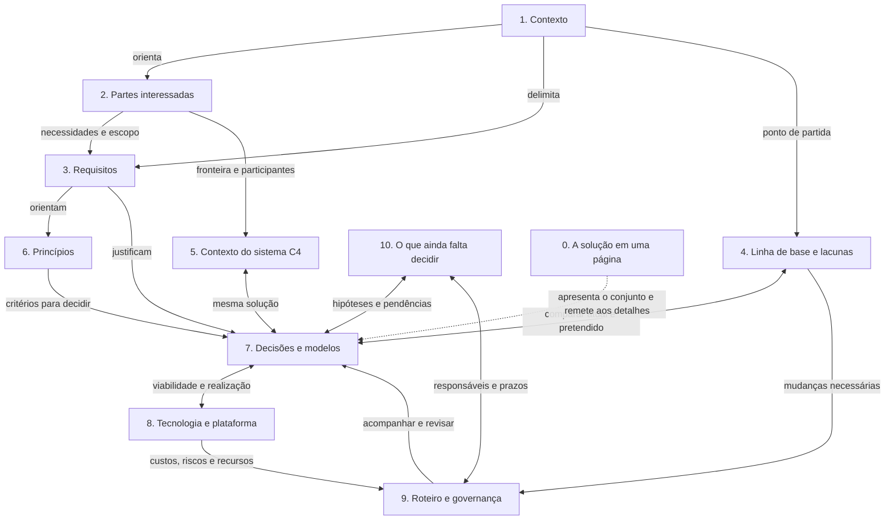
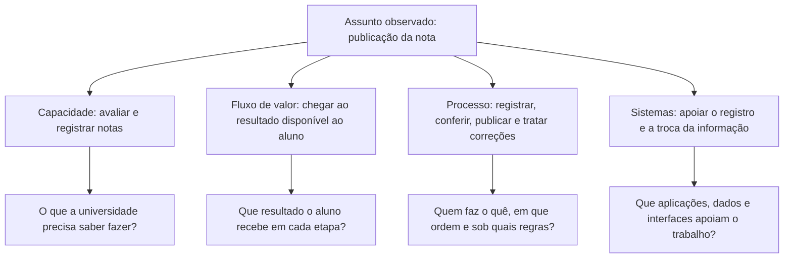
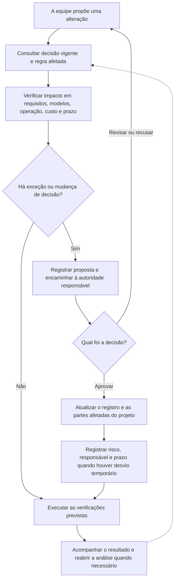

# Esquemas para apoiar a compreensão do projeto completo

As figuras propostas mantêm os módulos, conteúdos e produtos atuais. Não substituem tabelas do template nem transformam o projeto em um único fluxo de requisito. As relações existentes entre pessoas, processos, dados, aplicações, infraestrutura e decisões continuam sendo detalhadas nos respectivos blocos.

Há 77 imagens distintas referenciadas no material, além dos diagramas Mermaid. Por isso as propostas abaixo indicam quando ajustar uma figura existente e quando acrescentar uma representação com finalidade diferente. A avaliação aqui é do papel pedagógico das figuras a partir das legendas e da fonte, não uma avaliação visual de legibilidade de todas as imagens.

## Catálogo de propostas

| ID | Pergunta que a figura responde | Proposta e lugar de uso | Conteúdo e cuidados |
| --- | --- | --- | --- |
| V01 | Como as partes do projeto se relacionam? | Acrescentar um mapa de navegação em Início e retomá-lo nas sínteses | Mostrar as onze seções do caderno, com relações de ida e volta. Destacar a contribuição da aula sem ocultar o conjunto. Cada seção deve ser clicável na versão incorporada ao site |
| V02 | O que muda além do software? | Ajustar a figura de componentes da solução no M1 B2 | Manter os cinco tipos e associar a cada um uma mudança, um responsável e um efeito. Usar o exemplo da nota como situação local, não como resumo de todo o projeto |
| V03 | O que recebo e produzo em cada fase? | Ajustar a figura das oito fases no M1 B4 | Preservar nomes, entradas, atividades, saídas e realimentação. Acrescentar uma pergunta curta por fase. Manter a tabela completa para consulta |
| V04 | Quem precisa de qual informação para participar da decisão? | Apoiar as três visões já existentes no M2 B4 com um quadro de leitura | Colunas: leitor, preocupação, representação e decisão apoiada. Não confundir ter interesse com ter autoridade para aprovar |
| V05 | Qual a diferença entre capacidade, fluxo de valor, processo e sistema? | Acrescentar uma legenda comparativa junto aos modelos de negócio no M4 B1 | Usar o mesmo assunto nos quatro recortes. Manter separados o que a organização sabe fazer, o resultado recebido, a execução do trabalho e o apoio tecnológico |
| V06 | Como os quatro domínios descrevem a mesma solução? | Complementar a espinha dorsal já existente no M4 B0, sem substituí-la | Preservar recebe, decide, entrega e limites do papel. Acrescentar referências cruzadas a escopo, decisões, contratos e cenários. As setas devem nomear a informação relacionada |
| V07 | Quem pode alterar o dado e quem usa uma cópia? | Ajustar a figura de fonte de verdade e cópias do M4 B2 | Distinguir responsável de negócio, aplicação que registra, consumidores, prazo de propagação e controle de acesso. Manter a grade dado × aplicação completa |
| V08 | O que foi combinado na integração e como verificar? | Complementar o contrato do M4 B3 com uma sequência curta | Mostrar envio, confirmação, falha, nova tentativa e correção de informação. Anotar quais campos do contrato tratam cada ponto. Preservar os doze campos e evitar sugerir que um diagrama de sucesso cobre as exceções |
| V09 | Como uma necessidade chega à escolha de tecnologia? | Ajustar as figuras do bloco ao componente e do TRM no M5 B1 | Destacar a relação entre responsabilidade, requisito de serviço, catálogo, alternativas, critérios e decisão. Manter padrões, produtos, estados e evidências separados |
| V10 | O que acontece quando a implementação precisa mudar uma decisão? | Acrescentar fluxo de apoio à governança no M6 B1 | Mostrar regra vigente, pedido, análise de impactos, autoridade, registro e verificação. Vincular os cinco mecanismos existentes a esses pontos, sem inventar um novo processo obrigatório |
| V11 | O que muda primeiro e o que precisa estar pronto? | Apoiar o roteiro em ondas do M6 B1 | Manter todas as ondas, critérios, dependências técnicas e organizacionais, contratos e orçamento. Usar faixas para tecnologia, processos/equipes e contratos. Distinguir data confirmada de proposta |
| V12 | Como verificar uma saída de IA sem perder o contexto do projeto? | Acrescentar quadro de conferência no M6 B2 | Colunas: afirmação produzida, fonte vigente, parte do projeto afetada, conferência e responsável. Retomar as três etapas existentes e o registro de assistência. Mostrar que um erro pode afetar vários artefatos |

## Referências de figuras existentes

Estes arquivos são pontos de partida para os ajustes, não arquivos substituídos por este relatório:

| Propostas | Figuras e recursos a consultar em `docs/assets/images/` |
| --- | --- |
| V02 | `modulo-1-componentes-solucao.png`, `modulo-1-solucao-como-sistema.svg` |
| V03 | `modulo-1-processo-oito-fases.png` |
| V04 | `modulo-2-visao-contexto-patrocinador.svg`, `modulo-2-visao-seguranca-c2.svg`, `modulo-2-visao-rastreabilidade-gestor.svg` |
| V05 | `modulo-4-modelos-de-negocio.svg`, `modulo-4-b1-mapa-capacidades-hospital.svg`, `modulo-4-b1-fluxo-valor-laboratorio.svg`, `modulo-4-b1-processo-resultado-exame-v2.svg` |
| V06 | `modulo-4-b0-espinha-dorsal.svg` e os quatro mapas de domínio do bloco 0 |
| V07 | `modulo-4-b2-fonte-de-verdade-copias.svg`, `modulo-4-grade-dado-aplicacao.svg` |
| V08 | `modulo-4-servicos-e-contrato.svg`, `modulo-4-b3-estilos-integracao.svg` |
| V09 | `modulo-5-bloco-ao-componente.svg`, `modulo-5-trm-cinco-colunas-v3.svg`, `modulo-5-seis-criterios.svg` |
| V10 e V11 | Diagramas Mermaid do bloco de governança e `modulo-6-adm-governar-a-mudanca.svg` |
| V12 | Tabelas e exemplos de saída incorreta do bloco de IA |

## Esboço 1 · O projeto e as relações entre suas partes

Este mapa reúne as onze seções existentes. Os números são os do template. As setas representam relações de consulta e coerência, não uma nova sequência de produção. Os modelos de negócio, dados, aplicações e infraestrutura continuam nos locais atuais do caderno.

Para manter o esquema legível, ele mostra relações selecionadas. O resumo e as pendências se relacionam com todas as seções pertinentes, não apenas com as que receberam uma seta no desenho. Na versão do site, os onze nós devem levar às seções correspondentes do template, e o texto ao lado deve explicar essa seleção.

## Esboço 2 · Quatro perguntas sobre o mesmo trabalho

Exemplo de apoio: publicação de uma nota. A função é distinguir os recortes usados no projeto. O exemplo não substitui o caso, seus demais processos nem os modelos completos.

Ao lado da figura, manter as definições formais e os modelos já ensinados. Uma capacidade pode apoiar mais de um processo, um processo pode envolver vários sistemas e um sistema pode apoiar vários processos. O desenho não deve sugerir equivalência de um para um entre esses elementos.

## Esboço 3 · Governança ligada ao trabalho da equipe

O exemplo começa com uma alteração que pode contrariar uma decisão. É uma representação de apoio aos mecanismos existentes. As autoridades e os critérios continuam sendo os definidos pelo caso e pelo exercício.

Identificar no texto os cinco mecanismos: processo de proposta e aprovação, conselho de revisão, ADR versionado, gestão de dívida técnica e funções de adequação. O diagrama não dispensa as tabelas de quem decide nem os exemplos de código.

## Critérios para produzir as figuras finais

- Uma pergunta pedagógica principal por figura. Desdobrar em vistas quando o detalhamento exigir, sem eliminar informação do material.
- Usar o mesmo nome para o mesmo elemento no texto, no desenho e no template.
- Dar nome às setas: informação utilizada, decisão representada, requisito atendido ou responsabilidade atribuída.
- Preservar versões atual, proposta e aprovada quando a distinção for relevante.
- Usar cor como reforço, acompanhada de rótulos, formas ou padrões.
- Manter texto alternativo e explicação junto à figura. Permitir ampliar esquemas densos.
- Verificar a leitura no tamanho real da página antes de substituir uma imagem existente.

Os três esquemas acima são esboços Mermaid para revisão de conteúdo. Não foram incorporados às aulas nem renderizados para homologação visual neste levantamento.
